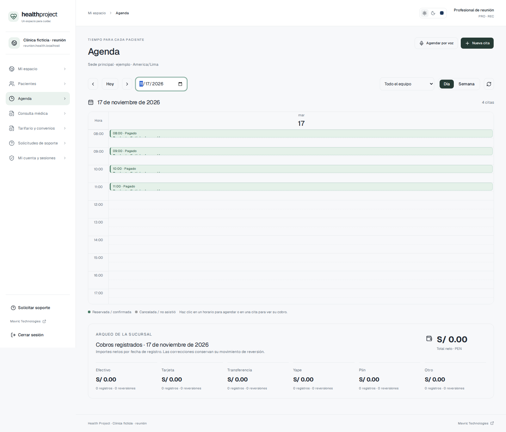
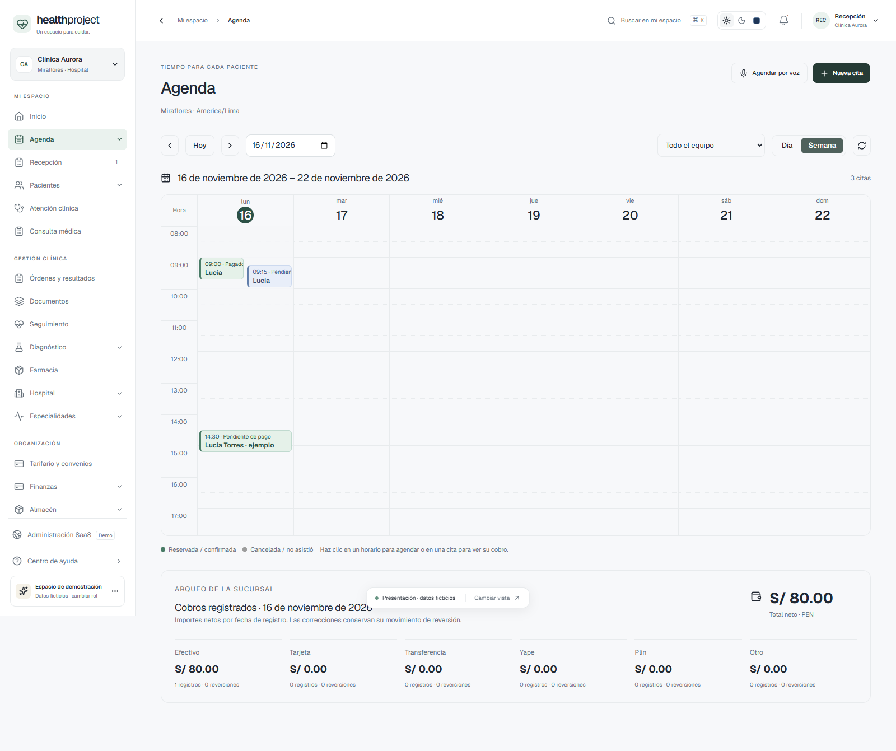

# Health Project

Aplicación clínica SaaS para organizaciones humanas, odontológicas y veterinarias:
pacientes, historia clínica, agenda, catálogo y administración por organización y
sucursal. La entrega para descargar e instalar está en la rama **`main`**.

**Lista para la reunión:** descarga desde GitHub y arranque con Docker, sin ZIP.
Frontend, API Java y SQL Server funcionan conectados con datos ficticios.
La [revisión del 16 de noviembre](docs/produccion/DEMO_DOCKER_LAPTOP_REVISION_20261116.md)
verificó acceso, pacientes, antecedentes, consulta, agenda, cobro y persistencia.
La presentación estática con Node.js se conserva como alternativa secundaria.

**Sistema conectado:** los recorridos RUC y HP4–HP8 están validados localmente.
El cierre del 14 de noviembre pasó 1.162 pruebas backend y 126 frontend. La puesta
en producción con pacientes reales aún requiere validar el destino, seguridad,
recuperación y aceptación del piloto. Las demás pantallas de diseño de la demo
no representan módulos clínicos aprobados.

## Instalar y abrir la demo conectada con Docker

Esta es la instalación para la reunión: navegador → frontend y API Java →
SQL Server 2022, con una clínica y cuentas ficticias. El stack se construyó y
probó en Docker Linux/amd64: 1.162 pruebas backend, navegador real y persistencia
tras reiniciar Java y repetir el arranque. No requiere herramientas de desarrollo
instaladas en el host. La laptop de la reunión debe cumplir los requisitos siguientes.

### Requisitos de la laptop

1. Instala [Git](https://git-scm.com/install/windows).
2. Instala y abre [Docker Desktop](https://docs.docker.com/desktop/setup/install/windows-install/).
   En Windows utiliza el backend WSL2 y **contenedores Linux**. Sigue el
   instalador de Docker si necesitas habilitar virtualización o WSL2 y reiniciar.
3. Utiliza un equipo **Intel/AMD de 64 bits (x86_64)**. Esta imagen SQL Server no
   tiene soporte nativo ARM/AppleSilicon; no se presenta la emulación como una
   instalación verificada. Consulta [requisitos oficiales de SQL Server](https://learn.microsoft.com/en-us/sql/linux/install-upgrade/setup?view=sql-server-ver16).
4. Reserva memoria y disco para las imágenes y la compilación. Docker Desktop
   documenta 8 GB de RAM del sistema para WSL2; este Compose limita SQL a 3 GB y el
   motor a 2.048 MB, además de frontend/Java durante el build. Revisa los requisitos
   del enlace de Docker para tu versión de Windows. Necesitas Internet para la
   primera descarga y compilación.

**No instales Node.js, Java, Maven, Python o SQL Server en la laptop para esta
opción**: se compilan y ejecutan dentro de Docker. Usa Chrome o Edge.

Comprueba que Docker Desktop ya está iniciado:

```powershell
git --version
docker version
docker compose version
docker info --format '{{.OSType}}/{{.Architecture}}'
```

El último comando debe indicar Linux y arquitectura x86_64/amd64. Si solo aparece
el cliente Docker y falla la conexión al servidor, abre Docker Desktop y espera
a que el motor quede disponible antes de continuar.

### Descargar y arrancar por primera vez

En PowerShell, desde la carpeta donde guardarás la entrega:

```powershell
git clone --branch main --single-branch https://github.com/mavrictech-dev/health-project.git health-project-reunion
cd health-project-reunion
if (-not (Test-Path -LiteralPath .env.demo)) { Copy-Item -LiteralPath .env.demo.example -Destination .env.demo }
docker compose -p health-meeting-demo --env-file .env.demo -f compose.demo.yaml config --quiet
docker compose -p health-meeting-demo --env-file .env.demo -f compose.demo.yaml up -d --build
docker compose -p health-meeting-demo --env-file .env.demo -f compose.demo.yaml ps -a
```

Todos los comandos Docker se ejecutan desde la raíz del repositorio. El nombre
explícito `health-meeting-demo` mantiene esta demo separada de otros stacks.
La primera vez se descargan imágenes y dependencias; hazlo antes de la reunión.
`setup` es un proceso de una sola ejecución: su estado final esperado es
**Exited(0)**. SQL, backend y gateway deben quedar levantados; SQL y backend
deben pasar a **healthy** antes de abrir la aplicación.

`.env.demo` está ignorado por Git. La plantilla contiene contraseñas públicas de
ejemplo EXCLUSIVAS para este entorno local ficticio. No añadas credenciales de
una base existente ni uses estos valores en producción. Si cambias los valores,
hazlo antes de la primera inicialización y conserva después el mismo archivo.
No vuelvas a copiar la plantilla encima de una configuración ya inicializada.

### Qué se crea automáticamente en la primera instalación

Una persona que descargue el proyecto en otra laptop solo necesita seguir los
comandos anteriores. Docker instala SQL Server y el servicio `setup` crea la
base **`health_meeting_demo`**, aplica las 19 migraciones V1–V19 y deja preparados
**43 tablas, 152 procedimientos almacenados y 34 triggers**. No hay que crear la
base, ejecutar el archivo SQL consolidado ni registrar usuarios manualmente.

Las credenciales se configuran en `.env.demo` antes del primer arranque y se
utilizan para crear estos accesos:

| Acceso creado | Usuario | Contraseña tomada de |
| --- | --- | --- |
| Administración del SQL del contenedor | `sa` | `DEMO_SQL_SA_PASSWORD` |
| Aplicación Java → SQL, solo ejecución de SP aprobados | `hp_meeting_runtime` | `DEMO_RUNTIME_PASSWORD` |
| Creación inicial de la cuenta de plataforma | `hp_meeting_bootstrap` | `DEMO_BOOTSTRAP_PASSWORD` |
| Plataforma de la aplicación | `plataforma@example.test` | `DEMO_APP_PASSWORD` |
| Administración de la clínica ficticia | `admin@example.test` | `DEMO_APP_PASSWORD` |
| Profesional y recepción | `profesional@example.test` | `DEMO_APP_PASSWORD` |

El setup crea también la clínica de ejemplo, RUC `20000000001`, dos sedes y el
paciente `DEMO-001`. Las contraseñas de las cuentas de aplicación se guardan como
hash BCrypt. Java utiliza únicamente el usuario SQL runtime; las credenciales de
administración y bootstrap quedan en el proceso de instalación separado.

Al volver a arrancar, el instalador reconoce la base completa y verifica su
versión y permisos: conserva los datos y no vuelve a crear cuentas ni cambia
contraseñas. Guarda `.env.demo` junto a tu instalación y conserva el volumen SQL.
Editar contraseñas en ese archivo después de instalar no actualiza las que ya
están almacenadas. La plantilla y estas cuentas corresponden a pruebas locales
con datos ficticios; los requisitos de producción se describen más abajo.

### Abrir, iniciar sesión y presentar

Abre [http://reunion.health.localhost:18090/acceso/](http://reunion.health.localhost:18090/acceso/).
Credenciales de ejemplo de la plantilla:

| Campo | Valor para la reunión |
| --- | --- |
| RUC | `20000000001` |
| Correo de profesional/recepción | `profesional@example.test` |
| Contraseña de aplicación | `Meeting_App_2026_Only!` |
| Sucursal | Sede principal · ejemplo |
| Paciente preparado | Paciente ficticio de reunión · `DEMO-001` |

También se prepara `admin@example.test` para administración de la clínica. La
cuenta de plataforma `plataforma@example.test` entra por el dominio base
[http://health.localhost:18090/acceso/](http://health.localhost:18090/acceso/).
Las cuentas comparten la contraseña de aplicación de ejemplo; si cambiaste
`DEMO_APP_PASSWORD`, utiliza tu valor. No confundas esa contraseña con las
contraseñas internas de SQL/runtime/bootstrap.

Guion conectado: [frontend/GUIA_PRESENTACION.md](frontend/GUIA_PRESENTACION.md).
Muestra acceso y sucursal, paciente, cita futura con revisión, cobro/arqueo y
consulta. Los datos se guardan en el SQL Server del stack y deben sobrevivir a
la recarga y los reinicios; no dependen del almacenamiento de la demo estática.
La voz es opcional y puede depender de Internet/permisos del navegador. Conserva
la entrada manual para la reunión y utiliza solo datos ficticios.



Captura del ensayo con datos ficticios. El arqueo se agrupa por el día del
registro del cobro, que puede ser distinto del día de la cita.

### Reabrir, detener y actualizar

Para otra reunión, desde la misma carpeta y con el mismo `.env.demo`:

```powershell
docker compose -p health-meeting-demo --env-file .env.demo -f compose.demo.yaml up -d
```

No hace falta reconstruir si no cambió el código. Para detener sin perder datos:

```powershell
docker compose -p health-meeting-demo --env-file .env.demo -f compose.demo.yaml stop
```

Para quitar los contenedores y la red conservando el volumen SQL:

```powershell
docker compose -p health-meeting-demo --env-file .env.demo -f compose.demo.yaml down
```

No añadas `-v` ni borres volúmenes: ahí se conservan los datos de las pruebas.
Reabrir una ventana privada no borra los datos de esta demo conectada. El setup
reconoce una instalación completa y no debe repetir las migraciones ni fixtures.

Para actualizar una copia sin cambios locales, conservando `.env.demo`:

```powershell
git switch main
git pull --ff-only
docker compose -p health-meeting-demo --env-file .env.demo -f compose.demo.yaml up -d --build
```

Si tienes cambios locales, consérvalos y revisa las diferencias antes de actualizar.
Un cambio inesperado de versión, huella o estado de instalación debe detener el
setup; conserva el volumen y el diagnóstico. No reapliques SQL ni borres la base
para resolver un error.

### Diagnóstico del stack Docker

```powershell
docker compose -p health-meeting-demo --env-file .env.demo -f compose.demo.yaml ps -a
docker compose -p health-meeting-demo --env-file .env.demo -f compose.demo.yaml logs --tail=80 setup backend gateway
```

| Problema | Qué revisar |
| --- | --- |
| No encuentra `.env.demo` | Ejecuta la copia inicial de la plantilla desde la raíz, solo si aún no existe |
| `docker version` no muestra servidor | Inicia Docker Desktop en modo Linux/WSL2 |
| Build interrumpido o exit 137 | Revisa memoria/disco asignados a Docker y conserva el error; no borres datos para liberar espacio |
| SQL tarda en quedar healthy | Consulta los logs de `sql`; verifica memoria, arquitectura y la configuración inicial |
| `setup` termina distinto de 0 | Conserva logs/volumen; no arranca una demo correcta hasta resolver la causa |
| Dominio no abre | Usa Chrome/Edge con la URL completa `.localhost`; comprueba que gateway publicó 18090 |
| Puerto 18090 ocupado | Cambia solo `DEMO_PORT` en `.env.demo` antes de arrancar; usa ese puerto también en ambas URLs |
| Login falla | Comprueba RUC/correo y `DEMO_APP_PASSWORD`; conserva la configuración usada al inicializar |
| Micrófono denegado | Continúa por captura manual |

No publiques el puerto SQL ni Java: solo el gateway escucha en loopback.
No uses los comandos de esta demo sobre otro proyecto Docker.

## Alternativa: demo estática con Node.js

### 1. Requisitos

- **Git** para descargar el código. Si el repositorio es privado, tu cuenta GitHub
  debe tener acceso.
- **Node.js 24**, con npm incluido. Es la versión usada para verificar esta guía.
- Chrome o Edge actualizado. La entrada manual funciona aunque no haya voz.
- Internet para descargar el código y dependencias la primera vez.

Para esta demo **no necesitas Java, Maven, Docker, SQL Server ni un archivo `.env`**.
Después de compilar, los recursos se sirven desde tu equipo. La voz del navegador
puede requerir Internet y los servicios de su proveedor.

Comprueba los requisitos en una terminal:

```text
git --version
node --version
npm --version
```

Si PowerShell bloquea `npm.ps1`, usa `npm.cmd` en los comandos siguientes.
No necesitas cambiar la política de ejecución de Windows.

### 2. Descargar la entrega

Abre una terminal en la carpeta donde quieras guardar el proyecto:

```text
git clone --branch main --single-branch https://github.com/mavrictech-dev/health-project.git
cd health-project
cd frontend
```

Si ya tienes una copia con cambios locales, consérvala. Puedes clonar en otra
carpeta para presentar sin sobrescribir tu trabajo.

### 3. Instalar, compilar y presentar

Desde `frontend`:

```text
npm ci
npm run build:demo
npm run preview:demo
```

Abre **[http://127.0.0.1:3002](http://127.0.0.1:3002)** y mantén la terminal
abierta durante la reunión. Para detener la demo pulsa **Ctrl+C** en esa terminal.

La portada ofrece seis recorridos, entre ellos **Medicina humana**,
**Administración SaaS**, **Odontología** y **Veterinaria**. No exige iniciar sesión
para entrar en esas vistas. Los formularios de acceso también son simulados.

`build:demo` genera `frontend/out-demo`; `preview:demo` sirve esa carpeta solo
en tu equipo. Abre la dirección HTTP anterior: hacer doble clic en `index.html`
no sustituye al servidor local.

### 4. Abrirla nuevamente

Si conservas el código y la carpeta compilada, solo ejecuta:

```text
cd health-project/frontend
npm run preview:demo
```

Adapta la ruta a la carpeta donde la descargaste. Solo necesitas recompilar si
actualizas el código. No vuelvas a instalar dependencias antes de cada reunión.

### Guion de la presentación estática

| Tiempo | Recorrido | Qué mostrar |
| --- | --- | --- |
| 1 min | Medicina humana | Espacio, sucursal, navegación y temas blanco/negro/navy |
| 3 min | Agenda con rol Recepción | Día/semana, cita para mañana, revisión, cobro y arqueo |
| 2 min | Pacientes e historia | DNI, antecedentes con autor/fecha y consulta escrita |
| 2 min | Administración SaaS | Clientes, sedes, planes y capacidades simulados |
| 2 min | Odontología o Veterinaria | Alcance visual y adaptación por especialidad |

Abre **Espacio de demostración** y elige el rol **Recepción** para reservar y
registrar cobros. Selecciona la sucursal si aparece el selector. Usa un paciente
existente y un horario futuro libre; enseña la revisión antes de confirmar.
El arqueo se agrupa por el día en que registras el cobro: vuelve a **Hoy** después
de cobrar una cita de mañana.

Guion detallado: [frontend/GUIA_PRESENTACION.md](frontend/GUIA_PRESENTACION.md).
Ensaya la voz antes de la reunión y conserva escritura manual como alternativa.
Las pruebas anteriores de voz usaron eventos simulados, no un micrófono físico.



### Reiniciar los datos de presentación estática

Los cambios se guardan en el navegador y origen de la demo (`127.0.0.1:3002`).
No se comparten entre equipos ni se envían al backend.

Para empezar desde cero, abre una **ventana privada nueva**, después de cerrar
todas las ventanas privadas anteriores. También puedes borrar los datos de sitio
de ese origen desde el navegador y recargar. No borres datos de otros sitios.

**Restaurar escenario** reinicia el escenario clínico principal; agenda, catálogo
y otras simulaciones mantienen almacenes separados. Para reiniciar todo, utiliza
una nueva sesión privada o borra los datos del sitio. Los adjuntos permanecen en
memoria durante la sesión y deben volver a seleccionarse después de recargar.

Usa únicamente datos ficticios. Cobros, correos, firmas y documentos de la demo
son simulaciones: no procesan dinero ni certifican o envían documentos reales.

### Compartir la presentación estática con otro equipo

Comparte este README para que el destinatario siga la instalación rápida.
GitHub aloja el código; abrir el repositorio no ejecuta la aplicación.

La entrega portátil ZIP fue retirada por pedido del usuario. El código se
obtiene por Git; el stack Docker de reunión se prepara por separado de la demo
estática y del candidato productivo del 14 de noviembre.

## Desarrollo y comprobaciones

Desde `frontend`:

```text
npm run check
npm test
npm run build:demo
```

Para desarrollar con recarga: `npm run dev:demo`. Abre la dirección que indique
Next.js, normalmente `http://localhost:3000`. Para una reunión utiliza el build
compilado con `preview:demo`. `localhost`, `127.0.0.1` y puertos distintos tienen
almacenamiento independiente porque son orígenes diferentes.

## Preparar un despliegue productivo

Es una instalación diferente de la demo local. No uses el instalador, los
principales o las credenciales de reunión en producción. El backend usa **Java 21/Spring Boot y
SQL Server 2022**, con acceso runtime exclusivamente por SP parametrizados. El
usuario runtime no debe tener acceso directo a tablas ni DDL. Migración y
bootstrap utilizan principales y procesos separados.

### Compilar los componentes

Además de Git y Node 24, instala **JDK 21**. Se incluye Maven Wrapper; no necesitas
Maven global. Desde la raíz del repositorio:

```powershell
cd backend
.\mvnw.cmd verify
cd ../frontend
npm ci
npm run check
npm test
npm run build
```

En Linux/macOS usa `./mvnw verify`. Se generan
`backend/target/health-project-0.1.0.jar` y `frontend/out`. El build conectado
debe ejecutarse sin `NEXT_PUBLIC_APP_MODE=mock`; ese valor compila el simulador.
El comando `build:demo` selecciona deliberadamente la presentación.

### Preparar y configurar el destino

1. Preparar alojamiento Java 21/contenedores, dominio base y subdominios HTTPS y
   una base SQL Server 2022 exclusiva de Health Project. Si se usa Somee para SQL,
   comprobarlo por separado del alojamiento Java.
2. Instalar o actualizar las migraciones mediante un proceso revisado y principal
   separado. Fuentes: `backend/src/main/resources/db/sqlserver`, V1–V19. No
   reaplicarlas sobre una base existente ni usar un script histórico como instalador
   universal. V15 exige un mapeo autorizado para tenants anteriores sin RUC.
3. Crear runtime con EXECUTE solo sobre SP aprobados, preparar el administrador
   mediante bootstrap separado y comprobar catálogo, versión y permisos efectivos.
   La aplicación web no migra ni crea administradores al iniciar.
4. Preparar archivos protegidos externos para contraseña runtime y una clave JWT
   aleatoria estable de al menos 32 bytes, sin saltos de línea. No añadir secretos
   a Git, imágenes, README ni argumentos de procesos.
5. Copiar [production.env.example](deploy/production/production.env.example) a una
   ubicación protegida fuera del repositorio y completar sus campos.
6. Preparar imágenes revisadas, terminador HTTPS y red; ensayar en preproducción.
   El Compose productivo no crea SQL ni descarga imágenes automáticamente.

| Variable | Qué debes configurar |
| --- | --- |
| `HEALTH_BACKEND_IMAGE` | Referencia inmutable de la imagen backend revisada |
| `HEALTH_GATEWAY_IMAGE` | Imagen nginx revisada compatible con UID 101 y la plantilla |
| `HEALTH_SQLSERVER_SERVER` / `HEALTH_SQLSERVER_PORT` | Hostname TLS y puerto del SQL externo; puerto predeterminado 1433 |
| `HEALTH_SQLSERVER_DATABASE` | Base exclusiva de Health Project |
| `HEALTH_SQLSERVER_RUNTIME_USER` | Principal runtime EXECUTE-only |
| `HEALTH_BASE_DOMAIN` | Dominio base, sin esquema ni ruta |
| `HEALTH_PUBLIC_ORIGIN` | Origen HTTPS exacto del dominio |
| `HEALTH_GATEWAY_PORT` | Puerto loopback detrás del terminador HTTPS; predeterminado 18080 |
| `HEALTH_SQL_PASSWORD_FILE` | Ruta al archivo externo de contraseña; no su valor |
| `HEALTH_JWT_SECRET_FILE` | Ruta al archivo externo de clave JWT; no su valor |

El perfil `production` importa secretos desde `/run/secrets/` y rechaza
configuración insegura antes de crear el datasource. SQL requiere validación de
CA y hostname; no usar `trustServerCertificate=true` como solución productiva.
El gateway monta `frontend/out`, necesita un terminador HTTPS dedicado y publica
solo loopback; no sirve `out-demo` ni expone el puerto Java.

Instrucciones técnicas y validación de configuración:
[deploy/production/README.md](deploy/production/README.md).
Secuencia operativa, aceptación y reversión:
[SALIDA_PRODUCCION_20261114.md](docs/produccion/SALIDA_PRODUCCION_20261114.md).
El destino final y estas condiciones aún requieren validación; no se ha
desplegado una instalación productiva habilitada para pacientes reales.

**No uses `docker compose up` sin indicar archivo:** `compose.yaml`,
`compose.qa.yaml` y los scripts antiguos de setup pertenecen al entorno MySQL
heredado. No son la instalación SQL Server vigente. El archivo separado es
`compose.production.yaml`; ejecutarlo requiere completar y validar el destino.

## Solución de problemas de la alternativa estática

| Problema | Solución |
| --- | --- |
| `node` o `npm` no se encuentra | Instala Node 24 y abre una terminal nueva |
| PowerShell bloquea `npm.ps1` | Usa `npm.cmd ci`, `npm.cmd run build:demo` y `npm.cmd run preview:demo` |
| Puerto 3002 ocupado | Detén tu otra demo con Ctrl+C o utiliza otro puerto, como se indica abajo |
| Falta `out-demo/index.html` | Desde `frontend`, ejecuta `npm run build:demo` y espera el resultado correcto |
| Aparece login/API sin datos | Comprueba que usaste `build:demo`, `preview:demo` y la dirección 3002 |
| Citas preparadas de otra fecha | Usa una sesión privada nueva; la agenda inicial toma la fecha de Lima |
| No permite reservar/cobrar | Selecciona rol Recepción, sucursal y un horario futuro libre |
| Falla el micrófono | Continúa escribiendo; ensaya voz antes de la reunión |
| Otro equipo no abre el preview | Es local; instala o copia la demo en el otro equipo |
| Falla `npm ci` | Revisa Node 24, registro npm y error concreto; conserva el lockfile y no uses `--force` indiscriminadamente |

Puerto alternativo en PowerShell, desde `frontend`:

```powershell
$env:PORT = '3012'
npm.cmd run preview:demo
```

Abre `http://127.0.0.1:3012`. Al terminar pulsa Ctrl+C y ejecuta
`Remove-Item Env:PORT` en esa terminal. En Linux/macOS:
`PORT=3012 npm run preview:demo`.

## Documentación y evidencia

- [Guion para la reunión](frontend/GUIA_PRESENTACION.md).
- [Frontend y estructura](frontend/README.md).
- [Cierre revisado de HP8](docs/produccion/HP8-CIERRE-REVISION-20261114.md).
- [Capturas de los recorridos](docs/produccion/evidencias/hp8-cierre-20261114/screenshots.json).
- [Preparación y reversión productiva](docs/produccion/SALIDA_PRODUCCION_20261114.md).
- [Plan completo y pendientes](docs/PLAN_EJECUCION_PRODUCCION.md).

Las capturas contienen datos ficticios. Disponer de pantallas para 241 perfiles
no acredita su validación clínica ni el cierre de los módulos avanzados.
