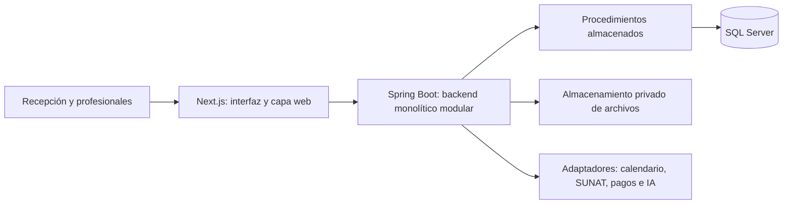
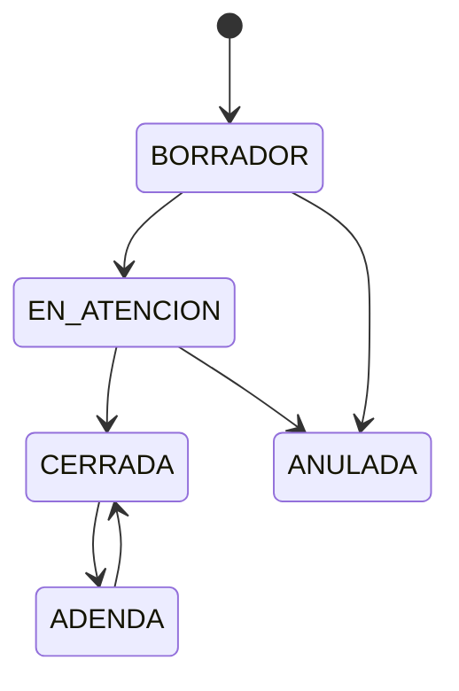

# Health Project: propuesta de arquitectura y alcance

Fecha: 13 de octubre de 2026. Estado: propuesta para diseño e implementación, pendiente de validación funcional con profesionales. Este documento define arquitectura; todavía no constituye software implementado ni certificación normativa.

Decisiones del usuario confirmadas el 13 de octubre: historia compartida entre sucursales de la misma organización con permisos y auditoría; primera versión de consulta externa humana, odontológica y veterinaria; portal para pacientes y responsables de animales. El [diseño funcional completo](Diseno_Funcional_Health_Project.md) desarrolla estos procesos y las ampliaciones posteriores.

El [mapa de medicina humana y veterinaria](Mapa_Especialidades_Health_Project.md) detalla las especialidades, subespecialidades, datos, componentes y flujos previstos, con odontología como bloque adicional de atención humana.

El [plan del frontend de presentación](frontend-demo/README.md) concreta navegación, componentes shadcn/ui, tres temas, paneles derechos con desenfoque y comportamiento local de todas las acciones. Su alcance es una demo completa con mocks; todavía no implementa el frontend ni el backend descritos aquí.

## 1. Decisión central

Construir una plataforma clínica SaaS con un backend monolítico modular en Java Spring Boot, frontend Next.js y persistencia en SQL Server mediante procedimientos almacenados. Compartir el núcleo administrativo y clínico entre clientes, y extender la captura clínica mediante plantillas versionadas y componentes especializados.

La plataforma tendrá capacidad de incorporar especialidades progresivamente. Cada especialidad se considera soportada cuando sus formularios, vocabulario, gráficos, documentos y reglas han sido implementados y validados. Un formulario genérico permite comenzar a registrar información; no sustituye un odontograma, un estudio cardiológico o un flujo de hospitalización.

Las especialidades se organizan en tres niveles:

| Nivel | Qué resuelve | Ejemplos |
| --- | --- | --- |
| Núcleo común | Identidad, paciente, expediente, atención, diagnósticos, observaciones, procedimientos, recetas y documentos | Consulta de cualquier especialidad |
| Configuración | Campos, secciones, catálogos, obligatoriedad, unidades y reglas declarativas | Anamnesis de cardiología, evaluación dermatológica, controles veterinarios |
| Componentes especializados | Interacción y cálculos que requieren código y validación específica | Odontograma, periodontograma, mapa anatómico, curvas de crecimiento |

## 2. Relación con el informe recibido

Fuente de requisitos: `C:/Users/maxmo/Downloads/Informe_Tecnico_Health_Project.pdf`, informe de ocho páginas emitido el 22 de septiembre de 2026. Las directivas del documento se analizan como requisitos del producto. La instrucción actual del usuario determina Java Spring Boot, Next.js y monolito.

| Tema | Informe | Decisión propuesta |
| --- | --- | --- |
| Backend | Java, Python o .NET; cronograma usa C# | Java Spring Boot |
| Arquitectura | Menciona microservicios | Un backend monolítico con módulos internos |
| Frontend | React | Next.js con TypeScript |
| Persistencia | SQL Server Cloud, 100 % SP | Mantener, incluidas lecturas, sesiones y auditoría |
| Especialidades | Relacional más JSON | Mantener y agregar validación, versiones y datos clínicos comunes estructurados |
| Aislamiento | Empresa y sucursal herméticas | Decisión actual del usuario: expediente por tenant, compartido entre sus sucursales mediante permisos y auditoría |
| Independientes | Lugares de atención y selector de contexto | Identidad única, múltiples membresías y tenant personal |
| Veterinaria | Tutor global y paciente animal | Núcleo de paciente común, perfil animal y responsables con vigencia |
| Login | RUC, usuario y contraseña, denominado tres factores | Mantener tres campos; corregir que no constituyen MFA |
| Directorio global | Comparte identidad y contactos | Identidad mínima; contactos locales. Búsqueda externa exacta y auditada requiere definición previa |
| Seguridad | SP y partición lógica presentados como garantía | Exigir autorización, integridad referencial, pruebas de aislamiento y controles de operación |
| Plazo | Demo del Básico en 20 días | Tratar como meta de demo acotada, no compromiso de producto completo |

Separar contactos por tenant y restringir el autocompletado global son cambios propuestos respecto al informe; deben resolverse antes de implementar el directorio compartido. Este documento no declara aprobados esos cambios.

## 3. Arquitectura de ejecución



Una aplicación Next.js y una aplicación Spring Boot se despliegan como componentes separados del mismo producto. Monolito significa que los módulos de negocio viven en un único backend y se entregan juntos. SQL Server y el almacenamiento de archivos son infraestructura; no convierten esos módulos en microservicios.

Next.js renderiza pantallas y contiene los componentes interactivos. Sus Route Handlers funcionan como una capa web delgada para llamar a Spring. No accede a SQL Server ni implementa una segunda versión de las reglas clínicas. Este uso corresponde al patrón BFF documentado por [Next.js](https://nextjs.org/docs/app/guides/backend-for-frontend).

Spring es la autoridad de autenticación, permisos, validación clínica, transacciones e integraciones. Una sesión opaca administrada por Spring se representa en el navegador mediante cookie HttpOnly, Secure y SameSite; Next la reenvía de forma controlada. Las mutaciones incluyen protección CSRF. Los datos clínicos no se almacenan en cachés públicas ni en respuestas compartidas entre usuarios.

Elegir versiones estables compatibles de Java, Spring Boot, Next.js y el driver de SQL Server al iniciar la implementación, fijarlas en el repositorio y registrar su política de actualización. La elección de versiones no está cerrada en esta propuesta.

### Módulos del backend

| Módulo | Responsabilidad | Dependencias principales |
| --- | --- | --- |
| `identity` | Usuarios, credenciales, sesiones y perfiles profesionales | Auditoría |
| `organizations` | Tenants, sucursales, membresías, permisos y lugares | Identidad |
| `patients` | Pacientes humanos/animales y responsables | Organizaciones |
| `scheduling` | Agendas, disponibilidad, citas y recursos | Profesionales, pacientes y organizaciones |
| `clinical` | Expedientes, atenciones, evolución, diagnósticos y prescripciones | Pacientes, organizaciones y especialidades |
| `specialties` | Plantillas, versiones, validadores y catálogos específicos | Catálogos comunes |
| `documents` | Adjuntos, documentos emitidos y consentimientos | Permisos y expediente |
| `cashier` | Caja, cargos, pagos, devoluciones y honorarios | Organizaciones y servicios |
| `billing` | Comprobantes e integración SUNAT | Caja e integraciones |
| `inventory` | Almacenes, lotes, vencimientos y movimientos | Organizaciones y productos |
| `laboratory` | Órdenes, muestras, resultados y revisión | Atención y pacientes |
| `integrations` | Calendario, IA, pagos y comunicaciones | Contratos de los módulos de negocio |
| `subscriptions` | Planes, derechos habilitados y sucursales facturables | Organizaciones |
| `reporting` | Reportes autorizados clínicos y administrativos | SP de lectura específicos |
| `audit` | Registro de accesos, cambios, exportaciones y acciones sensibles | Infraestructura |

Cada módulo expone interfaces públicas y mantiene su implementación interna. No se permite acceder al repositorio privado de otro módulo. Spring Modulith puede comprobar estas dependencias y detectar ciclos; sus capacidades están descritas en [Fundamentals](https://docs.spring.io/spring-modulith/reference/fundamentals.html).

Estructura propuesta, con paquetes por función:

```text
health-project/
  backend/src/main/java/com/mavric/health/
    identity/
    organizations/
    patients/
    scheduling/
    clinical/
      ClinicalFacade.java
      internal/api/
      internal/application/
      internal/domain/
      internal/persistence/
    specialties/
    documents/
    ...
  frontend/src/
    app/
    features/patients/
    features/encounters/
    features/specialties/
    components/clinical/
    lib/server/
  database/migrations/
  database/procedures/
  docs/
```

## 4. Tenants, sucursales y profesionales itinerantes

Definir tres conceptos diferentes:

| Concepto | Significado | Ejemplo |
| --- | --- | --- |
| Tenant o espacio | Organización responsable del expediente dentro del sistema | Clínica A o consultorio profesional de Ana |
| Sucursal | Ámbito operativo donde se agenda y realiza la atención | Clínica A, sede Surco |
| Lugar de atención | Ubicación donde ocurrió la atención | Sucursal, domicilio o consultorio externo |

Un usuario puede tener varias membresías. Cada membresía relaciona usuario, tenant, estado, permisos y sucursales autorizadas. El perfil profesional contiene sus especialidades y datos profesionales; no se duplica al incorporarse a otra clínica.

Ejemplo operativo:

1. Ana elige el espacio Clínica A y sucursal Surco. La atención pertenece a ese tenant y esa sucursal.
2. Ana elige su espacio independiente. Atiende a un paciente propio en un consultorio externo. La atención pertenece al espacio de Ana; el consultorio solo es su ubicación.
3. Cambiar de espacio modifica qué expedientes puede consultar. No copia historias ni permite consultar automáticamente las creadas bajo otra membresía.

Para el independiente, crear una sucursal lógica personal y varios lugares físicos. Su expediente muestra las atenciones propias realizadas en esos lugares porque pertenecen a su tenant personal. Un lugar externo no debe crearse como sucursal de otra empresa ni otorgarle acceso a su historia.

La política actual, elegida por el usuario, reemplaza el aislamiento clínico por sucursal del informe original. El expediente pertenece a `(TenantId, PatientId)` y es compartido entre las sucursales del mismo tenant con permisos y auditoría. Cada atención conserva `OriginBranchId`. Leer la historia de otra sucursal exige autorización sobre el expediente y el contenido correspondiente; habilitar la sucursal para agendar no concede por sí solo acceso clínico. Entre tenants no hay compartición automática. Las notas restringidas y vistas parciales conservan su política de acceso.

El contexto acompaña a cada petición. Evitar un único campo mutable `sucursalActual` en la sesión que provoque mezcla entre dos pestañas abiertas. Los identificadores recibidos son solicitudes de contexto: Spring comprueba membresía y alcance antes de usarlos.

## 5. Modelo de datos conceptual

Separar expediente longitudinal de atención. El expediente agrupa la historia; cada atención registra un evento asistencial con autor, fecha, especialidad, lugar y estado.

| Entidad | Datos y función esenciales |
| --- | --- |
| `User` | Identidad de acceso, username, estado y referencia de credencial |
| `ProfessionalProfile` | Identidad profesional y especialidades; distinta de la cuenta de acceso |
| `Tenant` | Tipo organización/profesional, datos fiscales y estado |
| `Branch` | Tenant, nombre y datos operativos |
| `Membership`, `MembershipBranchScope` | Usuario, tenant, permisos, sucursales y vigencia |
| `CareLocation`, `ProfessionalCareLocation` | Ubicación interna/externa/domiciliaria y asociación profesional |
| `PersonIdentity`, `PersonDocument` | Filiación mínima y documentos cuando existen |
| `Patient` | Tenant, identificador local, dominio HUMAN/ANIMAL y estado |
| `HumanPatientProfile` | Datos humanos y referencia opcional a identidad |
| `AnimalPatientProfile` | Nombre, especie, raza opcional, sexo, nacimiento estimado y microchip opcional |
| `PatientResponsibleParty` | Paciente, persona responsable, relación, vigencia y contactos locales |
| `ClinicalRecord` | Tenant, paciente y número de expediente de la organización; compartido entre sucursales autorizadas |
| `Appointment` | Profesional, paciente, sucursal, lugar, inicio/fin, estado y recursos |
| `Encounter` | Tenant, expediente, sucursal de origen, especialidad, profesional, motivo, fecha y estado clínico |
| `EncounterContributor` | Participantes y funciones, con permiso de colaboración |
| `EpisodeOfCare` | Agrupación opcional de atenciones de un proceso dentro del ámbito autorizado |
| `ClinicalNote`, `ClinicalNoteRevision` | Nota y contenido versionado; original firmado conservado |
| `Diagnosis` | Uno o varios por atención: sistema, versión, código, texto y estado |
| `Observation` | Medición/hallazgo, valor tipado, componentes, unidad, instante, método y localización opcional |
| `Procedure` | Planeado/realizado/cancelado, responsable, fecha y localización |
| `Allergy`, `Problem` | Datos longitudinales con estado y procedencia |
| `PatientHistory`, `MedicationStatement` | Antecedentes y medicación referida, con origen y fecha de registro |
| `Immunization` | Vacunación realizada, producto, lote cuando corresponde, fecha y responsable |
| `ServiceRequest`, `DiagnosticReport` | Orden de estudio/servicio e informe resultante; resultados vinculados como observaciones |
| `MedicationRequest`, `MedicationItem` | Prescripción y detalles estructurados; firma/cierre independiente |
| `SpecialtyTemplate`, `TemplateVersion` | Esquema, reglas, UI y estados borrador/publicada/retirada |
| `SpecialtyFormInstance`, `FormRevision` | Valores capturados y versión exacta de plantilla |
| `AnatomicalLocation`, `ChartAnnotation` | Región semántica, orientación, marcador y referencia a hallazgo/procedimiento |
| `Attachment`, `IssuedDocument`, `ConsentRecord` | Archivos privados, versiones emitidas y consentimientos |
| `AuditEvent`, `OutboxEvent`, `IdempotencyRecord` | Trazabilidad, integraciones fiables y control de reintentos |

### Invariantes de datos

1. Toda tabla operativa o clínica tiene `TenantId`. Las tablas del ámbito de sucursal también tienen `BranchId`. Los catálogos globales autorizados y la identidad de acceso son excepciones explícitas.
2. Usar claves candidatas y FK compuestas. La atención referencia `(TenantId, RecordId)` de un expediente del mismo tenant y `(TenantId, OriginBranchId)` de una sucursal de esa organización. No incluir la sucursal en la identidad del expediente compartido. Las notas/resultados se vinculan a sus recursos clínicos con referencias del mismo tenant.
3. Un paciente pertenece exactamente a un dominio. Tiene perfil humano o animal de acuerdo con ese dominio, nunca ambos. No repetir las dos columnas opcionales de paciente del DDL inicial sin garantizar esta exclusión.
4. La ausencia de DNI, CE o microchip no impide registrar un paciente. Menores, personas sin identificación y animales reciben identificadores internos; no usar el documento del tutor como identidad del paciente.
5. Los documentos se identifican por país/emisor, tipo y número normalizado. El `UNIQUE(NumeroDocumento)` del informe es insuficiente.
6. El tutor puede cambiar y pueden existir varios responsables autorizados. La relación conserva fechas; cambiar tutor no cambia al animal ni elimina su evolución.
7. Un diagnóstico no se limita a una columna CIE-10. Se almacenan múltiples diagnósticos con sistema y versión; veterinaria habilita vocabularios adecuados a ese dominio. La [OMS](https://www.who.int/standards/classifications/classification-of-diseases) describe ICD en el contexto de salud humana.
8. Los timestamps de eventos se almacenan en UTC; los lugares y agendas conservan zona horaria. Fechas civiles, como nacimiento, son fechas sin hora. Las medidas conservan unidad y precisión, y los importes usan tipos decimales y moneda explícita.
9. Un lugar de atención no determina el emisor fiscal de una receta o comprobante. El membrete se toma del emisor autorizado y se conserva con el documento emitido.
10. La historia visible se calcula dentro del ámbito autorizado. Una identidad global compartida no produce una historia global compartida.

Un dato vacío no significa normal: distinguir desconocido, no preguntado, no realizado y negado. Conservar momento clínico, momento de registro, autor y origen de cada dato. Una receta no prueba administración de medicamentos, una orden no es un resultado y un procedimiento planificado no implica que se realizó. Los rangos y cálculos conservan referencia y población/especie aplicable; no imponer un rango universal.

### Identidad global y directorio

Compartir una identidad no autoriza compartir sus datos clínicos. Propuesta para la primera versión: conservar filiación local del paciente y sus contactos dentro del tenant; vincular a una identidad mínima cuando sea apropiado. La búsqueda global, si se habilita, exige documento exacto, permiso, auditoría y protección contra enumeración. No ofrecer listados globales por nombre ni revelar dónde se atendió una persona.

Un dato global corregido no debe reescribir el nombre o la filiación de documentos ya firmados. No deduplicar automáticamente por nombre/teléfono; las fusiones requieren verificar identidad y conservar trazabilidad. El flujo operativo y las condiciones para compartir filiación deben definirse antes de activar ese directorio.

## 6. Relacional más JSON: reglas precisas

Usar tablas relacionales para lo que se consulta, vincula y protege de forma común: agenda, diagnósticos, mediciones, procedimientos, recetas, pagos, vacunas y movimientos de inventario. Usar JSON para las respuestas particulares de una plantilla y la configuración de un gráfico.

`ISJSON` comprueba sintaxis JSON; no certifica que los campos, unidades, piezas o reglas sean correctos. Incluso no verifica unicidad de claves, según [Microsoft](https://learn.microsoft.com/en-us/sql/t-sql/functions/isjson-transact-sql?view=sql-server-ver17). Spring valida JSON Schema y reglas del dominio; SQL vuelve a validar pertenencia, referencias, estado y restricciones críticas mediante SP.

Cada instancia guarda `TemplateId`, `TemplateVersion`, `RendererVersion`, autor, fecha y revisión. La publicación de una versión la vuelve inmutable. Las atenciones previas conservan su versión; un cambio de plantilla crea otra versión. No ejecutar JavaScript o SQL arbitrario de una plantilla.

Evitar duplicar un diagnóstico en un JSON y en una tabla sin definir fuente de verdad. El catálogo de campos especifica cuáles respuestas se convierten en observaciones/procedimientos estructurados. El guardado genera ambos de forma atómica y el frontend reconstruye las vistas desde esos contratos. Las proyecciones de búsqueda son derivadas, no otra historia editable.

Para una nueva especialidad sencilla se publican plantilla, catálogo, permisos y pruebas funcionales. Para una especialidad con un nuevo gráfico, cálculo o flujo se implementa además un renderer y un validador. Una ampliación que introduce nuevas entidades de negocio puede requerir migración de base de datos.

## 7. Interacción por especialidad

| Especialidad | Componente principal | Datos semánticos | Evolución |
| --- | --- | --- | --- |
| Medicina general | Formulario SOAP y lista de problemas | Síntomas, hallazgos, diagnósticos y plan | Notas y mediciones por atención |
| Odontología humana | Odontograma y, después, periodontograma | Pieza, cara, condición, procedimiento y estado | Comparación de estados y eventos entre visitas |
| Cardiología | Formulario, tabla de mediciones, estudios y gráficos | Observaciones con unidades, región cuando aplique, informe y resultados | Series temporales y comparación de estudios |
| Pediatría | Antropometría y curvas | Fecha, edad, datos requeridos por referencia, peso/talla/perímetro | Referencia de cálculo y versión conservadas |
| Dermatología | Mapa corporal y fotos seriadas | Región, lateralidad, hallazgo y marcador | Seguimiento de una lesión identificada |
| Psicología | Evaluación, sesiones y escalas autorizadas | Instrumento/versión, respuestas y notas | Evolución con permisos reforzados |
| Veterinaria | Perfil animal, vacunas, controles y mapas por especie | Especie, responsable, mediciones y eventos | Vacunación, tratamientos y controles por animal |

### Odontología

El odontólogo selecciona una pieza y su cara, registra un hallazgo o procedimiento, elige estado y asocia la acción a la atención. Diferenciar lo observado, lo indicado, lo realizado y lo resuelto. Una misma cara puede tener varios hallazgos a lo largo del tiempo. Guardar colores únicamente impediría reconstruir esa evolución.

El mapa tiene catálogo de dentición permanente, temporal y mixta; caras válidas por tipo de pieza, piezas ausentes, supernumerarias y convenciones de orientación. Estos catálogos deben validarse con odontólogos. Cada gráfico indica leyenda, fecha y autor; sus acciones tienen alternativa en tabla para accesibilidad.

La vista actual es una proyección de eventos fechados; cada atención firmada conserva su revisión y, cuando corresponda, una instantánea reproducible. Deshacer durante un borrador no elimina eventos de atenciones ya cerradas.

Para odontología veterinaria seleccionar sistema de numeración, especie y dentición. AVDC reconoce Triadan modificado para animales; no aplicar automáticamente el FDI humano. Fuente: [AVDC Nomenclature](https://avdc.org/avdc-nomenclature/).

### Cardiología y mapas anatómicos

Un dibujo del corazón puede ubicar un hallazgo en una estructura identificada, pero no cubre toda la especialidad. Se necesitan antecedentes, síntomas, observaciones, estudios, informes, diagnósticos y evolución. Adjuntar un ECG o ecocardiograma es distinto de interpretar señales o incorporar un visor especializado; esos últimos son ampliaciones explícitas.

El marcador guarda región semántica, lateralidad cuando aplique, versión del atlas y coordenadas normalizadas. Sus coordenadas solo indican posición visual. El hallazgo, la medición o el procedimiento relacionado se guarda como dato clínico. Si cambia el atlas, no mover silenciosamente los marcadores antiguos.

Las curvas pediátricas conservan las medidas originales y la referencia/versión con la que se calculó el indicador. Sus algoritmos requieren validación específica antes de usarse; no registrar un percentil aislado como si fuera la medida original.

## 8. Ciclo de vida clínico

El diagrama siguiente representa el cierre y corrección de contenido clínico. El estado de la visita, la firma de cada documento y el episodio asistencial se gestionan por separado, como detalla el diseño funcional. Un resultado pendiente puede llegar después de finalizar una visita y debe conservar responsable de revisión.



La adenda es un registro nuevo vinculado al original; la flecha no representa sobrescribirlo. Firma/cierre captura quién, cuándo y qué revisión se cerró. Una validación de usuario o sello de tiempo interno no equivale por sí sola a una firma digital con efectos normativos.

Flujo de atención:

1. Seleccionar espacio, sucursal y lugar de atención autorizado.
2. Buscar/registrar paciente y responsable cuando corresponde.
3. Crear cita o iniciar atención sin cita.
4. Capturar núcleo común y componentes de una o más especialidades.
5. Guardar borrador con revisión esperada para detectar ediciones concurrentes.
6. Revisar datos, diagnósticos, procedimientos, adjuntos y documentos.
7. Cerrar la revisión de forma atómica y registrar auditoría.
8. Emitir documentos y generar eventos de integración; una corrección posterior requiere adenda.

Los borradores se guardan automáticamente sin marcar la atención como firmada. Usar `rowversion` o una revisión numérica y devolver conflicto cuando otra persona modificó el registro. Una misma atención puede tener varios participantes autorizados; conservar la autoría por nota.

## 9. Spring Boot y procedimientos almacenados

```text
Controller -> servicio de caso de uso -> reglas/validadores -> puerto de persistencia
           -> adaptador JDBC -> procedimiento almacenado -> SQL Server
```

No usar repositorios ORM que generen SELECT/INSERT/UPDATE/DELETE automáticamente. El adaptador utiliza `CallableStatement` o `SimpleJdbcCall` con parámetros declarados. `withoutProcedureColumnMetaDataAccess()` permite evitar la búsqueda automática de parámetros, conforme a [Spring Framework](https://docs.spring.io/spring-framework/reference/data-access/jdbc/simple.html). Revisar también health checks y almacenamiento de sesiones para que cumplan el contrato de SP.

La cuenta de ejecución tiene únicamente los permisos necesarios para ejecutar SP aprobados, sin permisos directos de tablas ni DDL. Las migraciones DDL y creación de SP usan una cuenta separada, durante despliegue; no son SQL de acceso a datos ejecutado por la aplicación.

Distribución de responsabilidades:

| Spring | SQL Server |
| --- | --- |
| Autenticación y autorización de casos de uso | Persistencia mediante SP parametrizados |
| JSON Schema, reglas específicas y estados | FK, CHECK, unicidad y validación de pertenencia |
| Orquestación de transacciones | Operaciones consistentes sobre filas y manejo de errores |
| Hash de contraseña, sesiones y API | Hash almacenado, sesiones persistidas y auditoría |
| Renderizado de documentos e integraciones | Datos, metadatos y outbox transaccional |

### Contrato común de los SP operativos

- Reciben actor y ámbito verificados por Spring: `UserId`, `TenantId`, `BranchId` cuando corresponda y `CorrelationId`.
- Comprueban pertenencia de cada ID, membresía/alcance requerido y estado permitido; no confían en un TenantId copiado del body.
- Las escrituras reciben `IdempotencyKey` cuando pueden reintentarse y `ExpectedVersion` cuando hay edición concurrente.
- Los filtros y ordenamientos se seleccionan de listas permitidas; nunca concatenar fragmentos SQL recibidos del cliente.
- Devuelven resultados tipados, nueva revisión y códigos de error estables. Los listados se paginan y tienen límites.
- Participan en la transacción de Spring. El servicio con `@Transactional` delimita el caso de uso; los SP participantes no hacen commits autónomos. Usar un contrato uniforme de errores, `THROW` y `SET XACT_ABORT ON`, con rollback probado.

### Catálogo inicial de procedimientos

Firmas conceptuales; falta completar tipos SQL, resultsets y errores durante el diseño físico. Los SP de autenticación operan con alcance especial y permisos mínimos.

| SP propuesto | Entrada específica, además del contexto aplicable | Resultado |
| --- | --- | --- |
| `identity.usp_GetLoginCredential` | RUC, username normalizado | Credencial interna y usuario elegible; nunca devolver al frontend |
| `identity.usp_CreateSession` | Usuario autenticado, hash de identificador, expiración | Sesión creada |
| `identity.usp_GetSession`, `usp_RevokeSession` | Identificador de sesión | Sesión vigente o revocación |
| `organizations.usp_ListMemberships` | Usuario autenticado | Espacios y sucursales autorizados |
| `patients.usp_SearchLocalPatients` | Texto/documento exacto y paginación | Pacientes del ámbito permitido |
| `patients.usp_RegisterPatient` | Dominio, filiación/perfil y responsables | Paciente local e identificador |
| `patients.usp_GetPatient` | PatientId | Perfil y responsables autorizados |
| `scheduling.usp_ListAvailability` | Profesional, lugar y rango | Intervalos disponibles |
| `scheduling.usp_BookAppointment` | Paciente, profesional, inicio/fin y recursos | Cita o conflicto |
| `scheduling.usp_ChangeAppointmentState` | Cita, estado y versión | Nueva revisión |
| `clinical.usp_StartEncounter` | RecordId o paciente, cita opcional, especialidad y lugar | Atención y revisión inicial |
| `clinical.usp_GetEncounter` | EncounterId | Núcleo, notas y formularios autorizados |
| `clinical.usp_SaveEncounterDraft` | Atención, revisión, datos comunes y formularios | Nueva revisión atómica |
| `clinical.usp_CloseEncounter` | Atención y revisión verificada | Revisión cerrada y evento de auditoría/outbox |
| `clinical.usp_AddAddendum` | Atención cerrada, motivo y nuevo contenido | Adenda enlazada |
| `clinical.usp_GetRecordTimeline` | RecordId, rango y paginación | Evolución dentro de su ámbito |
| `specialties.usp_GetPublishedTemplate` | Especialidad, dominio y versión opcional | Contrato publicado exacto |
| `documents.usp_RegisterAttachment` | Atención, objeto privado, tipo, tamaño y checksum | Metadatos de adjunto |
| `audit.usp_RegisterAccess` | Recurso, acción y motivo cuando aplica | Acceso auditado |
| `integrations.usp_ClaimOutboxBatch`, `usp_CompleteOutboxEvent` | Worker, lote/resultado | Eventos adquiridos o completados |

Conflictos de agenda se comprueban también en SQL con concurrencia real; consultar disponibilidad y luego insertar sin protección deja una ventana de doble reserva. Los cambios de estado y reintentos requieren claves idempotentes.

El profesional puede consultar una agenda combinada de los espacios donde mantiene permiso vigente. Para advertir conflictos entre sus lugares de trabajo se necesitan intervalos de ocupación autorizados; no revelar pacientes, motivos ni historias de un espacio a otro. Las citas de un ámbito sin autorización no entran en esa agenda. Definir si el profesional comparte únicamente bloques de disponibilidad entre organizaciones y cómo se revoca esa autorización.

## 10. Autenticación y aislamiento

RUC y username identifican organización y cuenta; contraseña es el secreto. Son tres campos, no tres factores. MFA requiere autenticadores adecuados y una política de factores; ver [NIST SP 800-63B](https://pages.nist.gov/800-63-4/sp800-63b.html).

El SP recupera el hash almacenado y contexto elegible. Spring verifica la contraseña mediante `PasswordEncoder.matches` y un algoritmo adaptativo con sal; no acepta un hash enviado por el navegador como sustituto de contraseña. Spring crea la sesión, no el SP. Referencia: [Spring Security, Password Storage](https://docs.spring.io/spring-security/reference/features/authentication/password-storage.html).

Login inicial usa el RUC del espacio elegido y una cuenta única. Después del login, el selector solo ofrece membresías vigentes de esa cuenta. Cada petición vuelve a comprobar el permiso y su recurso. El RUC de un profesional independiente es una decisión fiscal/operativa a cerrar: el informe lo exige; no se elimina silenciosamente ni se supone que todos ya lo tienen.

Permisos recomendados: `patient.read`, `patient.register`, `appointment.manage`, `encounter.read`, `encounter.write`, `encounter.close`, `document.issue`, `cashier.operate`, `inventory.manage`, `audit.read`. Recepción accede a los datos administrativos necesarios; el rol de administrador de una clínica o del SaaS no concede automáticamente lectura clínica. Restricciones por autor, relación asistencial o contenido sensible complementan los roles. La autorización se ejecuta en el backend, según el modelo de [Spring Security](https://docs.spring.io/spring-security/reference/features/authorization/index.html).

RLS puede añadir filtros y bloqueos por tenant y alcance autorizado usando `SESSION_CONTEXT`. Para el expediente compartido no se debe aplicar un filtro fijo `OriginBranchId = sucursalActiva`, porque impediría la lectura autorizada entre sucursales. Los recursos administrativos pueden conservar alcance de sucursal. Si se adopta RLS, el pool debe fijar contexto antes de cada operación sobre la misma conexión, limpiar al devolverla y descartar conexiones cuyo estado no pueda verificarse. Sin contexto válido, denegar acceso. Probar reutilización A→B y errores de transacción. RLS complementa la autorización; `SESSION_CONTEXT` no autentica al usuario de la aplicación. Fuentes: [RLS](https://learn.microsoft.com/en-us/sql/relational-databases/security/row-level-security?view=sql-server-ver17) y [sp_set_session_context](https://learn.microsoft.com/en-us/sql/relational-databases/system-stored-procedures/sp-set-session-context-transact-sql?view=sql-server-ver17).

Los registros de aplicación excluyen contraseñas, tokens, JSON clínico y contenido de documentos. La auditoría conserva actor, ámbito, recurso, acción y momento con acceso restringido. Registrar consultas, modificaciones, exportaciones, cambios de permisos y acceso al directorio. Los archivos son privados: cada descarga pasa por autorización, o usa un enlace temporal emitido después de verificarla.

## 11. API y frontend

Contratos orientados a recursos y casos de uso, con documentación OpenAPI. Ejemplos conceptuales:

```text
POST /api/v1/auth/login
GET  /api/v1/me/workspaces
POST /api/v1/auth/logout
GET  /api/v1/workspaces/{w}/patients
POST /api/v1/workspaces/{w}/patients
GET  /api/v1/workspaces/{w}/branches/{b}/appointments
POST /api/v1/workspaces/{w}/branches/{b}/appointments
POST /api/v1/workspaces/{w}/branches/{b}/encounters
GET  /api/v1/workspaces/{w}/branches/{b}/encounters/{id}
PUT  /api/v1/workspaces/{w}/branches/{b}/encounters/{id}/draft
POST /api/v1/workspaces/{w}/branches/{b}/encounters/{id}/close
POST /api/v1/workspaces/{w}/branches/{b}/encounters/{id}/addenda
GET  /api/v1/workspaces/{w}/records/{id}/timeline
GET  /api/v1/workspaces/{w}/specialty-templates/{specialty}/versions/{v}
```

Spring resuelve el ámbito efectivo de la ruta y lo compara con sesión/membresía. Las respuestas no incluyen datos de otro espacio; el backend puede ocultar existencia de recursos ajenos devolviendo una respuesta uniforme.

Las rutas de expediente y paciente expresan su pertenencia al tenant. Las rutas de cita y creación de atención incluyen la sucursal operativa. Leer una atención originada en otra sucursal del mismo tenant requiere el permiso clínico correspondiente; la sucursal activa no sustituye esa comprobación.

Pantallas iniciales: login, selector de espacio, agenda, registro de paciente, ficha humana/animal, expediente con línea de tiempo entre sucursales autorizadas, atención y emisión de documentos. Añadir portal de pacientes/responsables para citas y documentos publicados, con vinculación verificada y delegaciones revocables. Mantener visibles espacio, sucursal y paciente en toda la atención.

Motor de formularios: JSON Schema describe datos; un UI schema declarativo ordena secciones y selecciona widgets permitidos. El registro de componentes contiene `soap`, `odontogram`, `anatomical-map`, `growth-chart` y formularios genéricos. La validación del navegador ayuda a capturar; el servidor siempre revalida.

## 12. Documentos, archivos e integraciones

Adjuntos e informes se guardan en almacenamiento privado de objetos. SQL conserva propietario, alcance, tipo, tamaño, checksum y referencia. Una receta/certificado emitido conserva emisor autorizado, fecha, revisión y datos tal como se emitieron. Validar tipos, tamaños y archivos antes de habilitar su descarga.

Las integraciones se implementan como adaptadores internos del monolito. La transacción registra un `OutboxEvent`; un proceso del propio backend lo ejecuta después con reintentos e idempotencia. No esperar una llamada a Google Calendar, SUNAT o IA dentro de una transacción SQL.

| Integración | Contrato y límites |
| --- | --- |
| Google Calendar | Conexión por profesional/organización, IDs externos, reglas de sincronización, conflictos y revocación. No enviar texto clínico en título/descripción |
| Dictado IA | Audio → borrador de texto/campos → revisión profesional. No firma ni agrega datos no confirmados a la historia |
| Secretaria IA | Disponibilidad autorizada, identificación, propuesta/reserva y confirmación. No concede acceso a historias |
| Pagos anticipados | Orden, webhook autenticado, deduplicación, conciliación y reversos |
| SUNAT | Emisor fiscal, documentos, proveedor/adaptador y estados. Emisión y aceptación externa se rastrean por separado |
| Reaprovisionamiento IA | Sugerencia basada en movimientos y existencias fiables; aprobación antes de convertirla en orden |

La decisión de proveedores, permisos externos, costo y condiciones de procesamiento queda pendiente. Los conectores anteriores están contemplados en la arquitectura; no se consideran implementados.

## 13. Planes y alcance de producto

Precios y características reproducen el informe recibido; no representan verificación de tarifas actuales ni validación de viabilidad comercial.

| Plan | Tarifa mensual del informe | Módulos previstos |
| --- | --- | --- |
| Básico | S/ 99 | Agenda, historia por especialidad, multisede personal, Google Calendar y dictado IA |
| Pyme | S/ 199 | Básico más recepción/caja, secretaria IA, anticipos, SUNAT y honorarios |
| Enterprise | S/ 399 | Pyme más farmacia, almacén, laboratorio y sugerencias de reaprovisionamiento |

Separar plan comercial de módulo implementado. `PlanEntitlement` determina derechos en el servidor; `FeatureAvailability` indica qué funcionalidad está lista. No ofrecer como disponible una característica que todavía no ha sido entregada.

El informe factura por sucursal activa, pero el independiente tiene lugares externos. Propuesta: facturar la sucursal lógica personal, no cada lugar físico registrado. Es una decisión comercial pendiente. Configurar precios, límites de usuarios, almacenamiento y consumo de IA; no fijarlos en condiciones dispersas del frontend.

El alcance completo contempla los procesos necesarios para los paquetes médicos y veterinarios del catálogo, incluidos hospitalización y procedimientos avanzados cuando corresponda. El usuario decidió entregar primero consulta externa; hospitalización humana y veterinaria, quirófano, urgencias, PACS/DICOM e integración con equipos se desarrollan en fases posteriores con sus propios criterios de salida.

## 14. Fases con criterios de salida

### Fase A: cerrar diseño y contratos

Entregables: modelo físico, política tenant/sucursal, datos de login, catálogo de permisos, flujo de firma/adendas, dos plantillas clínicas validadas y contratos REST/SP. Resolver decisiones del apartado 16. Prototipar odontograma con un profesional y probar navegación completa del expediente.

### Fase B: demo acotada del núcleo

Una secuencia compatible con los hitos del informe, sujeta a equipo y disponibilidad:

| Hito orientativo | Resultado verificable |
| --- | --- |
| Días 1–4 | Migraciones, aislamiento, usuarios/membresías, pacientes y SP iniciales |
| Días 5–9 | API Spring, sesión, contexto, agenda y contratos de atención |
| Días 10–15 | Next.js, expediente, formulario genérico y odontograma funcional |
| Días 16–20 | Integración de flujos, pruebas de aislamiento y demo con datos sintéticos |

Este orden es una hipótesis de demo. El número definitivo de SP lo determina el alcance, no la meta arbitraria de diez. No incluye asegurar toda la funcionalidad de los tres planes en veinte días.

La demo debe probar: dos tenants aislados; un profesional con membresía clínica y espacio propio; atención propia en lugar externo; paciente humano y animal con responsable; cita → atención → cierre → adenda; odontograma y una segunda plantilla; documento con emisor correcto. Si Calendar y dictado IA forman parte de la demo, definir y entregar sus recorridos expresamente; no presentarlos como operativos por tener un botón.

### Fase C: primera versión de consulta externa para uso real

Completar consulta externa humana, odontológica y veterinaria, historia compartida entre sucursales autorizadas, portal de pacientes/responsables, gestión profesional, recuperación de cuentas, operación, privacidad, trazabilidad y paquetes clínicos validados. Las funciones Calendar/dictado requieren proveedores y criterios propios. Verificar restauración de datos y archivos, concurrencia y pruebas de seguridad. No habilitar datos reales hasta cumplir los criterios de salida acordados. El catálogo completo permanece dentro del alcance final; cada paquete se entrega según sus capacidades requeridas y evidencia de aceptación.

### Fase D: Pyme

Recepción/caja, anticipos, comprobantes, honorarios y secretaria IA. Conciliar cargos/pagos y estados externos; no inferir que una cita fue pagada solo por una respuesta del navegador.

### Fase E: Enterprise y verticales avanzadas

Farmacia, inventario y laboratorio con trazabilidad de lotes, vencimientos y resultados. Incorporar hospitalización humana/veterinaria, urgencias y cirugía/anestesia con camas o jaulas, turnos, órdenes, administración de medicamentos y altas. Completar progresivamente las capacidades especializadas del catálogo hasta cumplir el alcance acordado.

## 15. Validación y operación

| Prueba necesaria | Criterio |
| --- | --- |
| Tenant y sucursal | Rechazar recursos de otro tenant; permitir historia entre sucursales del mismo tenant únicamente con permisos y auditoría |
| Portal y delegaciones | Publicar solo contenido autorizado; revocar vínculos impide acceso futuro y no cambia la historia |
| Cambio de espacio | Dos pestañas con distintos espacios no mezclan datos ni permisos |
| Profesional revocado | Revocar membresía impide nuevas operaciones sin esperar un nuevo login |
| Pool/RLS, si se usa | Reutilización y errores no conservan contexto anterior |
| Paciente humano/animal | Dominio, perfil y responsables cumplen invariantes |
| JSON versionado | V1 continúa legible después de publicar V2; se rechazan datos incompatibles |
| Cierre clínico | Nota, formularios, autoría y auditoría quedan consistentes o se revierten juntos |
| Evolución | El estado gráfico actual se reproduce desde eventos sin alterar originales |
| Concurrencia | Dos editores generan conflicto; dos reservas no crean doble ocupación |
| Integraciones | Reintentos no duplican pagos, citas externas o documentos |
| Recuperación | Restaurar SQL y objetos privados permite reconstruir una atención completa |

Separar entornos de desarrollo, pruebas y producción. Usar datos sintéticos en la demo. El proveedor de pruebas mencionado en el informe no se da por válido para producción sin comprobar conectividad JDBC/TLS, versión SQL, permisos de SP, capacidades de respaldo/restauración y políticas de hosting.

Definir con responsables del producto objetivos de carga, disponibilidad, RPO/RTO, tamaños de archivos y retención. Índices iniciales siguen tenant/sucursal y filtros frecuentes, como paciente y fecha de atención; ajustar con consultas reales y planes de ejecución. JSON no garantiza escalabilidad sin índices ni proyecciones apropiadas.

El cumplimiento normativo debe validarse para el país y servicio que se ofrecerán: tratamiento de datos, consentimientos, conservación, documentos y firma. Usar SP o cifrar transporte no constituye por sí solo cumplimiento.

## 16. Decisiones pendientes y supuestos de esta propuesta

| Decisión | Supuesto para diseñar | Momento límite |
| --- | --- | --- |
| Compartir entre sucursales | Confirmado: historia compartida dentro del tenant con permisos y auditoría | Aplicar al modelo físico y la autorización |
| Primera versión | Confirmado: consulta externa humana, odontológica y veterinaria | Diseñar recorridos y criterios de salida |
| Portal | Confirmado: acceso de pacientes y responsables verificados | Diseñar publicaciones, delegaciones y revocaciones |
| Directorio global y contactos | Identidad mínima y contactos locales; búsqueda externa restringida | Antes de habilitar autocompletado |
| Login de independientes | RUC como exige el informe; falta flujo de quienes no lo tienen | Antes del onboarding |
| Especialidades iniciales | Medicina general, odontología y veterinaria prueban el núcleo; cardiología se diseña con profesional | Antes de comprometer demo/venta |
| Firma y custodia | Cierre inmutable y adendas; alcance legal de firma pendiente | Antes de producción |
| Suscripción multisede | Un independiente: una sucursal lógica facturable y varios lugares | Antes del catálogo comercial |
| Hospitalización | Confirmado: posterior a consulta externa, dentro del alcance completo | Diseñar y validar antes de la fase hospitalaria |
| Calendar, IA, pagos y SUNAT | Adaptadores previstos; proveedores por elegir | Antes de implementar cada integración |
| Infraestructura SQL | SQL Server con SP; hosting de producción sin seleccionar | Antes de desplegar datos reales |

Las decisiones confirmadas del usuario ya gobiernan esta propuesta. Las que aún están pendientes no impiden elaborar los contratos ni desarrollar la demo con supuestos explícitos. Cambiar una política de acceso, firma o directorio después de tener datos reales sí puede exigir migraciones y revisión operativa.

## 17. Próximo paquete de implementación

El trabajo de construcción comienza con migraciones del núcleo, permisos, SP de identidad/contexto/pacientes y un recorrido completo de atención. Después se conecta el odontograma y una segunda plantilla para demostrar extensibilidad antes de agregar módulos comerciales.

Cada especialidad entregada incluye: requisitos revisados con profesional, plantilla versionada, catálogos, validaciones, renderer cuando haga falta, persistencia semántica, documentos, permisos y criterios de aceptación. Así el sistema puede crecer sin perder quién atendió, qué se registró, dónde ocurrió y cómo cambió en el tiempo.
