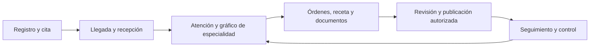

# Health Project: diseño funcional del sistema completo

Fecha: 13 de octubre de 2026. Estado: diseño de producto; implementación pendiente. Complementa la [arquitectura técnica](Arquitectura_Health_Project.md) y el [mapa de especialidades](Mapa_Especialidades_Health_Project.md).

La etapa actual prioriza [actores, flujos y diagramas antes de pantallas y desarrollo](diseno/README.md). Las pantallas, botones y gráficos se derivan de esos recorridos y permanecen como propuestas de diseño.

## 1. Alcance y decisiones confirmadas

El alcance final comprende las 241 entradas del catálogo: 152 médicas humanas, 30 odontológicas y 59 veterinarias, con sus formularios, componentes gráficos y flujos requeridos. Las entradas incluyen especialidades, subespecialidades, áreas de práctica y servicios. Cada paquete contará como soportado cuando todas sus capacidades obligatorias estén implementadas y validadas; su presencia en un catálogo solo identifica requisitos.

| Decisión del usuario | Consecuencia de diseño |
| --- | --- |
| Historia compartida entre sucursales de una misma clínica, con permisos y auditoría | Expediente por tenant y paciente; cada atención conserva sucursal de origen. Las reglas de acceso permiten lectura autorizada de la historia de la organización |
| Primera versión de consulta externa humana, odontológica y veterinaria | El primer recorrido operativo es agenda → recepción → atención → órdenes/documentos → seguimiento. Hospitalización se entrega después |
| Portal para pacientes y responsables de animales | Incorporar identidad externa, vinculación verificada, citas, publicaciones de documentos y delegaciones revocables |
| Todas las especialidades y gráficos necesarios dentro del sistema final | Mantener matriz de cobertura por paquete y capacidad; entregar por fases sin retirar silenciosamente áreas del alcance |
| Java Spring Boot, monolito modular, Next.js y SQL Server mediante SP | Un backend de negocio; ninguna especialidad constituye por sí sola otro microservicio |

Perú es la referencia inicial por RUC, SUNAT y los requisitos del informe. Las reglas fiscales, documentales y profesionales se validan por entidad y tipo de servicio antes de producción. Las referencias normativas de este documento identifican asuntos a resolver; no certifican cumplimiento.

## 2. Qué significa que el sistema esté completo

Un proceso está completo cuando tiene entradas, responsables, permisos, estados, salidas, correcciones, seguimiento y evidencia de aceptación. Un expediente completo conserva quién registró, qué ocurrió, cuándo, dónde, bajo qué contexto y cómo evolucionó. La experiencia del usuario también necesita búsquedas, accesibilidad, ayuda, confirmaciones y recuperación de errores.

Los módulos que deben diseñarse son los siguientes. La columna de entrega indica la secuencia propuesta, no disponibilidad actual.

| Bloque | Funcionalidad que debe cubrir | Entrega propuesta |
| --- | --- | --- |
| Organización y configuración | Alta de organización, sucursales, emisor fiscal, horarios, recursos y especialidades habilitadas | Consulta externa |
| Identidad y permisos | Profesionales, credenciales, membresías, roles, recuperación y portal externo | Consulta externa |
| Pacientes y responsables | Humanos/animales, documentos opcionales, vínculos, contactos, duplicados y verificación | Consulta externa |
| Agenda y recepción | Disponibilidad, citas, recursos, lista de espera, llegada, cola y atención sin cita | Consulta externa |
| Expediente y atención | Historia longitudinal, episodios, antecedentes, notas, diagnósticos, observaciones y adendas | Consulta externa |
| Paquetes de especialidad | Formularios, gráficos, vocabularios, validadores y documentos versionados | Progresiva según capacidad; todo el catálogo en alcance final |
| Órdenes y resultados | Solicitudes, tareas, ejecutores, informes y revisión; estudios externos al inicio cuando proceda | Consulta externa; ejecución interna avanzada después |
| Medicamentos | Prescripciones, conciliación e historial; dispensación y administración cuando exista el flujo | Prescripción en consulta externa; farmacia/hospital después |
| Documentos y consentimientos | Adjuntos privados, recetas, certificados, informes, autorizaciones y publicaciones | Consulta externa |
| Portal y comunicación | Citas, documentos publicados, instrucciones registradas y seguimiento autorizado | Consulta externa |
| Caja y facturación | Presupuestos, cargos, pagos, devoluciones, comprobantes, cuentas por cobrar y honorarios | Operación administrativa posterior o piloto acotado |
| Compras y almacenes | Proveedores, recepción, lotes, vencimientos, transferencias y consumos | Después del núcleo |
| Laboratorio e imagen internos | Muestras/adquisición, procesamiento, revisión, equipos y PACS cuando corresponda | Después del núcleo |
| Hospitalización y urgencias | Camas/jaulas, admisiones, traslados, turnos, cuidados, medicaciones y egreso | Posterior a consulta externa |
| Cirugía y anestesia | Programación, equipo, consentimientos, partes, implantes, muestras y recuperación | Posterior a consulta externa |
| Funciones avanzadas | Radioterapia, trasplantes, banco de sangre, reproducción avanzada y población animal según paquetes | Fases especializadas posteriores |
| Plataforma SaaS y operación | Planes, soporte, importación/exportación, observabilidad, continuidad y actualizaciones | Base desde el inicio; ampliación progresiva |

La fase de consulta externa puede incorporar funcionalidades comerciales acotadas si el piloto las requiere. No confundir el nombre de un plan comercial con el alcance de una versión de software.

## 3. Espacios de trabajo, profesionales y acceso

### Custodia y sucursales

`ClinicalRecord(TenantId, PatientId)` representa el expediente de la organización. `Encounter` agrega `OriginBranchId`, profesional, lugar físico y especialidad. Una atención en sede A y un control en sede B integran el mismo expediente si ambas pertenecen al tenant y el profesional tiene permiso. Las relaciones clínicas nunca se unen automáticamente entre tenants por DNI, microchip o cuenta del profesional.

El lugar externo de un profesional independiente indica dónde atendió. Su atención permanece bajo su tenant personal, salvo que actúe dentro del espacio de la clínica como miembro autorizado. Cada pantalla de atención mantiene visible organización, sucursal y paciente.

### Roles y alcance

| Perfil | Acceso operativo propuesto |
| --- | --- |
| Administrador de organización | Configuración, equipos y roles; acceso clínico solo si tiene permiso específico |
| Recepción | Registro administrativo, citas y llegada; información clínica mínima autorizada |
| Profesional | Expedientes y registros conforme a relación asistencial, permisos y especialidad habilitada |
| Asistente/enfermería | Tareas y registros autorizados; funciones específicas sin heredar todas las del médico |
| Caja | Servicios, cargos, saldos y pagos; contenido clínico solo cuando sea necesario y autorizado |
| Farmacia/laboratorio | Órdenes y datos necesarios para su ejecución |
| Auditor | Evidencias dentro de alcance y finalidad; consultas/exportaciones auditadas |
| Paciente o responsable externo | Sus citas y contenido expresamente publicado, según vínculo vigente |
| Soporte del SaaS | Diagnóstico técnico; acceso excepcional temporal, autorizado y auditado |

Separar `branch.operate` de `record.read.organization`. La primera permite gestionar una sucursal; la segunda permite historia compartida dentro del tenant bajo restricciones. Notas sensibles, exportaciones y acceso excepcional requieren permisos propios. Las vistas parciales indican su alcance para no presentar información oculta como si no existiera.

### Alta de un cliente

El onboarding configura entidad legal/emisor autorizado, sucursales, agenda, profesionales, recursos, servicios, especialidades y plantillas publicadas. El RUC identifica el emisor/organización correspondiente; el TenantId es la clave de aislamiento. Completar una configuración no verifica por sí mismo credenciales profesionales.

Guardar credenciales declaradas, evidencias, estado de comprobación y vigencia cuando corresponda. Habilitar un paquete de especialidad no concede una atribución profesional ni sustituye esa comprobación.

## 4. Pacientes y particularidades veterinarias

Permitir pacientes sin documento. Diferenciar fecha de nacimiento conocida, estimada y desconocida. Registrar identificadores por tipo/emisor/país, con normalización y evidencia. Buscar duplicados como candidatos; fusionarlos exige revisión, auditoría y conservación de las referencias originales.

En animales distinguir paciente, propietario declarado, responsable del cuidado, contacto de emergencia, representante autorizado y pagador. Cada relación tiene alcance y vigencia. Un cambio de responsable conserva la relación histórica; la autorización para consultar contenido previo se define explícitamente, no por sustitución automática del nombre del tutor.

Datos animales comunes: especie, raza opcional, sexo, estado reproductivo, nacimiento estimado, identificación local/microchip opcional, peso con fecha, condición corporal cuando aplique y responsables. Formularios, unidades, referencias y atlas se seleccionan por especie y etapa de vida.

La medicina poblacional necesita `AnimalPopulation` y `PopulationMembership` con intervalos. Rebaños, lotes, colonias, refugios y grupos acuáticos son sujetos colectivos; no se registran como personas. Las observaciones grupales conservan denominador, periodo, método y unidad. Las muestras indican procedencia individual, poblacional o compuesta. Este flujo pertenece a una fase especializada posterior.

## 5. Agenda, recepción y recorrido de consulta externa

Una cita puede reservar profesional, consultorio/sillón, sucursal y recurso pertinente. La disponibilidad considera horarios, excepciones, bloqueos, duración y ocupación. Los conflictos se resuelven en transacción, también cuando dos usuarios reservan simultáneamente.

La cita, la llegada y la atención son objetos distintos:

| Objeto | Estados de producto propuestos |
| --- | --- |
| Cita | Solicitada → confirmada → atendida; alternativas: reprogramada, cancelada o ausencia |
| Llegada/cola | Registrada → en espera → llamada → ingresó; alternativa: se retiró |
| Atención | Preparada → en curso → finalizada; alternativa: anulada con motivo |
| Nota clínica | Borrador → revisada → firmada; corrección posterior mediante adenda |
| Episodio de cuidado | Planificado → activo ↔ suspendido → finalizado |

Finalizar una visita, firmar una nota y terminar un episodio son acciones diferentes. Un episodio puede reunir controles de varias especialidades y sucursales autorizadas. Un resultado pendiente puede llegar después de la visita; el sistema conserva su responsable.



El profesional itinerante puede ver una agenda combinada de ámbitos autorizados. Compartir disponibilidad entre organizaciones utiliza bloques de ocupación, sin exponer pacientes, motivos o historias de otro tenant. La política de disponibilidad compartida necesita alcance y revocación.

## 6. Órdenes, tareas, resultados y pendientes

Formalizar `ServiceRequest`, `WorkTask`, `TaskAssignment`, `FulfillmentAttempt`, `Specimen`, `DiagnosticReportRevision`, `ResultReview` y `ResultCommunication`.

| Etapa | Evidencia que conserva |
| --- | --- |
| Solicitud | Quién pide, qué pide, paciente/episodio, motivo y fecha |
| Asignación | Equipo/persona responsable, prioridad operativa y plazo configurado |
| Ejecución | Intentos, ejecutor, muestras/adquisición, tiempos y estado |
| Resultado | Valores con unidades, documento, autor y revisión |
| Revisión profesional | Responsable, momento de revisión y actuación registrada |
| Comunicación | Contenido/versiones compartidos, destinatario, canal y recepción registrada |

La orden, tarea e informe tienen estados independientes. Un informe preliminar no es final; recibirlo no significa que un profesional lo revisó. Un informe corregido conserva original, autor y motivo, y reabre el pendiente de revisión cuando corresponda. Cada cola tiene responsable y suplente; las tareas sin resolver permanecen visibles.

Una remisión externa comparte un paquete seleccionado de documentos, destinatario y autorización; no otorga acceso permanente al expediente. La respuesta se incorpora con procedencia. En v1 se pueden registrar órdenes e informes externos; ejecutar un laboratorio o conectar equipos requiere su flujo adicional.

La separación entre solicitud, tarea y evento realizado se apoya como referencia conceptual en [HL7 FHIR Workflow](https://hl7.org/fhir/R4/workflow.html) y [ServiceRequest](https://hl7.org/fhir/R4/servicerequest.html). Usar esos conceptos no acredita una integración FHIR.

## 7. Medicamentos, farmacia y administración

Modelar prescripción, conciliación, dispensación y administración por separado:

```text
Prescripción versionada -> revisión autorizada -> dispensación parcial/total
                        -> dosis programada -> administración o motivo de no realización
```

El registro conserva producto/presentación, concentración, unidades, cantidad, vía indicada, fechas y profesional, además de lote cuando corresponda. La cantidad prescrita, entregada, administrada y referida por paciente/responsable son hechos distintos. Cambiar una prescripción no modifica administraciones ya registradas.

Definir en qué evento se descuenta stock para no hacerlo dos veces por entrega y administración. Las devoluciones y ajustes mantienen sus movimientos. Las reglas de cálculo y alertas clínicas necesitan fuentes, versión y validación profesional; esta especificación no incluye dosis ni decisiones terapéuticas automáticas. La distinción entre prescripción y administración también aparece en [HL7 MedicationAdministration](https://hl7.org/fhir/R4/medicationadministration.html).

Para v1: receta y conciliación registradas por profesional. Farmacia interna, turnos de administración y hojas hospitalarias se incorporan en las fases correspondientes.

## 8. Formularios y gráficos para todo el catálogo

Crear un registro interno de componentes reutilizables, extendido por paquete: odontogramas humano/veterinario, periodontograma, raíces/conductos, mapa anatómico, mapas ocular/neurológico/musculoesquelético, antropometría/crecimiento, tendencias, informes/estudios y hojas de procedimientos o cuidados.

Cada gráfico obligatorio necesita:

1. Atlas y versión; especie/población/dentición cuando aplique.
2. Estructuras semánticas y lateralidad; coordenadas para representación.
3. Interacciones que producen hallazgos, observaciones o procedimientos identificados.
4. Autor, fecha clínica, atención y estado observado/planeado/realizado/resuelto.
5. Comparación temporal reproducible y conservación de la versión original.
6. Alternativa textual accesible e impresión/exportación comprensibles.
7. Validación de backend y revisión por profesional de esa especialidad.

El renderer gráfico no es la fuente independiente de la historia. No permitir que un cambio de atlas, leyenda o color reinterprete silenciosamente una atención anterior. Los estudios y señales pueden necesitar visores o integraciones adicionales; adjuntar un informe no implementa interpretación de ECG, PACS o medición automática.

Registrar cobertura por paquete y capacidad en [Control_Cobertura_Health_Project.json](catalogs/Control_Cobertura_Health_Project.json): campos, gráficos/componentes, validaciones, flujo, documentos, permisos, integraciones y revisión profesional. Cada dimensión conserva estado y evidencia. `No aplica` exige justificación; una celda no implementada no se cuenta como completada.

## 9. Portal, documentos y comunicaciones

El portal permite gestionar citas, consultar documentos publicados y recibir seguimiento autorizado. Presupuestos, saldos y pagos aparecen cuando se entreguen sus módulos administrativos.

| Función | Regla |
| --- | --- |
| Vincular cuenta a paciente/animal | Invitación o verificación explícita. DNI, correo coincidente o microchip no conceden acceso por sí solos |
| Publicar un documento | Actor autorizado, versión exacta, destinatario y momento. Una nota interna no se publica por defecto |
| Delegar a familiar/responsable | Paciente/animal, alcance, vigencia, evidencia y revocación |
| Descargar | Verificar permiso vigente; enlaces temporales y descargas auditadas |
| Cambiar responsable animal | Revisar alcance de acceso anterior/nuevo y conservar historial de relaciones |
| Recordatorios | Preferencias, destinatario y canal; mensajes con información mínima necesaria |
| Seguimiento | Formularios o mensajes autorizados, asignación y estado de respuesta; indicar tiempos de atención del canal |

Cada publicación pertenece a una organización. Una persona puede tener vínculos con varias organizaciones; el portal selecciona contexto y mantiene la procedencia. Esto no concede acceso entre clínicas a sus respectivos expedientes.

Definir la gestión de representantes de menores y datos sensibles según reglas aplicables. Una receta publicada, una autorización administrativa y un consentimiento informado son documentos distintos, con versión y finalidad. La firma digital legal requiere definir proveedor, validación y evidencias; un botón de cierre no la sustituye.

## 10. Gestión comercial y operación de cada cliente

### Servicios, presupuesto y cargos

Separar catálogo clínico y catálogo comercial. Un servicio tiene precio, moneda, vigencia, sucursal y reglas autorizadas; la especialidad define la forma de atender. Conservar el precio realmente aplicado.

El plan clínico, presupuesto aceptado, procedimiento realizado y cargo son objetos distintos. Un tratamiento odontológico puede tener varias sesiones y pagos parciales. Registrar aceptación comercial y sus versiones sin usarla como prueba de ejecución clínica.

### Caja, comprobantes y honorarios

Cadena propuesta: presupuesto → cargos → asignación de pagos → saldo → comprobante fiscal → ajustes/devoluciones. Caja necesita apertura, movimientos, cierre y conciliación por operador/sucursal. Los estados fiscales y de pago permanecen separados.

SUNAT contempla tipos distintos de comprobantes y documentos complementarios; elegir emisor, sistema y adaptador conforme al caso. Referencia primaria: [Tipos de comprobante de pago electrónicos](https://cpe.sunat.gob.pe/informacion_general/tipos_comprobantes_pago). Esta propuesta no determina automáticamente las obligaciones fiscales de cada cliente.

Los acuerdos de honorarios tienen vigencia y base de cálculo explícita: realizado, facturado o cobrado, según contrato. Una liquidación conserva cálculo, ajustes, revisión y pago. Convenios con empresas/aseguradoras requieren autorizaciones y condiciones de cobro propias; ser pagador no concede acceso clínico.

### Compras, almacenes y farmacia

Solicitud → orden de compra → recepción → lote/almacén → consumo/dispensación/transferencia → conciliación. Guardar unidades, conversiones autorizadas, vencimientos, cantidades y responsables. Los consumos se vinculan a procedimientos cuando proceda. Equipos e instrumentos reutilizables necesitan trazabilidad de uso/mantenimiento si el flujo los incluye.

La suscripción SaaS cobrada por MAVRIC es distinta de los comprobantes emitidos por una clínica a sus pacientes. Los precios, consumo de IA, almacenamiento, sucursales facturables y condiciones de suspensión siguen pendientes de definición comercial.

## 11. Hospitalización, urgencias y cirugía: fases posteriores

### Hospitalización humana y veterinaria

Entidades: `Admission`, `Stay`, `CareUnit`, `ResourceSlot`, `OccupancyInterval`, `LocationMovement`, `Shift`, `Handover`, `CareTask` y `DeviceUse`. En veterinaria, `ResourceSlot` permite jaula/plaza con condiciones de alojamiento por especie y tamaño; el responsable no sustituye al paciente animal.

Ingreso solicitado → aceptado → estancia activa → alta clínica → egreso físico. Recurso disponible → reservado → ocupado → limpieza/bloqueado → disponible. Los movimientos conservan intervalos; dos asignaciones no ocupan simultáneamente la misma plaza. Cada turno recibe pendientes y responsables. La administración de medicación y resultados se vincula a la estancia sin duplicar la historia.

### Urgencias

Admitir identidad provisional y atenciones sin cita. Registrar clasificación, reevaluaciones, intervenciones y destino como eventos. Transferencias identifican emisor, receptor, pendientes y recepción. Resolver identidad después exige trazabilidad y conservación de referencias.

### Cirugía y anestesia

Caso propuesto → programado → preparación → en curso → recuperación → finalizado. Reservar equipo, sala y recursos; conservar consentimientos, verificaciones, parte, anestesia, administraciones, implantes y muestras. Una cancelación o interrupción posterior al inicio conserva lo realizado y libera solo los recursos que corresponda.

### Alta y seguimiento

Resumen e indicaciones versionadas, destinatario, pendientes, responsables y controles. Alta clínica, egreso físico y liquidación económica son estados diferentes. Un resultado posterior continúa asignado a un profesional; el alta no lo elimina.

Cada proceso avanzado necesita descubrimiento con usuarios y aceptación propia. Hospitalización humana y veterinaria reutilizan infraestructura, pero sus formularios, recursos y reglas requieren adaptación.

## 12. Datos, integraciones y continuidad

| Área | Requisito operativo |
| --- | --- |
| Importación | Lote, procedencia, formato/versiones, vista previa, rechazos, correspondencias de IDs y reconciliación de totales |
| Duplicados | Candidatos y revisión; fusión auditada con conservación de referencias y reparación de asociaciones equivocadas |
| Exportación | Datos estructurados, unidades, versiones, documentos originales y manifiesto de integridad |
| Integraciones | Adaptadores, credenciales, outbox, reintentos, idempotencia y cola de fallos con responsable |
| IA | Dictado/propuesta revisable; autoría y aprobación del profesional antes de incorporar al expediente |
| SQL/SP | Contratos tipados, autorización, transacciones, concurrencia, paginación y errores estables |
| Operación | Logs técnicos sin contenido clínico innecesario, trazas correlacionadas y auditoría separada |
| Recuperación | Restaurar base, archivos, configuración y claves, con evidencia de integridad y objetivos acordados |
| Release | Migraciones ensayadas, compatibilidad de contratos, retorno definido y comprobación posterior |
| Soporte | Casos, responsables, accesos temporales, incidentes y cambios auditados |

Acordar carga prevista, tiempos de respuesta, disponibilidad, pérdida máxima de datos aceptable (RPO) y tiempo de recuperación (RTO) con el equipo. No fijar cifras arbitrarias. El entorno de pruebas del informe no determina automáticamente el hosting productivo.

Query Store permite estudiar carga y regresiones en SQL Server, y `rowversion` puede ayudar a detectar conflictos de actualización; no representa fecha clínica. Referencias: [Query Store](https://learn.microsoft.com/en-us/sql/relational-databases/performance/query-store-usage-scenarios?view=sql-server-ver17), [rowversion](https://learn.microsoft.com/en-us/sql/t-sql/data-types/rowversion-transact-sql?view=sql-server-ver17).

La persistencia de sesiones, portal, auditoría y trabajos también sigue el requisito de SP. Migraciones y administración usan cuentas separadas. Las conexiones reutilizadas, archivos y cachés se validan para que no mezclen tenants ni permisos. No introducir infraestructura adicional sin una necesidad medida.

## 13. Normativa y gobierno clínico

Preparar una matriz de aplicabilidad con responsable, requisito, solución, evidencia y validación para el país, entidad y vertical. La política de custodia, acceso, conservación, firma, portabilidad y tratamiento de datos se cierra antes de producción; las reglas humanas no se aplican automáticamente como si fueran normas veterinarias.

Referencias iniciales verificadas para Perú:

- [NTS de gestión de historia clínica, RM 214-2018-MINSA](https://www.gob.pe/institucion/minsa/normas-legales/187487-214-2018-) y su [publicación con modificatoria RM 265-2018-MINSA](https://www.ino.gob.pe/wp-content/uploads/2023/05/NTS-GESTION-HISTORIA-CLINICA-MINSA-2018.pdf): revisar contenido y procesos documentales aplicables.
- [Reglamento de protección de datos, DS 016-2024-JUS](https://www.gob.pe/institucion/anpd/normas-legales/6554453-n-016-2024-jus): determinar bases, información al titular, roles, derechos y controles correspondientes al servicio.
- [Compendio MINSA de sistemas de información para la salud](https://www.gob.pe/institucion/minsa/colecciones/85428-sistemas-de-informacion-para-la-salud): revisar firma, acreditación e interoperabilidad aplicables al producto y establecimientos concretos.

La evaluación no está completada. No se fija aquí un periodo universal de retención ni se afirma acreditación de HCE, RENHICE, FHIR o firma digital. Seleccionar especialistas para revisar plantillas, gráficos, unidades y cálculos; registrar evidencia y aprobación por versión.

## 14. Criterios de aceptación del primer recorrido operativo

| Escenario | Evidencia necesaria |
| --- | --- |
| Dos sucursales de una clínica | Control en sede B recupera historia de sede A con permiso; quedan sucursal de origen y acceso auditado |
| Organizaciones diferentes | Cuentas, IDs, archivos, portal y reportes rechazan información de otro tenant |
| Profesional itinerante | Alterna clínica y espacio propio sin mezclar custodia, paciente o emisor documental |
| Humano y animal | Perfiles correctos; responsable animal verificado; ausencia de documento no bloquea registro |
| Atención completa | Cita o ingreso directo → nota/formulario/gráfico → cierre → documento → seguimiento |
| Gráfico longitudinal | Hallazgo y procedimiento se vinculan a región/pieza; comparar visitas conserva autoría y atlas original |
| Edición concurrente | Dos modificaciones sobre la misma revisión producen conflicto sin pérdida silenciosa |
| Adenda | Una corrección conserva el original firmado y muestra motivo/autor/fecha |
| Orden e informe | Resultado posterior a la visita queda pendiente de revisión con responsable; corrección conserva versión previa |
| Portal | Solo publica versión autorizada; revocar delegación bloquea acceso futuro |
| Operación | Importación idempotente, exportación completa y restauración demostrada dentro de objetivos acordados |
| Paquetes publicados | Todas sus capacidades obligatorias tienen evidencia de revisión funcional y clínica |

Estos criterios se prueban con datos sintéticos antes del piloto. La aceptación de consulta externa no implica aceptación de flujos hospitalarios aún pendientes.

## 15. Secuencia de diseño y construcción

| Paso | Entregable concreto | Criterio para continuar |
| --- | --- | --- |
| 1 | Modelo de dominio y matriz de roles/permisos | Custodia, expediente compartido y portal expresados sin ambigüedad |
| 2 | Recorridos de pantallas de consulta y portal | Cada acción tiene actor, entrada, permiso, salida y error esperado |
| 3 | Modelo físico SQL Server | Claves, relaciones, índices, versiones y estados consistentes |
| 4 | Contratos REST y SP por caso de uso | Especificar parámetros/resultados, transacción, errores e idempotencia |
| 5 | Primer recorrido completo y paquetes piloto | Paciente → atención → evolución/documento → portal aceptado |
| 6 | Ampliar capacidades de especialidad y operación administrativa | Cada entrega tiene cobertura y evidencia; no se publica solo por figurar en el catálogo |
| 7 | Flujos hospitalarios y diagnósticos internos | Admisión/ejecución/seguimiento y recuperación aceptados |
| 8 | Completar capacidades avanzadas del catálogo | Revisiones profesionales, integraciones y documentación por paquete |

La construcción conserva el alcance de todas las especialidades y gráficos requeridos. La secuencia permite validar el núcleo antes de multiplicar componentes; el avance se mide por capacidades completas, no por cantidad de formularios creados.

## 16. Decisiones que todavía debemos cerrar

| Tema | Qué falta concretar | Entregable que depende de ello |
| --- | --- | --- |
| Piloto y validadores | Clínicas/profesionales para revisar los primeros recorridos y gráficos | Paquetes iniciales y aceptación |
| Reglas de acceso compartido | Relación asistencial, roles, contenido sensible y acceso excepcional dentro del tenant | Matriz de permisos y SP de lectura |
| Directorio global | Finalidad, datos compartidos, verificación y condiciones para vincular identidad | Registro/autocompletado |
| Portal | Vinculación, representantes, publicación, canales y tiempos de seguimiento | Flujos externos y comunicaciones |
| Documentos y firma | Tipos, membretes, firmas, vigencia y conservación aplicables | Emisión y evidencia documental |
| Operación comercial | Servicios/precios, impuestos aplicables, emisor, adaptador fiscal y base de honorarios | Caja/facturación |
| Catálogo y gráficos | Reglas detalladas, atlas/diseños, referencias de cálculo y licencias cuando correspondan | Renderers y validadores |
| Proveedores | Calendar, mensajería, IA, pagos, firma y equipos según fase | Integraciones y costos |
| Infraestructura | Hosting, carga, disponibilidad, RPO/RTO, respaldos, archivos y entornos | Producción y continuidad |
| Capacidad de entrega | Equipo, presupuesto y cronograma según alcance de cada release | Plan de ejecución realista |

Estas decisiones se concretan sobre prototipos y contratos revisables. Las tres decisiones confirmadas del apartado 1 ya se aplican a la arquitectura y al catálogo; no requieren volver a pedir autorización.
