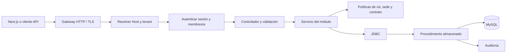
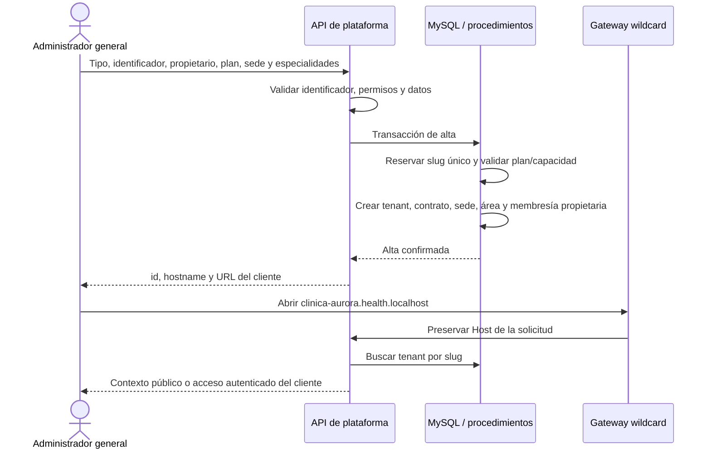
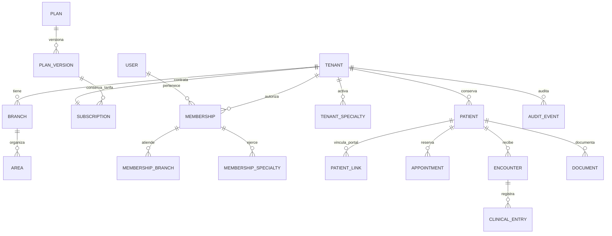
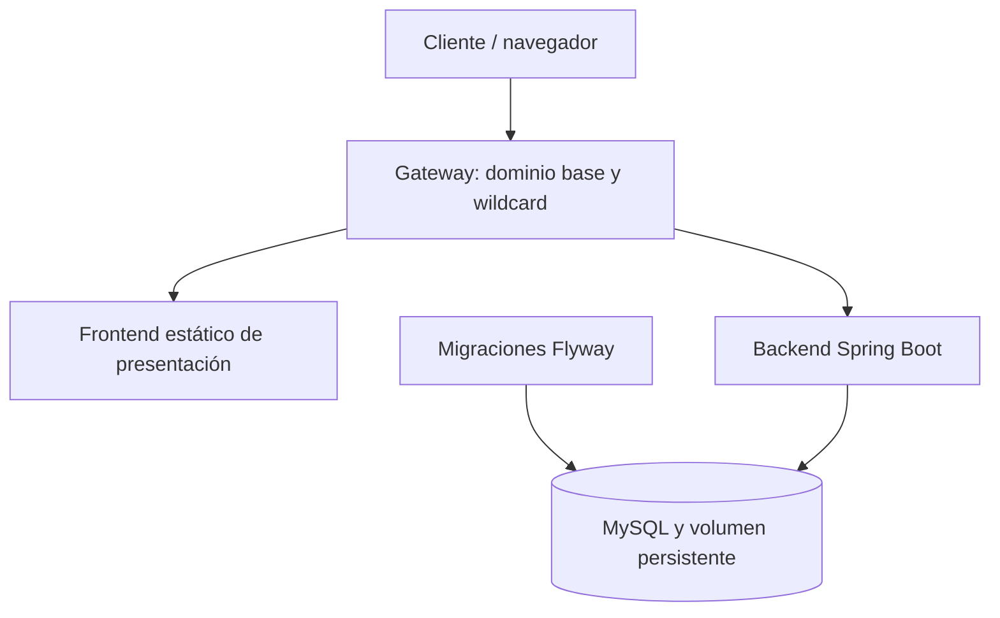

# Health Project · guía de arquitectura y construcción del backend

Fecha: 13 de octubre de 2026. Esta guía ordena la implementación y su verificación. Hay archivos iniciales adelantados; su existencia no significa que una etapa esté terminada o probada.

## 1. Decisiones de partida

| Tema | Decisión |
| --- | --- |
| Plataforma | SaaS multi-tenant para medicina humana, odontología y veterinaria |
| Backend | Java 21 y Spring Boot; un monolito modular, un despliegue de la aplicación |
| Datos | MySQL 8.4, sustituyendo la decisión anterior de SQL Server por la solicitud actual |
| Escrituras | Procedimientos almacenados invocados mediante JDBC; transacciones coordinadas por Spring |
| Evolución de BD | Migraciones versionadas con Flyway; sin modificar migraciones aplicadas |
| Ejecución local | Docker Compose: MySQL, migraciones, backend y gateway |
| Frontend | Se conserva Next.js y la presentación con mocks; la integración se hace contra contratos de API estables |
| Tenancy | Esquema compartido, `tenant_id` obligatorio en datos de clientes, claves foráneas compuestas |
| Subdominio | Se reserva de forma única al crear el cliente; dominio base configurable |
| Historias | Compartidas entre sedes del mismo tenant, conservando su origen y permisos |
| Usuarios | Identidad global; roles, sedes y especialidades mediante membresías por tenant |
| Catálogo clínico | Los 241 perfiles del diseño; cada cliente activa los compatibles con su contrato |

El dominio local inicial es `health.localhost`. El dominio público todavía debe definirse. La configuración debe permitir cambiar ese dominio base sin reescribir reglas de negocio.

## 2. Qué significa monolito estructurado

No se construirán microservicios. Cada módulo tendrá límites de responsabilidad y correrá dentro del mismo proceso Spring Boot. Separar módulos no implica separar servidores o bases de datos.

```text
backend/
  src/main/java/com/mavric/health/
    identity/       identidad, sesiones, contraseñas y autorización
    tenancy/        resolución del subdominio y contexto del tenant
    saas/           clientes, planes, versiones, contratos y cuenta SaaS
    organization/   sedes, áreas, equipo y especialidades activadas
    patients/       humanos, animales y responsables
    scheduling/     disponibilidad, citas y recepción
    clinical/       atenciones, evaluaciones, mediciones y anotaciones
    documents/      borradores, firma interna, adendas y publicación
    portal/         información permitida al paciente o responsable
    billing/        movimientos y saldo de la caja clínica
    inventory/      productos, lotes, dispensación y transferencias
    hospital/       recursos, admisiones y egresos
    workflows/      diagnóstico, cirugía y procesos especializados
    audit/          evidencia de cambios y consultas autorizadas
    shared/         errores, validaciones técnicas y acceso JDBC común
  src/main/resources/
    application.yml
    db/migration/
  src/test/
```

La entrada HTTP valida el contrato. El servicio de aplicación verifica permisos y coordina la operación. El acceso JDBC llama al procedimiento y obtiene una respuesta. Los procedimientos hacen cumplir las restricciones de datos y las reglas que deben ser atómicas. Los controladores no escriben SQL.



## 3. Creación y resolución de subdominios

El cliente elegirá su identificador al inicio: `clinica-aurora`, `veterinaria-brisa` o `dr-mateo`. El backend devolverá el nombre completo y la URL correspondiente.



Reglas:

- Minúsculas, números y guiones; máximo 63 caracteres; sin guiones al inicio o al final.
- Identificadores únicos y nombres reservados: `admin`, `api`, `www`, `app`, `saas`, `auth`, `portal`, entre otros.
- La creación completa debe confirmar o revertir en una transacción. Una colisión no deja cuentas o contratos parciales.
- El dominio base y `admin.<dominio>` son espacios de plataforma; un único prefijo válido corresponde a un cliente.
- No se acepta un tenant enviado por el navegador mediante `X-Tenant-ID`, cuerpo o parámetros para establecer el contexto de una operación clínica.
- Se ignoran cabeceras de forwarding no confiables. El gateway preserva el Host; la aplicación verifica su pertenencia al dominio configurado.
- Un subdominio desconocido devuelve un error, sin caer en los datos de una clínica predeterminada.
- El identificador del tenant es estable. Renombrar un subdominio requerirá un flujo especial de alias, auditoría y continuidad de enlaces; no será una edición casual del nombre comercial.

Para el entorno público se configura una vez el DNS wildcard y el certificado que cubra los hosts necesarios. El alta posterior registra y habilita el cliente en la aplicación. La creación de filas en MySQL no crea por sí misma registros DNS externos. No se aprovisionará DNS público sin conocer el dominio y tener acceso autorizado a su zona.

## 4. Aislamiento de datos

Las tablas clínicas y operativas pertenecen a un tenant. Una referencia a un paciente, sede, atención o lote debe ser válida dentro de ese mismo tenant. La base debe rechazar referencias cruzadas mediante claves foráneas compuestas, además de las comprobaciones del servicio.



Una persona puede atender en su consultorio y en distintos hospitales. Su usuario permanece global; cada acceso exige la membresía correspondiente. El expediente de su consultorio no se mezcla con el de un hospital. Los lugares externos del independiente se distinguen de sus sedes propias.

Las lecturas siempre aplicarán el tenant resuelto. No habrá repositorios clínicos que busquen únicamente por el identificador de un recurso. El administrador general consultará metadata comercial y de configuración; su sesión de plataforma no concederá acceso clínico automático.

## 5. Autenticación y permisos

Se usarán contraseñas con hash BCrypt y sesiones revocables con tokens aleatorios. La base guardará el hash del token, su usuario, tenant, vencimiento y estado. Las sesiones de plataforma y de clientes se separan; un token de un tenant no funciona en otro subdominio.

La membresía se verifica en cada solicitud. Desactivar un usuario o una membresía debe quitar su acceso sin esperar que venza el token. Cambiar una contraseña revoca las sesiones del usuario. Las cuentas invitadas necesitan un flujo de aceptación con prueba de identidad; no se enviarán correos reales en esta implementación sin autorización.

| Actor | Política inicial |
| --- | --- |
| SAD | Clientes, planes, contratos, cuenta SaaS y auditoría de plataforma |
| ADM | Configuración del cliente; el acceso clínico requiere otro rol autorizado |
| PRO | Atención y documentos; asignación válida por sede y especialidad |
| REC | Fichas administrativas, agenda, recepción y vínculos permitidos |
| ASI | Capturas y tareas autorizadas; sin finalizar una visita ajena por defecto |
| DIA | Trabajo e informes de diagnóstico dentro de su alcance |
| FAR | Dispensación autorizada y trazabilidad de lotes |
| CAJ | Registro de cargos, pagos, devoluciones y saldo clínico |
| ALM | Existencias, recepciones y transferencias por sedes autorizadas |
| PAC / RES | Pacientes vinculados y contenido publicado dentro del alcance vigente |
| AUD | Lectura de evidencia autorizada; sin modificar registros |
| SOP | Soporte y operación técnica; sin acceso clínico automático |

Las autorizaciones se comprobarán en el backend aunque el frontend oculte un botón. Un rol no sustituye a la asignación de sede, una especialidad no concede permisos por su nombre y el estado del contrato también condiciona las operaciones.

## 6. Planes, contratos y capacidad

Los tipos de tenant serán independiente humano o veterinario, clínica, hospital, centro veterinario, centro odontológico y centro de especialidad. Se conservarán los planes de ejemplo de la demo, con precios configurables y sin tratarlos como tarifas aprobadas.

El catálogo tiene versiones inmutables. Cada suscripción referencia una versión concreta: precios, capacidad y módulos. Editar el plan crea otra versión y no cambia automáticamente los contratos anteriores.

Se contarán sedes propias activas y membresías clínicas activas o invitadas. Un profesional en varias sedes ocupa una licencia en ese cliente. El resto del personal se gestiona por roles y no se confunde con licencias de médicos, odontólogos o veterinarios. El independiente tiene una identidad clínica. Las especialidades activadas están limitadas por ámbito, módulos y capacidad contratada.

Una reducción de capacidad se rechaza si queda por debajo del consumo. Las asignaciones e historias impiden retirar referencias necesarias para conservar la procedencia de datos. Suspender bloquea nuevas operaciones y conserva la información; no elimina historias.

## 7. Modelo clínico y especialidades

El núcleo de una atención es común: paciente, profesional, sede, especialidad, estado, nota, revisión y procedencia. Los datos de una especialidad se guardarán como entradas estructuradas versionables, vinculadas a una atención y a un perfil del catálogo.

Se diferencian evaluaciones, observaciones, anotaciones gráficas, órdenes y prescripciones. La definición del perfil y sus componentes debe permitir validar campos, tipos y opciones sin crear una tabla distinta para cada especialidad. El backend conserva la versión o snapshot necesario para interpretar las capturas históricas. Los SVG y componentes gráficos continúan en el frontend; la selección y los hallazgos se almacenan en el backend.

Humanos y animales comparten infraestructura, pero conservan sus reglas: dominio, especie, responsables, identificadores y perfiles compatibles. El animal no inicia sesión; lo hace su responsable mediante un vínculo vigente.

Los documentos mantienen revisiones. Una firma interna fija contenido, hash, firmante y fecha; las correcciones posteriores generan una adenda. Publicar exige el estado y vínculo apropiados. La firma interna no se presentará como integración certificada de firma digital ni como comprobante fiscal externo.

## 8. Procedimientos y transacciones

| Grupo | Operaciones que deben estar en procedimientos |
| --- | --- |
| Identidad | Alta de cuenta, sesión, revocación y cambio de contraseña |
| SaaS | Versionar plan, alta completa de cliente, contrato, estado y registro de pago SaaS |
| Organización | Sedes, áreas, membresías y especialidades con validación de capacidad |
| Pacientes | Alta/edición por revisión y vínculos del portal |
| Agenda | Reserva idempotente, cambios de horario, estados y rechazo de solapamientos |
| Clínica | Inicio, guardado por revisión, cierre y entradas estructuradas |
| Documentos | Borrador, firma, adenda, publicación y retiro |
| Caja | Cargos, pagos y devoluciones con importes en unidades menores |
| Inventario | Recepción, dispensación y transferencias con lotes y stock no negativo |
| Hospital | Recursos, asignación exclusiva, admisión y egreso |
| Procesos | Creación, transición válida, revisión y conservación de historia |

Spring abre y cierra la transacción; los procedimientos de negocio no hacen commits ocultos. Un error revierte los cambios relacionados y su auditoría. Las migraciones sí pueden ejecutar DDL según el comportamiento de MySQL, y se prueban antes de aplicarlas a otro entorno.

Se utilizarán bloqueos para cupos, reservas, cobros, lotes y plazas, y revisión esperada para evitar sobrescribir cambios ajenos. Las claves de idempotencia deben distinguir una repetición del mismo pedido de una reutilización con datos diferentes. Dos operaciones concurrentes no pueden cobrar dos veces, dispensar stock inexistente ni asignar la misma cama.

## 9. Contrato de API

| Familia | Prefijo | Contexto |
| --- | --- | --- |
| Contexto público | `/api/public/context` | Host validado, metadata mínima |
| Identidad | `/api/auth` | Login, usuario, sesión y contraseña |
| Plataforma | `/api/platform` | Dominio de plataforma y rol SAD |
| Organización | `/api/tenant` | Tenant del subdominio |
| Pacientes | `/api/patients` | Rol y tenant autorizados |
| Agenda | `/api/appointments` | Sede, profesional y especialidad |
| Atención | `/api/encounters` | Permiso clínico y revisión |
| Documentos | `/api/documents` | Permiso, estado y publicación |
| Portal | `/api/portal` | Usuario, vínculo y alcance |
| Caja | `/api/finance` | Rol CAJ y módulo contratado |
| Inventario | `/api/inventory` | Rol, sede y módulo |
| Hospital | `/api/hospital` | Rol clínico y capacidad |
| Procesos | `/api/workflows` | Tipo, rol, módulo y transición |
| Auditoría | `/api/audit` | Alcance de tenant o plataforma |

Las entradas tendrán DTOs validados. Los identificadores serán UUID; las fechas de agenda se comunicarán con zona u offset y se almacenarán en UTC. Los importes serán enteros en unidades menores; las cantidades de inventario tendrán precisión definida. Los listados estarán acotados y filtrados.

Los errores usarán una forma uniforme con código, estado HTTP, detalle y requestId. Se distinguirán validación, autenticación, permiso, recurso no disponible y conflicto. No se devolverán contraseñas, hashes de credenciales ni SQL interno en respuestas de error.

## 10. Docker y operación



La aplicación esperará a una base saludable y a migraciones exitosas. Las credenciales de migración se separarán de las del backend, cuyo acceso ordinario será de lectura y ejecución de procedimientos. Las claves locales se generarán en `.env`, que no se versiona. Los datos estarán en un volumen; reiniciar contenedores no debe borrarlos.

El entorno local no modifica el puerto 3001 usado por la presentación actual. El gateway Docker se preparará en el puerto 8080. El despliegue público debe añadir el dominio real, DNS, TLS, backups y los secretos del entorno. Esas configuraciones se distinguirán de una prueba local funcionando.

## 11. Orden de implementación y criterios de salida

| Etapa | Entrega | Se considera terminada cuando |
| --- | --- | --- |
| 0 | Esta guía y contratos de módulo | Se fijan decisiones, límites, modelo y pruebas |
| 1 | Docker, Spring Boot, MySQL y migraciones | Construye, arranca, aplica migraciones y reporta salud |
| 2 | Identidad, tenant por Host y SaaS | Alta atómica; subdominio único; roles y sesiones no cruzan tenants; cupos y versiones pasan pruebas |
| 3 | Organización, pacientes y agenda | Asignaciones válidas, directorios separados, historia entre sedes y reservas concurrentes correctas |
| 4 | Consulta externa, odontología, veterinaria, documentos y portal | Capturas válidas; revisión y cierre; original firmado conservado; publicación y revocación verificadas |
| 5 | Caja, inventario y trazabilidad | Idempotencia, saldo correcto, lotes y transferencia sin duplicación |
| 6 | Hospital y procesos avanzados | Ocupación exclusiva, egreso y estados válidos; se documenta qué protocolos e integraciones quedan pendientes |
| 7 | Integración de frontend y entrega operativa | Adaptadores reales por módulo, contratos probados y recorrido completo sin depender de mocks en los módulos conectados |

El primer circuito clínico utilizable será consulta externa humana, odontología y veterinaria con portal, conforme a las decisiones anteriores. Hospitalización y procesos avanzados se modelan desde el principio y se profundizan después del núcleo.

## 12. Pruebas obligatorias

- Crear dos clientes; rechazar subdominios repetidos y reservados sin dejar registros parciales.
- Rechazar hosts fuera del dominio y tenants inexistentes; ignorar intentos de cambiar el tenant con cabeceras o cuerpo.
- Login, expiración, logout, cambio de contraseña y revocación de membresía.
- Rechazar un token de otro tenant y referencias cruzadas de pacientes, documentos, sedes, lotes y recursos.
- Permitir historia entre sedes del mismo cliente solo a roles autorizados.
- Contabilizar invitaciones, sedes y profesionales; impedir exceder el contrato incluso con solicitudes concurrentes.
- Conservar la versión del contrato cuando se modifica el catálogo.
- Impedir reservas superpuestas de un mismo profesional, incluso si trabaja en distintos tenants.
- Rechazar revisiones obsoletas y modificaciones a atenciones finalizadas o documentos firmados.
- Mostrar al portal únicamente vínculos activos y documentos publicados; verificar retiro y revocación.
- Repetir cobros, movimientos y transferencias con la misma clave; probar una clave reutilizada con otros datos.
- Probar stock insuficiente, lotes vencidos, cama ocupada y egreso.
- Registrar auditoría sin copiar credenciales o texto clínico innecesario a los logs técnicos.
- Confirmar que la cuenta de aplicación no puede escribir tablas directamente.
- Reiniciar Docker y comprobar persistencia, migraciones y salud.

## 13. Estado y decisiones pendientes

Actualización del 14 de octubre de 2026: la base del backend ya se implementó siguiendo esta guía, con Docker, 8 migraciones Flyway aplicadas sobre MySQL real, 9 pruebas unitarias y 176 comprobaciones de API aprobadas. Incluye pruebas simultáneas de reservas, devoluciones, dispensaciones y cupos; contratos versionados; historias entre sedes; consulta humana, odontológica y veterinaria; publicación y revocación del portal. La cuenta `health_app` está restringida a SELECT y EXECUTE, verificada también en una instalación nueva.

La prueba de reinicio de servicios también pasó: los conteos de registros permanecieron iguales, el login volvió a funcionar y Flyway validó las 8 migraciones. Las evidencias y los límites de cobertura están en [verificación del backend](03_Verificacion_del_Backend.md).

El motor de hospitalización y procesos está operativo como base de estados y persistencia. Los protocolos avanzados y validaciones clínicas exhaustivas por especialidad aún requieren desarrollo específico. Actualización del 18 de octubre: la etapa 7 ya conecta acceso, registro, recuperación, sesiones, soporte, trazabilidad y monitor al backend. Los módulos clínicos de presentación permanecen como demostración explícita. Consulta [Identidad, trazabilidad y operación](04_Identidad_Trazabilidad_y_Operacion.md), los [contratos HTTP](02_API_y_Recorridos.md) y la [ejecución reproducible](../../backend/README.md).

El usuario todavía no compró un dominio y autorizó usar uno provisional. El entorno utiliza `health.localhost`, con dominio base y origen público configurables. Para despliegue público faltan dominio real, DNS y TLS. Integraciones de correo, pagos externos, firma certificada, fiscalización y almacenamiento de archivos necesitan implementación, contratos y credenciales propios; los registros internos no se presentan como integraciones activas.

Referencias técnicas: [Spring Boot](https://docs.spring.io/spring-boot/reference/index.html), [organización modular de Spring Boot 4](https://github.com/spring-projects/spring-boot/wiki/Spring-Boot-4.0-Migration-Guide), [procedimientos MySQL 8.4](https://dev.mysql.com/doc/refman/8.4/en/create-procedure.html).
