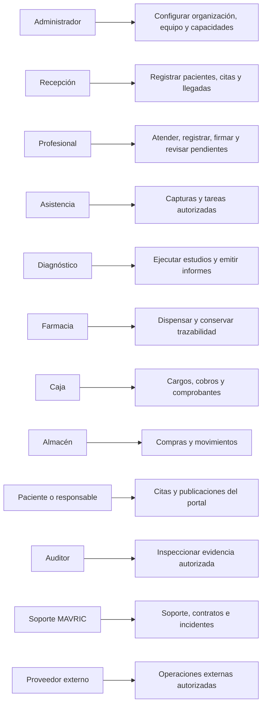

# Actores, alcance y reglas de diseño

Estado: propuesta de diseño del 13 de octubre de 2026. No se desarrolla la aplicación en esta etapa.

## Decisiones confirmadas

- Historia por organización, compartida entre sus sucursales con permisos y auditoría.
- Sin acceso clínico automático entre organizaciones.
- Consulta externa humana, odontológica y veterinaria como primera versión.
- Portal de pacientes y responsables de animales.
- Todo el catálogo de especialidades y gráficos requeridos en el alcance final.

## Actores y alcance

| ID | Actor | Alcance |
| --- | --- | --- |
| `ADM` | Administrador de la organización | Configura su organización y sucursales; el acceso clínico requiere permiso específico. |
| `REC` | Recepción | Registro administrativo, agenda, recepción y cola. |
| `PRO` | Profesional clínico | Médico, odontólogo o veterinario autorizado; puede trabajar en varios espacios con permisos independientes. |
| `ASI` | Asistente o enfermería | Captura y tareas según rol, competencia y autorización. |
| `DIA` | Equipo de diagnóstico | Órdenes, muestras, estudios e informes dentro de su alcance. |
| `FAR` | Farmacia | Revisión y dispensación autorizadas; trazabilidad de productos. |
| `CAJ` | Caja y administración financiera | Cargos, cobros, saldos, comprobantes y liquidaciones. |
| `ALM` | Compras y almacén | Compras, recepciones, inventario y transferencias. |
| `PAC` | Paciente humano | Citas y contenido publicado vinculado a su identidad verificada. |
| `RES` | Representante o responsable | Actúa para una persona o animal solo con relación verificada, alcance y vigencia. |
| `AUD` | Auditor autorizado | Lectura de evidencia dentro de su finalidad; no modifica registros clínicos. |
| `SOP` | Operador o soporte de MAVRIC | Operación del SaaS y soporte técnico; acceso excepcional a datos requiere autorización temporal. |
| `SYS` | Sistema Health Project | Valida, registra, mantiene estados, entrega tareas y notifica dentro de reglas autorizadas. |
| `EXT` | Proveedor o destinatario externo | Calendario, pagos, firma, IA, estudios externos o centro receptor según integración y autorización. |

Un actor es una función, no necesariamente una cuenta diferente. Una persona puede desempeñar varios roles y pertenecer a varias organizaciones. El perfil clínico depende de competencia y permisos; el nombre de una especialidad no concede acceso. Paciente humano y animal son sujetos de atención: el animal no inicia sesión, lo hace su responsable verificado.

## Diagrama de actores y casos de uso principales

Este diagrama es una vista de casos de uso. Las actividades y decisiones detalladas están en el documento de flujos; no se presenta como un diagrama UML de notación estricta.

## Participación por dominio

| Dominio | Actor iniciador principal de referencia | Participantes | Responsable del cierre |
| --- | --- | --- | --- |
| Acceso y organización | Profesional clínico | Administrador de la organización, Compras y almacén, Asistente o enfermería, Auditor autorizado, Caja y administración financiera, Equipo de diagnóstico, Farmacia, Paciente humano, Profesional clínico, Recepción, Representante o responsable, Operador o soporte de MAVRIC | Según objeto: actor autorizado; el sistema registra resultado y pendientes |
| Pacientes y responsables | Recepción | Administrador de la organización, Paciente humano, Profesional clínico, Recepción, Representante o responsable | Según objeto: actor autorizado; el sistema registra resultado y pendientes |
| Agenda y recepción | Recepción | Asistente o enfermería, Paciente humano, Profesional clínico, Recepción, Representante o responsable | Según objeto: actor autorizado; el sistema registra resultado y pendientes |
| Atención y expediente | Profesional clínico | Asistente o enfermería, Equipo de diagnóstico, Profesional clínico | Según objeto: actor autorizado; el sistema registra resultado y pendientes |
| Órdenes y diagnóstico | Profesional clínico | Equipo de diagnóstico, Profesional clínico | Según objeto: actor autorizado; el sistema registra resultado y pendientes |
| Medicamentos y documentos | Profesional clínico | Asistente o enfermería, Farmacia, Paciente humano, Profesional clínico, Representante o responsable | Según objeto: actor autorizado; el sistema registra resultado y pendientes |
| Portal y seguimiento | Recepción | Administrador de la organización, Paciente humano, Profesional clínico, Recepción, Representante o responsable | Según objeto: actor autorizado; el sistema registra resultado y pendientes |
| Administración financiera | Profesional clínico | Administrador de la organización, Caja y administración financiera, Paciente humano, Profesional clínico, Recepción, Representante o responsable | Según objeto: actor autorizado; el sistema registra resultado y pendientes |
| Compras e inventario | Compras y almacén | Administrador de la organización, Compras y almacén, Asistente o enfermería, Farmacia | Según objeto: actor autorizado; el sistema registra resultado y pendientes |
| Hospitalización y urgencias | Profesional clínico | Asistente o enfermería, Paciente humano, Profesional clínico, Recepción, Representante o responsable | Según objeto: actor autorizado; el sistema registra resultado y pendientes |
| Cirugía y anestesia | Profesional clínico | Asistente o enfermería, Profesional clínico, Recepción | Según objeto: actor autorizado; el sistema registra resultado y pendientes |
| Capacidades avanzadas | Profesional clínico | Asistente o enfermería, Equipo de diagnóstico, Paciente humano, Profesional clínico, Recepción, Representante o responsable | Según objeto: actor autorizado; el sistema registra resultado y pendientes |
| Integraciones y operación SaaS | Profesional clínico | Administrador de la organización, Auditor autorizado, Caja y administración financiera, Paciente humano, Profesional clínico, Recepción, Representante o responsable, Operador o soporte de MAVRIC | Según objeto: actor autorizado; el sistema registra resultado y pendientes |

El iniciador de referencia no convierte a todos los participantes en autorizantes. Por ejemplo, un paciente puede solicitar cita y recepción confirmarla; un informe técnico necesita su revisión profesional; soporte no autoriza su propio acceso excepcional. La matriz por botón precisa el contexto, y los permisos finos todavía se validarán antes de desarrollo.

## Límites y fases

| Código | Etapa |
| --- | --- |
| `CE` | Consulta externa y portal |
| `AD` | Operación administrativa posterior o piloto acotado |
| `DI` | Diagnóstico interno y farmacia |
| `HO` | Hospitalización, urgencias y cirugía |
| `AV` | Capacidades especializadas avanzadas |
| `TR` | Transversal; profundidad según release |

CE identifica consulta externa y portal. AD/DI/HO/AV son capacidades posteriores o pilotos expresamente acotados. TR atraviesa las fases, con profundidad según la versión. Diseñar un flujo futuro no lo declara implementado.

## Reglas compartidas de todos los flujos

1. Confirmar organización, paciente, sucursal operativa y lugar cuando correspondan antes de escribir. El expediente pertenece a la organización; la atención conserva su sucursal de origen.
2. Historia compartida entre sucursales solo mediante permisos y auditoría; no hay unión automática entre organizaciones por DNI, microchip o cuenta profesional.
3. Distinguir acciones del usuario, validaciones del sistema, tareas de otros actores y respuestas externas.
4. Cada operación finaliza, queda pendiente con responsable o termina con cancelación/rechazo explícitos. Un error no puede anunciar éxito.
5. Guardar borrador, firmar documento, finalizar visita y cerrar episodio son acciones diferentes.
6. Una orden, resultado recibido, resultado revisado, receta, entrega y administración son hechos diferentes.
7. Los reintentos conservan identidad de operación y verifican resultado previo. Las ediciones concurrentes no sobrescriben silenciosamente.
8. Conservar lo ejecutado antes de cancelar; corrección clínica firmada mediante adenda, reverso económico mediante movimiento vinculado.
9. El portal ve publicaciones/versiones autorizadas; vínculos y representación requieren verificación y vigencia.
10. Las decisiones clínicas corresponden al profesional; estos diagramas modelan operación y documentación, no protocolos de diagnóstico o tratamiento.

## Decisiones de producto pendientes de validación

| Tema | Propuesta visible en el diseño | Qué debe cerrarse |
| --- | --- | --- |
| Reserva desde portal | Soportar solicitud revisada o confirmación automática según configuración | Política por servicio, recursos y organización |
| Cambios de citas | Reprogramación/cancelación con historial | Plazos, anticipos y devoluciones |
| Representación | Vínculos verificables con alcance/vigencia | Facultades de menores, familiares y responsables animales |
| Firma | Revisión precisa y evidencia; proveedor cuando aplique | Tipos documentales y mecanismo con alcance aplicable |
| Acceso clínico | Permisos de organización y contenido sensible | Relación asistencial, excepciones y roles finos |
| Recursos avanzados | Verificaciones definidas por equipo especializado | Camas/jaulas, cirugía, radioterapia y otros requisitos particulares |
| Soporte/impago/baja | Estados y responsables; exportación y conservación explícitas | Condiciones comerciales y política de custodia |

Los flujos son revisables sin modificar las decisiones confirmadas. Resolver estas reglas de negocio no exige construir primero la aplicación.
