# Flujos y diagramas de principio a fin

Estado: propuesta de diseño; sin implementación de la aplicación.

## Cómo leer un flujo

Cada ficha indica inicio, actores, precondiciones, pasos, decisiones, alternativas y final. El actor de cada paso representa el perfil del recorrido de referencia; los participantes incluyen variantes autorizadas del mismo proceso. Los traspasos son continuaciones posibles, no pasos obligatorios en todos los casos.

Los rectángulos son acciones; los rombos, decisiones; los extremos redondeados, inicio o final de una ruta. Los diagramas son actividades de producto. La ficha textual define el significado si un estado requiere mayor precisión.

## Índice de procesos

| ID | Proceso | Etapa | Inicio | Final |
| --- | --- | --- | --- | --- |
| [F01](#f01) | Ingresar al espacio profesional | CE | El usuario abre el acceso profesional. | Sesión activa en contexto explícito; no se inicia una atención. |
| [F02](#f02) | Cambiar organización o sucursal | CE | El usuario selecciona el contexto visible en la cabecera. | Nuevo contexto seleccionado; no se copian pacientes ni historias. |
| [F03](#f03) | Recuperar acceso | CE | El usuario selecciona recuperación de cuenta. | Acceso recuperado; el usuario vuelve al login. |
| [F04](#f04) | Reanudar trabajo tras expiración o fallo de guardado | TR | La sesión caduca o la aplicación no recibe confirmación de guardado. | Trabajo reanudado sobre una revisión confirmada o detenido con motivo. |
| [F05](#f05) | Dar de alta y configurar una organización | CE | Se crea un espacio nuevo para clínica o profesional independiente. | Espacio configurado para iniciar recorridos habilitados. |
| [F06](#f06) | Invitar y asignar a un profesional | CE | Un administrador invita a un profesional a su organización. | Una identidad tiene una nueva membresía, sin duplicar sus otras cuentas. |
| [F07](#f07) | Cambiar permisos o revocar membresía | CE | Se modifica una función, sucursal o continuidad de un miembro. | Permisos actualizados y auditados; los registros clínicos conservan autoría. |
| [F08](#f08) | Diseñar, publicar y habilitar una plantilla de especialidad | TR | Se incorpora o cambia un paquete de especialidad. | Paquete utilizable solo dentro de su alcance validado; historia anterior sin reinterpretación. |
| [F09](#f09) | Definir disponibilidad y recursos de agenda | CE | Se configura jornada, lugar o recurso reservable. | Agenda disponible con reservas existentes conservadas o reprogramadas explícitamente. |
| [F10](#f10) | Registrar un paciente humano | CE | Recepción necesita registrar o identificar a una persona. | Paciente humano registrado en la organización. |
| [F11](#f11) | Registrar un animal y sus responsables | CE | Se registra un animal para atención veterinaria. | Animal registrado; persona responsable y paciente conservan identidades distintas. |
| [F12](#f12) | Actualizar o revocar una relación de responsable | CE | Cambia un tutor, representante, contacto o autorización. | Relaciones y accesos consistentes con alcance verificado. |
| [F13](#f13) | Revisar y fusionar pacientes duplicados | TR | Se detectan dos fichas posiblemente del mismo paciente. | Identidad consolidada con procedencia y trazabilidad. |
| [F14](#f14) | Registrar población animal y pertenencias | AV | Se atiende un rebaño, lote, colonia o grupo. | Población identificada y membresías temporales registradas. |
| [F15](#f15) | Buscar paciente y abrir historia compartida | CE | Un actor busca un paciente para una operación permitida. | Historia visible dentro del tenant con alcance explícito. |
| [F16](#f16) | Reservar una cita desde la clínica | CE | Recepción o profesional agenda una atención. | Cita reservada con organización, profesional y lugar identificados. |
| [F17](#f17) | Solicitar una cita desde el portal | CE | Paciente o responsable solicita atención en el portal. | Cita confirmada o solicitud pendiente con estado explícito. |
| [F18](#f18) | Confirmar, reprogramar o cancelar una cita | CE | Un actor autorizado solicita modificar una reserva. | Cita actualizada con historial; no borrar atención ya realizada. |
| [F19](#f19) | Gestionar lista de espera | CE | No hay horario o se libera un intervalo. | Solicitud convertida en cita o mantenida/cerrada con motivo. |
| [F20](#f20) | Registrar llegada, cola y atención sin cita | CE | El paciente llega a la clínica con o sin reserva. | Paciente preparado para atención o retiro registrado. |
| [F21](#f21) | Realizar una consulta y finalizar la visita | CE | El profesional inicia una consulta desde agenda o recepción. | Visita finalizada; notas y tareas conservan sus estados reales. |
| [F22](#f22) | Capturar un formulario de especialidad | CE | Se abre una sección clínica de la atención. | Captura versionada vinculada a atención, sin firma automática. |
| [F23](#f23) | Marcar un hallazgo en un mapa anatómico | CE | El profesional abre un gráfico anatómico de la especialidad. | Hallazgo localizado y reproducible; dibujo y dato clínico relacionados. |
| [F24](#f24) | Registrar odontograma y evolución dental humana o animal | CE | Se utiliza el componente dental de una atención. | Evolución dental guardada por pieza y cara, sin sustituir hechos previos por colores. |
| [F25](#f25) | Registrar mediciones, curvas y escalas | CE | Se registra una medida o se consulta un cálculo/gráfico. | Valores y referencias conservados; gráficos reconstruibles. |
| [F26](#f26) | Adjuntar y comparar archivos clínicos | CE | Se incorpora fotografía, informe, audio, video o estudio autorizado. | Archivo privado identificado y vinculado con procedencia. |
| [F27](#f27) | Revisar y firmar una nota o documento clínico | CE | El autor solicita cerrar una revisión clínica. | Revisión firmada y conservada; finalizar visita es una acción separada. |
| [F28](#f28) | Corregir contenido firmado mediante adenda | CE | Se requiere corregir o ampliar un registro clínico firmado. | Corrección trazable; ninguna versión firmada sobrescrita. |
| [F29](#f29) | Mantener episodios, problemas y antecedentes longitudinales | CE | Se incorpora o cambia un problema, antecedente o episodio de cuidado. | Datos longitudinales actualizados con origen y fechas. |
| [F30](#f30) | Crear orden de estudio, procedimiento o remisión | CE | El profesional solicita un servicio o una derivación. | Orden emitida con responsables de ejecución y revisión. |
| [F31](#f31) | Asignar tarea y obtener muestra o adquisición | DI | Una orden interna entra en la lista de trabajo. | Muestra/adquisición identificada y entrega trazada. |
| [F32](#f32) | Procesar y emitir resultado de laboratorio | DI | Se procesa muestra aceptada o se incorpora informe externo. | Informe emitido; revisión clínica aún pendiente. |
| [F33](#f33) | Adquirir estudio de imagen y emitir informe | DI | Se realiza un estudio o se recibe uno externo. | Estudio e informe vinculados; revisión clínica asignada. |
| [F34](#f34) | Revisar resultados y resolver pendientes clínicos | CE | Llega un informe o una versión corregida a la bandeja clínica. | Resultado revisado o pendiente explícito bajo responsable; recibir no equivale a revisar. |
| [F35](#f35) | Conciliar medicación y emitir receta | CE | El profesional registra medicación referida o prescribe. | Receta emitida o medicación referida registrada como hecho distinto. |
| [F36](#f36) | Dispensar medicamentos y registrar devoluciones | DI | Farmacia recibe orden o devolución autorizada. | Entrega/devolución trazable; dispensar no prueba administración. |
| [F37](#f37) | Registrar administración o dosis no realizada | HO | Corresponde ejecutar una administración autorizada. | Hecho de administración o excepción documentado. |
| [F38](#f38) | Preparar documentos y gestionar consentimiento | CE | Se emite receta, certificado, informe, indicación o consentimiento. | Documento/evidencia conservado o decisión pendiente explícita. |
| [F39](#f39) | Vincular portal y conceder delegación verificada | CE | Se invita al paciente o responsable a su portal. | Cuenta externa vinculada con alcance verificable; no por coincidencia de DNI o correo. |
| [F40](#f40) | Publicar una versión documental para el portal | CE | Un profesional decide compartir un documento con paciente/responsable. | Publicación concreta autorizada; no abre la historia interna completa. |
| [F41](#f41) | Organizar seguimiento y comunicación | CE | Se indica control, se recibe respuesta o queda un pendiente después de una visita. | Seguimiento resuelto o pendiente trazable; no confundir mensaje enviado con atención realizada. |
| [F42](#f42) | Preparar plan comercial y presupuesto | AD | Se presupuestan servicios o tratamiento por etapas. | Presupuesto aceptado/versionado; ejecución clínica todavía independiente. |
| [F43](#f43) | Registrar cargos y cuenta por cobrar | AD | Se realiza un servicio/producto o se registra cargo autorizado. | Cuenta actualizada sin acreditar automáticamente pago ni atención. |
| [F44](#f44) | Cobrar, conciliar caja y devolver pagos | AD | Se recibe pago, anticipo, respuesta de pasarela o devolución autorizada. | Pago/devolución y caja conciliados o pendientes reales visibles. |
| [F45](#f45) | Emitir comprobante y tratar rechazo o corrección | AD | Se necesita comprobante fiscal o documento correctivo. | Estado fiscal y evidencia conservados; pago permanece independiente. |
| [F46](#f46) | Calcular y pagar honorarios profesionales | AD | Se liquida un periodo de acuerdo profesional. | Liquidación revisada y pago identificado o saldo pendiente. |
| [F47](#f47) | Solicitar, comprar y recibir productos | AD | Se requieren insumos o productos. | Recepción trazable y cantidades pendientes explícitas. |
| [F48](#f48) | Mover, consumir, transferir o ajustar inventario | AD | Se registra movimiento autorizado de stock. | Stock trazable o movimiento en tránsito/revisión con responsable. |
| [F49](#f49) | Admitir paciente y asignar cama o jaula | HO | Se indica ingreso hospitalario humano o veterinario. | Estancia activa con ubicación y equipo responsable. |
| [F50](#f50) | Registrar cuidados, traslado y entrega de turno | HO | Se ejecutan tareas de estancia, traslado o relevo de equipo. | Cuidados registrados y responsabilidad transferida solo con recepción confirmada. |
| [F51](#f51) | Recibir urgencia, reevaluar y decidir destino | HO | Llega paciente que requiere circuito de urgencia. | Destino registrado y transferencia confirmada o pendiente explícito. |
| [F52](#f52) | Proponer y programar un caso quirúrgico | HO | Se propone procedimiento que necesita circuito quirúrgico. | Caso programado con tareas y responsables. |
| [F53](#f53) | Ejecutar procedimiento quirúrgico y cerrar parte | HO | El equipo inicia un caso programado o autorizado. | Parte de lo realmente realizado conservado, con recuperación y pendientes. |
| [F54](#f54) | Registrar anestesia y recuperación | HO | Se inicia evaluación/cuidado anestésico de un caso. | Registro anestésico/recuperación cerrado o activo con estado real. |
| [F55](#f55) | Preparar alta, egreso y seguimiento | HO | Se decide finalizar una estancia o circuito asistencial. | Egreso documentado y seguimiento conservado; caja no determina el estado clínico. |
| [F56](#f56) | Planificar y registrar curso de sesiones especializadas | AV | Se inicia curso de radioterapia, oncología u otro tratamiento por sesiones. | Curso y sesiones trazables; ningún cálculo o protocolo se presume implementado. |
| [F57](#f57) | Gestionar componente sanguíneo y transfusión | AV | Se solicita componente sanguíneo para un paciente. | Solicitud, unidad y evento vinculados con trazabilidad. |
| [F58](#f58) | Gestionar episodio de trasplante | AV | Se inicia evaluación o seguimiento de un episodio de trasplante. | Etapa del episodio documentada sin asumir decisiones clínicas o asignación automática. |
| [F59](#f59) | Gestionar ciclo reproductivo y muestras vinculadas | AV | Se inicia ciclo reproductivo humano o veterinario autorizado. | Etapas y sujetos vinculados sin fusionar identidades ni historiales. |
| [F60](#f60) | Registrar intervención sanitaria poblacional veterinaria | AV | Se planifica una intervención o estudio de población animal. | Intervención trazable con datos colectivos separados de individuos. |
| [F61](#f61) | Dictar y revisar un borrador asistido por IA | TR | El profesional utiliza dictado habilitado sobre atención editable. | Borrador revisado por profesional; sin firma automática ni datos inventados incorporados. |
| [F62](#f62) | Ejecutar integración y resolver fallos | TR | Una operación confirmada necesita calendario, comunicación, pago o emisión externa. | Estado externo conciliado o pendiente asignado; no deshacer atención por fallo de notificación. |
| [F63](#f63) | Gestionar reserva asistida y cobro anticipado | AD | Se solicita cita por canal asistido habilitado. | Reserva/pago trazables; canal asistido no accede a historia interna. |
| [F64](#f64) | Importar o exportar datos de una organización | TR | Se incorpora información histórica o se solicita exportación autorizada. | Lote reconciliado o exportación auditable, incluyendo versiones/documentos y unidades. |
| [F65](#f65) | Consultar reportes y auditar acceso o cambios | TR | Se solicita indicador, reporte o evidencia de una operación. | Reporte/evidencia consultado con trazabilidad y alcance explícito. |
| [F66](#f66) | Solicitar soporte y conceder acceso temporal | TR | Un usuario reporta un problema o requiere asistencia. | Caso resuelto o pendiente; acceso excepcional terminado y auditado. |
| [F67](#f67) | Gestionar plan, consumo y suscripción SaaS | TR | Se contrata, cambia o renueva el servicio de Health Project. | Plan y derechos trazables; factura SaaS separada de comprobantes de la clínica. |
| [F68](#f68) | Dar de baja organización y entregar sus datos | TR | El responsable autorizado solicita salida de la plataforma. | Salida documentada con datos entregados y política de conservación aplicada. |
| [F69](#f69) | Gestionar incidente y comprobar recuperación | TR | Se detecta incidente o se realiza simulacro de recuperación. | Operación recuperada con evidencia o incidente activo; no inferir recuperación por existir backup. |
| [F70](#f70) | Ingresar al portal de paciente o responsable | CE | Una persona accede al portal externo. | Portal abierto bajo vínculo y contexto verificables; login externo no exige RUC del paciente. |
| [F71](#f71) | Consultar y descargar contenido publicado | CE | El destinatario abre un documento o información publicada. | Contenido entregado al destinatario permitido, sin acceso a notas internas por defecto. |
| [F72](#f72) | Utilizar componente gráfico especializado | TR | La especialidad requiere periodontograma, conductos, oclusión, mapa ocular, audiograma u otro componente específico. | Datos especializados persistibles y reproducibles; interacción particular documentada por familia. |
| [F73](#f73) | Conectar o revocar proveedor externo | TR | Se habilita calendario, firma, IA, pagos, mensajería u otro proveedor. | Integración conectada con alcance explícito o revocada con pendientes gestionados. |
| [F74](#f74) | Actualizar cuenta, canales y preferencias | CE | El usuario modifica datos de su cuenta o preferencias de comunicación. | Preferencias/canal confirmados; cuenta y filiación clínica permanecen conceptos diferentes. |
| [F75](#f75) | Configurar servicios, tarifas y emisión documental | AD | Se crea o cambia una oferta comercial o emisor permitido. | Configuración versionada para operaciones nuevas. |
| [F76](#f76) | Registrar vacunación y control preventivo | CE | Se realiza una actuación preventiva humana o veterinaria. | Evento preventivo trazable y seguimiento/documento definidos. |
| [F77](#f77) | Gestionar convenio, autorización de pagador y saldo institucional | AD | Una empresa o aseguradora interviene como pagador. | Responsabilidad económica y autorización registradas con seguimiento. |
| [F78](#f78) | Ingresar a la consola de operación MAVRIC | TR | Un operador accede al entorno de administración de plataforma. | Operador autenticado en consola técnica; datos clínicos requieren autorización excepcional aparte. |
| [F79](#f79) | Cerrar sesión con trabajo pendiente | TR | El usuario solicita salir de la cuenta actual. | Sesión cerrada; trabajo confirmado conservado y vista clínica retirada. |

<a id="f01"></a>
## F01. Ingresar al espacio profesional

**Dominio:** Acceso y organización. **Etapa:** Consulta externa y portal.

**Actores:** Profesional clínico, Recepción, Administrador de la organización, Asistente o enfermería, Equipo de diagnóstico, Farmacia, Caja y administración financiera, Compras y almacén, Auditor autorizado, Sistema Health Project.

**Inicio:** El usuario abre el acceso profesional.

**Precondiciones:** Cuenta activa; RUC de un espacio al que pertenece.

| Paso | Actor | Acción o decisión |
| --- | --- | --- |
| 1 | Profesional clínico | Ingresar RUC, usuario y contraseña |
| 2 | Sistema Health Project | ¿Credenciales y cuenta válidas? |
| 3 | Sistema Health Project | Mostrar espacios autorizados |
| 4 | Profesional clínico | Elegir organización y sucursal operativa |
| 5 | Sistema Health Project | ¿Membresía vigente y contexto permitido? |
| 6 | Sistema Health Project | Abrir inicio del rol y registrar acceso |

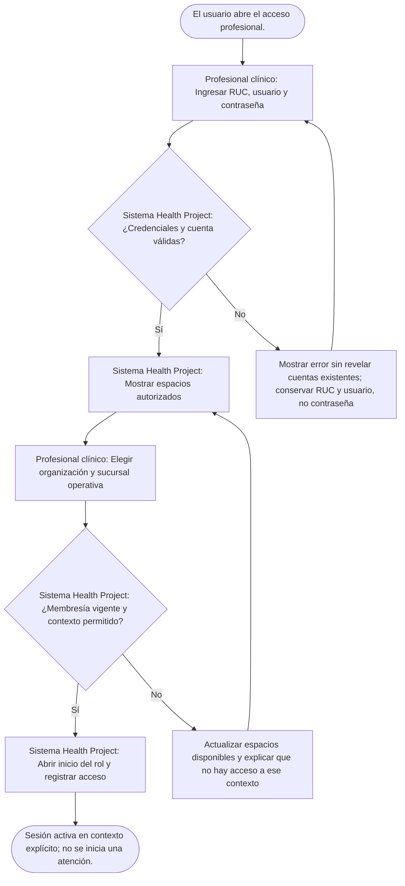

| Desde paso | Condición o alternativa | Respuesta | Resultado |
| --- | --- | --- | --- |
| 2 | No | Mostrar error sin revelar cuentas existentes; conservar RUC y usuario, no contraseña | Retomar paso 1 |
| 5 | No | Actualizar espacios disponibles y explicar que no hay acceso a ese contexto | Retomar paso 3 |

**Final de la ruta principal:** Sesión activa en contexto explícito; no se inicia una atención.

**Pantallas relacionadas:** S01, S03, S17.

**Acciones propuestas:** Ingresar, Elegir espacio, Continuar.

**Continuaciones posibles:** [F02](#f02), [F03](#f03).

**Criterio de diseño:** debe poder recorrerse hasta ese final y hasta cada alternativa documentada, manteniendo estados reales y responsables. [Diagrama independiente](diagramas/F01.mmd).

<a id="f02"></a>
## F02. Cambiar organización o sucursal

**Dominio:** Acceso y organización. **Etapa:** Consulta externa y portal.

**Actores:** Profesional clínico, Recepción, Administrador de la organización, Sistema Health Project.

**Inicio:** El usuario selecciona el contexto visible en la cabecera.

**Precondiciones:** Sesión activa y membresías vigentes.

| Paso | Actor | Acción o decisión |
| --- | --- | --- |
| 1 | Profesional clínico | Solicitar cambio de espacio o sucursal |
| 2 | Sistema Health Project | ¿Hay cambios sin guardar? |
| 3 | Profesional clínico | Guardar borrador o descartar cambios locales expresamente |
| 4 | Sistema Health Project | Validar pertenencia al contexto destino |
| 5 | Sistema Health Project | ¿Contexto autorizado? |
| 6 | Sistema Health Project | Vaciar vistas del contexto anterior y abrir el destino |

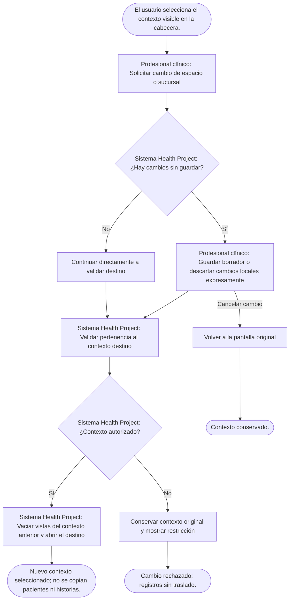

| Desde paso | Condición o alternativa | Respuesta | Resultado |
| --- | --- | --- | --- |
| 2 | No | Continuar directamente a validar destino | Retomar paso 4 |
| 5 | No | Conservar contexto original y mostrar restricción | Cambio rechazado; registros sin traslado. |
| 3 | Cancelar cambio | Volver a la pantalla original | Contexto conservado. |

**Final de la ruta principal:** Nuevo contexto seleccionado; no se copian pacientes ni historias.

**Pantallas relacionadas:** S03, S18.

**Acciones propuestas:** Cambiar espacio, Cambiar sucursal, Guardar y cambiar, Descartar cambios locales, Seguir aquí.

**Continuaciones posibles:** [F15](#f15).

**Criterio de diseño:** debe poder recorrerse hasta ese final y hasta cada alternativa documentada, manteniendo estados reales y responsables. [Diagrama independiente](diagramas/F02.mmd).

<a id="f03"></a>
## F03. Recuperar acceso

**Dominio:** Acceso y organización. **Etapa:** Consulta externa y portal.

**Actores:** Profesional clínico, Recepción, Administrador de la organización, Asistente o enfermería, Equipo de diagnóstico, Farmacia, Caja y administración financiera, Compras y almacén, Auditor autorizado, Paciente humano, Representante o responsable, Sistema Health Project.

**Inicio:** El usuario selecciona recuperación de cuenta.

**Precondiciones:** Canal de recuperación previamente vinculado.

| Paso | Actor | Acción o decisión |
| --- | --- | --- |
| 1 | Profesional clínico | Indicar identificador y canal de recuperación |
| 2 | Sistema Health Project | Responder de forma uniforme y enviar enlace si corresponde |
| 3 | Profesional clínico | Abrir enlace recibido |
| 4 | Sistema Health Project | ¿Enlace válido, vigente y sin usar? |
| 5 | Profesional clínico | Definir nueva contraseña según política visible |
| 6 | Sistema Health Project | Guardar cambio, invalidar enlace y aplicar revocación de sesiones definida |

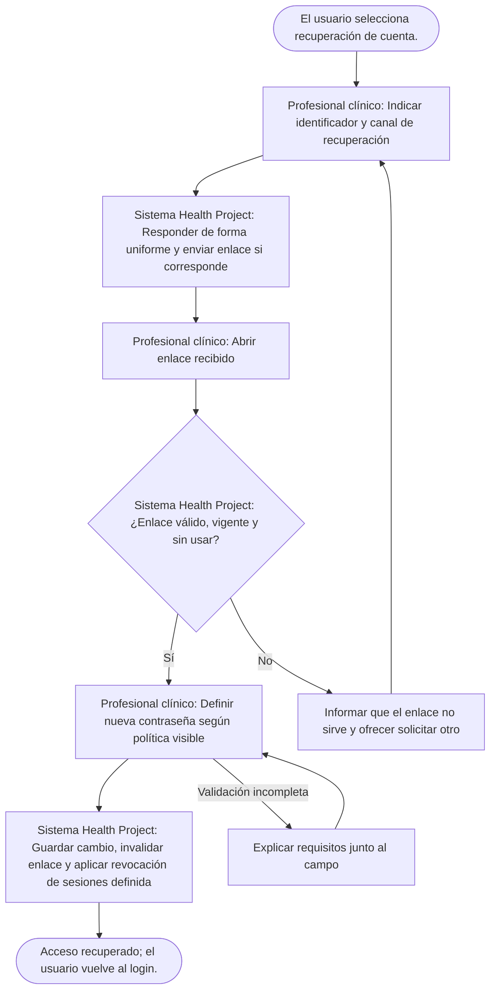

| Desde paso | Condición o alternativa | Respuesta | Resultado |
| --- | --- | --- | --- |
| 4 | No | Informar que el enlace no sirve y ofrecer solicitar otro | Retomar paso 1 |
| 5 | Validación incompleta | Explicar requisitos junto al campo | Retomar paso 5 |

**Final de la ruta principal:** Acceso recuperado; el usuario vuelve al login.

**Pantallas relacionadas:** S01, S02, S04.

**Acciones propuestas:** Recuperar acceso, Enviar enlace, Guardar nueva contraseña, Volver al acceso.

**Continuaciones posibles:** [F01](#f01), [F70](#f70).

**Criterio de diseño:** debe poder recorrerse hasta ese final y hasta cada alternativa documentada, manteniendo estados reales y responsables. [Diagrama independiente](diagramas/F03.mmd).

<a id="f04"></a>
## F04. Reanudar trabajo tras expiración o fallo de guardado

**Dominio:** Acceso y organización. **Etapa:** Transversal; profundidad según release.

**Actores:** Profesional clínico, Recepción, Administrador de la organización, Asistente o enfermería, Equipo de diagnóstico, Farmacia, Caja y administración financiera, Compras y almacén, Auditor autorizado, Sistema Health Project.

**Inicio:** La sesión caduca o la aplicación no recibe confirmación de guardado.

**Precondiciones:** El usuario trabaja sobre una revisión identificada.

| Paso | Actor | Acción o decisión |
| --- | --- | --- |
| 1 | Sistema Health Project | Mostrar estado real: pendiente de guardar o sesión vencida |
| 2 | Profesional clínico | Reautenticarse o reintentar según causa |
| 3 | Sistema Health Project | Verificar si la operación anterior ya quedó confirmada |
| 4 | Sistema Health Project | ¿El servidor contiene una revisión posterior? |
| 5 | Profesional clínico | Comparar versiones y resolver conflicto sin sobrescribir |
| 6 | Sistema Health Project | Confirmar revisión guardada y devolver al trabajo permitido |

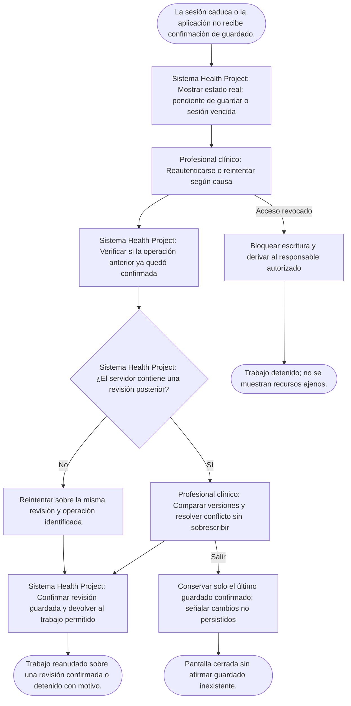

| Desde paso | Condición o alternativa | Respuesta | Resultado |
| --- | --- | --- | --- |
| 4 | No | Reintentar sobre la misma revisión y operación identificada | Retomar paso 6 |
| 2 | Acceso revocado | Bloquear escritura y derivar al responsable autorizado | Trabajo detenido; no se muestran recursos ajenos. |
| 5 | Salir | Conservar solo el último guardado confirmado; señalar cambios no persistidos | Pantalla cerrada sin afirmar guardado inexistente. |

**Final de la ruta principal:** Trabajo reanudado sobre una revisión confirmada o detenido con motivo.

**Pantallas relacionadas:** S01, S18.

**Acciones propuestas:** Volver a ingresar, Reintentar, Comparar versiones, Guardar revisión resuelta, Salir.

**Continuaciones posibles:** [F01](#f01), [F21](#f21).

**Criterio de diseño:** debe poder recorrerse hasta ese final y hasta cada alternativa documentada, manteniendo estados reales y responsables. [Diagrama independiente](diagramas/F04.mmd).

<a id="f05"></a>
## F05. Dar de alta y configurar una organización

**Dominio:** Acceso y organización. **Etapa:** Consulta externa y portal.

**Actores:** Administrador de la organización, Operador o soporte de MAVRIC, Sistema Health Project.

**Inicio:** Se crea un espacio nuevo para clínica o profesional independiente.

**Precondiciones:** Responsable verificado y condiciones de contratación definidas.

| Paso | Actor | Acción o decisión |
| --- | --- | --- |
| 1 | Administrador de la organización | Registrar organización, vertical y emisor autorizado |
| 2 | Sistema Health Project | ¿Datos de identidad y registro consistentes? |
| 3 | Administrador de la organización | Crear sucursales o sucursal lógica personal |
| 4 | Administrador de la organización | Configurar horarios, recursos y especialidades |
| 5 | Administrador de la organización | Invitar profesionales y revisar configuración mínima |
| 6 | Sistema Health Project | ¿Configuración mínima completa? |
| 7 | Sistema Health Project | Activar espacio y mostrar tareas pendientes |

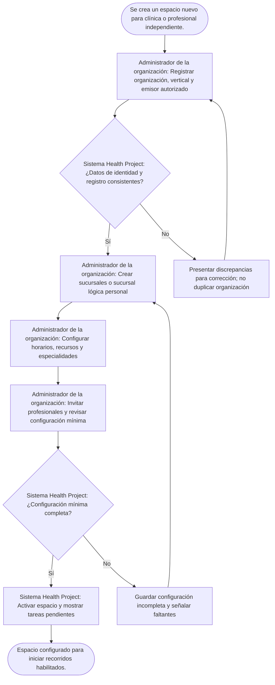

| Desde paso | Condición o alternativa | Respuesta | Resultado |
| --- | --- | --- | --- |
| 2 | No | Presentar discrepancias para corrección; no duplicar organización | Retomar paso 1 |
| 6 | No | Guardar configuración incompleta y señalar faltantes | Retomar paso 3 |

**Final de la ruta principal:** Espacio configurado para iniciar recorridos habilitados.

**Pantallas relacionadas:** S05, S06, S07, S08, S55.

**Acciones propuestas:** Crear organización, Guardar y continuar, Añadir sucursal, Invitar equipo, Activar espacio.

**Continuaciones posibles:** [F06](#f06), [F08](#f08), [F09](#f09).

**Criterio de diseño:** debe poder recorrerse hasta ese final y hasta cada alternativa documentada, manteniendo estados reales y responsables. [Diagrama independiente](diagramas/F05.mmd).

<a id="f06"></a>
## F06. Invitar y asignar a un profesional

**Dominio:** Acceso y organización. **Etapa:** Consulta externa y portal.

**Actores:** Administrador de la organización, Profesional clínico, Sistema Health Project.

**Inicio:** Un administrador invita a un profesional a su organización.

**Precondiciones:** Administrador con permiso para gestionar equipo.

| Paso | Actor | Acción o decisión |
| --- | --- | --- |
| 1 | Administrador de la organización | Elegir profesional o enviar invitación a identidad verificable |
| 2 | Administrador de la organización | Asignar rol, sucursales, especialidades y alcance |
| 3 | Profesional clínico | Aceptar invitación e iniciar o crear su cuenta |
| 4 | Sistema Health Project | ¿Invitación válida y destinatario verificado? |
| 5 | Administrador de la organización | Registrar evidencias y estado de revisión de credenciales |
| 6 | Sistema Health Project | Activar membresía y funciones que correspondan |

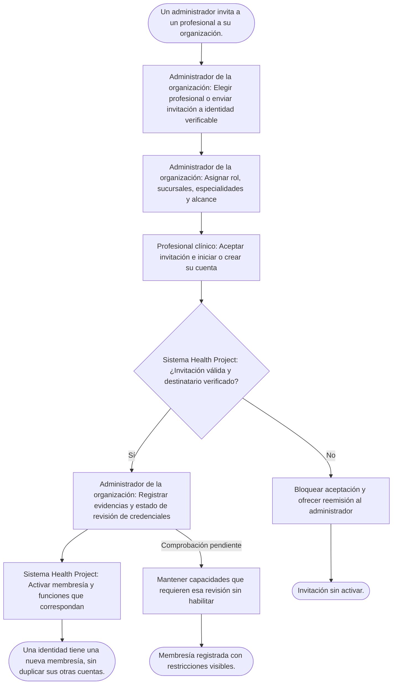

| Desde paso | Condición o alternativa | Respuesta | Resultado |
| --- | --- | --- | --- |
| 4 | No | Bloquear aceptación y ofrecer reemisión al administrador | Invitación sin activar. |
| 5 | Comprobación pendiente | Mantener capacidades que requieren esa revisión sin habilitar | Membresía registrada con restricciones visibles. |

**Final de la ruta principal:** Una identidad tiene una nueva membresía, sin duplicar sus otras cuentas.

**Pantallas relacionadas:** S06, S04.

**Acciones propuestas:** Invitar profesional, Aceptar invitación, Revisar credenciales, Activar membresía, Reenviar invitación.

**Continuaciones posibles:** [F01](#f01), [F07](#f07).

**Criterio de diseño:** debe poder recorrerse hasta ese final y hasta cada alternativa documentada, manteniendo estados reales y responsables. [Diagrama independiente](diagramas/F06.mmd).

<a id="f07"></a>
## F07. Cambiar permisos o revocar membresía

**Dominio:** Acceso y organización. **Etapa:** Consulta externa y portal.

**Actores:** Administrador de la organización, Sistema Health Project.

**Inicio:** Se modifica una función, sucursal o continuidad de un miembro.

**Precondiciones:** Actor autorizado para gestionar permisos.

| Paso | Actor | Acción o decisión |
| --- | --- | --- |
| 1 | Administrador de la organización | Seleccionar miembro y revisar permisos actuales |
| 2 | Administrador de la organización | Proponer cambios y motivo |
| 3 | Sistema Health Project | Mostrar recursos y tareas afectadas |
| 4 | Administrador de la organización | Confirmar cambio o revocación |
| 5 | Sistema Health Project | Revalidar autorización y aplicar cambio |
| 6 | Sistema Health Project | Revocar acceso correspondiente y reasignar pendientes a responsable |

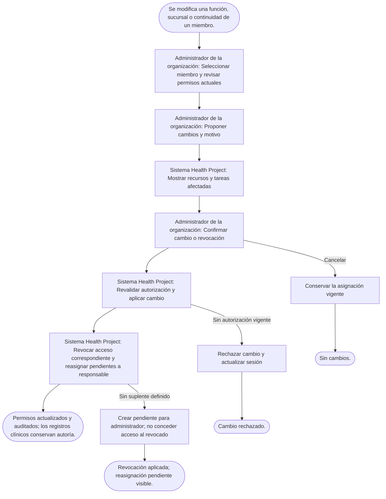

| Desde paso | Condición o alternativa | Respuesta | Resultado |
| --- | --- | --- | --- |
| 4 | Cancelar | Conservar la asignación vigente | Sin cambios. |
| 5 | Sin autorización vigente | Rechazar cambio y actualizar sesión | Cambio rechazado. |
| 6 | Sin suplente definido | Crear pendiente para administrador; no conceder acceso al revocado | Revocación aplicada; reasignación pendiente visible. |

**Final de la ruta principal:** Permisos actualizados y auditados; los registros clínicos conservan autoría.

**Pantallas relacionadas:** S06, S50.

**Acciones propuestas:** Editar permisos, Ver impacto, Guardar cambios, Revocar membresía, Asignar suplente.

**Continuaciones posibles:** [F34](#f34), [F65](#f65).

**Criterio de diseño:** debe poder recorrerse hasta ese final y hasta cada alternativa documentada, manteniendo estados reales y responsables. [Diagrama independiente](diagramas/F07.mmd).

<a id="f08"></a>
## F08. Diseñar, publicar y habilitar una plantilla de especialidad

**Dominio:** Acceso y organización. **Etapa:** Transversal; profundidad según release.

**Actores:** Administrador de la organización, Profesional clínico, Sistema Health Project.

**Inicio:** Se incorpora o cambia un paquete de especialidad.

**Precondiciones:** Catálogo existente; autor y revisor de plantilla asignados.

| Paso | Actor | Acción o decisión |
| --- | --- | --- |
| 1 | Administrador de la organización | Crear versión en borrador de campos, componentes y reglas |
| 2 | Profesional clínico | Revisar casos de uso y pruebas de captura |
| 3 | Sistema Health Project | ¿Componentes y reglas obligatorios disponibles y validados? |
| 4 | Administrador de la organización | Publicar versión y registrar revisión |
| 5 | Administrador de la organización | Habilitar paquete para organización, sucursales y profesionales autorizados |
| 6 | Sistema Health Project | Mantener versiones anteriores para atenciones históricas |

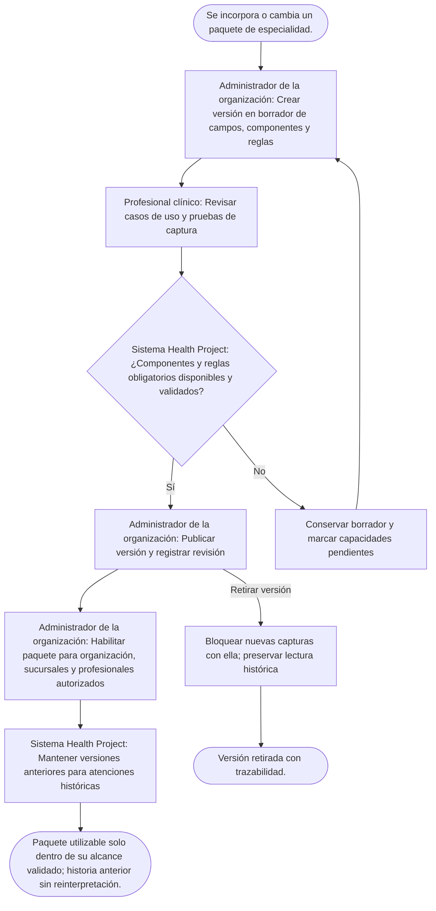

| Desde paso | Condición o alternativa | Respuesta | Resultado |
| --- | --- | --- | --- |
| 3 | No | Conservar borrador y marcar capacidades pendientes | Retomar paso 1 |
| 4 | Retirar versión | Bloquear nuevas capturas con ella; preservar lectura histórica | Versión retirada con trazabilidad. |

**Final de la ruta principal:** Paquete utilizable solo dentro de su alcance validado; historia anterior sin reinterpretación.

**Pantallas relacionadas:** S08.

**Acciones propuestas:** Nueva versión, Vista de ejemplo, Enviar a revisión, Publicar versión, Habilitar paquete, Retirar versión.

**Continuaciones posibles:** [F22](#f22), [F23](#f23), [F24](#f24).

**Criterio de diseño:** debe poder recorrerse hasta ese final y hasta cada alternativa documentada, manteniendo estados reales y responsables. [Diagrama independiente](diagramas/F08.mmd).

<a id="f09"></a>
## F09. Definir disponibilidad y recursos de agenda

**Dominio:** Acceso y organización. **Etapa:** Consulta externa y portal.

**Actores:** Administrador de la organización, Profesional clínico, Sistema Health Project.

**Inicio:** Se configura jornada, lugar o recurso reservable.

**Precondiciones:** Contexto y recursos de la organización autorizados.

| Paso | Actor | Acción o decisión |
| --- | --- | --- |
| 1 | Profesional clínico | Elegir sucursal o lugar propio y profesional |
| 2 | Profesional clínico | Definir horario, servicios, duración y excepciones |
| 3 | Administrador de la organización | Asignar consultorio, sillón u otro recurso requerido |
| 4 | Sistema Health Project | ¿Reglas y citas existentes compatibles? |
| 5 | Profesional clínico | Resolver impacto en reservas existentes |
| 6 | Sistema Health Project | Publicar disponibilidad y conservar bloqueos |

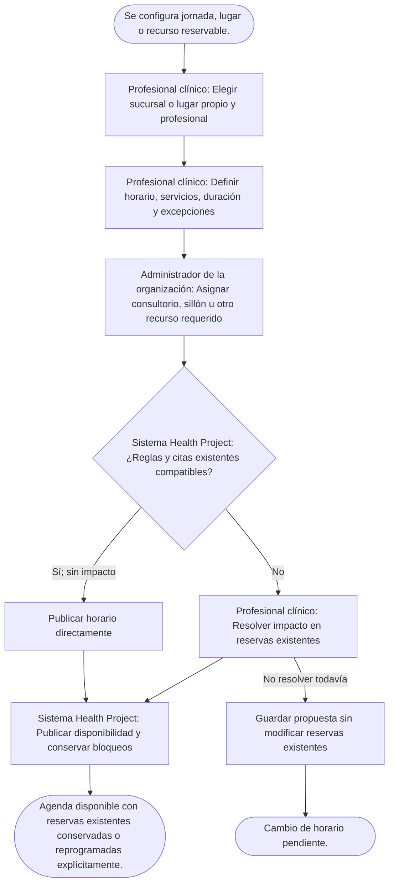

| Desde paso | Condición o alternativa | Respuesta | Resultado |
| --- | --- | --- | --- |
| 4 | Sí; sin impacto | Publicar horario directamente | Retomar paso 6 |
| 5 | No resolver todavía | Guardar propuesta sin modificar reservas existentes | Cambio de horario pendiente. |

**Final de la ruta principal:** Agenda disponible con reservas existentes conservadas o reprogramadas explícitamente.

**Pantallas relacionadas:** S55, S14.

**Acciones propuestas:** Añadir horario, Bloquear intervalo, Añadir recurso, Ver impacto, Publicar disponibilidad.

**Continuaciones posibles:** [F16](#f16), [F18](#f18).

**Criterio de diseño:** debe poder recorrerse hasta ese final y hasta cada alternativa documentada, manteniendo estados reales y responsables. [Diagrama independiente](diagramas/F09.mmd).

<a id="f10"></a>
## F10. Registrar un paciente humano

**Dominio:** Pacientes y responsables. **Etapa:** Consulta externa y portal.

**Actores:** Recepción, Sistema Health Project.

**Inicio:** Recepción necesita registrar o identificar a una persona.

**Precondiciones:** Permiso de registro en la organización.

| Paso | Actor | Acción o decisión |
| --- | --- | --- |
| 1 | Recepción | Buscar por identificador o datos permitidos |
| 2 | Sistema Health Project | ¿Existe paciente o candidato a duplicado? |
| 3 | Recepción | Crear ficha humana con identificador interno si no tiene documento |
| 4 | Recepción | Registrar contactos y representante cuando corresponda |
| 5 | Sistema Health Project | Validar campos, identidad y relaciones |
| 6 | Sistema Health Project | Guardar paciente y acceso al expediente permitido |

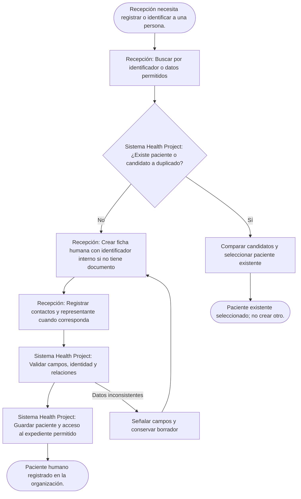

| Desde paso | Condición o alternativa | Respuesta | Resultado |
| --- | --- | --- | --- |
| 2 | Sí | Comparar candidatos y seleccionar paciente existente | Paciente existente seleccionado; no crear otro. |
| 5 | Datos inconsistentes | Señalar campos y conservar borrador | Retomar paso 3 |

**Final de la ruta principal:** Paciente humano registrado en la organización.

**Pantallas relacionadas:** S09, S10.

**Acciones propuestas:** Buscar paciente, Registrar humano, Seleccionar existente, Añadir representante, Guardar paciente.

**Continuaciones posibles:** [F13](#f13), [F16](#f16), [F20](#f20).

**Criterio de diseño:** debe poder recorrerse hasta ese final y hasta cada alternativa documentada, manteniendo estados reales y responsables. [Diagrama independiente](diagramas/F10.mmd).

<a id="f11"></a>
## F11. Registrar un animal y sus responsables

**Dominio:** Pacientes y responsables. **Etapa:** Consulta externa y portal.

**Actores:** Recepción, Representante o responsable, Sistema Health Project.

**Inicio:** Se registra un animal para atención veterinaria.

**Precondiciones:** Organización habilitada para atención veterinaria.

| Paso | Actor | Acción o decisión |
| --- | --- | --- |
| 1 | Recepción | Buscar animal por identificador y responsable sin exigir microchip |
| 2 | Sistema Health Project | ¿Existe animal coincidente verificado? |
| 3 | Recepción | Registrar especie, perfil, nacimiento conocido o estimado |
| 4 | Representante o responsable | Aportar datos y facultades del responsable, contacto y pagador |
| 5 | Recepción | Verificar relaciones y preferencias de contacto |
| 6 | Sistema Health Project | Guardar animal y relaciones con vigencia |

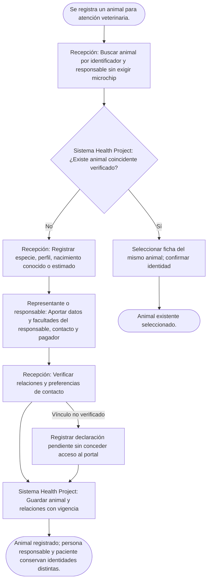

| Desde paso | Condición o alternativa | Respuesta | Resultado |
| --- | --- | --- | --- |
| 2 | Sí | Seleccionar ficha del mismo animal; confirmar identidad | Animal existente seleccionado. |
| 5 | Vínculo no verificado | Registrar declaración pendiente sin conceder acceso al portal | Retomar paso 6 |

**Final de la ruta principal:** Animal registrado; persona responsable y paciente conservan identidades distintas.

**Pantallas relacionadas:** S09, S11.

**Acciones propuestas:** Registrar animal, Buscar responsable, Añadir responsable, Guardar animal, Enviar verificación.

**Continuaciones posibles:** [F12](#f12), [F16](#f16), [F39](#f39).

**Criterio de diseño:** debe poder recorrerse hasta ese final y hasta cada alternativa documentada, manteniendo estados reales y responsables. [Diagrama independiente](diagramas/F11.mmd).

<a id="f12"></a>
## F12. Actualizar o revocar una relación de responsable

**Dominio:** Pacientes y responsables. **Etapa:** Consulta externa y portal.

**Actores:** Recepción, Administrador de la organización, Representante o responsable, Sistema Health Project, Paciente humano.

**Inicio:** Cambia un tutor, representante, contacto o autorización.

**Precondiciones:** Actor con permiso de verificar y gestionar relaciones.

| Paso | Actor | Acción o decisión |
| --- | --- | --- |
| 1 | Recepción | Identificar paciente y relación vigente |
| 2 | Recepción | Registrar solicitud y evidencia del cambio |
| 3 | Administrador de la organización | Definir alcance, vigencia y contenido permitido |
| 4 | Sistema Health Project | ¿Verificación suficiente según política aplicable? |
| 5 | Administrador de la organización | Confirmar nueva relación o revocación |
| 6 | Sistema Health Project | Actualizar accesos, publicaciones y pendientes afectados; conservar historia |

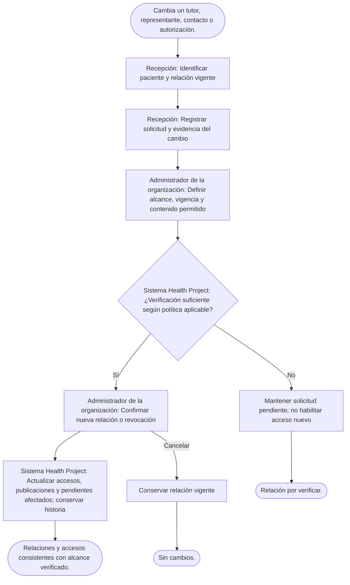

| Desde paso | Condición o alternativa | Respuesta | Resultado |
| --- | --- | --- | --- |
| 4 | No | Mantener solicitud pendiente; no habilitar acceso nuevo | Relación por verificar. |
| 5 | Cancelar | Conservar relación vigente | Sin cambios. |

**Final de la ruta principal:** Relaciones y accesos consistentes con alcance verificado.

**Pantallas relacionadas:** S10, S11, S32.

**Acciones propuestas:** Editar relación, Verificar relación, Establecer vigencia, Revocar acceso, Confirmar cambio, Solicitar revocación.

**Continuaciones posibles:** [F39](#f39), [F71](#f71).

**Criterio de diseño:** debe poder recorrerse hasta ese final y hasta cada alternativa documentada, manteniendo estados reales y responsables. [Diagrama independiente](diagramas/F12.mmd).

<a id="f13"></a>
## F13. Revisar y fusionar pacientes duplicados

**Dominio:** Pacientes y responsables. **Etapa:** Transversal; profundidad según release.

**Actores:** Administrador de la organización, Profesional clínico, Sistema Health Project.

**Inicio:** Se detectan dos fichas posiblemente del mismo paciente.

**Precondiciones:** Mismo tenant; permiso especial de revisión de identidad.

| Paso | Actor | Acción o decisión |
| --- | --- | --- |
| 1 | Administrador de la organización | Seleccionar candidatos y comparar evidencias |
| 2 | Profesional clínico | Revisar discrepancias clínicas cuando corresponda |
| 3 | Sistema Health Project | ¿Identidad suficientemente confirmada? |
| 4 | Administrador de la organización | Seleccionar ficha conservada y revisar impacto |
| 5 | Administrador de la organización | Confirmar fusión con motivo |
| 6 | Sistema Health Project | Reasociar referencias permitidas y conservar IDs, originales y auditoría |

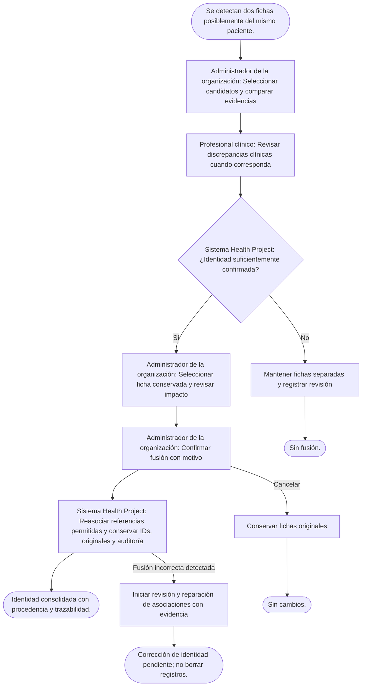

| Desde paso | Condición o alternativa | Respuesta | Resultado |
| --- | --- | --- | --- |
| 3 | No | Mantener fichas separadas y registrar revisión | Sin fusión. |
| 5 | Cancelar | Conservar fichas originales | Sin cambios. |
| 6 | Fusión incorrecta detectada | Iniciar revisión y reparación de asociaciones con evidencia | Corrección de identidad pendiente; no borrar registros. |

**Final de la ruta principal:** Identidad consolidada con procedencia y trazabilidad.

**Pantallas relacionadas:** S12, S19.

**Acciones propuestas:** Comparar fichas, Elegir ficha conservada, Ver impacto, Confirmar fusión, Solicitar corrección.

**Continuaciones posibles:** [F15](#f15), [F65](#f65).

**Criterio de diseño:** debe poder recorrerse hasta ese final y hasta cada alternativa documentada, manteniendo estados reales y responsables. [Diagrama independiente](diagramas/F13.mmd).

<a id="f14"></a>
## F14. Registrar población animal y pertenencias

**Dominio:** Pacientes y responsables. **Etapa:** Capacidades especializadas avanzadas.

**Actores:** Profesional clínico, Recepción, Sistema Health Project.

**Inicio:** Se atiende un rebaño, lote, colonia o grupo.

**Precondiciones:** Capacidad poblacional implementada y permisos correspondientes.

| Paso | Actor | Acción o decisión |
| --- | --- | --- |
| 1 | Profesional clínico | Crear población con tipo, contexto y responsable |
| 2 | Recepción | Registrar individuos o denominador cuando aplique |
| 3 | Profesional clínico | Definir pertenencias con intervalo y procedencia |
| 4 | Sistema Health Project | ¿Sujetos y períodos consistentes? |
| 5 | Profesional clínico | Registrar ingreso, traslado o baja de miembros |
| 6 | Sistema Health Project | Guardar historial poblacional e individual sin mezclarlos |

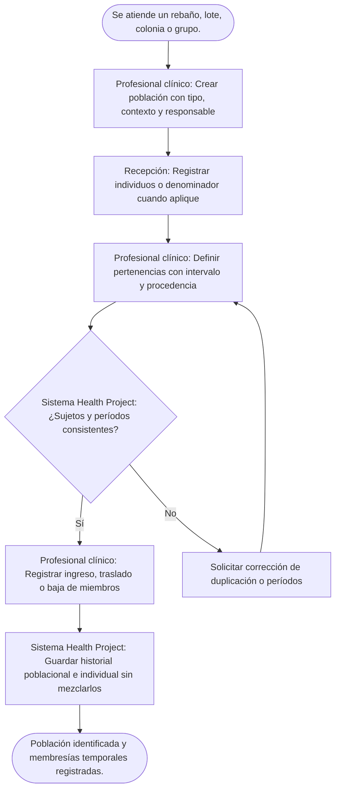

| Desde paso | Condición o alternativa | Respuesta | Resultado |
| --- | --- | --- | --- |
| 4 | No | Solicitar corrección de duplicación o períodos | Retomar paso 3 |

**Final de la ruta principal:** Población identificada y membresías temporales registradas.

**Pantallas relacionadas:** S13, S47.

**Acciones propuestas:** Crear población, Añadir individuo, Registrar traslado, Registrar baja, Guardar pertenencias.

**Continuaciones posibles:** [F60](#f60).

**Criterio de diseño:** debe poder recorrerse hasta ese final y hasta cada alternativa documentada, manteniendo estados reales y responsables. [Diagrama independiente](diagramas/F14.mmd).

<a id="f15"></a>
## F15. Buscar paciente y abrir historia compartida

**Dominio:** Pacientes y responsables. **Etapa:** Consulta externa y portal.

**Actores:** Profesional clínico, Recepción, Sistema Health Project.

**Inicio:** Un actor busca un paciente para una operación permitida.

**Precondiciones:** Contexto de organización confirmado.

| Paso | Actor | Acción o decisión |
| --- | --- | --- |
| 1 | Profesional clínico | Buscar paciente en la organización |
| 2 | Sistema Health Project | Mostrar coincidencias según permiso administrativo |
| 3 | Profesional clínico | Seleccionar paciente y solicitar historia |
| 4 | Sistema Health Project | ¿Permiso clínico y alcance de contenido suficientes? |
| 5 | Sistema Health Project | Mostrar historia de sucursales autorizadas con procedencia y restricciones |
| 6 | Sistema Health Project | Registrar acceso auditado |

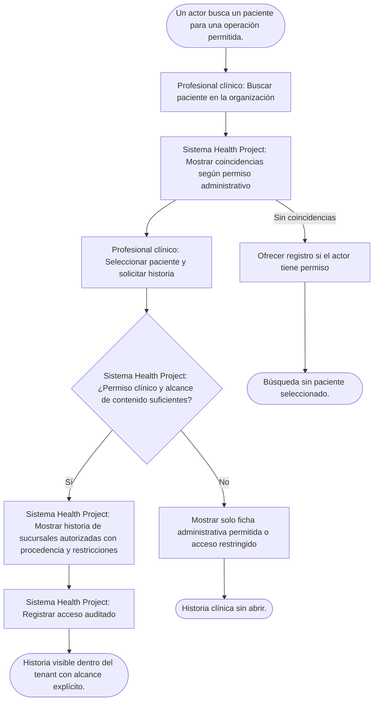

| Desde paso | Condición o alternativa | Respuesta | Resultado |
| --- | --- | --- | --- |
| 4 | No | Mostrar solo ficha administrativa permitida o acceso restringido | Historia clínica sin abrir. |
| 2 | Sin coincidencias | Ofrecer registro si el actor tiene permiso | Búsqueda sin paciente seleccionado. |

**Final de la ruta principal:** Historia visible dentro del tenant con alcance explícito.

**Pantallas relacionadas:** S09, S10, S11, S19.

**Acciones propuestas:** Buscar, Abrir ficha, Ver historia, Filtrar por fecha, Ver procedencia.

**Continuaciones posibles:** [F10](#f10), [F11](#f11), [F21](#f21).

**Criterio de diseño:** debe poder recorrerse hasta ese final y hasta cada alternativa documentada, manteniendo estados reales y responsables. [Diagrama independiente](diagramas/F15.mmd).

<a id="f16"></a>
## F16. Reservar una cita desde la clínica

**Dominio:** Agenda y recepción. **Etapa:** Consulta externa y portal.

**Actores:** Recepción, Profesional clínico, Sistema Health Project.

**Inicio:** Recepción o profesional agenda una atención.

**Precondiciones:** Paciente identificado y agenda publicada.

| Paso | Actor | Acción o decisión |
| --- | --- | --- |
| 1 | Recepción | Seleccionar paciente, servicio, sucursal y profesional |
| 2 | Sistema Health Project | Presentar horarios y recursos compatibles |
| 3 | Recepción | Elegir intervalo y datos mínimos de la cita |
| 4 | Sistema Health Project | ¿Disponibilidad vigente y recursos libres? |
| 5 | Sistema Health Project | Confirmar reserva sin duplicarla |
| 6 | Sistema Health Project | Mostrar comprobante de cita y notificación según preferencias |

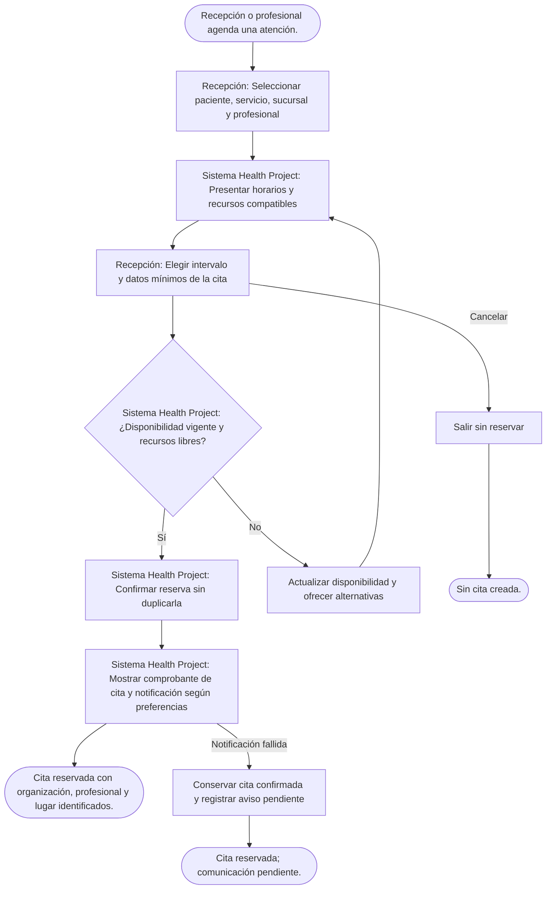

| Desde paso | Condición o alternativa | Respuesta | Resultado |
| --- | --- | --- | --- |
| 4 | No | Actualizar disponibilidad y ofrecer alternativas | Retomar paso 2 |
| 3 | Cancelar | Salir sin reservar | Sin cita creada. |
| 6 | Notificación fallida | Conservar cita confirmada y registrar aviso pendiente | Cita reservada; comunicación pendiente. |

**Final de la ruta principal:** Cita reservada con organización, profesional y lugar identificados.

**Pantallas relacionadas:** S14, S09.

**Acciones propuestas:** Nueva cita, Ver disponibilidad, Reservar cita, Ver confirmación, Enviar recordatorio.

**Continuaciones posibles:** [F18](#f18), [F20](#f20).

**Criterio de diseño:** debe poder recorrerse hasta ese final y hasta cada alternativa documentada, manteniendo estados reales y responsables. [Diagrama independiente](diagramas/F16.mmd).

<a id="f17"></a>
## F17. Solicitar una cita desde el portal

**Dominio:** Agenda y recepción. **Etapa:** Consulta externa y portal.

**Actores:** Paciente humano, Representante o responsable, Recepción, Sistema Health Project.

**Inicio:** Paciente o responsable solicita atención en el portal.

**Precondiciones:** Cuenta y vínculo verificados; agenda pública habilitada.

| Paso | Actor | Acción o decisión |
| --- | --- | --- |
| 1 | Paciente humano | Elegir paciente o animal autorizado y organización |
| 2 | Paciente humano | Seleccionar servicio, sede y preferencias |
| 3 | Sistema Health Project | Mostrar intervalos publicables |
| 4 | Paciente humano | Solicitar intervalo disponible |
| 5 | Sistema Health Project | ¿La política permite confirmación automática? |
| 6 | Recepción | Revisar solicitud y confirmar intervalo autorizado |
| 7 | Sistema Health Project | Publicar estado real y notificar al solicitante |

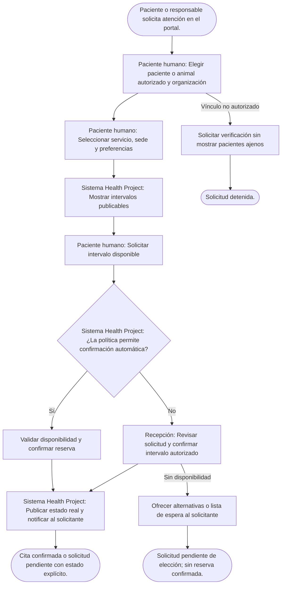

| Desde paso | Condición o alternativa | Respuesta | Resultado |
| --- | --- | --- | --- |
| 5 | Sí | Validar disponibilidad y confirmar reserva | Retomar paso 7 |
| 6 | Sin disponibilidad | Ofrecer alternativas o lista de espera al solicitante | Solicitud pendiente de elección; sin reserva confirmada. |
| 1 | Vínculo no autorizado | Solicitar verificación sin mostrar pacientes ajenos | Solicitud detenida. |

**Final de la ruta principal:** Cita confirmada o solicitud pendiente con estado explícito.

**Pantallas relacionadas:** S29, S30, S15.

**Acciones propuestas:** Solicitar cita, Elegir paciente, Ver horarios, Enviar solicitud, Aceptar alternativa.

**Continuaciones posibles:** [F18](#f18), [F19](#f19), [F39](#f39).

**Criterio de diseño:** debe poder recorrerse hasta ese final y hasta cada alternativa documentada, manteniendo estados reales y responsables. [Diagrama independiente](diagramas/F17.mmd).

<a id="f18"></a>
## F18. Confirmar, reprogramar o cancelar una cita

**Dominio:** Agenda y recepción. **Etapa:** Consulta externa y portal.

**Actores:** Recepción, Paciente humano, Representante o responsable, Profesional clínico, Sistema Health Project.

**Inicio:** Un actor autorizado solicita modificar una reserva.

**Precondiciones:** Cita vigente y política de cambios visible.

| Paso | Actor | Acción o decisión |
| --- | --- | --- |
| 1 | Recepción | Abrir cita y elegir confirmar, reprogramar o cancelar |
| 2 | Sistema Health Project | ¿Acción permitida por estado y rol? |
| 3 | Recepción | Indicar nueva fecha o motivo según operación |
| 4 | Sistema Health Project | Mostrar impacto y validar nuevo intervalo cuando aplique |
| 5 | Recepción | Confirmar modificación |
| 6 | Sistema Health Project | Aplicar cambio, conservar anterior, actualizar recursos y avisos |

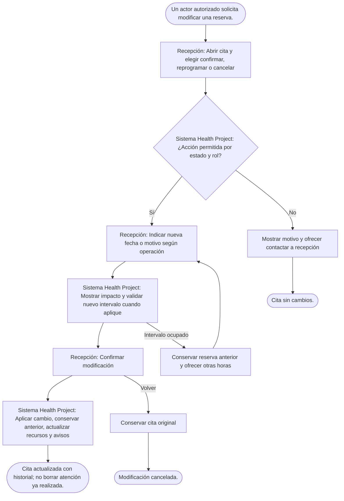

| Desde paso | Condición o alternativa | Respuesta | Resultado |
| --- | --- | --- | --- |
| 2 | No | Mostrar motivo y ofrecer contactar a recepción | Cita sin cambios. |
| 4 | Intervalo ocupado | Conservar reserva anterior y ofrecer otras horas | Retomar paso 3 |
| 5 | Volver | Conservar cita original | Modificación cancelada. |

**Final de la ruta principal:** Cita actualizada con historial; no borrar atención ya realizada.

**Pantallas relacionadas:** S14, S30.

**Acciones propuestas:** Confirmar asistencia, Reprogramar, Cancelar cita, Guardar cambio, Conservar cita.

**Continuaciones posibles:** [F19](#f19), [F20](#f20).

**Criterio de diseño:** debe poder recorrerse hasta ese final y hasta cada alternativa documentada, manteniendo estados reales y responsables. [Diagrama independiente](diagramas/F18.mmd).

<a id="f19"></a>
## F19. Gestionar lista de espera

**Dominio:** Agenda y recepción. **Etapa:** Consulta externa y portal.

**Actores:** Recepción, Paciente humano, Representante o responsable, Sistema Health Project.

**Inicio:** No hay horario o se libera un intervalo.

**Precondiciones:** Preferencias y canales de contacto registrados.

| Paso | Actor | Acción o decisión |
| --- | --- | --- |
| 1 | Recepción | Registrar solicitud y preferencias de espera |
| 2 | Sistema Health Project | Detectar intervalo compatible sin prometer reserva |
| 3 | Recepción | Ofrecer intervalo con vigencia configurada |
| 4 | Paciente humano | Aceptar o rechazar oferta |
| 5 | Sistema Health Project | ¿Oferta vigente y recurso disponible? |
| 6 | Sistema Health Project | Confirmar cita y retirar solicitud cumplida |

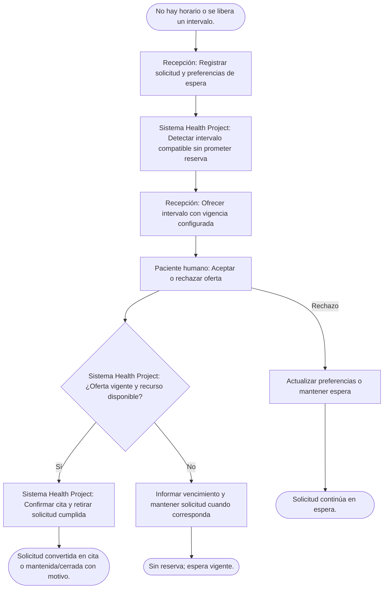

| Desde paso | Condición o alternativa | Respuesta | Resultado |
| --- | --- | --- | --- |
| 4 | Rechazo | Actualizar preferencias o mantener espera | Solicitud continúa en espera. |
| 5 | No | Informar vencimiento y mantener solicitud cuando corresponda | Sin reserva; espera vigente. |

**Final de la ruta principal:** Solicitud convertida en cita o mantenida/cerrada con motivo.

**Pantallas relacionadas:** S15, S30.

**Acciones propuestas:** Añadir a espera, Ofrecer intervalo, Aceptar oferta, Rechazar oferta, Salir de espera.

**Continuaciones posibles:** [F16](#f16), [F18](#f18).

**Criterio de diseño:** debe poder recorrerse hasta ese final y hasta cada alternativa documentada, manteniendo estados reales y responsables. [Diagrama independiente](diagramas/F19.mmd).

<a id="f20"></a>
## F20. Registrar llegada, cola y atención sin cita

**Dominio:** Agenda y recepción. **Etapa:** Consulta externa y portal.

**Actores:** Recepción, Asistente o enfermería, Profesional clínico, Sistema Health Project.

**Inicio:** El paciente llega a la clínica con o sin reserva.

**Precondiciones:** Sucursal operativa y paciente confirmado.

| Paso | Actor | Acción o decisión |
| --- | --- | --- |
| 1 | Recepción | Identificar paciente y cita si existe |
| 2 | Sistema Health Project | ¿Qué tipo de ingreso corresponde? |
| 3 | Recepción | Registrar llegada o ingreso directo con motivo administrativo mínimo |
| 4 | Sistema Health Project | Añadir a cola correspondiente sin duplicar ingreso |
| 5 | Asistente o enfermería | Preparar datos y capturas autorizadas |
| 6 | Profesional clínico | Llamar paciente y confirmar identidad antes de iniciar atención |

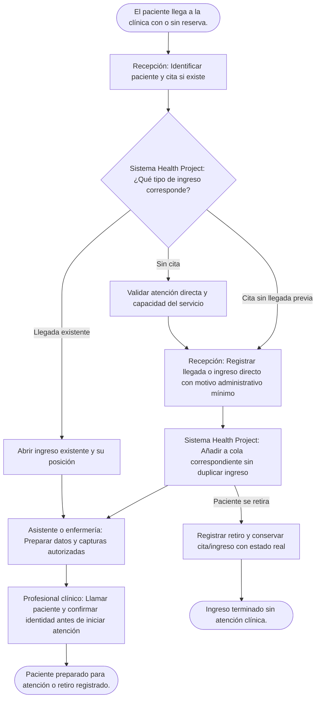

| Desde paso | Condición o alternativa | Respuesta | Resultado |
| --- | --- | --- | --- |
| 2 | Llegada existente | Abrir ingreso existente y su posición | Retomar paso 5 |
| 2 | Sin cita | Validar atención directa y capacidad del servicio | Retomar paso 3 |
| 4 | Paciente se retira | Registrar retiro y conservar cita/ingreso con estado real | Ingreso terminado sin atención clínica. |

**Final de la ruta principal:** Paciente preparado para atención o retiro registrado.

**Pantallas relacionadas:** S16, S17, S09.

**Acciones propuestas:** Registrar llegada, Ingreso sin cita, Enviar a cola, Llamar paciente, Registrar retiro, Iniciar atención.

**Continuaciones posibles:** [F21](#f21), [F51](#f51).

**Criterio de diseño:** debe poder recorrerse hasta ese final y hasta cada alternativa documentada, manteniendo estados reales y responsables. [Diagrama independiente](diagramas/F20.mmd).

<a id="f21"></a>
## F21. Realizar una consulta y finalizar la visita

**Dominio:** Atención y expediente. **Etapa:** Consulta externa y portal.

**Actores:** Profesional clínico, Asistente o enfermería, Sistema Health Project.

**Inicio:** El profesional inicia una consulta desde agenda o recepción.

**Precondiciones:** Paciente/contexto confirmados; permiso asistencial y paquete apropiado.

| Paso | Actor | Acción o decisión |
| --- | --- | --- |
| 1 | Profesional clínico | Confirmar paciente, organización, sucursal y lugar |
| 2 | Sistema Health Project | ¿Puede iniciar atención sobre este expediente? |
| 3 | Profesional clínico | Revisar antecedentes, problemas y datos visibles de otras sedes |
| 4 | Profesional clínico | Registrar motivo, exploración, formularios y gráficos |
| 5 | Profesional clínico | Crear diagnósticos, procedimientos, órdenes o receta según lo ocurrido |
| 6 | Sistema Health Project | ¿Capturas obligatorias y cierre documental cumplidos? |
| 7 | Profesional clínico | Revisar resumen y finalizar visita con pendientes asignados |
| 8 | Sistema Health Project | Conservar evolución y estados separados de notas, órdenes y episodio |

```mermaid
flowchart TD
    START(["El profesional inicia una consulta desde agenda o recepción."]) --> N1
    N1["Profesional clínico: Confirmar paciente, organización, sucursal y lugar"]
    N2{"Sistema Health Project: ¿Puede iniciar atención sobre este expediente?"}
    N3["Profesional clínico: Revisar antecedentes, problemas y datos visibles de otras sedes"]
    N4["Profesional clínico: Registrar motivo, exploración, formularios y gráficos"]
    N5["Profesional clínico: Crear diagnósticos, procedimientos, órdenes o receta según lo ocurrido"]
    N6{"Sistema Health Project: ¿Capturas obligatorias y cierre documental cumplidos?"}
    N7["Profesional clínico: Revisar resumen y finalizar visita con pendientes asignados"]
    N8["Sistema Health Project: Conservar evolución y estados separados de notas, órdenes y episodio"]
    END(["Visita finalizada; notas y tareas conservan sus estados reales."])
    N1 --> N2
    N2 -->|"Sí"| N3
    N3 --> N4
    N4 --> N5
    N5 --> N6
    N6 -->|"Sí"| N7
    N7 --> N8
    N8 --> END
    N2 -->|"No"| A1["Impedir apertura y mostrar restricción de contexto"]
    A1 --> E1(["Consulta no iniciada."])
    N6 -->|"No"| A2["Mostrar faltantes y conservar borrador"]
    A2 --> N4
    N7 -->|"Interrumpir atención"| A3["Guardar borrador y registrar interrupción con responsable"]
    A3 --> E3(["Atención pendiente de retomar."])
```

| Desde paso | Condición o alternativa | Respuesta | Resultado |
| --- | --- | --- | --- |
| 2 | No | Impedir apertura y mostrar restricción de contexto | Consulta no iniciada. |
| 6 | No | Mostrar faltantes y conservar borrador | Retomar paso 4 |
| 7 | Interrumpir atención | Guardar borrador y registrar interrupción con responsable | Atención pendiente de retomar. |

**Final de la ruta principal:** Visita finalizada; notas y tareas conservan sus estados reales.

**Pantallas relacionadas:** S17, S18, S19.

**Acciones propuestas:** Iniciar atención, Guardar borrador, Revisar resumen, Finalizar visita, Dejar pendiente.

**Continuaciones posibles:** [F22](#f22), [F23](#f23), [F24](#f24), [F27](#f27), [F30](#f30), [F35](#f35), [F41](#f41).

**Criterio de diseño:** debe poder recorrerse hasta ese final y hasta cada alternativa documentada, manteniendo estados reales y responsables. [Diagrama independiente](diagramas/F21.mmd).

<a id="f22"></a>
## F22. Capturar un formulario de especialidad

**Dominio:** Atención y expediente. **Etapa:** Consulta externa y portal.

**Actores:** Profesional clínico, Asistente o enfermería, Sistema Health Project.

**Inicio:** Se abre una sección clínica de la atención.

**Precondiciones:** Atención editable; versión y perfil humano/animal compatibles.

| Paso | Actor | Acción o decisión |
| --- | --- | --- |
| 1 | Sistema Health Project | Cargar versión de plantilla y datos de procedencia explícita |
| 2 | Profesional clínico | Completar campos, unidades y datos ausentes o negados |
| 3 | Sistema Health Project | ¿Reglas del formulario y perfil válidas? |
| 4 | Profesional clínico | Revisar valores y asociaciones a datos clínicos comunes |
| 5 | Sistema Health Project | Guardar borrador y revisión esperada |
| 6 | Sistema Health Project | Mostrar guardado confirmado y valores estructurados relacionados |

```mermaid
flowchart TD
    START(["Se abre una sección clínica de la atención."]) --> N1
    N1["Sistema Health Project: Cargar versión de plantilla y datos de procedencia explícita"]
    N2["Profesional clínico: Completar campos, unidades y datos ausentes o negados"]
    N3{"Sistema Health Project: ¿Reglas del formulario y perfil válidas?"}
    N4["Profesional clínico: Revisar valores y asociaciones a datos clínicos comunes"]
    N5["Sistema Health Project: Guardar borrador y revisión esperada"]
    N6["Sistema Health Project: Mostrar guardado confirmado y valores estructurados relacionados"]
    END(["Captura versionada vinculada a atención, sin firma automática."])
    N1 --> N2
    N2 --> N3
    N3 -->|"Sí"| N4
    N4 --> N5
    N5 --> N6
    N6 --> END
    N3 -->|"No"| A1["Marcar campos y explicar corrección sin borrar capturas"]
    A1 --> N2
    N5 -->|"Otra revisión guardada"| A2["Mostrar conflicto y abrir comparación"]
    A2 --> E2(["Guardado pendiente de resolución."])
    N1 -->|"Componente no disponible"| A3["Indicar alcance de la plantilla; impedir publicar captura incompatible"]
    A3 --> E3(["Sección no habilitada para esa capacidad."])
```

| Desde paso | Condición o alternativa | Respuesta | Resultado |
| --- | --- | --- | --- |
| 3 | No | Marcar campos y explicar corrección sin borrar capturas | Retomar paso 2 |
| 5 | Otra revisión guardada | Mostrar conflicto y abrir comparación | Guardado pendiente de resolución. |
| 1 | Componente no disponible | Indicar alcance de la plantilla; impedir publicar captura incompatible | Sección no habilitada para esa capacidad. |

**Final de la ruta principal:** Captura versionada vinculada a atención, sin firma automática.

**Pantallas relacionadas:** S18.

**Acciones propuestas:** Abrir sección, Añadir medición, Marcar dato desconocido, Guardar borrador, Comparar versiones.

**Continuaciones posibles:** [F04](#f04), [F27](#f27), [F25](#f25).

**Criterio de diseño:** debe poder recorrerse hasta ese final y hasta cada alternativa documentada, manteniendo estados reales y responsables. [Diagrama independiente](diagramas/F22.mmd).

<a id="f23"></a>
## F23. Marcar un hallazgo en un mapa anatómico

**Dominio:** Atención y expediente. **Etapa:** Consulta externa y portal.

**Actores:** Profesional clínico, Sistema Health Project.

**Inicio:** El profesional abre un gráfico anatómico de la especialidad.

**Precondiciones:** Atlas validado para perfil/especie y atención editable.

| Paso | Actor | Acción o decisión |
| --- | --- | --- |
| 1 | Sistema Health Project | Mostrar atlas, versión, orientación y leyenda |
| 2 | Profesional clínico | Seleccionar región y lateralidad por gráfico o tabla |
| 3 | Profesional clínico | Elegir hallazgo, observación o procedimiento relacionado |
| 4 | Sistema Health Project | ¿Localización, significado y estado compatibles? |
| 5 | Profesional clínico | Añadir detalle y revisar la marca semántica |
| 6 | Sistema Health Project | Guardar marca con autor, fecha y atención |
| 7 | Profesional clínico | Comparar con registros previos dentro del alcance |

```mermaid
flowchart TD
    START(["El profesional abre un gráfico anatómico de la especialidad."]) --> N1
    N1["Sistema Health Project: Mostrar atlas, versión, orientación y leyenda"]
    N2["Profesional clínico: Seleccionar región y lateralidad por gráfico o tabla"]
    N3["Profesional clínico: Elegir hallazgo, observación o procedimiento relacionado"]
    N4{"Sistema Health Project: ¿Localización, significado y estado compatibles?"}
    N5["Profesional clínico: Añadir detalle y revisar la marca semántica"]
    N6["Sistema Health Project: Guardar marca con autor, fecha y atención"]
    N7["Profesional clínico: Comparar con registros previos dentro del alcance"]
    END(["Hallazgo localizado y reproducible; dibujo y dato clínico relacionados."])
    N1 --> N2
    N2 --> N3
    N3 --> N4
    N4 -->|"Sí"| N5
    N5 --> N6
    N6 --> N7
    N7 --> END
    N4 -->|"No"| A1["Explicar incompatibilidad y conservar selección para corregir"]
    A1 --> N2
    N5 -->|"Deshacer marca local"| A2["Retirar solo cambio no confirmado de este borrador"]
    A2 --> N2
    N1 -->|"Atlas histórico distinto"| A3["Mostrar versión original o comparación explícita; no reubicar marcas automáticamente"]
    A3 --> N2
```

| Desde paso | Condición o alternativa | Respuesta | Resultado |
| --- | --- | --- | --- |
| 4 | No | Explicar incompatibilidad y conservar selección para corregir | Retomar paso 2 |
| 5 | Deshacer marca local | Retirar solo cambio no confirmado de este borrador | Retomar paso 2 |
| 1 | Atlas histórico distinto | Mostrar versión original o comparación explícita; no reubicar marcas automáticamente | Retomar paso 2 |

**Final de la ruta principal:** Hallazgo localizado y reproducible; dibujo y dato clínico relacionados.

**Pantallas relacionadas:** S18, S19.

**Acciones propuestas:** Elegir vista anatómica, Marcar región, Añadir hallazgo, Vincular procedimiento, Deshacer cambio local, Comparar evolución.

**Continuaciones posibles:** [F22](#f22), [F27](#f27), [F72](#f72).

**Criterio de diseño:** debe poder recorrerse hasta ese final y hasta cada alternativa documentada, manteniendo estados reales y responsables. [Diagrama independiente](diagramas/F23.mmd).

<a id="f24"></a>
## F24. Registrar odontograma y evolución dental humana o animal

**Dominio:** Atención y expediente. **Etapa:** Consulta externa y portal.

**Actores:** Profesional clínico, Sistema Health Project.

**Inicio:** Se utiliza el componente dental de una atención.

**Precondiciones:** Paquete dental validado; paciente y dentición seleccionados.

| Paso | Actor | Acción o decisión |
| --- | --- | --- |
| 1 | Sistema Health Project | Cargar perfil, nomenclatura y atlas humano o veterinario correspondiente |
| 2 | Profesional clínico | Elegir pieza, cara o estado general de la pieza |
| 3 | Profesional clínico | Registrar hallazgo o procedimiento y estado observado, planeado o realizado |
| 4 | Sistema Health Project | ¿Pieza, cara, dentición y dato compatibles? |
| 5 | Profesional clínico | Revisar leyenda y listado textual de cambios |
| 6 | Sistema Health Project | Guardar eventos clínicos y revisión del gráfico |
| 7 | Profesional clínico | Comparar estado previo con la atención actual |

```mermaid
flowchart TD
    START(["Se utiliza el componente dental de una atención."]) --> N1
    N1["Sistema Health Project: Cargar perfil, nomenclatura y atlas humano o veterinario correspondiente"]
    N2["Profesional clínico: Elegir pieza, cara o estado general de la pieza"]
    N3["Profesional clínico: Registrar hallazgo o procedimiento y estado observado, planeado o realizado"]
    N4{"Sistema Health Project: ¿Pieza, cara, dentición y dato compatibles?"}
    N5["Profesional clínico: Revisar leyenda y listado textual de cambios"]
    N6["Sistema Health Project: Guardar eventos clínicos y revisión del gráfico"]
    N7["Profesional clínico: Comparar estado previo con la atención actual"]
    END(["Evolución dental guardada por pieza y cara, sin sustituir hechos previos por colores."])
    N1 --> N2
    N2 --> N3
    N3 --> N4
    N4 -->|"Sí"| N5
    N5 --> N6
    N6 --> N7
    N7 --> END
    N4 -->|"No"| A1["Solicitar pieza/cara o dato válido según atlas seleccionado"]
    A1 --> N2
    N1 -->|"Dentición o anatomía especial"| A2["Registrar variante mediante catálogo autorizado y atlas correspondiente"]
    A2 --> N2
    N5 -->|"Corregir registro firmado"| A3["Abrir adenda sobre la revisión original"]
    A3 --> E3(["Corrección derivada al flujo de adenda."])
```

| Desde paso | Condición o alternativa | Respuesta | Resultado |
| --- | --- | --- | --- |
| 4 | No | Solicitar pieza/cara o dato válido según atlas seleccionado | Retomar paso 2 |
| 1 | Dentición o anatomía especial | Registrar variante mediante catálogo autorizado y atlas correspondiente | Retomar paso 2 |
| 5 | Corregir registro firmado | Abrir adenda sobre la revisión original | Corrección derivada al flujo de adenda. |

**Final de la ruta principal:** Evolución dental guardada por pieza y cara, sin sustituir hechos previos por colores.

**Pantallas relacionadas:** S18, S19.

**Acciones propuestas:** Seleccionar pieza, Seleccionar cara, Registrar condición, Registrar procedimiento, Ver cambios, Comparar odontogramas.

**Continuaciones posibles:** [F27](#f27), [F28](#f28), [F42](#f42), [F72](#f72).

**Criterio de diseño:** debe poder recorrerse hasta ese final y hasta cada alternativa documentada, manteniendo estados reales y responsables. [Diagrama independiente](diagramas/F24.mmd).

<a id="f25"></a>
## F25. Registrar mediciones, curvas y escalas

**Dominio:** Atención y expediente. **Etapa:** Consulta externa y portal.

**Actores:** Profesional clínico, Asistente o enfermería, Sistema Health Project.

**Inicio:** Se registra una medida o se consulta un cálculo/gráfico.

**Precondiciones:** Tipo de medida, unidad e instrumento/refencia definidos.

| Paso | Actor | Acción o decisión |
| --- | --- | --- |
| 1 | Profesional clínico | Elegir medición o instrumento y registrar momento clínico |
| 2 | Profesional clínico | Introducir valores originales, unidades y método |
| 3 | Sistema Health Project | ¿Referencia e inputs válidos para población/especie? |
| 4 | Sistema Health Project | Calcular solo indicadores implementados y validados, mostrando referencia |
| 5 | Profesional clínico | Revisar valores e interpretación profesional separada |
| 6 | Sistema Health Project | Guardar observaciones y cálculo versionado |
| 7 | Profesional clínico | Consultar curva o tendencia con tabla de datos |

```mermaid
flowchart TD
    START(["Se registra una medida o se consulta un cálculo/gráfico."]) --> N1
    N1["Profesional clínico: Elegir medición o instrumento y registrar momento clínico"]
    N2["Profesional clínico: Introducir valores originales, unidades y método"]
    N3{"Sistema Health Project: ¿Referencia e inputs válidos para población/especie?"}
    N4["Sistema Health Project: Calcular solo indicadores implementados y validados, mostrando referencia"]
    N5["Profesional clínico: Revisar valores e interpretación profesional separada"]
    N6["Sistema Health Project: Guardar observaciones y cálculo versionado"]
    N7["Profesional clínico: Consultar curva o tendencia con tabla de datos"]
    END(["Valores y referencias conservados; gráficos reconstruibles."])
    N1 --> N2
    N2 --> N3
    N3 -->|"Sí"| N4
    N4 --> N5
    N5 --> N6
    N6 --> N7
    N7 --> END
    N3 -->|"No"| A1["Conservar medidas originales y explicar por qué no se calcula indicador"]
    A1 --> E1(["Medición registrada; indicador no calculado."])
    N2 -->|"Dato no disponible"| A2["Registrar causa de ausencia en lugar de asignar valor normal"]
    A2 --> N5
```

| Desde paso | Condición o alternativa | Respuesta | Resultado |
| --- | --- | --- | --- |
| 3 | No | Conservar medidas originales y explicar por qué no se calcula indicador | Medición registrada; indicador no calculado. |
| 2 | Dato no disponible | Registrar causa de ausencia en lugar de asignar valor normal | Retomar paso 5 |

**Final de la ruta principal:** Valores y referencias conservados; gráficos reconstruibles.

**Pantallas relacionadas:** S18, S19.

**Acciones propuestas:** Añadir medición, Elegir unidad, Aplicar instrumento, Ver referencia, Ver tendencia, Ver tabla.

**Continuaciones posibles:** [F22](#f22), [F27](#f27), [F72](#f72).

**Criterio de diseño:** debe poder recorrerse hasta ese final y hasta cada alternativa documentada, manteniendo estados reales y responsables. [Diagrama independiente](diagramas/F25.mmd).

<a id="f26"></a>
## F26. Adjuntar y comparar archivos clínicos

**Dominio:** Atención y expediente. **Etapa:** Consulta externa y portal.

**Actores:** Profesional clínico, Equipo de diagnóstico, Sistema Health Project.

**Inicio:** Se incorpora fotografía, informe, audio, video o estudio autorizado.

**Precondiciones:** Paciente/recurso y permiso de adjuntar confirmados.

| Paso | Actor | Acción o decisión |
| --- | --- | --- |
| 1 | Profesional clínico | Seleccionar recurso clínico y tipo de archivo |
| 2 | Profesional clínico | Aportar archivo, procedencia, fecha y consentimiento requerido |
| 3 | Sistema Health Project | ¿Tipo, tamaño e integridad aceptables? |
| 4 | Sistema Health Project | Guardar privado y enlazar metadatos a la atención |
| 5 | Profesional clínico | Revisar vista previa, descripción y localización si aplica |
| 6 | Sistema Health Project | Confirmar adjunto y habilitar comparación/descarga según permisos |

```mermaid
flowchart TD
    START(["Se incorpora fotografía, informe, audio, video o estudio autorizado."]) --> N1
    N1["Profesional clínico: Seleccionar recurso clínico y tipo de archivo"]
    N2["Profesional clínico: Aportar archivo, procedencia, fecha y consentimiento requerido"]
    N3{"Sistema Health Project: ¿Tipo, tamaño e integridad aceptables?"}
    N4["Sistema Health Project: Guardar privado y enlazar metadatos a la atención"]
    N5["Profesional clínico: Revisar vista previa, descripción y localización si aplica"]
    N6["Sistema Health Project: Confirmar adjunto y habilitar comparación/descarga según permisos"]
    END(["Archivo privado identificado y vinculado con procedencia."])
    N1 --> N2
    N2 --> N3
    N3 -->|"Sí"| N4
    N4 --> N5
    N5 --> N6
    N6 --> END
    N3 -->|"No"| A1["Explicar rechazo y permitir archivo compatible"]
    A1 --> N2
    N4 -->|"Carga interrumpida"| A2["Conservar estado de carga pendiente sin afirmar adjunto guardado"]
    A2 --> E2(["Carga pendiente de reintento."])
    N5 -->|"Archivo equivocado"| A3["Retirar asociación de borrador con motivo y trazabilidad; original firmado requiere corrección"]
    A3 --> E3(["Asociación corregida o adenda requerida."])
```

| Desde paso | Condición o alternativa | Respuesta | Resultado |
| --- | --- | --- | --- |
| 3 | No | Explicar rechazo y permitir archivo compatible | Retomar paso 2 |
| 4 | Carga interrumpida | Conservar estado de carga pendiente sin afirmar adjunto guardado | Carga pendiente de reintento. |
| 5 | Archivo equivocado | Retirar asociación de borrador con motivo y trazabilidad; original firmado requiere corrección | Asociación corregida o adenda requerida. |

**Final de la ruta principal:** Archivo privado identificado y vinculado con procedencia.

**Pantallas relacionadas:** S18, S24, S28.

**Acciones propuestas:** Adjuntar archivo, Ver vista previa, Comparar imágenes, Descargar autorizado, Retirar asociación.

**Continuaciones posibles:** [F28](#f28), [F40](#f40).

**Criterio de diseño:** debe poder recorrerse hasta ese final y hasta cada alternativa documentada, manteniendo estados reales y responsables. [Diagrama independiente](diagramas/F26.mmd).

<a id="f27"></a>
## F27. Revisar y firmar una nota o documento clínico

**Dominio:** Atención y expediente. **Etapa:** Consulta externa y portal.

**Actores:** Profesional clínico, Sistema Health Project, Proveedor o destinatario externo.

**Inicio:** El autor solicita cerrar una revisión clínica.

**Precondiciones:** Autor habilitado; revisión guardada y requisitos documentales definidos.

| Paso | Actor | Acción o decisión |
| --- | --- | --- |
| 1 | Profesional clínico | Abrir resumen de la revisión guardada |
| 2 | Sistema Health Project | ¿Datos y permisos de cierre válidos? |
| 3 | Profesional clínico | Confirmar contenido, autoría y revisión a cerrar |
| 4 | Sistema Health Project | Aplicar mecanismo de firma definido y guardar evidencia |
| 5 | Sistema Health Project | ¿Firma y persistencia confirmadas? |
| 6 | Sistema Health Project | Marcar revisión firmada, impedir edición y registrar auditoría |

```mermaid
flowchart TD
    START(["El autor solicita cerrar una revisión clínica."]) --> N1
    N1["Profesional clínico: Abrir resumen de la revisión guardada"]
    N2{"Sistema Health Project: ¿Datos y permisos de cierre válidos?"}
    N3["Profesional clínico: Confirmar contenido, autoría y revisión a cerrar"]
    N4["Sistema Health Project: Aplicar mecanismo de firma definido y guardar evidencia"]
    N5{"Sistema Health Project: ¿Firma y persistencia confirmadas?"}
    N6["Sistema Health Project: Marcar revisión firmada, impedir edición y registrar auditoría"]
    END(["Revisión firmada y conservada; finalizar visita es una acción separada."])
    N1 --> N2
    N2 -->|"Sí"| N3
    N3 --> N4
    N4 --> N5
    N5 -->|"Sí"| N6
    N6 --> END
    N2 -->|"No"| A1["Mostrar faltantes o conflicto y volver a revisión editable"]
    A1 --> N1
    N3 -->|"Cancelar"| A2["Conservar borrador sin firma"]
    A2 --> E2(["Documento sin firmar."])
    N5 -->|"No"| A3["Mantener estado pendiente y verificar resultado del proveedor antes de reintentar"]
    A3 --> E3(["Firma pendiente; no anunciar documento firmado."])
```

| Desde paso | Condición o alternativa | Respuesta | Resultado |
| --- | --- | --- | --- |
| 2 | No | Mostrar faltantes o conflicto y volver a revisión editable | Retomar paso 1 |
| 3 | Cancelar | Conservar borrador sin firma | Documento sin firmar. |
| 5 | No | Mantener estado pendiente y verificar resultado del proveedor antes de reintentar | Firma pendiente; no anunciar documento firmado. |

**Final de la ruta principal:** Revisión firmada y conservada; finalizar visita es una acción separada.

**Pantallas relacionadas:** S18, S28.

**Acciones propuestas:** Revisar documento, Firmar revisión, Volver al borrador, Ver evidencia de firma.

**Continuaciones posibles:** [F21](#f21), [F28](#f28), [F40](#f40).

**Criterio de diseño:** debe poder recorrerse hasta ese final y hasta cada alternativa documentada, manteniendo estados reales y responsables. [Diagrama independiente](diagramas/F27.mmd).

<a id="f28"></a>
## F28. Corregir contenido firmado mediante adenda

**Dominio:** Atención y expediente. **Etapa:** Consulta externa y portal.

**Actores:** Profesional clínico, Sistema Health Project.

**Inicio:** Se requiere corregir o ampliar un registro clínico firmado.

**Precondiciones:** Permiso de adenda; original y autoría visibles.

| Paso | Actor | Acción o decisión |
| --- | --- | --- |
| 1 | Profesional clínico | Abrir revisión original y solicitar adenda |
| 2 | Profesional clínico | Indicar motivo y contenido corregido o adicional |
| 3 | Sistema Health Project | ¿Adenda válida y vinculada al original correcto? |
| 4 | Profesional clínico | Revisar y firmar nueva revisión |
| 5 | Sistema Health Project | Conservar original, adenda, motivo y referencias |
| 6 | Sistema Health Project | Actualizar pendientes/publicaciones afectadas con nueva versión explícita |

```mermaid
flowchart TD
    START(["Se requiere corregir o ampliar un registro clínico firmado."]) --> N1
    N1["Profesional clínico: Abrir revisión original y solicitar adenda"]
    N2["Profesional clínico: Indicar motivo y contenido corregido o adicional"]
    N3{"Sistema Health Project: ¿Adenda válida y vinculada al original correcto?"}
    N4["Profesional clínico: Revisar y firmar nueva revisión"]
    N5["Sistema Health Project: Conservar original, adenda, motivo y referencias"]
    N6["Sistema Health Project: Actualizar pendientes/publicaciones afectadas con nueva versión explícita"]
    END(["Corrección trazable; ninguna versión firmada sobrescrita."])
    N1 --> N2
    N2 --> N3
    N3 -->|"Sí"| N4
    N4 --> N5
    N5 --> N6
    N6 --> END
    N3 -->|"No"| A1["Mostrar errores y conservar borrador de adenda"]
    A1 --> N2
    N4 -->|"Cancelar"| A2["Conservar original sin cambios"]
    A2 --> E2(["Adenda sin emitir."])
```

| Desde paso | Condición o alternativa | Respuesta | Resultado |
| --- | --- | --- | --- |
| 3 | No | Mostrar errores y conservar borrador de adenda | Retomar paso 2 |
| 4 | Cancelar | Conservar original sin cambios | Adenda sin emitir. |

**Final de la ruta principal:** Corrección trazable; ninguna versión firmada sobrescrita.

**Pantallas relacionadas:** S19, S28.

**Acciones propuestas:** Crear adenda, Ver original, Revisar corrección, Firmar adenda, Ver versiones.

**Continuaciones posibles:** [F34](#f34), [F40](#f40).

**Criterio de diseño:** debe poder recorrerse hasta ese final y hasta cada alternativa documentada, manteniendo estados reales y responsables. [Diagrama independiente](diagramas/F28.mmd).

<a id="f29"></a>
## F29. Mantener episodios, problemas y antecedentes longitudinales

**Dominio:** Atención y expediente. **Etapa:** Consulta externa y portal.

**Actores:** Profesional clínico, Sistema Health Project.

**Inicio:** Se incorpora o cambia un problema, antecedente o episodio de cuidado.

**Precondiciones:** Expediente autorizado; procedencia y registros relacionados disponibles.

| Paso | Actor | Acción o decisión |
| --- | --- | --- |
| 1 | Profesional clínico | Seleccionar episodio o crear uno dentro de la organización |
| 2 | Profesional clínico | Registrar problema, antecedente o alergia con estado y fuente |
| 3 | Sistema Health Project | ¿Relaciones y contexto clínico coherentes? |
| 4 | Profesional clínico | Vincular atención y participantes autorizados |
| 5 | Profesional clínico | Actualizar estado con fecha y motivo sin borrar historia |
| 6 | Sistema Health Project | Guardar evolución y pendientes de seguimiento |

```mermaid
flowchart TD
    START(["Se incorpora o cambia un problema, antecedente o episodio de cuidado."]) --> N1
    N1["Profesional clínico: Seleccionar episodio o crear uno dentro de la organización"]
    N2["Profesional clínico: Registrar problema, antecedente o alergia con estado y fuente"]
    N3{"Sistema Health Project: ¿Relaciones y contexto clínico coherentes?"}
    N4["Profesional clínico: Vincular atención y participantes autorizados"]
    N5["Profesional clínico: Actualizar estado con fecha y motivo sin borrar historia"]
    N6["Sistema Health Project: Guardar evolución y pendientes de seguimiento"]
    END(["Datos longitudinales actualizados con origen y fechas."])
    N1 --> N2
    N2 --> N3
    N3 -->|"Sí"| N4
    N4 --> N5
    N5 --> N6
    N6 --> END
    N3 -->|"No"| A1["Pedir corrección de asociación y fuente"]
    A1 --> N2
    N5 -->|"Dato dudoso"| A2["Registrar incertidumbre/revisión pendiente con responsable"]
    A2 --> E2(["Dato por revisar; no convertirlo en confirmado."])
```

| Desde paso | Condición o alternativa | Respuesta | Resultado |
| --- | --- | --- | --- |
| 3 | No | Pedir corrección de asociación y fuente | Retomar paso 2 |
| 5 | Dato dudoso | Registrar incertidumbre/revisión pendiente con responsable | Dato por revisar; no convertirlo en confirmado. |

**Final de la ruta principal:** Datos longitudinales actualizados con origen y fechas.

**Pantallas relacionadas:** S19, S18.

**Acciones propuestas:** Crear episodio, Añadir antecedente, Registrar problema, Registrar alergia, Vincular atención, Actualizar estado.

**Continuaciones posibles:** [F21](#f21), [F41](#f41).

**Criterio de diseño:** debe poder recorrerse hasta ese final y hasta cada alternativa documentada, manteniendo estados reales y responsables. [Diagrama independiente](diagramas/F29.mmd).

<a id="f30"></a>
## F30. Crear orden de estudio, procedimiento o remisión

**Dominio:** Órdenes y diagnóstico. **Etapa:** Consulta externa y portal.

**Actores:** Profesional clínico, Sistema Health Project, Proveedor o destinatario externo.

**Inicio:** El profesional solicita un servicio o una derivación.

**Precondiciones:** Paciente/atención y catálogo de servicios clínicos disponibles.

| Paso | Actor | Acción o decisión |
| --- | --- | --- |
| 1 | Profesional clínico | Elegir servicio, motivo y destinatario |
| 2 | Profesional clínico | Indicar prioridad operativa y datos necesarios |
| 3 | Sistema Health Project | ¿Orden completa y destinatario permitido? |
| 4 | Profesional clínico | Revisar y emitir orden |
| 5 | Sistema Health Project | Crear tareas y asignar responsable de resultados |
| 6 | Sistema Health Project | Entregar orden o paquete externo seleccionado y conservar estado |

```mermaid
flowchart TD
    START(["El profesional solicita un servicio o una derivación."]) --> N1
    N1["Profesional clínico: Elegir servicio, motivo y destinatario"]
    N2["Profesional clínico: Indicar prioridad operativa y datos necesarios"]
    N3{"Sistema Health Project: ¿Orden completa y destinatario permitido?"}
    N4["Profesional clínico: Revisar y emitir orden"]
    N5["Sistema Health Project: Crear tareas y asignar responsable de resultados"]
    N6["Sistema Health Project: Entregar orden o paquete externo seleccionado y conservar estado"]
    END(["Orden emitida con responsables de ejecución y revisión."])
    N1 --> N2
    N2 --> N3
    N3 -->|"Sí"| N4
    N4 --> N5
    N5 --> N6
    N6 --> END
    N3 -->|"No"| A1["Mostrar faltantes o destinatario incompatible"]
    A1 --> N1
    N6 -->|"Servicio externo"| A2["Publicar documento seleccionado y esperar respuesta con procedencia"]
    A2 --> E2(["Orden externa emitida; resultado pendiente."])
    N4 -->|"Cancelar antes de emitir"| A3["Conservar borrador o descartarlo expresamente"]
    A3 --> E3(["Sin orden activa."])
```

| Desde paso | Condición o alternativa | Respuesta | Resultado |
| --- | --- | --- | --- |
| 3 | No | Mostrar faltantes o destinatario incompatible | Retomar paso 1 |
| 6 | Servicio externo | Publicar documento seleccionado y esperar respuesta con procedencia | Orden externa emitida; resultado pendiente. |
| 4 | Cancelar antes de emitir | Conservar borrador o descartarlo expresamente | Sin orden activa. |

**Final de la ruta principal:** Orden emitida con responsables de ejecución y revisión.

**Pantallas relacionadas:** S20, S18.

**Acciones propuestas:** Nueva orden, Elegir servicio, Emitir orden, Generar remisión, Ver tareas, Cancelar orden.

**Continuaciones posibles:** [F31](#f31), [F32](#f32), [F33](#f33), [F34](#f34).

**Criterio de diseño:** debe poder recorrerse hasta ese final y hasta cada alternativa documentada, manteniendo estados reales y responsables. [Diagrama independiente](diagramas/F30.mmd).

<a id="f31"></a>
## F31. Asignar tarea y obtener muestra o adquisición

**Dominio:** Órdenes y diagnóstico. **Etapa:** Diagnóstico interno y farmacia.

**Actores:** Equipo de diagnóstico, Sistema Health Project.

**Inicio:** Una orden interna entra en la lista de trabajo.

**Precondiciones:** Permiso de ejecución y orden activa.

| Paso | Actor | Acción o decisión |
| --- | --- | --- |
| 1 | Equipo de diagnóstico | Aceptar tarea y confirmar paciente/orden |
| 2 | Equipo de diagnóstico | Registrar obtención, responsable y tiempos |
| 3 | Sistema Health Project | Asignar identidad de muestra/adquisición y trazabilidad |
| 4 | Equipo de diagnóstico | Evaluar aceptación según procedimiento definido |
| 5 | Sistema Health Project | ¿Muestra o adquisición aceptada? |
| 6 | Equipo de diagnóstico | Completar tarea de obtención y entregar a procesamiento |

```mermaid
flowchart TD
    START(["Una orden interna entra en la lista de trabajo."]) --> N1
    N1["Equipo de diagnóstico: Aceptar tarea y confirmar paciente/orden"]
    N2["Equipo de diagnóstico: Registrar obtención, responsable y tiempos"]
    N3["Sistema Health Project: Asignar identidad de muestra/adquisición y trazabilidad"]
    N4["Equipo de diagnóstico: Evaluar aceptación según procedimiento definido"]
    N5{"Sistema Health Project: ¿Muestra o adquisición aceptada?"}
    N6["Equipo de diagnóstico: Completar tarea de obtención y entregar a procesamiento"]
    END(["Muestra/adquisición identificada y entrega trazada."])
    N1 --> N2
    N2 --> N3
    N3 --> N4
    N4 --> N5
    N5 -->|"Sí"| N6
    N6 --> END
    N5 -->|"No"| A1["Registrar rechazo con motivo y solicitar nuevo intento identificado"]
    A1 --> N2
    N1 -->|"Tarea rechazada"| A2["Registrar motivo y reasignar a cola con responsable"]
    A2 --> E2(["Tarea pendiente de asignación."])
    N2 -->|"Orden cancelada"| A3["Detener nuevas ejecuciones y conservar hechos parciales"]
    A3 --> E3(["Ejecución detenida con evidencia."])
```

| Desde paso | Condición o alternativa | Respuesta | Resultado |
| --- | --- | --- | --- |
| 5 | No | Registrar rechazo con motivo y solicitar nuevo intento identificado | Retomar paso 2 |
| 1 | Tarea rechazada | Registrar motivo y reasignar a cola con responsable | Tarea pendiente de asignación. |
| 2 | Orden cancelada | Detener nuevas ejecuciones y conservar hechos parciales | Ejecución detenida con evidencia. |

**Final de la ruta principal:** Muestra/adquisición identificada y entrega trazada.

**Pantallas relacionadas:** S21, S22, S24.

**Acciones propuestas:** Aceptar tarea, Registrar obtención, Imprimir identificación, Aceptar muestra, Rechazar muestra, Registrar entrega.

**Continuaciones posibles:** [F32](#f32), [F33](#f33).

**Criterio de diseño:** debe poder recorrerse hasta ese final y hasta cada alternativa documentada, manteniendo estados reales y responsables. [Diagrama independiente](diagramas/F31.mmd).

<a id="f32"></a>
## F32. Procesar y emitir resultado de laboratorio

**Dominio:** Órdenes y diagnóstico. **Etapa:** Diagnóstico interno y farmacia.

**Actores:** Equipo de diagnóstico, Sistema Health Project.

**Inicio:** Se procesa muestra aceptada o se incorpora informe externo.

**Precondiciones:** Orden, muestra/procedencia y profesionales responsables definidos.

| Paso | Actor | Acción o decisión |
| --- | --- | --- |
| 1 | Equipo de diagnóstico | Registrar método, resultados originales y unidades |
| 2 | Sistema Health Project | ¿Validación técnica y referencias aplicables completas? |
| 3 | Equipo de diagnóstico | Revisar informe preliminar |
| 4 | Equipo de diagnóstico | Emitir informe final autorizado |
| 5 | Sistema Health Project | Crear pendiente de revisión para el profesional solicitante |
| 6 | Sistema Health Project | Conservar informe y trazabilidad de versiones |

```mermaid
flowchart TD
    START(["Se procesa muestra aceptada o se incorpora informe externo."]) --> N1
    N1["Equipo de diagnóstico: Registrar método, resultados originales y unidades"]
    N2{"Sistema Health Project: ¿Validación técnica y referencias aplicables completas?"}
    N3["Equipo de diagnóstico: Revisar informe preliminar"]
    N4["Equipo de diagnóstico: Emitir informe final autorizado"]
    N5["Sistema Health Project: Crear pendiente de revisión para el profesional solicitante"]
    N6["Sistema Health Project: Conservar informe y trazabilidad de versiones"]
    END(["Informe emitido; revisión clínica aún pendiente."])
    N1 --> N2
    N2 -->|"Sí"| N3
    N3 --> N4
    N4 --> N5
    N5 --> N6
    N6 --> END
    N2 -->|"No"| A1["Marcar revisión técnica pendiente; no publicar como final"]
    A1 --> N1
    N4 -->|"Corregir informe emitido"| A2["Crear versión corregida con motivo y nuevo pendiente de revisión"]
    A2 --> N5
    N1 -->|"Informe externo"| A3["Guardar fuente e integridad sin atribuir ejecución a la clínica"]
    A3 --> N3
```

| Desde paso | Condición o alternativa | Respuesta | Resultado |
| --- | --- | --- | --- |
| 2 | No | Marcar revisión técnica pendiente; no publicar como final | Retomar paso 1 |
| 4 | Corregir informe emitido | Crear versión corregida con motivo y nuevo pendiente de revisión | Retomar paso 5 |
| 1 | Informe externo | Guardar fuente e integridad sin atribuir ejecución a la clínica | Retomar paso 3 |

**Final de la ruta principal:** Informe emitido; revisión clínica aún pendiente.

**Pantallas relacionadas:** S23, S22, S20.

**Acciones propuestas:** Registrar resultados, Guardar preliminar, Emitir informe, Corregir informe, Ver trazabilidad.

**Continuaciones posibles:** [F34](#f34), [F40](#f40).

**Criterio de diseño:** debe poder recorrerse hasta ese final y hasta cada alternativa documentada, manteniendo estados reales y responsables. [Diagrama independiente](diagramas/F32.mmd).

<a id="f33"></a>
## F33. Adquirir estudio de imagen y emitir informe

**Dominio:** Órdenes y diagnóstico. **Etapa:** Diagnóstico interno y farmacia.

**Actores:** Equipo de diagnóstico, Profesional clínico, Sistema Health Project, Proveedor o destinatario externo.

**Inicio:** Se realiza un estudio o se recibe uno externo.

**Precondiciones:** Orden/contexto verificados; capacidades de visor/adquisición habilitadas.

| Paso | Actor | Acción o decisión |
| --- | --- | --- |
| 1 | Equipo de diagnóstico | Confirmar orden, paciente y región del estudio |
| 2 | Equipo de diagnóstico | Registrar adquisición o procedencia externa |
| 3 | Sistema Health Project | Relacionar estudio e imágenes con identificadores correctos |
| 4 | Profesional clínico | Interpretar y redactar informe con hallazgos localizados |
| 5 | Sistema Health Project | ¿Informe revisado y listo para cierre autorizado? |
| 6 | Profesional clínico | Firmar informe y enviar a revisión del solicitante |

```mermaid
flowchart TD
    START(["Se realiza un estudio o se recibe uno externo."]) --> N1
    N1["Equipo de diagnóstico: Confirmar orden, paciente y región del estudio"]
    N2["Equipo de diagnóstico: Registrar adquisición o procedencia externa"]
    N3["Sistema Health Project: Relacionar estudio e imágenes con identificadores correctos"]
    N4["Profesional clínico: Interpretar y redactar informe con hallazgos localizados"]
    N5{"Sistema Health Project: ¿Informe revisado y listo para cierre autorizado?"}
    N6["Profesional clínico: Firmar informe y enviar a revisión del solicitante"]
    END(["Estudio e informe vinculados; revisión clínica asignada."])
    N1 --> N2
    N2 --> N3
    N3 --> N4
    N4 --> N5
    N5 -->|"Sí"| N6
    N6 --> END
    N3 -->|"Identidad o estudio discrepante"| A1["Detener asociación y abrir revisión antes de mostrar como estudio del paciente"]
    A1 --> E1(["Estudio por conciliar."])
    N5 -->|"No"| A2["Conservar informe preliminar con estado visible"]
    A2 --> N4
    N2 -->|"Adquisición no completada"| A3["Registrar intento y motivo; reasignar ejecución"]
    A3 --> E3(["Estudio pendiente o cancelado con motivo."])
```

| Desde paso | Condición o alternativa | Respuesta | Resultado |
| --- | --- | --- | --- |
| 3 | Identidad o estudio discrepante | Detener asociación y abrir revisión antes de mostrar como estudio del paciente | Estudio por conciliar. |
| 5 | No | Conservar informe preliminar con estado visible | Retomar paso 4 |
| 2 | Adquisición no completada | Registrar intento y motivo; reasignar ejecución | Estudio pendiente o cancelado con motivo. |

**Final de la ruta principal:** Estudio e informe vinculados; revisión clínica asignada.

**Pantallas relacionadas:** S24, S21, S20.

**Acciones propuestas:** Abrir estudio, Vincular adquisición, Guardar informe, Firmar informe, Ver imágenes, Solicitar conciliación.

**Continuaciones posibles:** [F26](#f26), [F34](#f34), [F40](#f40).

**Criterio de diseño:** debe poder recorrerse hasta ese final y hasta cada alternativa documentada, manteniendo estados reales y responsables. [Diagrama independiente](diagramas/F33.mmd).

<a id="f34"></a>
## F34. Revisar resultados y resolver pendientes clínicos

**Dominio:** Órdenes y diagnóstico. **Etapa:** Consulta externa y portal.

**Actores:** Profesional clínico, Sistema Health Project.

**Inicio:** Llega un informe o una versión corregida a la bandeja clínica.

**Precondiciones:** Responsable o suplente vigente; permiso sobre paciente e informe.

| Paso | Actor | Acción o decisión |
| --- | --- | --- |
| 1 | Sistema Health Project | Incluir informe y versión en bandeja con responsable |
| 2 | Profesional clínico | Abrir resultado y antecedentes autorizados |
| 3 | Profesional clínico | Registrar revisión e interpretación profesional |
| 4 | Profesional clínico | Definir actuación, comunicación o control posterior |
| 5 | Sistema Health Project | ¿Pendiente tiene resolución o siguiente responsable? |
| 6 | Sistema Health Project | Guardar revisión y conservar seguimiento vinculado |

```mermaid
flowchart TD
    START(["Llega un informe o una versión corregida a la bandeja clínica."]) --> N1
    N1["Sistema Health Project: Incluir informe y versión en bandeja con responsable"]
    N2["Profesional clínico: Abrir resultado y antecedentes autorizados"]
    N3["Profesional clínico: Registrar revisión e interpretación profesional"]
    N4["Profesional clínico: Definir actuación, comunicación o control posterior"]
    N5{"Sistema Health Project: ¿Pendiente tiene resolución o siguiente responsable?"}
    N6["Sistema Health Project: Guardar revisión y conservar seguimiento vinculado"]
    END(["Resultado revisado o pendiente explícito bajo responsable; recibir no equivale a revisar."])
    N1 --> N2
    N2 --> N3
    N3 --> N4
    N4 --> N5
    N5 -->|"Sí"| N6
    N6 --> END
    N2 -->|"Responsable no disponible"| A1["Reasignar a suplente autorizado conservando trazabilidad"]
    A1 --> N1
    N5 -->|"No"| A2["Mantener pendiente visible y solicitar asignación"]
    A2 --> N4
    N6 -->|"Nuevo informe corregido"| A3["Crear revisión pendiente de la nueva versión"]
    A3 --> N1
```

| Desde paso | Condición o alternativa | Respuesta | Resultado |
| --- | --- | --- | --- |
| 2 | Responsable no disponible | Reasignar a suplente autorizado conservando trazabilidad | Retomar paso 1 |
| 5 | No | Mantener pendiente visible y solicitar asignación | Retomar paso 4 |
| 6 | Nuevo informe corregido | Crear revisión pendiente de la nueva versión | Retomar paso 1 |

**Final de la ruta principal:** Resultado revisado o pendiente explícito bajo responsable; recibir no equivale a revisar.

**Pantallas relacionadas:** S17, S20, S23, S24.

**Acciones propuestas:** Revisar resultado, Registrar revisión, Asignar seguimiento, Reasignar pendiente, Solicitar aclaración.

**Continuaciones posibles:** [F30](#f30), [F35](#f35), [F40](#f40), [F41](#f41).

**Criterio de diseño:** debe poder recorrerse hasta ese final y hasta cada alternativa documentada, manteniendo estados reales y responsables. [Diagrama independiente](diagramas/F34.mmd).

<a id="f35"></a>
## F35. Conciliar medicación y emitir receta

**Dominio:** Medicamentos y documentos. **Etapa:** Consulta externa y portal.

**Actores:** Profesional clínico, Sistema Health Project.

**Inicio:** El profesional registra medicación referida o prescribe.

**Precondiciones:** Paciente/contexto y permiso de prescripción verificados.

| Paso | Actor | Acción o decisión |
| --- | --- | --- |
| 1 | Profesional clínico | Revisar medicación referida y registros visibles |
| 2 | Profesional clínico | Registrar producto, presentación y pauta indicada por el profesional |
| 3 | Sistema Health Project | ¿Campos, unidades y controles implementados completos? |
| 4 | Profesional clínico | Resolver discrepancias y revisar receta |
| 5 | Profesional clínico | Cerrar o firmar receta con emisor autorizado |
| 6 | Sistema Health Project | Guardar prescripción versionada y opciones de entrega |

```mermaid
flowchart TD
    START(["El profesional registra medicación referida o prescribe."]) --> N1
    N1["Profesional clínico: Revisar medicación referida y registros visibles"]
    N2["Profesional clínico: Registrar producto, presentación y pauta indicada por el profesional"]
    N3{"Sistema Health Project: ¿Campos, unidades y controles implementados completos?"}
    N4["Profesional clínico: Resolver discrepancias y revisar receta"]
    N5["Profesional clínico: Cerrar o firmar receta con emisor autorizado"]
    N6["Sistema Health Project: Guardar prescripción versionada y opciones de entrega"]
    END(["Receta emitida o medicación referida registrada como hecho distinto."])
    N1 --> N2
    N2 --> N3
    N3 -->|"Sí"| N4
    N4 --> N5
    N5 --> N6
    N6 --> END
    N3 -->|"No"| A1["Explicar faltantes o advertencias implementadas sin generar decisión terapéutica automática"]
    A1 --> N2
    N5 -->|"Guardar para después"| A2["Conservar receta como borrador"]
    A2 --> E2(["Receta sin emitir."])
    N2 -->|"Solo medicación referida"| A3["Registrar fuente; no generar prescripción ni administración"]
    A3 --> E3(["Conciliación registrada."])
```

| Desde paso | Condición o alternativa | Respuesta | Resultado |
| --- | --- | --- | --- |
| 3 | No | Explicar faltantes o advertencias implementadas sin generar decisión terapéutica automática | Retomar paso 2 |
| 5 | Guardar para después | Conservar receta como borrador | Receta sin emitir. |
| 2 | Solo medicación referida | Registrar fuente; no generar prescripción ni administración | Conciliación registrada. |

**Final de la ruta principal:** Receta emitida o medicación referida registrada como hecho distinto.

**Pantallas relacionadas:** S25, S18, S28.

**Acciones propuestas:** Conciliar medicación, Añadir medicamento, Guardar receta en borrador, Revisar receta, Emitir receta, Ver versiones.

**Continuaciones posibles:** [F36](#f36), [F38](#f38), [F40](#f40).

**Criterio de diseño:** debe poder recorrerse hasta ese final y hasta cada alternativa documentada, manteniendo estados reales y responsables. [Diagrama independiente](diagramas/F35.mmd).

<a id="f36"></a>
## F36. Dispensar medicamentos y registrar devoluciones

**Dominio:** Medicamentos y documentos. **Etapa:** Diagnóstico interno y farmacia.

**Actores:** Farmacia, Sistema Health Project.

**Inicio:** Farmacia recibe orden o devolución autorizada.

**Precondiciones:** Permiso de dispensación; productos, lotes y cantidades disponibles.

| Paso | Actor | Acción o decisión |
| --- | --- | --- |
| 1 | Farmacia | Verificar paciente, orden y cantidad pendiente |
| 2 | Farmacia | Seleccionar producto/presentación y lotes compatibles |
| 3 | Sistema Health Project | ¿Stock y datos de entrega válidos? |
| 4 | Farmacia | Confirmar cantidad total o parcial entregada |
| 5 | Sistema Health Project | Registrar dispensación y movimiento de stock una sola vez |
| 6 | Sistema Health Project | Actualizar pendiente y evidencia de entrega |

```mermaid
flowchart TD
    START(["Farmacia recibe orden o devolución autorizada."]) --> N1
    N1["Farmacia: Verificar paciente, orden y cantidad pendiente"]
    N2["Farmacia: Seleccionar producto/presentación y lotes compatibles"]
    N3{"Sistema Health Project: ¿Stock y datos de entrega válidos?"}
    N4["Farmacia: Confirmar cantidad total o parcial entregada"]
    N5["Sistema Health Project: Registrar dispensación y movimiento de stock una sola vez"]
    N6["Sistema Health Project: Actualizar pendiente y evidencia de entrega"]
    END(["Entrega/devolución trazable; dispensar no prueba administración."])
    N1 --> N2
    N2 --> N3
    N3 -->|"Sí"| N4
    N4 --> N5
    N5 --> N6
    N6 --> END
    N3 -->|"No"| A1["Mantener pendiente y mostrar alternativas operativas autorizadas"]
    A1 --> N2
    N4 -->|"Devolución"| A2["Registrar referencia original, cantidad y destino del producto según política"]
    A2 --> N5
    N4 -->|"Cancelar"| A3["Liberar reserva sin registrar entrega"]
    A3 --> E3(["Sin dispensación."])
```

| Desde paso | Condición o alternativa | Respuesta | Resultado |
| --- | --- | --- | --- |
| 3 | No | Mantener pendiente y mostrar alternativas operativas autorizadas | Retomar paso 2 |
| 4 | Devolución | Registrar referencia original, cantidad y destino del producto según política | Retomar paso 5 |
| 4 | Cancelar | Liberar reserva sin registrar entrega | Sin dispensación. |

**Final de la ruta principal:** Entrega/devolución trazable; dispensar no prueba administración.

**Pantallas relacionadas:** S26, S39.

**Acciones propuestas:** Preparar entrega, Elegir lote, Registrar entrega parcial, Confirmar dispensación, Registrar devolución.

**Continuaciones posibles:** [F37](#f37), [F48](#f48).

**Criterio de diseño:** debe poder recorrerse hasta ese final y hasta cada alternativa documentada, manteniendo estados reales y responsables. [Diagrama independiente](diagramas/F36.mmd).

<a id="f37"></a>
## F37. Registrar administración o dosis no realizada

**Dominio:** Medicamentos y documentos. **Etapa:** Hospitalización, urgencias y cirugía.

**Actores:** Asistente o enfermería, Profesional clínico, Sistema Health Project.

**Inicio:** Corresponde ejecutar una administración autorizada.

**Precondiciones:** Orden vigente y rol competente; paciente y registro de administración verificados.

| Paso | Actor | Acción o decisión |
| --- | --- | --- |
| 1 | Asistente o enfermería | Seleccionar administración programada y paciente |
| 2 | Sistema Health Project | ¿Orden/revisión vigente y ejecución autorizada? |
| 3 | Asistente o enfermería | Registrar producto, cantidad, vía, tiempos reales y ejecutor |
| 4 | Asistente o enfermería | Indicar realizada o no realizada con motivo |
| 5 | Sistema Health Project | Guardar evento y movimientos asociados sin duplicación |
| 6 | Sistema Health Project | Actualizar hoja y pendientes para revisión |

```mermaid
flowchart TD
    START(["Corresponde ejecutar una administración autorizada."]) --> N1
    N1["Asistente o enfermería: Seleccionar administración programada y paciente"]
    N2{"Sistema Health Project: ¿Orden/revisión vigente y ejecución autorizada?"}
    N3["Asistente o enfermería: Registrar producto, cantidad, vía, tiempos reales y ejecutor"]
    N4["Asistente o enfermería: Indicar realizada o no realizada con motivo"]
    N5["Sistema Health Project: Guardar evento y movimientos asociados sin duplicación"]
    N6["Sistema Health Project: Actualizar hoja y pendientes para revisión"]
    END(["Hecho de administración o excepción documentado."])
    N1 --> N2
    N2 -->|"Sí"| N3
    N3 --> N4
    N4 --> N5
    N5 --> N6
    N6 --> END
    N2 -->|"No"| A1["Detener ejecución y crear revisión con responsable"]
    A1 --> E1(["Administración pendiente de revisión."])
    N4 -->|"No realizada"| A2["Conservar motivo y asignar seguimiento; no marcar como administrada"]
    A2 --> N5
```

| Desde paso | Condición o alternativa | Respuesta | Resultado |
| --- | --- | --- | --- |
| 2 | No | Detener ejecución y crear revisión con responsable | Administración pendiente de revisión. |
| 4 | No realizada | Conservar motivo y asignar seguimiento; no marcar como administrada | Retomar paso 5 |

**Final de la ruta principal:** Hecho de administración o excepción documentado.

**Pantallas relacionadas:** S27, S42.

**Acciones propuestas:** Verificar orden, Registrar administración, Registrar no realizada, Solicitar revisión, Ver historial de dosis.

**Continuaciones posibles:** [F34](#f34), [F50](#f50), [F54](#f54).

**Criterio de diseño:** debe poder recorrerse hasta ese final y hasta cada alternativa documentada, manteniendo estados reales y responsables. [Diagrama independiente](diagramas/F37.mmd).

<a id="f38"></a>
## F38. Preparar documentos y gestionar consentimiento

**Dominio:** Medicamentos y documentos. **Etapa:** Consulta externa y portal.

**Actores:** Profesional clínico, Paciente humano, Representante o responsable, Sistema Health Project, Proveedor o destinatario externo.

**Inicio:** Se emite receta, certificado, informe, indicación o consentimiento.

**Precondiciones:** Tipo documental, versión y emisor autorizado definidos.

| Paso | Actor | Acción o decisión |
| --- | --- | --- |
| 1 | Profesional clínico | Elegir tipo documental y contenido clínico pertinente |
| 2 | Sistema Health Project | Generar vista previa con paciente, emisor y referencias |
| 3 | Profesional clínico | Revisar contenido y destinatario |
| 4 | Sistema Health Project | ¿Requiere consentimiento o firma externa? |
| 5 | Paciente humano | Recibir explicación y registrar decisión mediante mecanismo definido |
| 6 | Sistema Health Project | Guardar documento y evidencia con versión exacta |
| 7 | Profesional clínico | Elegir entrega o publicación autorizada |

```mermaid
flowchart TD
    START(["Se emite receta, certificado, informe, indicación o consentimiento."]) --> N1
    N1["Profesional clínico: Elegir tipo documental y contenido clínico pertinente"]
    N2["Sistema Health Project: Generar vista previa con paciente, emisor y referencias"]
    N3["Profesional clínico: Revisar contenido y destinatario"]
    N4{"Sistema Health Project: ¿Requiere consentimiento o firma externa?"}
    N5["Paciente humano: Recibir explicación y registrar decisión mediante mecanismo definido"]
    N6["Sistema Health Project: Guardar documento y evidencia con versión exacta"]
    N7["Profesional clínico: Elegir entrega o publicación autorizada"]
    END(["Documento/evidencia conservado o decisión pendiente explícita."])
    N1 --> N2
    N2 --> N3
    N3 --> N4
    N4 -->|"Sí"| N5
    N5 --> N6
    N6 --> N7
    N7 --> END
    N4 -->|"No"| A1["Cerrar documento mediante mecanismo autorizado"]
    A1 --> N6
    N5 -->|"No acepta o retira consentimiento"| A2["Registrar decisión y derivar actuación clínica al profesional"]
    A2 --> E2(["Consentimiento no concedido; proceso clínico por decidir."])
    N6 -->|"Firma externa pendiente"| A3["Mostrar pendiente y verificar confirmación antes de emitir"]
    A3 --> E3(["Documento pendiente de firma."])
```

| Desde paso | Condición o alternativa | Respuesta | Resultado |
| --- | --- | --- | --- |
| 4 | No | Cerrar documento mediante mecanismo autorizado | Retomar paso 6 |
| 5 | No acepta o retira consentimiento | Registrar decisión y derivar actuación clínica al profesional | Consentimiento no concedido; proceso clínico por decidir. |
| 6 | Firma externa pendiente | Mostrar pendiente y verificar confirmación antes de emitir | Documento pendiente de firma. |

**Final de la ruta principal:** Documento/evidencia conservado o decisión pendiente explícita.

**Pantallas relacionadas:** S28, S31.

**Acciones propuestas:** Nuevo documento, Ver vista previa, Registrar consentimiento, Registrar decisión, Cerrar documento, Elegir entrega.

**Continuaciones posibles:** [F27](#f27), [F40](#f40), [F71](#f71).

**Criterio de diseño:** debe poder recorrerse hasta ese final y hasta cada alternativa documentada, manteniendo estados reales y responsables. [Diagrama independiente](diagramas/F38.mmd).

<a id="f39"></a>
## F39. Vincular portal y conceder delegación verificada

**Dominio:** Portal y seguimiento. **Etapa:** Consulta externa y portal.

**Actores:** Recepción, Paciente humano, Representante o responsable, Administrador de la organización, Sistema Health Project.

**Inicio:** Se invita al paciente o responsable a su portal.

**Precondiciones:** Identidad/relación verificable y política de representación definida.

| Paso | Actor | Acción o decisión |
| --- | --- | --- |
| 1 | Recepción | Seleccionar persona destinataria y pacientes/animales permitidos |
| 2 | Recepción | Definir alcance y vigencia de vínculo |
| 3 | Sistema Health Project | Enviar invitación de uso controlado |
| 4 | Paciente humano | Verificar identidad y aceptar vínculo |
| 5 | Sistema Health Project | ¿Identidad, relación e invitación vigentes? |
| 6 | Sistema Health Project | Activar portal con acceso limitado a publicaciones autorizadas |

```mermaid
flowchart TD
    START(["Se invita al paciente o responsable a su portal."]) --> N1
    N1["Recepción: Seleccionar persona destinataria y pacientes/animales permitidos"]
    N2["Recepción: Definir alcance y vigencia de vínculo"]
    N3["Sistema Health Project: Enviar invitación de uso controlado"]
    N4["Paciente humano: Verificar identidad y aceptar vínculo"]
    N5{"Sistema Health Project: ¿Identidad, relación e invitación vigentes?"}
    N6["Sistema Health Project: Activar portal con acceso limitado a publicaciones autorizadas"]
    END(["Cuenta externa vinculada con alcance verificable; no por coincidencia de DNI o correo."])
    N1 --> N2
    N2 --> N3
    N3 --> N4
    N4 --> N5
    N5 -->|"Sí"| N6
    N6 --> END
    N5 -->|"No"| A1["Mantener vínculo pendiente y ofrecer revisión por personal autorizado"]
    A1 --> E1(["Portal sin acceso a ese paciente."])
    N2 -->|"Delegación"| A2["Registrar quién autoriza y facultades comprobadas"]
    A2 --> N3
    N5 -->|"Vínculo revocado"| A3["Retirar acceso y conservar historial de autorización"]
    A3 --> E3(["Acceso revocado."])
```

| Desde paso | Condición o alternativa | Respuesta | Resultado |
| --- | --- | --- | --- |
| 5 | No | Mantener vínculo pendiente y ofrecer revisión por personal autorizado | Portal sin acceso a ese paciente. |
| 2 | Delegación | Registrar quién autoriza y facultades comprobadas | Retomar paso 3 |
| 5 | Vínculo revocado | Retirar acceso y conservar historial de autorización | Acceso revocado. |

**Final de la ruta principal:** Cuenta externa vinculada con alcance verificable; no por coincidencia de DNI o correo.

**Pantallas relacionadas:** S10, S11, S32, S02.

**Acciones propuestas:** Invitar al portal, Definir alcance, Verificar identidad, Aceptar vínculo, Revocar delegación.

**Continuaciones posibles:** [F12](#f12), [F70](#f70), [F71](#f71).

**Criterio de diseño:** debe poder recorrerse hasta ese final y hasta cada alternativa documentada, manteniendo estados reales y responsables. [Diagrama independiente](diagramas/F39.mmd).

<a id="f40"></a>
## F40. Publicar una versión documental para el portal

**Dominio:** Portal y seguimiento. **Etapa:** Consulta externa y portal.

**Actores:** Profesional clínico, Sistema Health Project.

**Inicio:** Un profesional decide compartir un documento con paciente/responsable.

**Precondiciones:** Documento emitido y permiso de publicación; destinatario autorizado.

| Paso | Actor | Acción o decisión |
| --- | --- | --- |
| 1 | Profesional clínico | Seleccionar documento y versión exacta |
| 2 | Profesional clínico | Elegir destinatario verificado y alcance |
| 3 | Sistema Health Project | ¿Contenido y publicación autorizados? |
| 4 | Profesional clínico | Revisar lo que verá el destinatario y confirmar |
| 5 | Sistema Health Project | Registrar publicación y notificar con información mínima |
| 6 | Sistema Health Project | Conservar estado de entrega y acceso auditado |

```mermaid
flowchart TD
    START(["Un profesional decide compartir un documento con paciente/responsable."]) --> N1
    N1["Profesional clínico: Seleccionar documento y versión exacta"]
    N2["Profesional clínico: Elegir destinatario verificado y alcance"]
    N3{"Sistema Health Project: ¿Contenido y publicación autorizados?"}
    N4["Profesional clínico: Revisar lo que verá el destinatario y confirmar"]
    N5["Sistema Health Project: Registrar publicación y notificar con información mínima"]
    N6["Sistema Health Project: Conservar estado de entrega y acceso auditado"]
    END(["Publicación concreta autorizada; no abre la historia interna completa."])
    N1 --> N2
    N2 --> N3
    N3 -->|"Sí"| N4
    N4 --> N5
    N5 --> N6
    N6 --> END
    N3 -->|"No"| A1["Explicar bloqueo y revisar vínculo o documento"]
    A1 --> N1
    N4 -->|"Cancelar"| A2["Conservar documento interno sin publicar"]
    A2 --> E2(["Documento no publicado."])
    N5 -->|"Versión corregida"| A3["Publicar nueva versión explícita y marcar sustitución visible sin borrar la anterior"]
    A3 --> N6
    N6 -->|"Retirar publicación"| A4["Revocar acceso futuro con motivo; preservar documento interno y auditoría"]
    A4 --> E4(["Publicación retirada."])
```

| Desde paso | Condición o alternativa | Respuesta | Resultado |
| --- | --- | --- | --- |
| 3 | No | Explicar bloqueo y revisar vínculo o documento | Retomar paso 1 |
| 4 | Cancelar | Conservar documento interno sin publicar | Documento no publicado. |
| 5 | Versión corregida | Publicar nueva versión explícita y marcar sustitución visible sin borrar la anterior | Retomar paso 6 |
| 6 | Retirar publicación | Revocar acceso futuro con motivo; preservar documento interno y auditoría | Publicación retirada. |

**Final de la ruta principal:** Publicación concreta autorizada; no abre la historia interna completa.

**Pantallas relacionadas:** S28, S31.

**Acciones propuestas:** Preparar publicación, Ver como destinatario, Publicar documento, Ver entregas, Retirar publicación.

**Continuaciones posibles:** [F71](#f71), [F41](#f41).

**Criterio de diseño:** debe poder recorrerse hasta ese final y hasta cada alternativa documentada, manteniendo estados reales y responsables. [Diagrama independiente](diagramas/F40.mmd).

<a id="f41"></a>
## F41. Organizar seguimiento y comunicación

**Dominio:** Portal y seguimiento. **Etapa:** Consulta externa y portal.

**Actores:** Profesional clínico, Recepción, Paciente humano, Representante o responsable, Sistema Health Project.

**Inicio:** Se indica control, se recibe respuesta o queda un pendiente después de una visita.

**Precondiciones:** Responsable de seguimiento y canal/plazo definidos.

| Paso | Actor | Acción o decisión |
| --- | --- | --- |
| 1 | Profesional clínico | Crear tarea de control, contacto o respuesta esperada |
| 2 | Sistema Health Project | Asignar responsable/suplente y fecha operativa |
| 3 | Recepción | Enviar mensaje o gestionar cita según autorización |
| 4 | Paciente humano | Responder o confirmar solicitud |
| 5 | Sistema Health Project | ¿Respuesta resuelve la tarea? |
| 6 | Profesional clínico | Registrar revisión, actuación o siguiente tarea |
| 7 | Sistema Health Project | Cerrar tarea resuelta y conservar pendientes no resueltos |

```mermaid
flowchart TD
    START(["Se indica control, se recibe respuesta o queda un pendiente después de una visita."]) --> N1
    N1["Profesional clínico: Crear tarea de control, contacto o respuesta esperada"]
    N2["Sistema Health Project: Asignar responsable/suplente y fecha operativa"]
    N3["Recepción: Enviar mensaje o gestionar cita según autorización"]
    N4["Paciente humano: Responder o confirmar solicitud"]
    N5{"Sistema Health Project: ¿Respuesta resuelve la tarea?"}
    N6["Profesional clínico: Registrar revisión, actuación o siguiente tarea"]
    N7["Sistema Health Project: Cerrar tarea resuelta y conservar pendientes no resueltos"]
    END(["Seguimiento resuelto o pendiente trazable; no confundir mensaje enviado con atención realizada."])
    N1 --> N2
    N2 --> N3
    N3 --> N4
    N4 --> N5
    N5 -->|"Sí"| N6
    N6 --> N7
    N7 --> END
    N5 -->|"No"| A1["Mantener pendiente y asignar siguiente actuación"]
    A1 --> N6
    N4 -->|"Sin respuesta"| A2["Aplicar política de seguimiento configurada con responsable; no marcar completada"]
    A2 --> E2(["Seguimiento pendiente o cerrado con motivo explícito."])
    N3 -->|"Canal no consentido"| A3["Usar canal autorizado o dejar tarea para contacto alternativo"]
    A3 --> E3(["Comunicación pendiente."])
```

| Desde paso | Condición o alternativa | Respuesta | Resultado |
| --- | --- | --- | --- |
| 5 | No | Mantener pendiente y asignar siguiente actuación | Retomar paso 6 |
| 4 | Sin respuesta | Aplicar política de seguimiento configurada con responsable; no marcar completada | Seguimiento pendiente o cerrado con motivo explícito. |
| 3 | Canal no consentido | Usar canal autorizado o dejar tarea para contacto alternativo | Comunicación pendiente. |

**Final de la ruta principal:** Seguimiento resuelto o pendiente trazable; no confundir mensaje enviado con atención realizada.

**Pantallas relacionadas:** S33, S17, S29.

**Acciones propuestas:** Programar control, Crear pendiente, Asignar responsable, Enviar mensaje, Registrar respuesta, Resolver tarea, Enviar respuesta.

**Continuaciones posibles:** [F16](#f16), [F18](#f18), [F34](#f34).

**Criterio de diseño:** debe poder recorrerse hasta ese final y hasta cada alternativa documentada, manteniendo estados reales y responsables. [Diagrama independiente](diagramas/F41.mmd).

<a id="f42"></a>
## F42. Preparar plan comercial y presupuesto

**Dominio:** Administración financiera. **Etapa:** Operación administrativa posterior o piloto acotado.

**Actores:** Profesional clínico, Caja y administración financiera, Paciente humano, Representante o responsable, Sistema Health Project.

**Inicio:** Se presupuestan servicios o tratamiento por etapas.

**Precondiciones:** Servicios, precios, moneda y vigencias configurados.

| Paso | Actor | Acción o decisión |
| --- | --- | --- |
| 1 | Profesional clínico | Identificar plan clínico y servicios propuestos |
| 2 | Caja y administración financiera | Crear presupuesto con etapas, precios y condiciones |
| 3 | Sistema Health Project | ¿Importes y descuentos autorizados? |
| 4 | Paciente humano | Revisar y aceptar o rechazar versión del presupuesto |
| 5 | Caja y administración financiera | Registrar aceptación y modalidad de cobro |
| 6 | Sistema Health Project | Conservar versión comercial y relación con plan clínico |

```mermaid
flowchart TD
    START(["Se presupuestan servicios o tratamiento por etapas."]) --> N1
    N1["Profesional clínico: Identificar plan clínico y servicios propuestos"]
    N2["Caja y administración financiera: Crear presupuesto con etapas, precios y condiciones"]
    N3{"Sistema Health Project: ¿Importes y descuentos autorizados?"}
    N4["Paciente humano: Revisar y aceptar o rechazar versión del presupuesto"]
    N5["Caja y administración financiera: Registrar aceptación y modalidad de cobro"]
    N6["Sistema Health Project: Conservar versión comercial y relación con plan clínico"]
    END(["Presupuesto aceptado/versionado; ejecución clínica todavía independiente."])
    N1 --> N2
    N2 --> N3
    N3 -->|"Sí"| N4
    N4 --> N5
    N5 --> N6
    N6 --> END
    N3 -->|"No"| A1["Solicitar revisión o autorización del descuento"]
    A1 --> N2
    N4 -->|"Rechazo"| A2["Guardar respuesta sin crear ejecución clínica ni cargos reales automáticamente"]
    A2 --> E2(["Presupuesto rechazado o por revisar."])
```

| Desde paso | Condición o alternativa | Respuesta | Resultado |
| --- | --- | --- | --- |
| 3 | No | Solicitar revisión o autorización del descuento | Retomar paso 2 |
| 4 | Rechazo | Guardar respuesta sin crear ejecución clínica ni cargos reales automáticamente | Presupuesto rechazado o por revisar. |

**Final de la ruta principal:** Presupuesto aceptado/versionado; ejecución clínica todavía independiente.

**Pantallas relacionadas:** S34, S18, S29.

**Acciones propuestas:** Crear presupuesto, Añadir etapa, Solicitar descuento, Enviar presupuesto, Registrar aceptación, Crear nueva versión.

**Continuaciones posibles:** [F43](#f43), [F21](#f21).

**Criterio de diseño:** debe poder recorrerse hasta ese final y hasta cada alternativa documentada, manteniendo estados reales y responsables. [Diagrama independiente](diagramas/F42.mmd).

<a id="f43"></a>
## F43. Registrar cargos y cuenta por cobrar

**Dominio:** Administración financiera. **Etapa:** Operación administrativa posterior o piloto acotado.

**Actores:** Caja y administración financiera, Profesional clínico, Sistema Health Project.

**Inicio:** Se realiza un servicio/producto o se registra cargo autorizado.

**Precondiciones:** Responsable de pago, tarifa y referencia del servicio identificados.

| Paso | Actor | Acción o decisión |
| --- | --- | --- |
| 1 | Sistema Health Project | Proponer cargo desde hecho o autorización comercial |
| 2 | Caja y administración financiera | Revisar paciente, pagador, concepto, cantidad y precio aplicado |
| 3 | Sistema Health Project | ¿Cargo válido y sin registro duplicado? |
| 4 | Caja y administración financiera | Confirmar o ajustar con motivo y permiso |
| 5 | Sistema Health Project | Registrar cargo y saldo pendiente |
| 6 | Sistema Health Project | Mostrar cuenta y referencias de origen |

```mermaid
flowchart TD
    START(["Se realiza un servicio/producto o se registra cargo autorizado."]) --> N1
    N1["Sistema Health Project: Proponer cargo desde hecho o autorización comercial"]
    N2["Caja y administración financiera: Revisar paciente, pagador, concepto, cantidad y precio aplicado"]
    N3{"Sistema Health Project: ¿Cargo válido y sin registro duplicado?"}
    N4["Caja y administración financiera: Confirmar o ajustar con motivo y permiso"]
    N5["Sistema Health Project: Registrar cargo y saldo pendiente"]
    N6["Sistema Health Project: Mostrar cuenta y referencias de origen"]
    END(["Cuenta actualizada sin acreditar automáticamente pago ni atención."])
    N1 --> N2
    N2 --> N3
    N3 -->|"Sí"| N4
    N4 --> N5
    N5 --> N6
    N6 --> END
    N3 -->|"No"| A1["Mostrar discrepancia o cargo existente"]
    A1 --> E1(["Cargo nuevo sin registrar."])
    N4 -->|"Anular cargo permitido"| A2["Registrar reverso con motivo y verificar pagos/comprobante afectados"]
    A2 --> E2(["Cargo revertido mediante movimiento trazable."])
```

| Desde paso | Condición o alternativa | Respuesta | Resultado |
| --- | --- | --- | --- |
| 3 | No | Mostrar discrepancia o cargo existente | Cargo nuevo sin registrar. |
| 4 | Anular cargo permitido | Registrar reverso con motivo y verificar pagos/comprobante afectados | Cargo revertido mediante movimiento trazable. |

**Final de la ruta principal:** Cuenta actualizada sin acreditar automáticamente pago ni atención.

**Pantallas relacionadas:** S35, S34.

**Acciones propuestas:** Añadir cargo, Revisar cargos propuestos, Confirmar cargo, Ajustar cargo, Revertir cargo, Ver cuenta.

**Continuaciones posibles:** [F44](#f44), [F45](#f45).

**Criterio de diseño:** debe poder recorrerse hasta ese final y hasta cada alternativa documentada, manteniendo estados reales y responsables. [Diagrama independiente](diagramas/F43.mmd).

<a id="f44"></a>
## F44. Cobrar, conciliar caja y devolver pagos

**Dominio:** Administración financiera. **Etapa:** Operación administrativa posterior o piloto acotado.

**Actores:** Caja y administración financiera, Paciente humano, Representante o responsable, Sistema Health Project, Proveedor o destinatario externo.

**Inicio:** Se recibe pago, anticipo, respuesta de pasarela o devolución autorizada.

**Precondiciones:** Caja/operador habilitados y referencias financieras verificadas.

| Paso | Actor | Acción o decisión |
| --- | --- | --- |
| 1 | Caja y administración financiera | Abrir caja o seleccionar operación en caja vigente |
| 2 | Caja y administración financiera | Identificar pagador, cargos/anticipo y medios de pago |
| 3 | Sistema Health Project | ¿Pago confirmado y referencia sin duplicar? |
| 4 | Caja y administración financiera | Asignar importes y confirmar registro |
| 5 | Sistema Health Project | Actualizar saldo y conservar comprobación del medio |
| 6 | Caja y administración financiera | Conciliar y cerrar caja con diferencias registradas |

```mermaid
flowchart TD
    START(["Se recibe pago, anticipo, respuesta de pasarela o devolución autorizada."]) --> N1
    N1["Caja y administración financiera: Abrir caja o seleccionar operación en caja vigente"]
    N2["Caja y administración financiera: Identificar pagador, cargos/anticipo y medios de pago"]
    N3{"Sistema Health Project: ¿Pago confirmado y referencia sin duplicar?"}
    N4["Caja y administración financiera: Asignar importes y confirmar registro"]
    N5["Sistema Health Project: Actualizar saldo y conservar comprobación del medio"]
    N6["Caja y administración financiera: Conciliar y cerrar caja con diferencias registradas"]
    END(["Pago/devolución y caja conciliados o pendientes reales visibles."])
    N1 --> N2
    N2 --> N3
    N3 -->|"Sí"| N4
    N4 --> N5
    N5 --> N6
    N6 --> END
    N3 -->|"No; pasarela pendiente"| A1["Mantener pago pendiente hasta confirmación verificable"]
    A1 --> E1(["Sin acreditar cobro."])
    N4 -->|"Devolución"| A2["Referenciar pago original, autorizar monto/motivo y registrar reverso"]
    A2 --> N5
    N6 -->|"Diferencia"| A3["Registrar diferencia y revisión por responsable"]
    A3 --> E3(["Cierre registrado con revisión pendiente."])
```

| Desde paso | Condición o alternativa | Respuesta | Resultado |
| --- | --- | --- | --- |
| 3 | No; pasarela pendiente | Mantener pago pendiente hasta confirmación verificable | Sin acreditar cobro. |
| 4 | Devolución | Referenciar pago original, autorizar monto/motivo y registrar reverso | Retomar paso 5 |
| 6 | Diferencia | Registrar diferencia y revisión por responsable | Cierre registrado con revisión pendiente. |

**Final de la ruta principal:** Pago/devolución y caja conciliados o pendientes reales visibles.

**Pantallas relacionadas:** S35, S29.

**Acciones propuestas:** Abrir caja, Registrar pago, Asignar anticipo, Conciliar pago, Solicitar devolución, Confirmar devolución, Cerrar caja.

**Continuaciones posibles:** [F45](#f45), [F46](#f46).

**Criterio de diseño:** debe poder recorrerse hasta ese final y hasta cada alternativa documentada, manteniendo estados reales y responsables. [Diagrama independiente](diagramas/F44.mmd).

<a id="f45"></a>
## F45. Emitir comprobante y tratar rechazo o corrección

**Dominio:** Administración financiera. **Etapa:** Operación administrativa posterior o piloto acotado.

**Actores:** Caja y administración financiera, Sistema Health Project, Proveedor o destinatario externo.

**Inicio:** Se necesita comprobante fiscal o documento correctivo.

**Precondiciones:** Emisor, tipo, reglas y adaptador fiscal definidos para el caso.

| Paso | Actor | Acción o decisión |
| --- | --- | --- |
| 1 | Caja y administración financiera | Seleccionar cargos y datos del comprobante |
| 2 | Sistema Health Project | ¿Emisor, numeración y datos completos? |
| 3 | Caja y administración financiera | Revisar vista previa y autorizar emisión |
| 4 | Sistema Health Project | Emitir documento y enviar mediante adaptador autorizado |
| 5 | Proveedor o destinatario externo | Responder aceptación, observación, rechazo o estado pendiente |
| 6 | Sistema Health Project | Guardar evidencia y asignar errores a responsable |

```mermaid
flowchart TD
    START(["Se necesita comprobante fiscal o documento correctivo."]) --> N1
    N1["Caja y administración financiera: Seleccionar cargos y datos del comprobante"]
    N2{"Sistema Health Project: ¿Emisor, numeración y datos completos?"}
    N3["Caja y administración financiera: Revisar vista previa y autorizar emisión"]
    N4["Sistema Health Project: Emitir documento y enviar mediante adaptador autorizado"]
    N5["Proveedor o destinatario externo: Responder aceptación, observación, rechazo o estado pendiente"]
    N6["Sistema Health Project: Guardar evidencia y asignar errores a responsable"]
    END(["Estado fiscal y evidencia conservados; pago permanece independiente."])
    N1 --> N2
    N2 -->|"Sí"| N3
    N3 --> N4
    N4 --> N5
    N5 --> N6
    N6 --> END
    N2 -->|"No"| A1["Solicitar corrección de datos antes de emisión"]
    A1 --> N1
    N5 -->|"Rechazo"| A2["Conservar documento/estado y gestionar subsanación conforme al tipo aplicable"]
    A2 --> E2(["Comprobante con resolución pendiente."])
    N5 -->|"Pendiente"| A3["Consultar respuesta sin emitir duplicado"]
    A3 --> E3(["Comprobante en espera de respuesta."])
    N6 -->|"Corrección posterior"| A4["Crear documento correctivo autorizado vinculado al original"]
    A4 --> E4(["Corrección fiscal trazable."])
```

| Desde paso | Condición o alternativa | Respuesta | Resultado |
| --- | --- | --- | --- |
| 2 | No | Solicitar corrección de datos antes de emisión | Retomar paso 1 |
| 5 | Rechazo | Conservar documento/estado y gestionar subsanación conforme al tipo aplicable | Comprobante con resolución pendiente. |
| 5 | Pendiente | Consultar respuesta sin emitir duplicado | Comprobante en espera de respuesta. |
| 6 | Corrección posterior | Crear documento correctivo autorizado vinculado al original | Corrección fiscal trazable. |

**Final de la ruta principal:** Estado fiscal y evidencia conservados; pago permanece independiente.

**Pantallas relacionadas:** S36, S35.

**Acciones propuestas:** Preparar comprobante, Ver vista previa, Emitir comprobante, Consultar estado, Gestionar rechazo, Crear documento correctivo.

**Continuaciones posibles:** [F44](#f44), [F62](#f62).

**Criterio de diseño:** debe poder recorrerse hasta ese final y hasta cada alternativa documentada, manteniendo estados reales y responsables. [Diagrama independiente](diagramas/F45.mmd).

<a id="f46"></a>
## F46. Calcular y pagar honorarios profesionales

**Dominio:** Administración financiera. **Etapa:** Operación administrativa posterior o piloto acotado.

**Actores:** Administrador de la organización, Caja y administración financiera, Profesional clínico, Sistema Health Project.

**Inicio:** Se liquida un periodo de acuerdo profesional.

**Precondiciones:** Contrato/base de cálculo y periodo definidos.

| Paso | Actor | Acción o decisión |
| --- | --- | --- |
| 1 | Caja y administración financiera | Elegir profesional, periodo y acuerdo vigente |
| 2 | Sistema Health Project | Calcular propuesta desde realizado, facturado o cobrado según contrato |
| 3 | Caja y administración financiera | Revisar partidas y ajustes autorizados |
| 4 | Sistema Health Project | ¿Cálculo y documentación completos? |
| 5 | Administrador de la organización | Aprobar liquidación |
| 6 | Caja y administración financiera | Registrar pago y entregar detalle autorizado |

```mermaid
flowchart TD
    START(["Se liquida un periodo de acuerdo profesional."]) --> N1
    N1["Caja y administración financiera: Elegir profesional, periodo y acuerdo vigente"]
    N2["Sistema Health Project: Calcular propuesta desde realizado, facturado o cobrado según contrato"]
    N3["Caja y administración financiera: Revisar partidas y ajustes autorizados"]
    N4{"Sistema Health Project: ¿Cálculo y documentación completos?"}
    N5["Administrador de la organización: Aprobar liquidación"]
    N6["Caja y administración financiera: Registrar pago y entregar detalle autorizado"]
    END(["Liquidación revisada y pago identificado o saldo pendiente."])
    N1 --> N2
    N2 --> N3
    N3 --> N4
    N4 -->|"Sí"| N5
    N5 --> N6
    N6 --> END
    N4 -->|"No"| A1["Conservar propuesta y solicitar aclaración"]
    A1 --> N3
    N5 -->|"Rechazo"| A2["Devolver propuesta con motivo; no pagar"]
    A2 --> E2(["Liquidación pendiente de revisión."])
```

| Desde paso | Condición o alternativa | Respuesta | Resultado |
| --- | --- | --- | --- |
| 4 | No | Conservar propuesta y solicitar aclaración | Retomar paso 3 |
| 5 | Rechazo | Devolver propuesta con motivo; no pagar | Liquidación pendiente de revisión. |

**Final de la ruta principal:** Liquidación revisada y pago identificado o saldo pendiente.

**Pantallas relacionadas:** S37.

**Acciones propuestas:** Generar propuesta, Ver detalle, Registrar ajuste, Aprobar liquidación, Registrar pago, Entregar detalle.

**Continuaciones posibles:** [F44](#f44).

**Criterio de diseño:** debe poder recorrerse hasta ese final y hasta cada alternativa documentada, manteniendo estados reales y responsables. [Diagrama independiente](diagramas/F46.mmd).

<a id="f47"></a>
## F47. Solicitar, comprar y recibir productos

**Dominio:** Compras e inventario. **Etapa:** Operación administrativa posterior o piloto acotado.

**Actores:** Compras y almacén, Administrador de la organización, Sistema Health Project, Proveedor o destinatario externo.

**Inicio:** Se requieren insumos o productos.

**Precondiciones:** Productos/unidades y proveedor identificados.

| Paso | Actor | Acción o decisión |
| --- | --- | --- |
| 1 | Compras y almacén | Crear solicitud y justificar cantidades |
| 2 | Administrador de la organización | Revisar y autorizar compra |
| 3 | Compras y almacén | Emitir orden y registrar proveedor |
| 4 | Compras y almacén | Registrar recepción real, lotes y vencimientos cuando aplique |
| 5 | Sistema Health Project | ¿Recepción coincide o diferencia aceptada con motivo? |
| 6 | Sistema Health Project | Crear stock recibido y pendientes de compra restantes |

```mermaid
flowchart TD
    START(["Se requieren insumos o productos."]) --> N1
    N1["Compras y almacén: Crear solicitud y justificar cantidades"]
    N2["Administrador de la organización: Revisar y autorizar compra"]
    N3["Compras y almacén: Emitir orden y registrar proveedor"]
    N4["Compras y almacén: Registrar recepción real, lotes y vencimientos cuando aplique"]
    N5{"Sistema Health Project: ¿Recepción coincide o diferencia aceptada con motivo?"}
    N6["Sistema Health Project: Crear stock recibido y pendientes de compra restantes"]
    END(["Recepción trazable y cantidades pendientes explícitas."])
    N1 --> N2
    N2 --> N3
    N3 --> N4
    N4 --> N5
    N5 -->|"Sí"| N6
    N6 --> END
    N2 -->|"No autoriza"| A1["Registrar rechazo y cerrar solicitud"]
    A1 --> E1(["Sin compra."])
    N5 -->|"No"| A2["Registrar discrepancia y separar cantidad aceptada/rechazada"]
    A2 --> N4
```

| Desde paso | Condición o alternativa | Respuesta | Resultado |
| --- | --- | --- | --- |
| 2 | No autoriza | Registrar rechazo y cerrar solicitud | Sin compra. |
| 5 | No | Registrar discrepancia y separar cantidad aceptada/rechazada | Retomar paso 4 |

**Final de la ruta principal:** Recepción trazable y cantidades pendientes explícitas.

**Pantallas relacionadas:** S38, S39.

**Acciones propuestas:** Nueva solicitud, Aprobar compra, Emitir orden, Registrar recepción, Registrar discrepancia, Ver pendientes.

**Continuaciones posibles:** [F48](#f48).

**Criterio de diseño:** debe poder recorrerse hasta ese final y hasta cada alternativa documentada, manteniendo estados reales y responsables. [Diagrama independiente](diagramas/F47.mmd).

<a id="f48"></a>
## F48. Mover, consumir, transferir o ajustar inventario

**Dominio:** Compras e inventario. **Etapa:** Operación administrativa posterior o piloto acotado.

**Actores:** Compras y almacén, Farmacia, Asistente o enfermería, Sistema Health Project, Administrador de la organización.

**Inicio:** Se registra movimiento autorizado de stock.

**Precondiciones:** Almacén, producto, unidad, lote y actor identificados.

| Paso | Actor | Acción o decisión |
| --- | --- | --- |
| 1 | Compras y almacén | Elegir movimiento, origen y referencia |
| 2 | Compras y almacén | Indicar cantidades y destino cuando corresponda |
| 3 | Sistema Health Project | ¿Stock, conversión y permisos válidos? |
| 4 | Compras y almacén | Confirmar salida o ajuste con motivo |
| 5 | Sistema Health Project | Registrar movimientos vinculados sin duplicación |
| 6 | Compras y almacén | Confirmar recepción destino si existe transferencia |

```mermaid
flowchart TD
    START(["Se registra movimiento autorizado de stock."]) --> N1
    N1["Compras y almacén: Elegir movimiento, origen y referencia"]
    N2["Compras y almacén: Indicar cantidades y destino cuando corresponda"]
    N3{"Sistema Health Project: ¿Stock, conversión y permisos válidos?"}
    N4["Compras y almacén: Confirmar salida o ajuste con motivo"]
    N5["Sistema Health Project: Registrar movimientos vinculados sin duplicación"]
    N6["Compras y almacén: Confirmar recepción destino si existe transferencia"]
    END(["Stock trazable o movimiento en tránsito/revisión con responsable."])
    N1 --> N2
    N2 --> N3
    N3 -->|"Sí"| N4
    N4 --> N5
    N5 --> N6
    N6 --> END
    N3 -->|"No"| A1["Bloquear movimiento y mostrar inconsistencia"]
    A1 --> N2
    N6 -->|"Diferencia destino"| A2["Conservar tránsito y registrar discrepancia con responsable"]
    A2 --> E2(["Transferencia por conciliar."])
    N4 -->|"Reverso"| A3["Crear movimiento inverso autorizado referenciado al original"]
    A3 --> N5
```

| Desde paso | Condición o alternativa | Respuesta | Resultado |
| --- | --- | --- | --- |
| 3 | No | Bloquear movimiento y mostrar inconsistencia | Retomar paso 2 |
| 6 | Diferencia destino | Conservar tránsito y registrar discrepancia con responsable | Transferencia por conciliar. |
| 4 | Reverso | Crear movimiento inverso autorizado referenciado al original | Retomar paso 5 |

**Final de la ruta principal:** Stock trazable o movimiento en tránsito/revisión con responsable.

**Pantallas relacionadas:** S39, S26.

**Acciones propuestas:** Registrar consumo, Transferir stock, Confirmar recepción, Solicitar ajuste, Aprobar ajuste, Registrar reverso.

**Continuaciones posibles:** [F36](#f36), [F47](#f47).

**Criterio de diseño:** debe poder recorrerse hasta ese final y hasta cada alternativa documentada, manteniendo estados reales y responsables. [Diagrama independiente](diagramas/F48.mmd).

<a id="f49"></a>
## F49. Admitir paciente y asignar cama o jaula

**Dominio:** Hospitalización y urgencias. **Etapa:** Hospitalización, urgencias y cirugía.

**Actores:** Profesional clínico, Recepción, Asistente o enfermería, Sistema Health Project.

**Inicio:** Se indica ingreso hospitalario humano o veterinario.

**Precondiciones:** Decisión clínica registrada; recursos y permisos hospitalarios habilitados.

| Paso | Actor | Acción o decisión |
| --- | --- | --- |
| 1 | Profesional clínico | Registrar solicitud de ingreso y unidad adecuada |
| 2 | Recepción | Confirmar paciente y responsable administrativo |
| 3 | Sistema Health Project | Presentar plazas compatibles y estado real |
| 4 | Asistente o enfermería | Seleccionar cama/jaula y comprobar preparación |
| 5 | Sistema Health Project | ¿Plaza sigue disponible y compatible? |
| 6 | Sistema Health Project | Crear estancia y ocupación sin solapar asignaciones |
| 7 | Asistente o enfermería | Recibir paciente, órdenes y pendientes |

```mermaid
flowchart TD
    START(["Se indica ingreso hospitalario humano o veterinario."]) --> N1
    N1["Profesional clínico: Registrar solicitud de ingreso y unidad adecuada"]
    N2["Recepción: Confirmar paciente y responsable administrativo"]
    N3["Sistema Health Project: Presentar plazas compatibles y estado real"]
    N4["Asistente o enfermería: Seleccionar cama/jaula y comprobar preparación"]
    N5{"Sistema Health Project: ¿Plaza sigue disponible y compatible?"}
    N6["Sistema Health Project: Crear estancia y ocupación sin solapar asignaciones"]
    N7["Asistente o enfermería: Recibir paciente, órdenes y pendientes"]
    END(["Estancia activa con ubicación y equipo responsable."])
    N1 --> N2
    N2 --> N3
    N3 --> N4
    N4 --> N5
    N5 -->|"Sí"| N6
    N6 --> N7
    N7 --> END
    N5 -->|"No"| A1["Ofrecer otra plaza o dejar ingreso pendiente con responsable"]
    A1 --> N3
    N1 -->|"Ingreso cancelado"| A2["Registrar motivo y liberar reserva aún no ocupada"]
    A2 --> E2(["Sin estancia activa."])
```

| Desde paso | Condición o alternativa | Respuesta | Resultado |
| --- | --- | --- | --- |
| 5 | No | Ofrecer otra plaza o dejar ingreso pendiente con responsable | Retomar paso 3 |
| 1 | Ingreso cancelado | Registrar motivo y liberar reserva aún no ocupada | Sin estancia activa. |

**Final de la ruta principal:** Estancia activa con ubicación y equipo responsable.

**Pantallas relacionadas:** S40, S41, S42.

**Acciones propuestas:** Solicitar ingreso, Ver plazas, Reservar plaza, Confirmar admisión, Registrar recepción, Cancelar solicitud.

**Continuaciones posibles:** [F50](#f50), [F55](#f55).

**Criterio de diseño:** debe poder recorrerse hasta ese final y hasta cada alternativa documentada, manteniendo estados reales y responsables. [Diagrama independiente](diagramas/F49.mmd).

<a id="f50"></a>
## F50. Registrar cuidados, traslado y entrega de turno

**Dominio:** Hospitalización y urgencias. **Etapa:** Hospitalización, urgencias y cirugía.

**Actores:** Asistente o enfermería, Profesional clínico, Sistema Health Project.

**Inicio:** Se ejecutan tareas de estancia, traslado o relevo de equipo.

**Precondiciones:** Estancia activa y equipo autorizado.

| Paso | Actor | Acción o decisión |
| --- | --- | --- |
| 1 | Asistente o enfermería | Abrir estancia y tareas asignadas |
| 2 | Asistente o enfermería | Registrar observaciones, ejecución o excepción de cuidados |
| 3 | Profesional clínico | Actualizar órdenes y pendientes con responsables |
| 4 | Asistente o enfermería | Preparar traslado o entrega de turno con pendientes |
| 5 | Sistema Health Project | ¿Destino/equipo receptor disponible y autorizado? |
| 6 | Asistente o enfermería | Confirmar recepción y movimientos necesarios |
| 7 | Sistema Health Project | Conservar intervalos, entrega y tareas aún abiertas |

```mermaid
flowchart TD
    START(["Se ejecutan tareas de estancia, traslado o relevo de equipo."]) --> N1
    N1["Asistente o enfermería: Abrir estancia y tareas asignadas"]
    N2["Asistente o enfermería: Registrar observaciones, ejecución o excepción de cuidados"]
    N3["Profesional clínico: Actualizar órdenes y pendientes con responsables"]
    N4["Asistente o enfermería: Preparar traslado o entrega de turno con pendientes"]
    N5{"Sistema Health Project: ¿Destino/equipo receptor disponible y autorizado?"}
    N6["Asistente o enfermería: Confirmar recepción y movimientos necesarios"]
    N7["Sistema Health Project: Conservar intervalos, entrega y tareas aún abiertas"]
    END(["Cuidados registrados y responsabilidad transferida solo con recepción confirmada."])
    N1 --> N2
    N2 --> N3
    N3 --> N4
    N4 --> N5
    N5 -->|"Sí"| N6
    N6 --> N7
    N7 --> END
    N5 -->|"No"| A1["Mantener responsabilidad del equipo emisor y tarea de transferencia pendiente"]
    A1 --> E1(["Entrega/traslado no confirmado."])
    N2 -->|"Tarea no realizada"| A2["Registrar motivo y reasignar revisión"]
    A2 --> N3
```

| Desde paso | Condición o alternativa | Respuesta | Resultado |
| --- | --- | --- | --- |
| 5 | No | Mantener responsabilidad del equipo emisor y tarea de transferencia pendiente | Entrega/traslado no confirmado. |
| 2 | Tarea no realizada | Registrar motivo y reasignar revisión | Retomar paso 3 |

**Final de la ruta principal:** Cuidados registrados y responsabilidad transferida solo con recepción confirmada.

**Pantallas relacionadas:** S42, S41, S27.

**Acciones propuestas:** Registrar cuidado, Registrar excepción, Preparar traslado, Preparar entrega de turno, Aceptar entrega, Ver pendientes.

**Continuaciones posibles:** [F37](#f37), [F55](#f55).

**Criterio de diseño:** debe poder recorrerse hasta ese final y hasta cada alternativa documentada, manteniendo estados reales y responsables. [Diagrama independiente](diagramas/F50.mmd).

<a id="f51"></a>
## F51. Recibir urgencia, reevaluar y decidir destino

**Dominio:** Hospitalización y urgencias. **Etapa:** Hospitalización, urgencias y cirugía.

**Actores:** Recepción, Asistente o enfermería, Profesional clínico, Sistema Health Project.

**Inicio:** Llega paciente que requiere circuito de urgencia.

**Precondiciones:** Circuito de urgencias, clasificación y roles definidos por equipo clínico.

| Paso | Actor | Acción o decisión |
| --- | --- | --- |
| 1 | Recepción | Registrar llegada e identidad provisional si hace falta |
| 2 | Asistente o enfermería | Registrar valoración/clasificación según procedimiento validado |
| 3 | Profesional clínico | Iniciar atención y registrar actuaciones |
| 4 | Profesional clínico | Registrar reevaluaciones como eventos nuevos |
| 5 | Profesional clínico | Definir observación, hospitalización, traslado o egreso |
| 6 | Sistema Health Project | ¿Destino y receptor confirmados cuando corresponda? |
| 7 | Sistema Health Project | Cerrar transición y conservar tiempos, órdenes y pendientes |

```mermaid
flowchart TD
    START(["Llega paciente que requiere circuito de urgencia."]) --> N1
    N1["Recepción: Registrar llegada e identidad provisional si hace falta"]
    N2["Asistente o enfermería: Registrar valoración/clasificación según procedimiento validado"]
    N3["Profesional clínico: Iniciar atención y registrar actuaciones"]
    N4["Profesional clínico: Registrar reevaluaciones como eventos nuevos"]
    N5["Profesional clínico: Definir observación, hospitalización, traslado o egreso"]
    N6{"Sistema Health Project: ¿Destino y receptor confirmados cuando corresponda?"}
    N7["Sistema Health Project: Cerrar transición y conservar tiempos, órdenes y pendientes"]
    END(["Destino registrado y transferencia confirmada o pendiente explícito."])
    N1 --> N2
    N2 --> N3
    N3 --> N4
    N4 --> N5
    N5 --> N6
    N6 -->|"Sí"| N7
    N7 --> END
    N6 -->|"No"| A1["Mantener circuito/responsabilidad vigente y escalar coordinación"]
    A1 --> E1(["Destino pendiente; atención continúa bajo equipo emisor."])
    N1 -->|"Identidad resuelta después"| A2["Vincular identidad mediante revisión trazable sin duplicar actuación"]
    A2 --> N3
```

| Desde paso | Condición o alternativa | Respuesta | Resultado |
| --- | --- | --- | --- |
| 6 | No | Mantener circuito/responsabilidad vigente y escalar coordinación | Destino pendiente; atención continúa bajo equipo emisor. |
| 1 | Identidad resuelta después | Vincular identidad mediante revisión trazable sin duplicar actuación | Retomar paso 3 |

**Final de la ruta principal:** Destino registrado y transferencia confirmada o pendiente explícito.

**Pantallas relacionadas:** S45, S18, S40.

**Acciones propuestas:** Registrar urgencia, Registrar clasificación, Añadir reevaluación, Indicar destino, Confirmar transferencia, Resolver identidad.

**Continuaciones posibles:** [F13](#f13), [F49](#f49), [F55](#f55).

**Criterio de diseño:** debe poder recorrerse hasta ese final y hasta cada alternativa documentada, manteniendo estados reales y responsables. [Diagrama independiente](diagramas/F51.mmd).

<a id="f52"></a>
## F52. Proponer y programar un caso quirúrgico

**Dominio:** Cirugía y anestesia. **Etapa:** Hospitalización, urgencias y cirugía.

**Actores:** Profesional clínico, Recepción, Asistente o enfermería, Sistema Health Project.

**Inicio:** Se propone procedimiento que necesita circuito quirúrgico.

**Precondiciones:** Caso clínico y recursos/profesionales habilitados.

| Paso | Actor | Acción o decisión |
| --- | --- | --- |
| 1 | Profesional clínico | Crear caso con paciente, procedimiento y localización |
| 2 | Recepción | Proponer fecha, sala, equipo y recursos |
| 3 | Sistema Health Project | ¿Disponibilidad y requisitos de preparación completos? |
| 4 | Profesional clínico | Revisar preparación y consentimientos aplicables |
| 5 | Recepción | Confirmar programación |
| 6 | Sistema Health Project | Reservar recursos y crear tareas preoperatorias |

```mermaid
flowchart TD
    START(["Se propone procedimiento que necesita circuito quirúrgico."]) --> N1
    N1["Profesional clínico: Crear caso con paciente, procedimiento y localización"]
    N2["Recepción: Proponer fecha, sala, equipo y recursos"]
    N3{"Sistema Health Project: ¿Disponibilidad y requisitos de preparación completos?"}
    N4["Profesional clínico: Revisar preparación y consentimientos aplicables"]
    N5["Recepción: Confirmar programación"]
    N6["Sistema Health Project: Reservar recursos y crear tareas preoperatorias"]
    END(["Caso programado con tareas y responsables."])
    N1 --> N2
    N2 --> N3
    N3 -->|"Sí"| N4
    N4 --> N5
    N5 --> N6
    N6 --> END
    N3 -->|"No"| A1["Registrar faltantes o conflicto y mantener propuesta"]
    A1 --> N2
    N5 -->|"Cancelar/reprogramar"| A2["Registrar motivo y liberar/reasignar recursos conservando historia"]
    A2 --> E2(["Caso cancelado o reprogramado, sin ejecución registrada."])
```

| Desde paso | Condición o alternativa | Respuesta | Resultado |
| --- | --- | --- | --- |
| 3 | No | Registrar faltantes o conflicto y mantener propuesta | Retomar paso 2 |
| 5 | Cancelar/reprogramar | Registrar motivo y liberar/reasignar recursos conservando historia | Caso cancelado o reprogramado, sin ejecución registrada. |

**Final de la ruta principal:** Caso programado con tareas y responsables.

**Pantallas relacionadas:** S43, S14, S28.

**Acciones propuestas:** Proponer cirugía, Ver disponibilidad, Ver preparación, Programar caso, Reprogramar caso, Cancelar programación.

**Continuaciones posibles:** [F53](#f53), [F54](#f54).

**Criterio de diseño:** debe poder recorrerse hasta ese final y hasta cada alternativa documentada, manteniendo estados reales y responsables. [Diagrama independiente](diagramas/F52.mmd).

<a id="f53"></a>
## F53. Ejecutar procedimiento quirúrgico y cerrar parte

**Dominio:** Cirugía y anestesia. **Etapa:** Hospitalización, urgencias y cirugía.

**Actores:** Profesional clínico, Asistente o enfermería, Sistema Health Project.

**Inicio:** El equipo inicia un caso programado o autorizado.

**Precondiciones:** Identidad, caso, equipo y requisitos clínicos confirmados.

| Paso | Actor | Acción o decisión |
| --- | --- | --- |
| 1 | Asistente o enfermería | Confirmar paciente, caso y verificaciones registradas |
| 2 | Sistema Health Project | ¿Caso habilitado para iniciar según comprobaciones? |
| 3 | Profesional clínico | Iniciar y registrar tiempos, participantes y actuación realizada |
| 4 | Asistente o enfermería | Registrar materiales, implantes y muestras vinculadas |
| 5 | Profesional clínico | Registrar eventos e interrupciones y cerrar parte quirúrgico |
| 6 | Sistema Health Project | Vincular recuperación, órdenes y pendientes |

```mermaid
flowchart TD
    START(["El equipo inicia un caso programado o autorizado."]) --> N1
    N1["Asistente o enfermería: Confirmar paciente, caso y verificaciones registradas"]
    N2{"Sistema Health Project: ¿Caso habilitado para iniciar según comprobaciones?"}
    N3["Profesional clínico: Iniciar y registrar tiempos, participantes y actuación realizada"]
    N4["Asistente o enfermería: Registrar materiales, implantes y muestras vinculadas"]
    N5["Profesional clínico: Registrar eventos e interrupciones y cerrar parte quirúrgico"]
    N6["Sistema Health Project: Vincular recuperación, órdenes y pendientes"]
    END(["Parte de lo realmente realizado conservado, con recuperación y pendientes."])
    N1 --> N2
    N2 -->|"Sí"| N3
    N3 --> N4
    N4 --> N5
    N5 --> N6
    N6 --> END
    N2 -->|"No"| A1["Detener inicio y asignar resolución de faltantes"]
    A1 --> E1(["Caso no iniciado."])
    N3 -->|"Interrumpir tras inicio"| A2["Conservar actuación parcial y motivo; dirigir al destino clínico decidido"]
    A2 --> N5
```

| Desde paso | Condición o alternativa | Respuesta | Resultado |
| --- | --- | --- | --- |
| 2 | No | Detener inicio y asignar resolución de faltantes | Caso no iniciado. |
| 3 | Interrumpir tras inicio | Conservar actuación parcial y motivo; dirigir al destino clínico decidido | Retomar paso 5 |

**Final de la ruta principal:** Parte de lo realmente realizado conservado, con recuperación y pendientes.

**Pantallas relacionadas:** S43, S44, S22.

**Acciones propuestas:** Verificar caso, Iniciar procedimiento, Registrar implante, Registrar muestra, Registrar interrupción, Cerrar parte.

**Continuaciones posibles:** [F31](#f31), [F48](#f48), [F54](#f54), [F55](#f55).

**Criterio de diseño:** debe poder recorrerse hasta ese final y hasta cada alternativa documentada, manteniendo estados reales y responsables. [Diagrama independiente](diagramas/F53.mmd).

<a id="f54"></a>
## F54. Registrar anestesia y recuperación

**Dominio:** Cirugía y anestesia. **Etapa:** Hospitalización, urgencias y cirugía.

**Actores:** Profesional clínico, Asistente o enfermería, Sistema Health Project.

**Inicio:** Se inicia evaluación/cuidado anestésico de un caso.

**Precondiciones:** Profesional habilitado y vínculo al caso/paciente correcto.

| Paso | Actor | Acción o decisión |
| --- | --- | --- |
| 1 | Profesional clínico | Registrar evaluación y plan profesional |
| 2 | Profesional clínico | Confirmar inicio autorizado y contexto del caso |
| 3 | Asistente o enfermería | Registrar tiempos, observaciones y administraciones efectivas |
| 4 | Profesional clínico | Registrar eventos y finalización de actuación |
| 5 | Asistente o enfermería | Recibir en recuperación y registrar evolución |
| 6 | Sistema Health Project | ¿Criterio de salida registrado por actor autorizado? |
| 7 | Sistema Health Project | Cerrar recuperación y entregar órdenes/pendientes al destino |

```mermaid
flowchart TD
    START(["Se inicia evaluación/cuidado anestésico de un caso."]) --> N1
    N1["Profesional clínico: Registrar evaluación y plan profesional"]
    N2["Profesional clínico: Confirmar inicio autorizado y contexto del caso"]
    N3["Asistente o enfermería: Registrar tiempos, observaciones y administraciones efectivas"]
    N4["Profesional clínico: Registrar eventos y finalización de actuación"]
    N5["Asistente o enfermería: Recibir en recuperación y registrar evolución"]
    N6{"Sistema Health Project: ¿Criterio de salida registrado por actor autorizado?"}
    N7["Sistema Health Project: Cerrar recuperación y entregar órdenes/pendientes al destino"]
    END(["Registro anestésico/recuperación cerrado o activo con estado real."])
    N1 --> N2
    N2 --> N3
    N3 --> N4
    N4 --> N5
    N5 --> N6
    N6 -->|"Sí"| N7
    N7 --> END
    N6 -->|"No"| A1["Mantener recuperación activa con responsable"]
    A1 --> N5
    N3 -->|"Cambio o interrupción"| A2["Registrar evento y decisión profesional sin alterar hechos anteriores"]
    A2 --> N4
```

| Desde paso | Condición o alternativa | Respuesta | Resultado |
| --- | --- | --- | --- |
| 6 | No | Mantener recuperación activa con responsable | Retomar paso 5 |
| 3 | Cambio o interrupción | Registrar evento y decisión profesional sin alterar hechos anteriores | Retomar paso 4 |

**Final de la ruta principal:** Registro anestésico/recuperación cerrado o activo con estado real.

**Pantallas relacionadas:** S44, S27, S42.

**Acciones propuestas:** Registrar evaluación, Iniciar registro, Añadir observación, Registrar administración, Registrar evento, Confirmar salida de recuperación.

**Continuaciones posibles:** [F37](#f37), [F50](#f50), [F55](#f55).

**Criterio de diseño:** debe poder recorrerse hasta ese final y hasta cada alternativa documentada, manteniendo estados reales y responsables. [Diagrama independiente](diagramas/F54.mmd).

<a id="f55"></a>
## F55. Preparar alta, egreso y seguimiento

**Dominio:** Hospitalización y urgencias. **Etapa:** Hospitalización, urgencias y cirugía.

**Actores:** Profesional clínico, Asistente o enfermería, Recepción, Paciente humano, Representante o responsable, Sistema Health Project.

**Inicio:** Se decide finalizar una estancia o circuito asistencial.

**Precondiciones:** Decisión de alta clínica y responsables identificados.

| Paso | Actor | Acción o decisión |
| --- | --- | --- |
| 1 | Profesional clínico | Preparar resumen, indicaciones y pendientes |
| 2 | Sistema Health Project | ¿Cada pendiente tiene responsable/destino? |
| 3 | Profesional clínico | Revisar y emitir alta clínica |
| 4 | Paciente humano | Recibir documentos autorizados y confirmación registrada |
| 5 | Asistente o enfermería | Registrar egreso físico y entrega de información |
| 6 | Sistema Health Project | Cerrar ocupación y actualizar estado de recurso |
| 7 | Recepción | Gestionar controles y trámites económicos separados |

```mermaid
flowchart TD
    START(["Se decide finalizar una estancia o circuito asistencial."]) --> N1
    N1["Profesional clínico: Preparar resumen, indicaciones y pendientes"]
    N2{"Sistema Health Project: ¿Cada pendiente tiene responsable/destino?"}
    N3["Profesional clínico: Revisar y emitir alta clínica"]
    N4["Paciente humano: Recibir documentos autorizados y confirmación registrada"]
    N5["Asistente o enfermería: Registrar egreso físico y entrega de información"]
    N6["Sistema Health Project: Cerrar ocupación y actualizar estado de recurso"]
    N7["Recepción: Gestionar controles y trámites económicos separados"]
    END(["Egreso documentado y seguimiento conservado; caja no determina el estado clínico."])
    N1 --> N2
    N2 -->|"Sí"| N3
    N3 --> N4
    N4 --> N5
    N5 --> N6
    N6 --> N7
    N7 --> END
    N2 -->|"No"| A1["Solicitar asignación antes de completar el plan de alta"]
    A1 --> N1
    N5 -->|"Salida aún no realizada"| A2["Conservar alta clínica y plaza ocupada con estado explícito"]
    A2 --> E2(["Alta clínica emitida; egreso físico pendiente."])
```

| Desde paso | Condición o alternativa | Respuesta | Resultado |
| --- | --- | --- | --- |
| 2 | No | Solicitar asignación antes de completar el plan de alta | Retomar paso 1 |
| 5 | Salida aún no realizada | Conservar alta clínica y plaza ocupada con estado explícito | Alta clínica emitida; egreso físico pendiente. |

**Final de la ruta principal:** Egreso documentado y seguimiento conservado; caja no determina el estado clínico.

**Pantallas relacionadas:** S42, S40, S28, S33.

**Acciones propuestas:** Preparar alta, Asignar pendientes, Emitir resumen, Registrar entrega, Confirmar egreso, Programar control.

**Continuaciones posibles:** [F34](#f34), [F40](#f40), [F41](#f41), [F44](#f44).

**Criterio de diseño:** debe poder recorrerse hasta ese final y hasta cada alternativa documentada, manteniendo estados reales y responsables. [Diagrama independiente](diagramas/F55.mmd).

<a id="f56"></a>
## F56. Planificar y registrar curso de sesiones especializadas

**Dominio:** Capacidades avanzadas. **Etapa:** Capacidades especializadas avanzadas.

**Actores:** Profesional clínico, Asistente o enfermería, Sistema Health Project.

**Inicio:** Se inicia curso de radioterapia, oncología u otro tratamiento por sesiones.

**Precondiciones:** Paquete/flujo específico y validación clínica implementados.

| Paso | Actor | Acción o decisión |
| --- | --- | --- |
| 1 | Profesional clínico | Crear curso y plan versionado según decisión profesional |
| 2 | Profesional clínico | Asignar equipo, recursos y sesiones previstas |
| 3 | Sistema Health Project | ¿Requisitos de la sesión y autorización completos? |
| 4 | Asistente o enfermería | Registrar ejecución real y observaciones de sesión |
| 5 | Profesional clínico | Registrar evaluación y cambios prospectivos del plan |
| 6 | Sistema Health Project | Cerrar sesión/curso con pendientes y documentación |

```mermaid
flowchart TD
    START(["Se inicia curso de radioterapia, oncología u otro tratamiento por sesiones."]) --> N1
    N1["Profesional clínico: Crear curso y plan versionado según decisión profesional"]
    N2["Profesional clínico: Asignar equipo, recursos y sesiones previstas"]
    N3{"Sistema Health Project: ¿Requisitos de la sesión y autorización completos?"}
    N4["Asistente o enfermería: Registrar ejecución real y observaciones de sesión"]
    N5["Profesional clínico: Registrar evaluación y cambios prospectivos del plan"]
    N6["Sistema Health Project: Cerrar sesión/curso con pendientes y documentación"]
    END(["Curso y sesiones trazables; ningún cálculo o protocolo se presume implementado."])
    N1 --> N2
    N2 --> N3
    N3 -->|"Sí"| N4
    N4 --> N5
    N5 --> N6
    N6 --> END
    N3 -->|"No"| A1["Mantener sesión pendiente con faltantes y responsable"]
    A1 --> E1(["Sesión no iniciada."])
    N4 -->|"No realizada o interrumpida"| A2["Registrar motivo y hechos parciales; reprogramación explícita"]
    A2 --> N5
```

| Desde paso | Condición o alternativa | Respuesta | Resultado |
| --- | --- | --- | --- |
| 3 | No | Mantener sesión pendiente con faltantes y responsable | Sesión no iniciada. |
| 4 | No realizada o interrumpida | Registrar motivo y hechos parciales; reprogramación explícita | Retomar paso 5 |

**Final de la ruta principal:** Curso y sesiones trazables; ningún cálculo o protocolo se presume implementado.

**Pantallas relacionadas:** S46, S18, S14.

**Acciones propuestas:** Crear curso, Versionar plan, Programar sesión, Registrar sesión, Registrar interrupción, Cerrar curso.

**Continuaciones posibles:** [F25](#f25), [F27](#f27), [F41](#f41).

**Criterio de diseño:** debe poder recorrerse hasta ese final y hasta cada alternativa documentada, manteniendo estados reales y responsables. [Diagrama independiente](diagramas/F56.mmd).

<a id="f57"></a>
## F57. Gestionar componente sanguíneo y transfusión

**Dominio:** Capacidades avanzadas. **Etapa:** Capacidades especializadas avanzadas.

**Actores:** Equipo de diagnóstico, Profesional clínico, Asistente o enfermería, Sistema Health Project.

**Inicio:** Se solicita componente sanguíneo para un paciente.

**Precondiciones:** Flujo validado y roles/identificación/trazabilidad disponibles.

| Paso | Actor | Acción o decisión |
| --- | --- | --- |
| 1 | Profesional clínico | Registrar solicitud y contexto clínico |
| 2 | Equipo de diagnóstico | Asignar unidad, pruebas y revisión requerida |
| 3 | Sistema Health Project | ¿Identificación y verificaciones profesionales completas? |
| 4 | Equipo de diagnóstico | Registrar liberación y entrega de componente |
| 5 | Asistente o enfermería | Registrar actuación real, tiempos y observaciones |
| 6 | Sistema Health Project | Conciliar unidad utilizada/devuelta y documentar eventos |

```mermaid
flowchart TD
    START(["Se solicita componente sanguíneo para un paciente."]) --> N1
    N1["Profesional clínico: Registrar solicitud y contexto clínico"]
    N2["Equipo de diagnóstico: Asignar unidad, pruebas y revisión requerida"]
    N3{"Sistema Health Project: ¿Identificación y verificaciones profesionales completas?"}
    N4["Equipo de diagnóstico: Registrar liberación y entrega de componente"]
    N5["Asistente o enfermería: Registrar actuación real, tiempos y observaciones"]
    N6["Sistema Health Project: Conciliar unidad utilizada/devuelta y documentar eventos"]
    END(["Solicitud, unidad y evento vinculados con trazabilidad."])
    N1 --> N2
    N2 --> N3
    N3 -->|"Sí"| N4
    N4 --> N5
    N5 --> N6
    N6 --> END
    N3 -->|"No"| A1["Bloquear liberación y asignar revisión"]
    A1 --> E1(["Solicitud pendiente de resolución."])
    N5 -->|"No realizada o evento"| A2["Registrar hechos y revisión profesional; no cerrar como realizada completa"]
    A2 --> N6
```

| Desde paso | Condición o alternativa | Respuesta | Resultado |
| --- | --- | --- | --- |
| 3 | No | Bloquear liberación y asignar revisión | Solicitud pendiente de resolución. |
| 5 | No realizada o evento | Registrar hechos y revisión profesional; no cerrar como realizada completa | Retomar paso 6 |

**Final de la ruta principal:** Solicitud, unidad y evento vinculados con trazabilidad.

**Pantallas relacionadas:** S46, S23, S27.

**Acciones propuestas:** Solicitar componente, Revisar verificaciones, Registrar entrega, Registrar actuación, Registrar evento, Conciliar unidad.

**Continuaciones posibles:** [F34](#f34), [F37](#f37).

**Criterio de diseño:** debe poder recorrerse hasta ese final y hasta cada alternativa documentada, manteniendo estados reales y responsables. [Diagrama independiente](diagramas/F57.mmd).

<a id="f58"></a>
## F58. Gestionar episodio de trasplante

**Dominio:** Capacidades avanzadas. **Etapa:** Capacidades especializadas avanzadas.

**Actores:** Profesional clínico, Recepción, Sistema Health Project, Proveedor o destinatario externo.

**Inicio:** Se inicia evaluación o seguimiento de un episodio de trasplante.

**Precondiciones:** Flujo especializado, permisos y requisitos legales/clinicos concretados.

| Paso | Actor | Acción o decisión |
| --- | --- | --- |
| 1 | Profesional clínico | Crear episodio y roles de participantes con identidad separada |
| 2 | Profesional clínico | Registrar evaluaciones, solicitudes y documentos |
| 3 | Sistema Health Project | ¿Permisos y requisitos para etapa correspondiente completos? |
| 4 | Recepción | Coordinar etapa con centro/equipo autorizado |
| 5 | Profesional clínico | Registrar procedimiento o seguimiento realmente realizado |
| 6 | Sistema Health Project | Conservar procedencias, restricciones y pendientes del episodio |

```mermaid
flowchart TD
    START(["Se inicia evaluación o seguimiento de un episodio de trasplante."]) --> N1
    N1["Profesional clínico: Crear episodio y roles de participantes con identidad separada"]
    N2["Profesional clínico: Registrar evaluaciones, solicitudes y documentos"]
    N3{"Sistema Health Project: ¿Permisos y requisitos para etapa correspondiente completos?"}
    N4["Recepción: Coordinar etapa con centro/equipo autorizado"]
    N5["Profesional clínico: Registrar procedimiento o seguimiento realmente realizado"]
    N6["Sistema Health Project: Conservar procedencias, restricciones y pendientes del episodio"]
    END(["Etapa del episodio documentada sin asumir decisiones clínicas o asignación automática."])
    N1 --> N2
    N2 --> N3
    N3 -->|"Sí"| N4
    N4 --> N5
    N5 --> N6
    N6 --> END
    N3 -->|"No"| A1["Mantener etapa pendiente; no avanzar por estado automático"]
    A1 --> E1(["Etapa pendiente de decisión autorizada."])
```

| Desde paso | Condición o alternativa | Respuesta | Resultado |
| --- | --- | --- | --- |
| 3 | No | Mantener etapa pendiente; no avanzar por estado automático | Etapa pendiente de decisión autorizada. |

**Final de la ruta principal:** Etapa del episodio documentada sin asumir decisiones clínicas o asignación automática.

**Pantallas relacionadas:** S46, S19, S20, S43.

**Acciones propuestas:** Crear episodio especializado, Registrar evaluación, Ver requisitos, Coordinar etapa, Registrar actuación, Programar seguimiento.

**Continuaciones posibles:** [F30](#f30), [F52](#f52), [F55](#f55).

**Criterio de diseño:** debe poder recorrerse hasta ese final y hasta cada alternativa documentada, manteniendo estados reales y responsables. [Diagrama independiente](diagramas/F58.mmd).

<a id="f59"></a>
## F59. Gestionar ciclo reproductivo y muestras vinculadas

**Dominio:** Capacidades avanzadas. **Etapa:** Capacidades especializadas avanzadas.

**Actores:** Profesional clínico, Equipo de diagnóstico, Paciente humano, Representante o responsable, Sistema Health Project.

**Inicio:** Se inicia ciclo reproductivo humano o veterinario autorizado.

**Precondiciones:** Paquete, sujetos, permisos, consentimientos y trazabilidad específica definidos.

| Paso | Actor | Acción o decisión |
| --- | --- | --- |
| 1 | Profesional clínico | Crear ciclo y participantes/pacientes con vínculos autorizados |
| 2 | Profesional clínico | Registrar plan profesional y consentimientos aplicables |
| 3 | Equipo de diagnóstico | Identificar muestras, procedencia, custodia y etapas |
| 4 | Sistema Health Project | ¿Identificación y autorizaciones suficientes para continuar? |
| 5 | Profesional clínico | Registrar etapas y actuaciones realizadas |
| 6 | Sistema Health Project | Conservar resultados, vínculos de descendencia cuando proceda y seguimiento |

```mermaid
flowchart TD
    START(["Se inicia ciclo reproductivo humano o veterinario autorizado."]) --> N1
    N1["Profesional clínico: Crear ciclo y participantes/pacientes con vínculos autorizados"]
    N2["Profesional clínico: Registrar plan profesional y consentimientos aplicables"]
    N3["Equipo de diagnóstico: Identificar muestras, procedencia, custodia y etapas"]
    N4{"Sistema Health Project: ¿Identificación y autorizaciones suficientes para continuar?"}
    N5["Profesional clínico: Registrar etapas y actuaciones realizadas"]
    N6["Sistema Health Project: Conservar resultados, vínculos de descendencia cuando proceda y seguimiento"]
    END(["Etapas y sujetos vinculados sin fusionar identidades ni historiales."])
    N1 --> N2
    N2 --> N3
    N3 --> N4
    N4 -->|"Sí"| N5
    N5 --> N6
    N6 --> END
    N4 -->|"No"| A1["Detener etapa y asignar revisión sin perder trazabilidad"]
    A1 --> E1(["Ciclo en espera de resolución."])
    N5 -->|"Cancelación o suspensión"| A2["Registrar decisión y destino autorizado de recursos/muestras"]
    A2 --> E2(["Ciclo suspendido/cancelado con evidencia."])
```

| Desde paso | Condición o alternativa | Respuesta | Resultado |
| --- | --- | --- | --- |
| 4 | No | Detener etapa y asignar revisión sin perder trazabilidad | Ciclo en espera de resolución. |
| 5 | Cancelación o suspensión | Registrar decisión y destino autorizado de recursos/muestras | Ciclo suspendido/cancelado con evidencia. |

**Final de la ruta principal:** Etapas y sujetos vinculados sin fusionar identidades ni historiales.

**Pantallas relacionadas:** S46, S22, S28.

**Acciones propuestas:** Crear ciclo, Vincular participantes, Registrar custodia, Revisar etapa, Registrar actuación, Suspender ciclo.

**Continuaciones posibles:** [F31](#f31), [F38](#f38), [F41](#f41).

**Criterio de diseño:** debe poder recorrerse hasta ese final y hasta cada alternativa documentada, manteniendo estados reales y responsables. [Diagrama independiente](diagramas/F59.mmd).

<a id="f60"></a>
## F60. Registrar intervención sanitaria poblacional veterinaria

**Dominio:** Capacidades avanzadas. **Etapa:** Capacidades especializadas avanzadas.

**Actores:** Profesional clínico, Asistente o enfermería, Representante o responsable, Sistema Health Project.

**Inicio:** Se planifica una intervención o estudio de población animal.

**Precondiciones:** Población y pertenencias identificadas; permiso poblacional.

| Paso | Actor | Acción o decisión |
| --- | --- | --- |
| 1 | Profesional clínico | Seleccionar población, periodo y alcance |
| 2 | Profesional clínico | Registrar plan, denominador y unidades |
| 3 | Asistente o enfermería | Registrar muestras, observaciones y actuaciones grupales/individuales |
| 4 | Sistema Health Project | ¿Datos y sujetos consistentes? |
| 5 | Profesional clínico | Revisar resultados y registrar decisiones profesionales |
| 6 | Sistema Health Project | Guardar informe y tareas de seguimiento de población |

```mermaid
flowchart TD
    START(["Se planifica una intervención o estudio de población animal."]) --> N1
    N1["Profesional clínico: Seleccionar población, periodo y alcance"]
    N2["Profesional clínico: Registrar plan, denominador y unidades"]
    N3["Asistente o enfermería: Registrar muestras, observaciones y actuaciones grupales/individuales"]
    N4{"Sistema Health Project: ¿Datos y sujetos consistentes?"}
    N5["Profesional clínico: Revisar resultados y registrar decisiones profesionales"]
    N6["Sistema Health Project: Guardar informe y tareas de seguimiento de población"]
    END(["Intervención trazable con datos colectivos separados de individuos."])
    N1 --> N2
    N2 --> N3
    N3 --> N4
    N4 -->|"Sí"| N5
    N5 --> N6
    N6 --> END
    N4 -->|"No"| A1["Solicitar reconciliación de sujetos, periodo o denominador"]
    A1 --> N3
    N3 -->|"Animal sale del grupo"| A2["Cerrar pertenencia temporal sin perder actuaciones anteriores"]
    A2 --> N4
```

| Desde paso | Condición o alternativa | Respuesta | Resultado |
| --- | --- | --- | --- |
| 4 | No | Solicitar reconciliación de sujetos, periodo o denominador | Retomar paso 3 |
| 3 | Animal sale del grupo | Cerrar pertenencia temporal sin perder actuaciones anteriores | Retomar paso 4 |

**Final de la ruta principal:** Intervención trazable con datos colectivos separados de individuos.

**Pantallas relacionadas:** S47, S13, S23.

**Acciones propuestas:** Crear intervención, Seleccionar población, Registrar denominador, Registrar actuación grupal, Emitir informe poblacional, Crear seguimiento.

**Continuaciones posibles:** [F14](#f14), [F31](#f31), [F41](#f41).

**Criterio de diseño:** debe poder recorrerse hasta ese final y hasta cada alternativa documentada, manteniendo estados reales y responsables. [Diagrama independiente](diagramas/F60.mmd).

<a id="f61"></a>
## F61. Dictar y revisar un borrador asistido por IA

**Dominio:** Integraciones y operación SaaS. **Etapa:** Transversal; profundidad según release.

**Actores:** Profesional clínico, Sistema Health Project, Proveedor o destinatario externo.

**Inicio:** El profesional utiliza dictado habilitado sobre atención editable.

**Precondiciones:** Proveedor, tratamiento de audio y permisos definidos; contexto confirmado.

| Paso | Actor | Acción o decisión |
| --- | --- | --- |
| 1 | Profesional clínico | Elegir sección y activar dictado autorizado |
| 2 | Sistema Health Project | Mostrar captura y permitir detenerla |
| 3 | Proveedor o destinatario externo | Producir transcripción/propuesta de campos |
| 4 | Profesional clínico | Comparar, corregir y aceptar contenido seleccionado |
| 5 | Sistema Health Project | ¿Valores aceptados cumplen reglas de captura? |
| 6 | Sistema Health Project | Guardar como borrador bajo autoría y revisión profesional |

```mermaid
flowchart TD
    START(["El profesional utiliza dictado habilitado sobre atención editable."]) --> N1
    N1["Profesional clínico: Elegir sección y activar dictado autorizado"]
    N2["Sistema Health Project: Mostrar captura y permitir detenerla"]
    N3["Proveedor o destinatario externo: Producir transcripción/propuesta de campos"]
    N4["Profesional clínico: Comparar, corregir y aceptar contenido seleccionado"]
    N5{"Sistema Health Project: ¿Valores aceptados cumplen reglas de captura?"}
    N6["Sistema Health Project: Guardar como borrador bajo autoría y revisión profesional"]
    END(["Borrador revisado por profesional; sin firma automática ni datos inventados incorporados."])
    N1 --> N2
    N2 --> N3
    N3 --> N4
    N4 --> N5
    N5 -->|"Sí"| N6
    N6 --> END
    N3 -->|"Proveedor falla"| A1["Permitir captura manual; indicar audio/propuesta no incorporados"]
    A1 --> E1(["Dictado sin incorporación automática."])
    N4 -->|"Descartar"| A2["No incorporar propuesta y aplicar política de audio definida"]
    A2 --> E2(["Propuesta descartada."])
    N5 -->|"No"| A3["Señalar campos incompatibles para revisión"]
    A3 --> N4
```

| Desde paso | Condición o alternativa | Respuesta | Resultado |
| --- | --- | --- | --- |
| 3 | Proveedor falla | Permitir captura manual; indicar audio/propuesta no incorporados | Dictado sin incorporación automática. |
| 4 | Descartar | No incorporar propuesta y aplicar política de audio definida | Propuesta descartada. |
| 5 | No | Señalar campos incompatibles para revisión | Retomar paso 4 |

**Final de la ruta principal:** Borrador revisado por profesional; sin firma automática ni datos inventados incorporados.

**Pantallas relacionadas:** S18, S54.

**Acciones propuestas:** Iniciar dictado, Detener dictado, Revisar transcripción, Aceptar selección, Descartar propuesta.

**Continuaciones posibles:** [F22](#f22), [F27](#f27).

**Criterio de diseño:** debe poder recorrerse hasta ese final y hasta cada alternativa documentada, manteniendo estados reales y responsables. [Diagrama independiente](diagramas/F61.mmd).

<a id="f62"></a>
## F62. Ejecutar integración y resolver fallos

**Dominio:** Integraciones y operación SaaS. **Etapa:** Transversal; profundidad según release.

**Actores:** Administrador de la organización, Sistema Health Project, Proveedor o destinatario externo.

**Inicio:** Una operación confirmada necesita calendario, comunicación, pago o emisión externa.

**Precondiciones:** Integración habilitada con alcance definido.

| Paso | Actor | Acción o decisión |
| --- | --- | --- |
| 1 | Sistema Health Project | Registrar tarea externa después de operación local confirmada |
| 2 | Sistema Health Project | Enviar solicitud identificada al proveedor |
| 3 | Proveedor o destinatario externo | Responder o notificar evento verificable |
| 4 | Sistema Health Project | ¿Respuesta válida y operación identificada? |
| 5 | Sistema Health Project | Actualizar solo el estado correspondiente |
| 6 | Administrador de la organización | Resolver fallos pendientes o revocar integración según permiso |

```mermaid
flowchart TD
    START(["Una operación confirmada necesita calendario, comunicación, pago o emisión externa."]) --> N1
    N1["Sistema Health Project: Registrar tarea externa después de operación local confirmada"]
    N2["Sistema Health Project: Enviar solicitud identificada al proveedor"]
    N3["Proveedor o destinatario externo: Responder o notificar evento verificable"]
    N4{"Sistema Health Project: ¿Respuesta válida y operación identificada?"}
    N5["Sistema Health Project: Actualizar solo el estado correspondiente"]
    N6["Administrador de la organización: Resolver fallos pendientes o revocar integración según permiso"]
    END(["Estado externo conciliado o pendiente asignado; no deshacer atención por fallo de notificación."])
    N1 --> N2
    N2 --> N3
    N3 --> N4
    N4 -->|"Sí"| N5
    N5 --> N6
    N6 --> END
    N4 -->|"No; temporal"| A1["Reintentar la misma operación sin duplicar efecto"]
    A1 --> N2
    N4 -->|"Discrepancia"| A2["Conservar estado local y asignar conciliación"]
    A2 --> E2(["Integración pendiente de conciliación."])
```

| Desde paso | Condición o alternativa | Respuesta | Resultado |
| --- | --- | --- | --- |
| 4 | No; temporal | Reintentar la misma operación sin duplicar efecto | Retomar paso 2 |
| 4 | Discrepancia | Conservar estado local y asignar conciliación | Integración pendiente de conciliación. |

**Final de la ruta principal:** Estado externo conciliado o pendiente asignado; no deshacer atención por fallo de notificación.

**Pantallas relacionadas:** S54, S51.

**Acciones propuestas:** Ver integración, Ver tarea fallida, Reintentar operación, Resolver discrepancia, Desconectar integración.

**Continuaciones posibles:** [F18](#f18), [F45](#f45), [F73](#f73).

**Criterio de diseño:** debe poder recorrerse hasta ese final y hasta cada alternativa documentada, manteniendo estados reales y responsables. [Diagrama independiente](diagramas/F62.mmd).

<a id="f63"></a>
## F63. Gestionar reserva asistida y cobro anticipado

**Dominio:** Integraciones y operación SaaS. **Etapa:** Operación administrativa posterior o piloto acotado.

**Actores:** Paciente humano, Representante o responsable, Recepción, Sistema Health Project, Proveedor o destinatario externo.

**Inicio:** Se solicita cita por canal asistido habilitado.

**Precondiciones:** Política de agenda, identificación y anticipo definidas; proveedor autorizado.

| Paso | Actor | Acción o decisión |
| --- | --- | --- |
| 1 | Paciente humano | Indicar paciente y servicio mediante canal permitido |
| 2 | Sistema Health Project | Verificar vínculo antes de exponer datos específicos |
| 3 | Sistema Health Project | Ofrecer disponibilidad y condiciones de reserva/anticipo |
| 4 | Paciente humano | Elegir y confirmar solicitud |
| 5 | Proveedor o destinatario externo | Confirmar pago cuando corresponda mediante respuesta verificable |
| 6 | Sistema Health Project | ¿Reserva y condiciones completas? |
| 7 | Sistema Health Project | Confirmar cita o entregar solicitud a recepción con estado real |

```mermaid
flowchart TD
    START(["Se solicita cita por canal asistido habilitado."]) --> N1
    N1["Paciente humano: Indicar paciente y servicio mediante canal permitido"]
    N2["Sistema Health Project: Verificar vínculo antes de exponer datos específicos"]
    N3["Sistema Health Project: Ofrecer disponibilidad y condiciones de reserva/anticipo"]
    N4["Paciente humano: Elegir y confirmar solicitud"]
    N5["Proveedor o destinatario externo: Confirmar pago cuando corresponda mediante respuesta verificable"]
    N6{"Sistema Health Project: ¿Reserva y condiciones completas?"}
    N7["Sistema Health Project: Confirmar cita o entregar solicitud a recepción con estado real"]
    END(["Reserva/pago trazables; canal asistido no accede a historia interna."])
    N1 --> N2
    N2 --> N3
    N3 --> N4
    N4 --> N5
    N5 --> N6
    N6 -->|"Sí"| N7
    N7 --> END
    N6 -->|"No"| A1["Mantener pendiente y ofrecer resolución por recepción; liberar reserva temporal según política"]
    A1 --> E1(["Cita no confirmada o pendiente explícita."])
    N2 -->|"Identidad no verificada"| A2["Atender consulta general sin revelar datos del paciente; derivar verificación"]
    A2 --> E2(["Solicitud sin acceso clínico."])
```

| Desde paso | Condición o alternativa | Respuesta | Resultado |
| --- | --- | --- | --- |
| 6 | No | Mantener pendiente y ofrecer resolución por recepción; liberar reserva temporal según política | Cita no confirmada o pendiente explícita. |
| 2 | Identidad no verificada | Atender consulta general sin revelar datos del paciente; derivar verificación | Solicitud sin acceso clínico. |

**Final de la ruta principal:** Reserva/pago trazables; canal asistido no accede a historia interna.

**Pantallas relacionadas:** S15, S30, S35, S54.

**Acciones propuestas:** Revisar solicitud asistida, Continuar reserva, Ver condiciones, Pagar anticipo, Derivar a recepción.

**Continuaciones posibles:** [F17](#f17), [F44](#f44), [F62](#f62).

**Criterio de diseño:** debe poder recorrerse hasta ese final y hasta cada alternativa documentada, manteniendo estados reales y responsables. [Diagrama independiente](diagramas/F63.mmd).

<a id="f64"></a>
## F64. Importar o exportar datos de una organización

**Dominio:** Integraciones y operación SaaS. **Etapa:** Transversal; profundidad según release.

**Actores:** Administrador de la organización, Operador o soporte de MAVRIC, Sistema Health Project.

**Inicio:** Se incorpora información histórica o se solicita exportación autorizada.

**Precondiciones:** Actor, finalidad y alcance verificados.

| Paso | Actor | Acción o decisión |
| --- | --- | --- |
| 1 | Administrador de la organización | Elegir operación, alcance y formato versionado |
| 2 | Sistema Health Project | ¿Permisos y contexto correctos? |
| 3 | Administrador de la organización | Revisar vista previa, totales y datos excluidos/rechazados |
| 4 | Administrador de la organización | Confirmar lote de importación o exportación |
| 5 | Sistema Health Project | Procesar con procedencia, referencias e identificación del lote |
| 6 | Sistema Health Project | Entregar reporte/manifiesto y archivo privado autorizado |

```mermaid
flowchart TD
    START(["Se incorpora información histórica o se solicita exportación autorizada."]) --> N1
    N1["Administrador de la organización: Elegir operación, alcance y formato versionado"]
    N2{"Sistema Health Project: ¿Permisos y contexto correctos?"}
    N3["Administrador de la organización: Revisar vista previa, totales y datos excluidos/rechazados"]
    N4["Administrador de la organización: Confirmar lote de importación o exportación"]
    N5["Sistema Health Project: Procesar con procedencia, referencias e identificación del lote"]
    N6["Sistema Health Project: Entregar reporte/manifiesto y archivo privado autorizado"]
    END(["Lote reconciliado o exportación auditable, incluyendo versiones/documentos y unidades."])
    N1 --> N2
    N2 -->|"Sí"| N3
    N3 --> N4
    N4 --> N5
    N5 --> N6
    N6 --> END
    N2 -->|"No"| A1["Denegar operación sin crear archivo ni exponer información"]
    A1 --> E1(["Operación rechazada."])
    N3 -->|"Errores de importación"| A2["Permitir corregir entradas; no confirmar lote incompatible"]
    A2 --> N1
    N5 -->|"Mismo lote"| A3["Informar resultado existente sin duplicar registros"]
    A3 --> N6
```

| Desde paso | Condición o alternativa | Respuesta | Resultado |
| --- | --- | --- | --- |
| 2 | No | Denegar operación sin crear archivo ni exponer información | Operación rechazada. |
| 3 | Errores de importación | Permitir corregir entradas; no confirmar lote incompatible | Retomar paso 1 |
| 5 | Mismo lote | Informar resultado existente sin duplicar registros | Retomar paso 6 |

**Final de la ruta principal:** Lote reconciliado o exportación auditable, incluyendo versiones/documentos y unidades.

**Pantallas relacionadas:** S48.

**Acciones propuestas:** Nueva importación, Seleccionar formato, Ver vista previa, Confirmar lote, Solicitar exportación, Descargar manifiesto.

**Continuaciones posibles:** [F13](#f13), [F68](#f68).

**Criterio de diseño:** debe poder recorrerse hasta ese final y hasta cada alternativa documentada, manteniendo estados reales y responsables. [Diagrama independiente](diagramas/F64.mmd).

<a id="f65"></a>
## F65. Consultar reportes y auditar acceso o cambios

**Dominio:** Integraciones y operación SaaS. **Etapa:** Transversal; profundidad según release.

**Actores:** Administrador de la organización, Auditor autorizado, Profesional clínico, Sistema Health Project, Caja y administración financiera.

**Inicio:** Se solicita indicador, reporte o evidencia de una operación.

**Precondiciones:** Permiso, finalidad y alcance del reporte establecidos.

| Paso | Actor | Acción o decisión |
| --- | --- | --- |
| 1 | Auditor autorizado | Seleccionar reporte/evidencia y ámbito permitido |
| 2 | Sistema Health Project | Aplicar permisos y datos mínimos para finalidad |
| 3 | Auditor autorizado | Elegir filtros y periodo |
| 4 | Sistema Health Project | ¿Consulta/exportación autorizada? |
| 5 | Sistema Health Project | Mostrar resultados con definición, alcance y fecha |
| 6 | Auditor autorizado | Inspeccionar detalle o exportar con auditoría |

```mermaid
flowchart TD
    START(["Se solicita indicador, reporte o evidencia de una operación."]) --> N1
    N1["Auditor autorizado: Seleccionar reporte/evidencia y ámbito permitido"]
    N2["Sistema Health Project: Aplicar permisos y datos mínimos para finalidad"]
    N3["Auditor autorizado: Elegir filtros y periodo"]
    N4{"Sistema Health Project: ¿Consulta/exportación autorizada?"}
    N5["Sistema Health Project: Mostrar resultados con definición, alcance y fecha"]
    N6["Auditor autorizado: Inspeccionar detalle o exportar con auditoría"]
    END(["Reporte/evidencia consultado con trazabilidad y alcance explícito."])
    N1 --> N2
    N2 --> N3
    N3 --> N4
    N4 -->|"Sí"| N5
    N5 --> N6
    N6 --> END
    N4 -->|"No"| A1["Rechazar exportación o mostrar solo vista permitida"]
    A1 --> E1(["Sin entrega fuera de alcance."])
    N5 -->|"Sin resultados"| A2["Mostrar estado vacío y filtros aplicados; distinguirlo de acceso limitado"]
    A2 --> E2(["Consulta sin resultados visibles."])
```

| Desde paso | Condición o alternativa | Respuesta | Resultado |
| --- | --- | --- | --- |
| 4 | No | Rechazar exportación o mostrar solo vista permitida | Sin entrega fuera de alcance. |
| 5 | Sin resultados | Mostrar estado vacío y filtros aplicados; distinguirlo de acceso limitado | Consulta sin resultados visibles. |

**Final de la ruta principal:** Reporte/evidencia consultado con trazabilidad y alcance explícito.

**Pantallas relacionadas:** S49, S50.

**Acciones propuestas:** Ver reporte, Aplicar filtros, Ver definición, Inspeccionar evento, Exportar autorizado.

**Continuaciones posibles:** [F64](#f64).

**Criterio de diseño:** debe poder recorrerse hasta ese final y hasta cada alternativa documentada, manteniendo estados reales y responsables. [Diagrama independiente](diagramas/F65.mmd).

<a id="f66"></a>
## F66. Solicitar soporte y conceder acceso temporal

**Dominio:** Integraciones y operación SaaS. **Etapa:** Transversal; profundidad según release.

**Actores:** Administrador de la organización, Profesional clínico, Operador o soporte de MAVRIC, Sistema Health Project.

**Inicio:** Un usuario reporta un problema o requiere asistencia.

**Precondiciones:** Cuenta activa o canal de soporte autorizado; evidencia mínima necesaria.

| Paso | Actor | Acción o decisión |
| --- | --- | --- |
| 1 | Profesional clínico | Crear caso con descripción y referencias sin datos sensibles innecesarios |
| 2 | Operador o soporte de MAVRIC | Clasificar y asignar responsable |
| 3 | Sistema Health Project | ¿Resolver requiere acceso excepcional a datos? |
| 4 | Administrador de la organización | Autorizar alcance, duración y finalidad del acceso si procede |
| 5 | Operador o soporte de MAVRIC | Investigar y registrar acciones realizadas |
| 6 | Sistema Health Project | Revocar acceso temporal y registrar resolución o pendientes |

```mermaid
flowchart TD
    START(["Un usuario reporta un problema o requiere asistencia."]) --> N1
    N1["Profesional clínico: Crear caso con descripción y referencias sin datos sensibles innecesarios"]
    N2["Operador o soporte de MAVRIC: Clasificar y asignar responsable"]
    N3{"Sistema Health Project: ¿Resolver requiere acceso excepcional a datos?"}
    N4["Administrador de la organización: Autorizar alcance, duración y finalidad del acceso si procede"]
    N5["Operador o soporte de MAVRIC: Investigar y registrar acciones realizadas"]
    N6["Sistema Health Project: Revocar acceso temporal y registrar resolución o pendientes"]
    END(["Caso resuelto o pendiente; acceso excepcional terminado y auditado."])
    N1 --> N2
    N2 --> N3
    N3 -->|"Sí"| N4
    N4 --> N5
    N5 --> N6
    N6 --> END
    N3 -->|"No"| A1["Investigar mediante evidencias técnicas permitidas"]
    A1 --> N5
    N4 -->|"No autoriza"| A2["Continuar con evidencia permitida o solicitar alternativa concreta"]
    A2 --> E2(["Caso abierto con limitación de acceso."])
```

| Desde paso | Condición o alternativa | Respuesta | Resultado |
| --- | --- | --- | --- |
| 3 | No | Investigar mediante evidencias técnicas permitidas | Retomar paso 5 |
| 4 | No autoriza | Continuar con evidencia permitida o solicitar alternativa concreta | Caso abierto con limitación de acceso. |

**Final de la ruta principal:** Caso resuelto o pendiente; acceso excepcional terminado y auditado.

**Pantallas relacionadas:** S51, S52.

**Acciones propuestas:** Crear caso, Añadir evidencia, Autorizar acceso temporal, Rechazar acceso, Ver actividad, Cerrar caso.

**Continuaciones posibles:** [F65](#f65), [F69](#f69).

**Criterio de diseño:** debe poder recorrerse hasta ese final y hasta cada alternativa documentada, manteniendo estados reales y responsables. [Diagrama independiente](diagramas/F66.mmd).

<a id="f67"></a>
## F67. Gestionar plan, consumo y suscripción SaaS

**Dominio:** Integraciones y operación SaaS. **Etapa:** Transversal; profundidad según release.

**Actores:** Administrador de la organización, Caja y administración financiera, Operador o soporte de MAVRIC, Sistema Health Project, Proveedor o destinatario externo.

**Inicio:** Se contrata, cambia o renueva el servicio de Health Project.

**Precondiciones:** Condiciones comerciales, límites y políticas documentadas.

| Paso | Actor | Acción o decisión |
| --- | --- | --- |
| 1 | Administrador de la organización | Revisar plan, capacidades disponibles y consumo |
| 2 | Administrador de la organización | Solicitar alta, cambio o renovación |
| 3 | Sistema Health Project | Mostrar costo, vigencia e impacto en habilitación |
| 4 | Administrador de la organización | Aceptar condiciones aplicables |
| 5 | Sistema Health Project | Registrar contratación y respuesta de cobro verificable |
| 6 | Sistema Health Project | Aplicar derechos conforme a vigencia y disponibilidad real |

```mermaid
flowchart TD
    START(["Se contrata, cambia o renueva el servicio de Health Project."]) --> N1
    N1["Administrador de la organización: Revisar plan, capacidades disponibles y consumo"]
    N2["Administrador de la organización: Solicitar alta, cambio o renovación"]
    N3["Sistema Health Project: Mostrar costo, vigencia e impacto en habilitación"]
    N4["Administrador de la organización: Aceptar condiciones aplicables"]
    N5["Sistema Health Project: Registrar contratación y respuesta de cobro verificable"]
    N6["Sistema Health Project: Aplicar derechos conforme a vigencia y disponibilidad real"]
    END(["Plan y derechos trazables; factura SaaS separada de comprobantes de la clínica."])
    N1 --> N2
    N2 --> N3
    N3 --> N4
    N4 --> N5
    N5 --> N6
    N6 --> END
    N4 -->|"Cancelar"| A1["Mantener plan vigente"]
    A1 --> E1(["Sin cambio comercial."])
    N5 -->|"Pago pendiente o impago"| A2["Mostrar estado y aplicar política definida preservando custodia/continuidad acordada"]
    A2 --> E2(["Suscripción con resolución pendiente."])
```

| Desde paso | Condición o alternativa | Respuesta | Resultado |
| --- | --- | --- | --- |
| 4 | Cancelar | Mantener plan vigente | Sin cambio comercial. |
| 5 | Pago pendiente o impago | Mostrar estado y aplicar política definida preservando custodia/continuidad acordada | Suscripción con resolución pendiente. |

**Final de la ruta principal:** Plan y derechos trazables; factura SaaS separada de comprobantes de la clínica.

**Pantallas relacionadas:** S51, S52.

**Acciones propuestas:** Ver plan, Ver consumo, Solicitar cambio, Revisar condiciones, Confirmar contratación, Ver estado de pago.

**Continuaciones posibles:** [F68](#f68).

**Criterio de diseño:** debe poder recorrerse hasta ese final y hasta cada alternativa documentada, manteniendo estados reales y responsables. [Diagrama independiente](diagramas/F67.mmd).

<a id="f68"></a>
## F68. Dar de baja organización y entregar sus datos

**Dominio:** Integraciones y operación SaaS. **Etapa:** Transversal; profundidad según release.

**Actores:** Administrador de la organización, Operador o soporte de MAVRIC, Sistema Health Project.

**Inicio:** El responsable autorizado solicita salida de la plataforma.

**Precondiciones:** Identidad y facultad de solicitud verificadas; política de conservación definida.

| Paso | Actor | Acción o decisión |
| --- | --- | --- |
| 1 | Administrador de la organización | Solicitar baja y revisar obligaciones/impacto |
| 2 | Sistema Health Project | Identificar cuentas, integraciones y pendientes afectados |
| 3 | Administrador de la organización | Solicitar exportación y confirmar recepción autorizada |
| 4 | Operador o soporte de MAVRIC | Acordar fecha y condiciones de cierre |
| 5 | Sistema Health Project | Revocar accesos/integraciones según acuerdo y conservar evidencia |
| 6 | Sistema Health Project | Aplicar conservación y eliminación solo según política validada |

```mermaid
flowchart TD
    START(["El responsable autorizado solicita salida de la plataforma."]) --> N1
    N1["Administrador de la organización: Solicitar baja y revisar obligaciones/impacto"]
    N2["Sistema Health Project: Identificar cuentas, integraciones y pendientes afectados"]
    N3["Administrador de la organización: Solicitar exportación y confirmar recepción autorizada"]
    N4["Operador o soporte de MAVRIC: Acordar fecha y condiciones de cierre"]
    N5["Sistema Health Project: Revocar accesos/integraciones según acuerdo y conservar evidencia"]
    N6["Sistema Health Project: Aplicar conservación y eliminación solo según política validada"]
    END(["Salida documentada con datos entregados y política de conservación aplicada."])
    N1 --> N2
    N2 --> N3
    N3 --> N4
    N4 --> N5
    N5 --> N6
    N6 --> END
    N3 -->|"Entrega incompleta"| A1["Reconciliar exportación antes de cerrar entrega"]
    A1 --> N3
    N4 -->|"Desistir"| A2["Conservar servicio según condiciones vigentes"]
    A2 --> E2(["Baja cancelada."])
    N6 -->|"Conservación requerida"| A3["Mantener datos bajo custodia definida y acceso limitado"]
    A3 --> E3(["Espacio cerrado; datos conservados conforme a política."])
```

| Desde paso | Condición o alternativa | Respuesta | Resultado |
| --- | --- | --- | --- |
| 3 | Entrega incompleta | Reconciliar exportación antes de cerrar entrega | Retomar paso 3 |
| 4 | Desistir | Conservar servicio según condiciones vigentes | Baja cancelada. |
| 6 | Conservación requerida | Mantener datos bajo custodia definida y acceso limitado | Espacio cerrado; datos conservados conforme a política. |

**Final de la ruta principal:** Salida documentada con datos entregados y política de conservación aplicada.

**Pantallas relacionadas:** S51, S48, S52.

**Acciones propuestas:** Solicitar baja, Ver impacto, Preparar entrega, Confirmar recepción, Confirmar cierre, Cancelar solicitud.

**Continuaciones posibles:** [F64](#f64), [F65](#f65).

**Criterio de diseño:** debe poder recorrerse hasta ese final y hasta cada alternativa documentada, manteniendo estados reales y responsables. [Diagrama independiente](diagramas/F68.mmd).

<a id="f69"></a>
## F69. Gestionar incidente y comprobar recuperación

**Dominio:** Integraciones y operación SaaS. **Etapa:** Transversal; profundidad según release.

**Actores:** Operador o soporte de MAVRIC, Administrador de la organización, Sistema Health Project.

**Inicio:** Se detecta incidente o se realiza simulacro de recuperación.

**Precondiciones:** Responsables, objetivos y procedimiento operativo definidos.

| Paso | Actor | Acción o decisión |
| --- | --- | --- |
| 1 | Operador o soporte de MAVRIC | Registrar incidente, alcance y responsable |
| 2 | Operador o soporte de MAVRIC | Evaluar impacto y comunicar por canales establecidos |
| 3 | Operador o soporte de MAVRIC | Aplicar procedimiento de recuperación autorizado |
| 4 | Sistema Health Project | Comprobar consistencia de base, archivos, claves y configuración |
| 5 | Operador o soporte de MAVRIC | ¿Evidencias cumplen objetivos acordados? |
| 6 | Operador o soporte de MAVRIC | Restablecer operación y documentar retorno/acciones pendientes |

```mermaid
flowchart TD
    START(["Se detecta incidente o se realiza simulacro de recuperación."]) --> N1
    N1["Operador o soporte de MAVRIC: Registrar incidente, alcance y responsable"]
    N2["Operador o soporte de MAVRIC: Evaluar impacto y comunicar por canales establecidos"]
    N3["Operador o soporte de MAVRIC: Aplicar procedimiento de recuperación autorizado"]
    N4["Sistema Health Project: Comprobar consistencia de base, archivos, claves y configuración"]
    N5{"Operador o soporte de MAVRIC: ¿Evidencias cumplen objetivos acordados?"}
    N6["Operador o soporte de MAVRIC: Restablecer operación y documentar retorno/acciones pendientes"]
    END(["Operación recuperada con evidencia o incidente activo; no inferir recuperación por existir backup."])
    N1 --> N2
    N2 --> N3
    N3 --> N4
    N4 --> N5
    N5 -->|"Sí"| N6
    N6 --> END
    N5 -->|"No"| A1["Mantener incidente activo y corregir recuperación con responsable"]
    A1 --> N3
```

| Desde paso | Condición o alternativa | Respuesta | Resultado |
| --- | --- | --- | --- |
| 5 | No | Mantener incidente activo y corregir recuperación con responsable | Retomar paso 3 |

**Final de la ruta principal:** Operación recuperada con evidencia o incidente activo; no inferir recuperación por existir backup.

**Pantallas relacionadas:** S52, S51.

**Acciones propuestas:** Registrar incidente, Ver impacto, Registrar recuperación, Adjuntar evidencia, Confirmar retorno, Crear acción pendiente.

**Continuaciones posibles:** [F66](#f66), [F65](#f65).

**Criterio de diseño:** debe poder recorrerse hasta ese final y hasta cada alternativa documentada, manteniendo estados reales y responsables. [Diagrama independiente](diagramas/F69.mmd).

<a id="f70"></a>
## F70. Ingresar al portal de paciente o responsable

**Dominio:** Portal y seguimiento. **Etapa:** Consulta externa y portal.

**Actores:** Paciente humano, Representante o responsable, Sistema Health Project.

**Inicio:** Una persona accede al portal externo.

**Precondiciones:** Cuenta externa o invitación válida; contexto de portal identificado.

| Paso | Actor | Acción o decisión |
| --- | --- | --- |
| 1 | Paciente humano | Ingresar con su cuenta externa o completar invitación |
| 2 | Sistema Health Project | ¿Cuenta válida y vínculo vigente? |
| 3 | Sistema Health Project | Mostrar personas/animales y organizaciones autorizados |
| 4 | Paciente humano | Elegir paciente/animal y organización |
| 5 | Sistema Health Project | Abrir inicio de portal con citas y documentos publicados |

```mermaid
flowchart TD
    START(["Una persona accede al portal externo."]) --> N1
    N1["Paciente humano: Ingresar con su cuenta externa o completar invitación"]
    N2{"Sistema Health Project: ¿Cuenta válida y vínculo vigente?"}
    N3["Sistema Health Project: Mostrar personas/animales y organizaciones autorizados"]
    N4["Paciente humano: Elegir paciente/animal y organización"]
    N5["Sistema Health Project: Abrir inicio de portal con citas y documentos publicados"]
    END(["Portal abierto bajo vínculo y contexto verificables; login externo no exige RUC del paciente."])
    N1 --> N2
    N2 -->|"Sí"| N3
    N3 --> N4
    N4 --> N5
    N5 --> END
    N2 -->|"No"| A1["Solicitar recuperación o verificación sin revelar identidades ajenas"]
    A1 --> E1(["Portal sin datos clínicos abiertos."])
    N3 -->|"Sin vínculos"| A2["Mostrar estado sin pacientes y opción de verificar invitación"]
    A2 --> E2(["Cuenta válida sin acceso a paciente."])
```

| Desde paso | Condición o alternativa | Respuesta | Resultado |
| --- | --- | --- | --- |
| 2 | No | Solicitar recuperación o verificación sin revelar identidades ajenas | Portal sin datos clínicos abiertos. |
| 3 | Sin vínculos | Mostrar estado sin pacientes y opción de verificar invitación | Cuenta válida sin acceso a paciente. |

**Final de la ruta principal:** Portal abierto bajo vínculo y contexto verificables; login externo no exige RUC del paciente.

**Pantallas relacionadas:** S02, S29, S32.

**Acciones propuestas:** Ingresar al portal, Completar invitación, Elegir paciente, Elegir organización, Ver mis citas.

**Continuaciones posibles:** [F03](#f03), [F39](#f39), [F17](#f17), [F71](#f71).

**Criterio de diseño:** debe poder recorrerse hasta ese final y hasta cada alternativa documentada, manteniendo estados reales y responsables. [Diagrama independiente](diagramas/F70.mmd).

<a id="f71"></a>
## F71. Consultar y descargar contenido publicado

**Dominio:** Portal y seguimiento. **Etapa:** Consulta externa y portal.

**Actores:** Paciente humano, Representante o responsable, Sistema Health Project.

**Inicio:** El destinatario abre un documento o información publicada.

**Precondiciones:** Cuenta, vínculo y publicación vigentes.

| Paso | Actor | Acción o decisión |
| --- | --- | --- |
| 1 | Paciente humano | Seleccionar paciente/contexto y publicación |
| 2 | Sistema Health Project | ¿Acceso vigente a esta versión concreta? |
| 3 | Sistema Health Project | Mostrar contenido, emisor, fecha y versión |
| 4 | Paciente humano | Consultar o solicitar descarga autorizada |
| 5 | Sistema Health Project | Verificar permiso de entrega y registrar acceso/descarga |

```mermaid
flowchart TD
    START(["El destinatario abre un documento o información publicada."]) --> N1
    N1["Paciente humano: Seleccionar paciente/contexto y publicación"]
    N2{"Sistema Health Project: ¿Acceso vigente a esta versión concreta?"}
    N3["Sistema Health Project: Mostrar contenido, emisor, fecha y versión"]
    N4["Paciente humano: Consultar o solicitar descarga autorizada"]
    N5["Sistema Health Project: Verificar permiso de entrega y registrar acceso/descarga"]
    END(["Contenido entregado al destinatario permitido, sin acceso a notas internas por defecto."])
    N1 --> N2
    N2 -->|"Sí"| N3
    N3 --> N4
    N4 --> N5
    N5 --> END
    N2 -->|"No"| A1["Explicar disponibilidad restringida sin revelar contenido; actualizar lista"]
    A1 --> E1(["Documento sin abrir."])
    N3 -->|"Versión sustituida"| A2["Indicar corrección y ofrecer versión publicada actual con procedencia"]
    A2 --> N4
```

| Desde paso | Condición o alternativa | Respuesta | Resultado |
| --- | --- | --- | --- |
| 2 | No | Explicar disponibilidad restringida sin revelar contenido; actualizar lista | Documento sin abrir. |
| 3 | Versión sustituida | Indicar corrección y ofrecer versión publicada actual con procedencia | Retomar paso 4 |

**Final de la ruta principal:** Contenido entregado al destinatario permitido, sin acceso a notas internas por defecto.

**Pantallas relacionadas:** S31, S29.

**Acciones propuestas:** Ver documento, Ver versión actual, Descargar documento, Ver emisor.

**Continuaciones posibles:** [F41](#f41).

**Criterio de diseño:** debe poder recorrerse hasta ese final y hasta cada alternativa documentada, manteniendo estados reales y responsables. [Diagrama independiente](diagramas/F71.mmd).

<a id="f72"></a>
## F72. Utilizar componente gráfico especializado

**Dominio:** Atención y expediente. **Etapa:** Transversal; profundidad según release.

**Actores:** Profesional clínico, Sistema Health Project.

**Inicio:** La especialidad requiere periodontograma, conductos, oclusión, mapa ocular, audiograma u otro componente específico.

**Precondiciones:** Capacidad de interacción y datos validada para ese paquete/perfil.

| Paso | Actor | Acción o decisión |
| --- | --- | --- |
| 1 | Sistema Health Project | Cargar componente, versión, esquema y perfil compatibles |
| 2 | Profesional clínico | Seleccionar estructura, sitio, dimensión o estudio según componente |
| 3 | Profesional clínico | Introducir datos semánticos y estado clínico |
| 4 | Sistema Health Project | ¿Datos e interacción válidos según reglas específicas? |
| 5 | Profesional clínico | Revisar gráfico junto con tabla/listado equivalente |
| 6 | Sistema Health Project | Guardar revisión y vínculos clínicos |
| 7 | Profesional clínico | Comparar versiones/visitas y cerrar mediante flujo documental |

```mermaid
flowchart TD
    START(["La especialidad requiere periodontograma, conductos, oclusión, mapa ocular, audiograma u otro componente específico."]) --> N1
    N1["Sistema Health Project: Cargar componente, versión, esquema y perfil compatibles"]
    N2["Profesional clínico: Seleccionar estructura, sitio, dimensión o estudio según componente"]
    N3["Profesional clínico: Introducir datos semánticos y estado clínico"]
    N4{"Sistema Health Project: ¿Datos e interacción válidos según reglas específicas?"}
    N5["Profesional clínico: Revisar gráfico junto con tabla/listado equivalente"]
    N6["Sistema Health Project: Guardar revisión y vínculos clínicos"]
    N7["Profesional clínico: Comparar versiones/visitas y cerrar mediante flujo documental"]
    END(["Datos especializados persistibles y reproducibles; interacción particular documentada por familia."])
    N1 --> N2
    N2 --> N3
    N3 --> N4
    N4 -->|"Sí"| N5
    N5 --> N6
    N6 --> N7
    N7 --> END
    N4 -->|"No"| A1["Conservar captura y mostrar error específico del componente"]
    A1 --> N2
    N1 -->|"Capacidad aún no validada"| A2["Mostrar alcance disponible sin habilitar operación dependiente"]
    A2 --> E2(["Componente no operativo para esa capacidad."])
```

| Desde paso | Condición o alternativa | Respuesta | Resultado |
| --- | --- | --- | --- |
| 4 | No | Conservar captura y mostrar error específico del componente | Retomar paso 2 |
| 1 | Capacidad aún no validada | Mostrar alcance disponible sin habilitar operación dependiente | Componente no operativo para esa capacidad. |

**Final de la ruta principal:** Datos especializados persistibles y reproducibles; interacción particular documentada por familia.

**Pantallas relacionadas:** S18, S19, S24.

**Acciones propuestas:** Abrir componente, Elegir estructura, Añadir registro, Ver tabla equivalente, Comparar visitas, Revisar cambios.

**Continuaciones posibles:** [F23](#f23), [F24](#f24), [F25](#f25), [F27](#f27).

**Criterio de diseño:** debe poder recorrerse hasta ese final y hasta cada alternativa documentada, manteniendo estados reales y responsables. [Diagrama independiente](diagramas/F72.mmd).

<a id="f73"></a>
## F73. Conectar o revocar proveedor externo

**Dominio:** Integraciones y operación SaaS. **Etapa:** Transversal; profundidad según release.

**Actores:** Administrador de la organización, Profesional clínico, Sistema Health Project, Proveedor o destinatario externo.

**Inicio:** Se habilita calendario, firma, IA, pagos, mensajería u otro proveedor.

**Precondiciones:** Proveedor y tratamiento de datos aprobados para el uso previsto.

| Paso | Actor | Acción o decisión |
| --- | --- | --- |
| 1 | Administrador de la organización | Elegir integración y contexto de uso |
| 2 | Sistema Health Project | Mostrar permisos, datos y responsable de conexión |
| 3 | Administrador de la organización | Autorizar mediante mecanismo del proveedor |
| 4 | Proveedor o destinatario externo | Confirmar vinculación y alcance concedido |
| 5 | Sistema Health Project | ¿Conexión y prueba operativa válidas? |
| 6 | Sistema Health Project | Activar capacidades previstas y conservar estado |
| 7 | Administrador de la organización | Elegir conservar conexión o solicitar revocación |

```mermaid
flowchart TD
    START(["Se habilita calendario, firma, IA, pagos, mensajería u otro proveedor."]) --> N1
    N1["Administrador de la organización: Elegir integración y contexto de uso"]
    N2["Sistema Health Project: Mostrar permisos, datos y responsable de conexión"]
    N3["Administrador de la organización: Autorizar mediante mecanismo del proveedor"]
    N4["Proveedor o destinatario externo: Confirmar vinculación y alcance concedido"]
    N5{"Sistema Health Project: ¿Conexión y prueba operativa válidas?"}
    N6["Sistema Health Project: Activar capacidades previstas y conservar estado"]
    N7["Administrador de la organización: Elegir conservar conexión o solicitar revocación"]
    END(["Integración conectada con alcance explícito o revocada con pendientes gestionados."])
    N1 --> N2
    N2 --> N3
    N3 --> N4
    N4 --> N5
    N5 -->|"Sí"| N6
    N6 --> N7
    N7 --> END
    N5 -->|"No"| A1["Conservar integración inactiva y mostrar fallo resoluble"]
    A1 --> E1(["Conexión no habilitada."])
    N7 -->|"Revocar"| A2["Detener nuevas tareas, revisar pendientes y retirar credenciales de uso"]
    A2 --> E2(["Integración desconectada; historia local conservada."])
```

| Desde paso | Condición o alternativa | Respuesta | Resultado |
| --- | --- | --- | --- |
| 5 | No | Conservar integración inactiva y mostrar fallo resoluble | Conexión no habilitada. |
| 7 | Revocar | Detener nuevas tareas, revisar pendientes y retirar credenciales de uso | Integración desconectada; historia local conservada. |

**Final de la ruta principal:** Integración conectada con alcance explícito o revocada con pendientes gestionados.

**Pantallas relacionadas:** S54.

**Acciones propuestas:** Conectar proveedor, Revisar permisos, Probar conexión, Activar integración, Revocar conexión.

**Continuaciones posibles:** [F61](#f61), [F62](#f62), [F63](#f63).

**Criterio de diseño:** debe poder recorrerse hasta ese final y hasta cada alternativa documentada, manteniendo estados reales y responsables. [Diagrama independiente](diagramas/F73.mmd).

<a id="f74"></a>
## F74. Actualizar cuenta, canales y preferencias

**Dominio:** Acceso y organización. **Etapa:** Consulta externa y portal.

**Actores:** Profesional clínico, Recepción, Administrador de la organización, Paciente humano, Representante o responsable, Sistema Health Project.

**Inicio:** El usuario modifica datos de su cuenta o preferencias de comunicación.

**Precondiciones:** Cuenta propia autenticada y canal actual verificable.

| Paso | Actor | Acción o decisión |
| --- | --- | --- |
| 1 | Profesional clínico | Abrir cuenta y elegir dato o preferencia |
| 2 | Profesional clínico | Registrar cambio y finalidad visible |
| 3 | Sistema Health Project | ¿Cambio requiere verificación de canal o reautenticación? |
| 4 | Profesional clínico | Completar comprobación solicitada |
| 5 | Sistema Health Project | Guardar cambio confirmado y preferencias |
| 6 | Sistema Health Project | Aplicar a comunicaciones futuras sin reescribir documentos clínicos |

```mermaid
flowchart TD
    START(["El usuario modifica datos de su cuenta o preferencias de comunicación."]) --> N1
    N1["Profesional clínico: Abrir cuenta y elegir dato o preferencia"]
    N2["Profesional clínico: Registrar cambio y finalidad visible"]
    N3{"Sistema Health Project: ¿Cambio requiere verificación de canal o reautenticación?"}
    N4["Profesional clínico: Completar comprobación solicitada"]
    N5["Sistema Health Project: Guardar cambio confirmado y preferencias"]
    N6["Sistema Health Project: Aplicar a comunicaciones futuras sin reescribir documentos clínicos"]
    END(["Preferencias/canal confirmados; cuenta y filiación clínica permanecen conceptos diferentes."])
    N1 --> N2
    N2 --> N3
    N3 -->|"Sí"| N4
    N4 --> N5
    N5 --> N6
    N6 --> END
    N3 -->|"No"| A1["Guardar preferencia de forma directa"]
    A1 --> N5
    N4 -->|"No verifica"| A2["Mantener canal original y cambio pendiente"]
    A2 --> E2(["Datos de cuenta sin sustituir."])
```

| Desde paso | Condición o alternativa | Respuesta | Resultado |
| --- | --- | --- | --- |
| 3 | No | Guardar preferencia de forma directa | Retomar paso 5 |
| 4 | No verifica | Mantener canal original y cambio pendiente | Datos de cuenta sin sustituir. |

**Final de la ruta principal:** Preferencias/canal confirmados; cuenta y filiación clínica permanecen conceptos diferentes.

**Pantallas relacionadas:** S53.

**Acciones propuestas:** Editar cuenta, Cambiar canal, Verificar nuevo canal, Guardar preferencias, Revisar sesiones.

**Continuaciones posibles:** [F03](#f03), [F41](#f41).

**Criterio de diseño:** debe poder recorrerse hasta ese final y hasta cada alternativa documentada, manteniendo estados reales y responsables. [Diagrama independiente](diagramas/F74.mmd).

<a id="f75"></a>
## F75. Configurar servicios, tarifas y emisión documental

**Dominio:** Acceso y organización. **Etapa:** Operación administrativa posterior o piloto acotado.

**Actores:** Administrador de la organización, Caja y administración financiera, Sistema Health Project.

**Inicio:** Se crea o cambia una oferta comercial o emisor permitido.

**Precondiciones:** Permiso de configuración y reglas comerciales/fiscales concretadas.

| Paso | Actor | Acción o decisión |
| --- | --- | --- |
| 1 | Administrador de la organización | Seleccionar servicio, tarifa, emisor o condición |
| 2 | Administrador de la organización | Crear versión con valores, vigencia y ámbito |
| 3 | Sistema Health Project | ¿Datos coherentes y cambio autorizado? |
| 4 | Caja y administración financiera | Revisar efecto sobre operaciones futuras |
| 5 | Administrador de la organización | Confirmar publicación de configuración |
| 6 | Sistema Health Project | Aplicar prospectivamente y conservar precios/documentos usados anteriormente |

```mermaid
flowchart TD
    START(["Se crea o cambia una oferta comercial o emisor permitido."]) --> N1
    N1["Administrador de la organización: Seleccionar servicio, tarifa, emisor o condición"]
    N2["Administrador de la organización: Crear versión con valores, vigencia y ámbito"]
    N3{"Sistema Health Project: ¿Datos coherentes y cambio autorizado?"}
    N4["Caja y administración financiera: Revisar efecto sobre operaciones futuras"]
    N5["Administrador de la organización: Confirmar publicación de configuración"]
    N6["Sistema Health Project: Aplicar prospectivamente y conservar precios/documentos usados anteriormente"]
    END(["Configuración versionada para operaciones nuevas."])
    N1 --> N2
    N2 --> N3
    N3 -->|"Sí"| N4
    N4 --> N5
    N5 --> N6
    N6 --> END
    N3 -->|"No"| A1["Señalar inconsistencia y conservar propuesta sin publicar"]
    A1 --> N2
    N5 -->|"Cancelar"| A2["Mantener configuración vigente"]
    A2 --> E2(["Sin cambio publicado."])
```

| Desde paso | Condición o alternativa | Respuesta | Resultado |
| --- | --- | --- | --- |
| 3 | No | Señalar inconsistencia y conservar propuesta sin publicar | Retomar paso 2 |
| 5 | Cancelar | Mantener configuración vigente | Sin cambio publicado. |

**Final de la ruta principal:** Configuración versionada para operaciones nuevas.

**Pantallas relacionadas:** S07.

**Acciones propuestas:** Crear servicio, Crear tarifa, Editar emisor, Definir vigencia, Ver impacto, Publicar configuración.

**Continuaciones posibles:** [F42](#f42), [F43](#f43), [F45](#f45).

**Criterio de diseño:** debe poder recorrerse hasta ese final y hasta cada alternativa documentada, manteniendo estados reales y responsables. [Diagrama independiente](diagramas/F75.mmd).

<a id="f76"></a>
## F76. Registrar vacunación y control preventivo

**Dominio:** Atención y expediente. **Etapa:** Consulta externa y portal.

**Actores:** Profesional clínico, Asistente o enfermería, Sistema Health Project.

**Inicio:** Se realiza una actuación preventiva humana o veterinaria.

**Precondiciones:** Paciente, facultad profesional y evento realmente efectuado confirmados.

| Paso | Actor | Acción o decisión |
| --- | --- | --- |
| 1 | Profesional clínico | Revisar historial preventivo y perfil del paciente |
| 2 | Profesional clínico | Registrar decisión/orden profesional cuando corresponda |
| 3 | Asistente o enfermería | Registrar actuación real, producto, lote, cantidad y fecha según evento |
| 4 | Sistema Health Project | ¿Datos, ejecutor y vínculo clínico válidos? |
| 5 | Sistema Health Project | Guardar evento distinto de una mera indicación o receta |
| 6 | Profesional clínico | Definir control posterior y documento para destinatario autorizado |

```mermaid
flowchart TD
    START(["Se realiza una actuación preventiva humana o veterinaria."]) --> N1
    N1["Profesional clínico: Revisar historial preventivo y perfil del paciente"]
    N2["Profesional clínico: Registrar decisión/orden profesional cuando corresponda"]
    N3["Asistente o enfermería: Registrar actuación real, producto, lote, cantidad y fecha según evento"]
    N4{"Sistema Health Project: ¿Datos, ejecutor y vínculo clínico válidos?"}
    N5["Sistema Health Project: Guardar evento distinto de una mera indicación o receta"]
    N6["Profesional clínico: Definir control posterior y documento para destinatario autorizado"]
    END(["Evento preventivo trazable y seguimiento/documento definidos."])
    N1 --> N2
    N2 --> N3
    N3 --> N4
    N4 -->|"Sí"| N5
    N5 --> N6
    N6 --> END
    N4 -->|"No"| A1["Conservar borrador y solicitar corrección"]
    A1 --> N3
    N3 -->|"No realizada"| A2["Registrar motivo y seguimiento sin afirmar vacunación realizada"]
    A2 --> E2(["Actuación no realizada documentada."])
```

| Desde paso | Condición o alternativa | Respuesta | Resultado |
| --- | --- | --- | --- |
| 4 | No | Conservar borrador y solicitar corrección | Retomar paso 3 |
| 3 | No realizada | Registrar motivo y seguimiento sin afirmar vacunación realizada | Actuación no realizada documentada. |

**Final de la ruta principal:** Evento preventivo trazable y seguimiento/documento definidos.

**Pantallas relacionadas:** S18, S25, S28, S27.

**Acciones propuestas:** Ver historial preventivo, Registrar actuación preventiva, Registrar no realizada, Emitir constancia, Programar próximo control.

**Continuaciones posibles:** [F38](#f38), [F40](#f40), [F41](#f41), [F48](#f48).

**Criterio de diseño:** debe poder recorrerse hasta ese final y hasta cada alternativa documentada, manteniendo estados reales y responsables. [Diagrama independiente](diagramas/F76.mmd).

<a id="f77"></a>
## F77. Gestionar convenio, autorización de pagador y saldo institucional

**Dominio:** Administración financiera. **Etapa:** Operación administrativa posterior o piloto acotado.

**Actores:** Administrador de la organización, Caja y administración financiera, Recepción, Sistema Health Project, Proveedor o destinatario externo.

**Inicio:** Una empresa o aseguradora interviene como pagador.

**Precondiciones:** Convenio, condiciones, identidad y consentimiento de entrega pertinente definidos.

| Paso | Actor | Acción o decisión |
| --- | --- | --- |
| 1 | Administrador de la organización | Registrar convenio y condiciones versionadas |
| 2 | Recepción | Verificar pagador/cobertura registrada para servicio solicitado |
| 3 | Caja y administración financiera | Solicitar autorización o documentar referencia recibida |
| 4 | Sistema Health Project | ¿Autorización válida y alcance económico definido? |
| 5 | Caja y administración financiera | Asignar cargos al pagador y parte paciente según acuerdo |
| 6 | Sistema Health Project | Seguir documentación, respuesta y saldo institucional sin conceder acceso clínico |

```mermaid
flowchart TD
    START(["Una empresa o aseguradora interviene como pagador."]) --> N1
    N1["Administrador de la organización: Registrar convenio y condiciones versionadas"]
    N2["Recepción: Verificar pagador/cobertura registrada para servicio solicitado"]
    N3["Caja y administración financiera: Solicitar autorización o documentar referencia recibida"]
    N4{"Sistema Health Project: ¿Autorización válida y alcance económico definido?"}
    N5["Caja y administración financiera: Asignar cargos al pagador y parte paciente según acuerdo"]
    N6["Sistema Health Project: Seguir documentación, respuesta y saldo institucional sin conceder acceso clínico"]
    END(["Responsabilidad económica y autorización registradas con seguimiento."])
    N1 --> N2
    N2 --> N3
    N3 --> N4
    N4 -->|"Sí"| N5
    N5 --> N6
    N6 --> END
    N4 -->|"No"| A1["Mantener autorización pendiente/rechazada y asignar resolución administrativa"]
    A1 --> E1(["Pago institucional sin confirmar; no decidir automáticamente atención clínica."])
```

| Desde paso | Condición o alternativa | Respuesta | Resultado |
| --- | --- | --- | --- |
| 4 | No | Mantener autorización pendiente/rechazada y asignar resolución administrativa | Pago institucional sin confirmar; no decidir automáticamente atención clínica. |

**Final de la ruta principal:** Responsabilidad económica y autorización registradas con seguimiento.

**Pantallas relacionadas:** S07, S35, S36.

**Acciones propuestas:** Crear convenio, Verificar cobertura registrada, Solicitar autorización, Registrar respuesta, Asignar pagador, Ver saldo institucional.

**Continuaciones posibles:** [F43](#f43), [F44](#f44), [F45](#f45).

**Criterio de diseño:** debe poder recorrerse hasta ese final y hasta cada alternativa documentada, manteniendo estados reales y responsables. [Diagrama independiente](diagramas/F77.mmd).

<a id="f78"></a>
## F78. Ingresar a la consola de operación MAVRIC

**Dominio:** Integraciones y operación SaaS. **Etapa:** Transversal; profundidad según release.

**Actores:** Operador o soporte de MAVRIC, Sistema Health Project.

**Inicio:** Un operador accede al entorno de administración de plataforma.

**Precondiciones:** Cuenta de operador activa y política de autenticación definida.

| Paso | Actor | Acción o decisión |
| --- | --- | --- |
| 1 | Operador o soporte de MAVRIC | Ingresar mediante acceso específico de operador |
| 2 | Sistema Health Project | ¿Credenciales y comprobaciones requeridas válidas? |
| 3 | Sistema Health Project | Cargar funciones operativas asignadas |
| 4 | Sistema Health Project | ¿Permiso de consola vigente? |
| 5 | Sistema Health Project | Abrir consola y registrar acceso sin abrir historias de clientes |

```mermaid
flowchart TD
    START(["Un operador accede al entorno de administración de plataforma."]) --> N1
    N1["Operador o soporte de MAVRIC: Ingresar mediante acceso específico de operador"]
    N2{"Sistema Health Project: ¿Credenciales y comprobaciones requeridas válidas?"}
    N3["Sistema Health Project: Cargar funciones operativas asignadas"]
    N4{"Sistema Health Project: ¿Permiso de consola vigente?"}
    N5["Sistema Health Project: Abrir consola y registrar acceso sin abrir historias de clientes"]
    END(["Operador autenticado en consola técnica; datos clínicos requieren autorización excepcional aparte."])
    N1 --> N2
    N2 -->|"Sí"| N3
    N3 --> N4
    N4 -->|"Sí"| N5
    N5 --> END
    N2 -->|"No"| A1["Mostrar rechazo uniforme y mantener consola cerrada"]
    A1 --> N1
    N4 -->|"No"| A2["Denegar funciones operativas y ofrecer soporte de cuenta"]
    A2 --> E2(["Consola sin acceso."])
```

| Desde paso | Condición o alternativa | Respuesta | Resultado |
| --- | --- | --- | --- |
| 2 | No | Mostrar rechazo uniforme y mantener consola cerrada | Retomar paso 1 |
| 4 | No | Denegar funciones operativas y ofrecer soporte de cuenta | Consola sin acceso. |

**Final de la ruta principal:** Operador autenticado en consola técnica; datos clínicos requieren autorización excepcional aparte.

**Pantallas relacionadas:** S56, S52.

**Acciones propuestas:** Ingresar a consola, Completar comprobación, Abrir caso operativo.

**Continuaciones posibles:** [F66](#f66), [F69](#f69), [F79](#f79).

**Criterio de diseño:** debe poder recorrerse hasta ese final y hasta cada alternativa documentada, manteniendo estados reales y responsables. [Diagrama independiente](diagramas/F78.mmd).

<a id="f79"></a>
## F79. Cerrar sesión con trabajo pendiente

**Dominio:** Acceso y organización. **Etapa:** Transversal; profundidad según release.

**Actores:** Profesional clínico, Recepción, Administrador de la organización, Asistente o enfermería, Equipo de diagnóstico, Farmacia, Caja y administración financiera, Compras y almacén, Auditor autorizado, Paciente humano, Representante o responsable, Operador o soporte de MAVRIC, Sistema Health Project.

**Inicio:** El usuario solicita salir de la cuenta actual.

**Precondiciones:** Sesión identificada; estado de operaciones en curso visible.

| Paso | Actor | Acción o decisión |
| --- | --- | --- |
| 1 | Profesional clínico | Solicitar cierre de sesión |
| 2 | Sistema Health Project | ¿Hay cambios locales o confirmaciones pendientes? |
| 3 | Profesional clínico | Guardar, resolver estado incierto o descartar cambios locales explícitamente |
| 4 | Sistema Health Project | Revocar sesión y detener nuevas solicitudes con ella |
| 5 | Sistema Health Project | Limpiar vistas sensibles y volver al acceso apropiado |

```mermaid
flowchart TD
    START(["El usuario solicita salir de la cuenta actual."]) --> N1
    N1["Profesional clínico: Solicitar cierre de sesión"]
    N2{"Sistema Health Project: ¿Hay cambios locales o confirmaciones pendientes?"}
    N3["Profesional clínico: Guardar, resolver estado incierto o descartar cambios locales explícitamente"]
    N4["Sistema Health Project: Revocar sesión y detener nuevas solicitudes con ella"]
    N5["Sistema Health Project: Limpiar vistas sensibles y volver al acceso apropiado"]
    END(["Sesión cerrada; trabajo confirmado conservado y vista clínica retirada."])
    N1 --> N2
    N2 -->|"Sí"| N3
    N3 --> N4
    N4 --> N5
    N5 --> END
    N2 -->|"No"| A1["Revocar sesión directamente"]
    A1 --> N4
    N3 -->|"Seguir trabajando"| A2["Cancelar salida y mantener contexto autorizado"]
    A2 --> E2(["Sesión conservada."])
    N3 -->|"No puede guardar"| A3["Explicar qué quedó confirmado y qué no; permitir volver o descartar lo local"]
    A3 --> E3(["Salida por resolver; no afirmar guardado inexistente."])
```

| Desde paso | Condición o alternativa | Respuesta | Resultado |
| --- | --- | --- | --- |
| 2 | No | Revocar sesión directamente | Retomar paso 4 |
| 3 | Seguir trabajando | Cancelar salida y mantener contexto autorizado | Sesión conservada. |
| 3 | No puede guardar | Explicar qué quedó confirmado y qué no; permitir volver o descartar lo local | Salida por resolver; no afirmar guardado inexistente. |

**Final de la ruta principal:** Sesión cerrada; trabajo confirmado conservado y vista clínica retirada.

**Pantallas relacionadas:** S53, S03, S29, S52.

**Acciones propuestas:** Cerrar sesión, Guardar y salir, Descartar cambios locales y salir, Seguir trabajando.

**Continuaciones posibles:** [F01](#f01), [F04](#f04), [F70](#f70), [F78](#f78).

**Criterio de diseño:** debe poder recorrerse hasta ese final y hasta cada alternativa documentada, manteniendo estados reales y responsables. [Diagrama independiente](diagramas/F79.mmd).
