# Estados, colaboración entre actores y navegación

Estado: diseño de comportamiento. Las transiciones requieren actor, permiso y condición del flujo correspondiente. Los nombres son propuestas de producto; no representan implementación ni protocolo clínico.

## Consulta externa entre actores

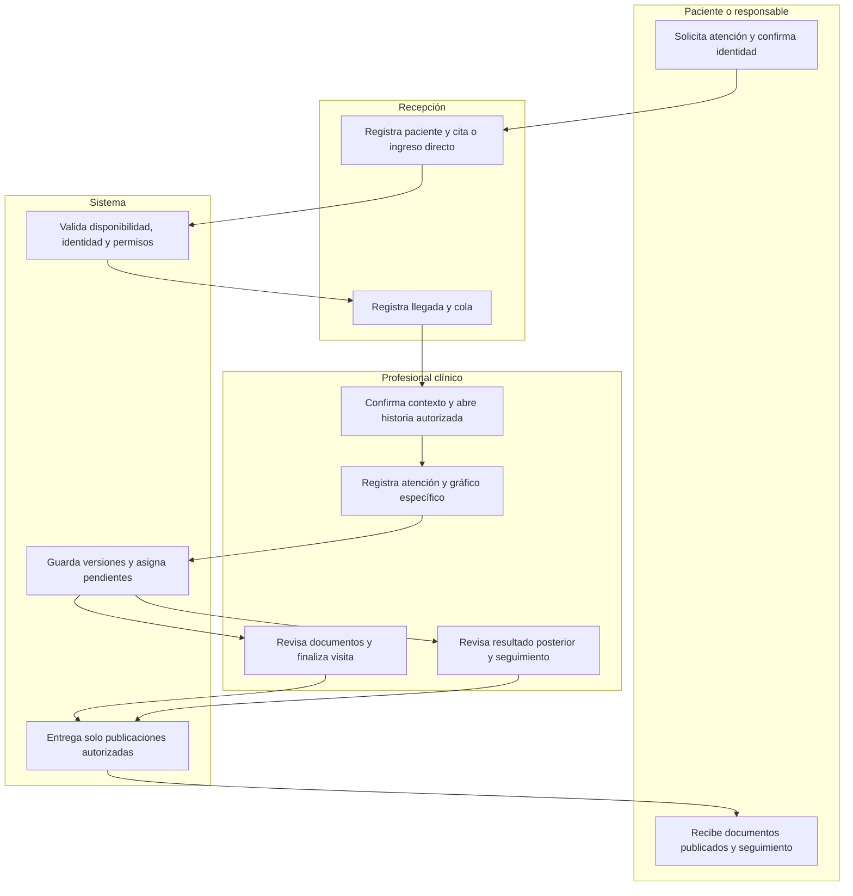

La revisión de un resultado posterior no impide terminar una visita si su pendiente tiene responsable y se cumplen las reglas de cierre. Las cajas administrativas no determinan la decisión clínica.

## Reserva desde portal y resolución por recepción

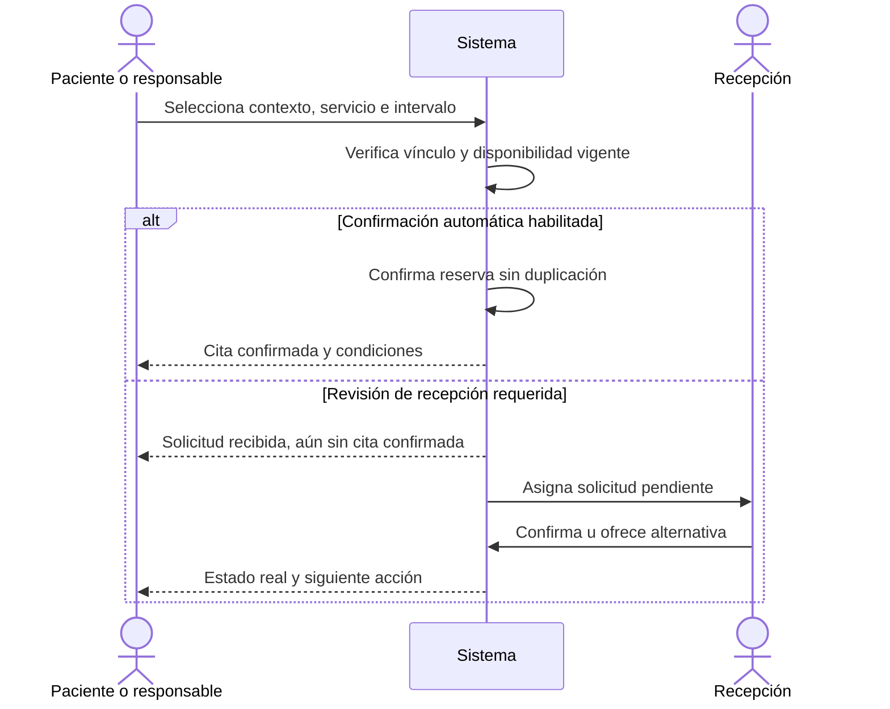

## Cita

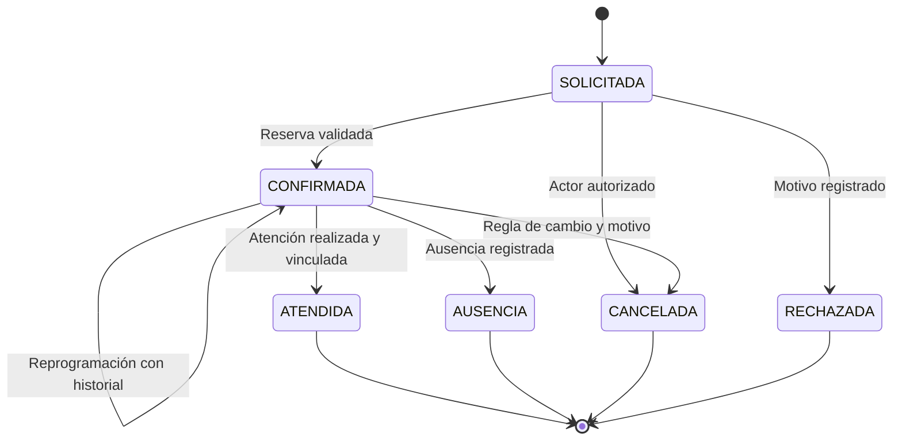

Llegada/cola y atención conservan sus estados aparte. Un botón de confirmar asistencia no registra atención realizada.

## Atención y documento: dos ciclos diferentes

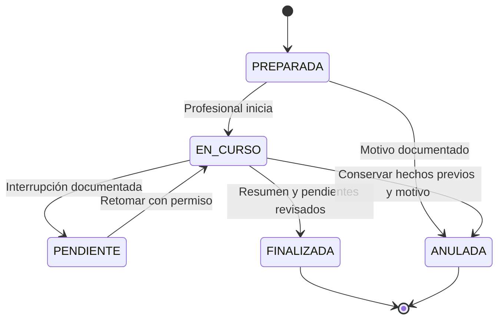

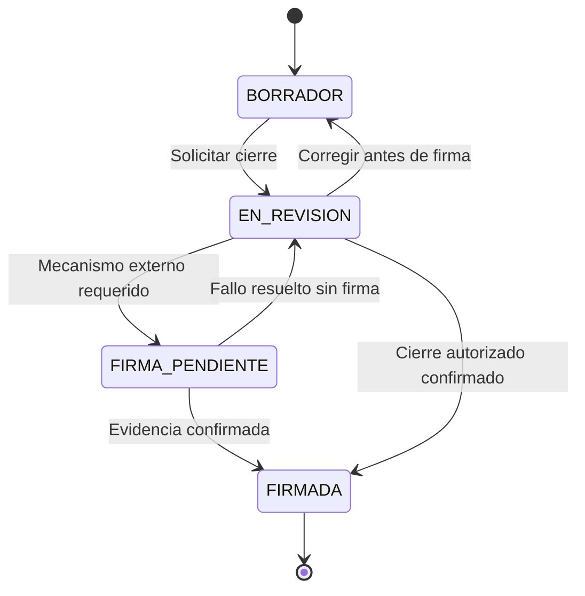

La adenda es otro documento con su ciclo de borrador/revisión/firma, vinculado al original. El original firmado no vuelve a borrador. Una visita terminada puede conservar otras tareas, resultados e informes pendientes.

## Orden, tarea e informe

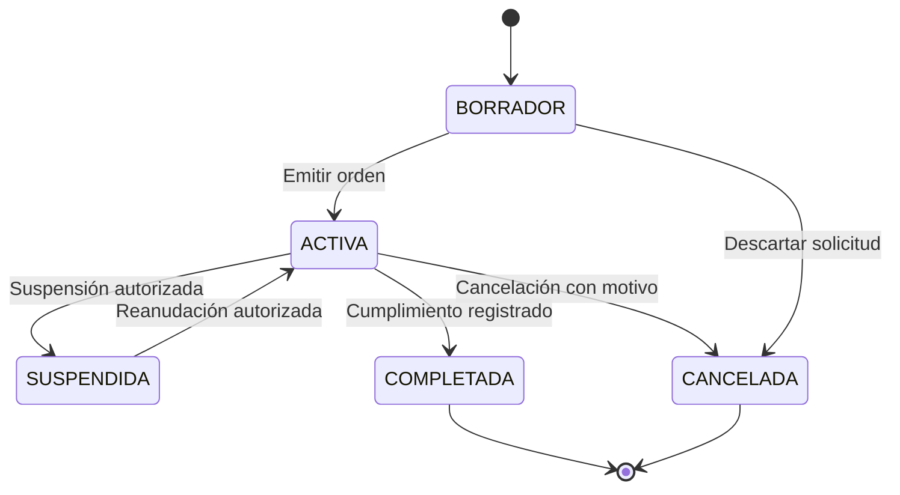

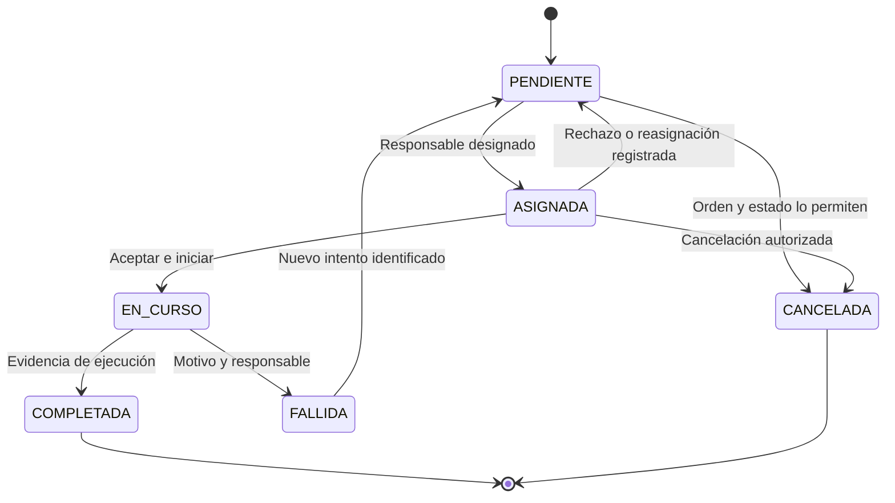

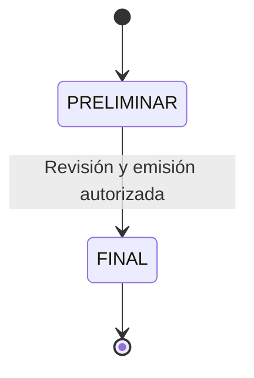

Corregir un informe final crea otra revisión relacionada; el original sigue conservado. La nueva revisión produce su propio pendiente de revisión clínica. Completar una tarea técnica, emitir un informe y revisarlo clínicamente son tres acontecimientos diferentes.

## Pago y estado externo

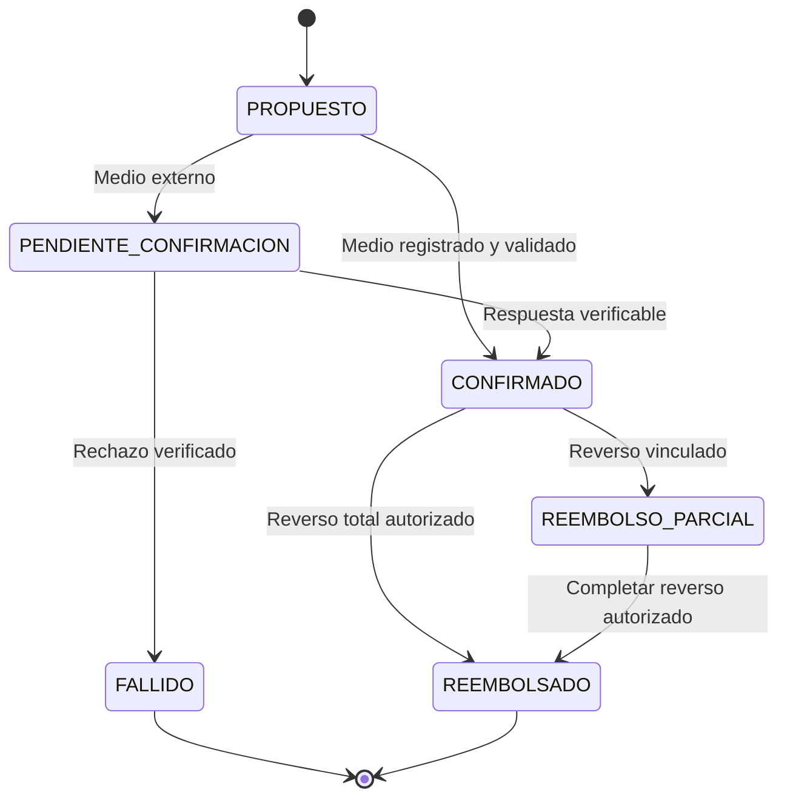

Un pago confirmado puede permanecer confirmado sin necesidad de un reembolso. Los reversos son objetos/movimientos vinculados, no eliminación del pago original. El estado fiscal del comprobante tiene su propio ciclo y evidencias externas.

## Plaza de hospitalización

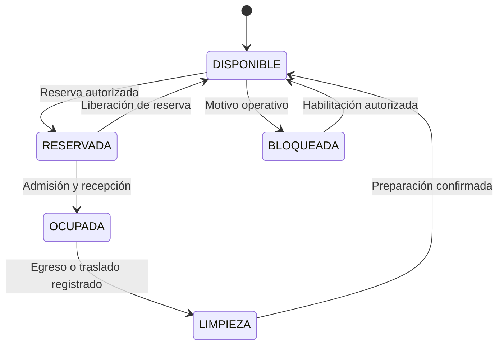

La estancia y el recurso son objetos distintos. El alta clínica no libera por sí sola una cama/jaula físicamente ocupada. Cada ocupación/traslado conserva su intervalo.

## Publicación y vínculo del portal

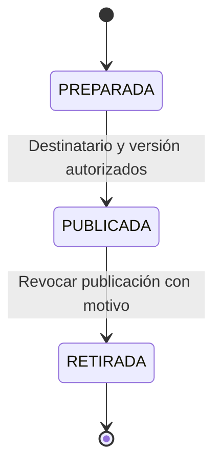

El documento puede seguir firmado internamente aunque su publicación se retire. El vínculo del destinatario se verifica en cada acceso. Una corrección se publica como nueva versión identificada; una descarga realizada anteriormente queda registrada y no se presume recuperable.

## Mapa de navegación funcional

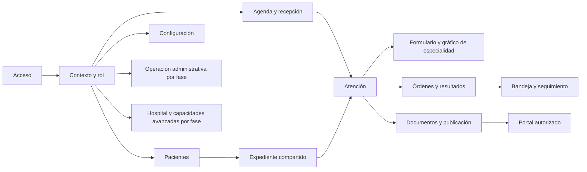

Este mapa indica enlaces funcionales. Cada pantalla concreta y cada acción se relacionan con un flujo en `Trazabilidad_Diseno.json`. El portal y la consola MAVRIC usan navegación y permisos propios.
