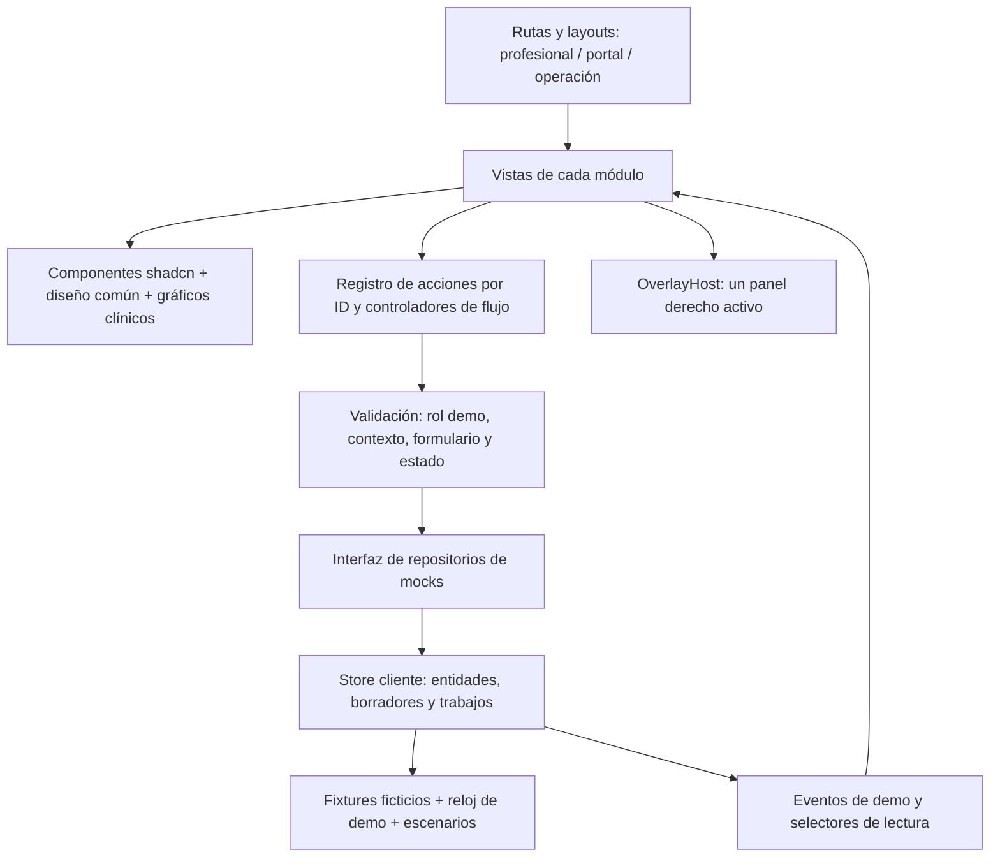

# Arquitectura y plan de implementación del frontend

## 1. Resultado esperado

Construir, en la siguiente etapa, una plataforma de presentación con **Next.js, TypeScript y shadcn/ui**. Tendrá navegación completa por rol, temas blanco, negro y navy, gráficos de especialidad y paneles modales que entran desde la derecha sobre un fondo desenfocado. Todos los botones del diseño tendrán comportamiento comprobable con datos ficticios.

Este documento plantea la arquitectura y los contratos antes del desarrollo. No se ha creado una aplicación, instalado dependencias ni conectado un backend. La arquitectura final de producto continúa siendo Next.js → monolito modular Java Spring Boot → procedimientos almacenados SQL Server. El frontend de presentación sustituye ese último recorrido por repositorios locales de mocks.

## 2. Alcance completo de la demo

| Área | Qué podrá mostrarse |
|---|---|
| Acceso y contexto | Acceso ficticio por rol, organizaciones, sucursales, recuperación simulada, invitaciones y cierre con borradores |
| Configuración | Organización, equipo, permisos de demostración, servicios, precios, emisores, disponibilidad, recursos y plantillas |
| Pacientes humanos | Registro, representantes, búsqueda, expediente compartido entre sucursales, duplicados y relaciones |
| Veterinaria | Animal, especie, responsables, vínculos verificados, pertenencia a poblaciones, prevención y programas grupales |
| Agenda y recepción | Citas internas y del portal, lista de espera, conflictos, reprogramación, llegada y cola |
| Atención clínica | Borrador, antecedentes, problemas, formularios, gráficos, mediciones, órdenes, recetas, documentos y cierre |
| Todas las especialidades | Catálogo de 241 entradas, perfiles de captura y gráficos adecuados al órgano, dominio y especie |
| Portal | Citas, paciente o animal seleccionado, documentos publicados, seguimiento, vínculos y presupuesto/pagos ficticios |
| Diagnóstico y farmacia | Tareas, muestras, laboratorio, imágenes, revisión de resultados, dispensación y administración |
| Finanzas y almacén | Presupuestos, cargos, caja, anticipos, devoluciones, comprobantes simulados, honorarios, compras, lotes y stock |
| Hospital, urgencias y cirugía | Admisión, camas o jaulas, cuidados, turnos, traslado, clasificación registrada, cirugía, anestesia y egreso |
| Procesos avanzados | Sesiones, transfusión, trasplante, reproducción y salud poblacional veterinaria |
| Plataforma | Reportes, evidencia de eventos de demo, importación/exportación local, integraciones simuladas, soporte y suscripciones |

La navegación oculta o deshabilita lo que no corresponde al rol de demostración. El menú del profesional no se convierte en un listado de 241 especialidades: muestra las habilitadas para ese espacio y permite buscar el catálogo completo en configuración.

## 3. Decisiones de arquitectura

| Decisión | Aplicación en la demo |
|---|---|
| Next.js App Router + TypeScript | Rutas y layouts por aplicación profesional, portal y consola de operación |
| Tailwind + componentes shadcn/ui | Componentes copiados al proyecto y personalizados con tokens; una misma base de primitivas para todo el sistema |
| Base de componentes | Se propone Base UI, disponible en la documentación actual de shadcn. Confirmar compatibilidad de los componentes elegidos al inicializar y fijar las versiones en el lockfile; evitar mezclar implementaciones Base UI, Radix y React Aria |
| Estado cliente con Zustand | Entidades normalizadas, contexto, borradores, trabajos simulados y selectores; interfaz pequeña de repositorios para sustituir mocks más adelante |
| React Hook Form + Zod | Captura, errores por campo y validación de comandos antes de modificar mocks |
| Tablas | Table de shadcn + TanStack Table, con columnas, filtros y acciones por área |
| Gráficos de tendencias | Chart de shadcn + Recharts; valores, unidades y tabla equivalente |
| Diagramas especializados | SVG y componentes propios con estructuras seleccionables; Chart no reemplaza un odontograma ni un atlas anatómico |
| Entrega estática | Exportación estática y hosting de archivos; operaciones del producto ejecutadas en cliente |
| Fuentes e iconos | Geist Sans y una colección coherente de iconos; recursos empaquetados para presentar sin depender de servicios remotos |

Las tablas y los formularios se basan en las recetas oficiales de [Data Table](https://ui.shadcn.com/docs/components/data-table) y [React Hook Form](https://ui.shadcn.com/docs/forms/react-hook-form). La elección del estado cliente sigue la interfaz de stores de [Zustand](https://github.com/pmndrs/zustand). Son decisiones propuestas para este proyecto, no requisitos impuestos por shadcn.

La [exportación estática de Next.js](https://nextjs.org/docs/app/guides/static-exports) permite entregar el frontend como archivos. Por eso la demo usará rutas de módulo fijas y parámetros para identificar pacientes o atenciones creados en el navegador. No dependerá de rutas dinámicas generadas para cada registro, Server Actions, cookies de sesión servidor ni endpoints de producto.

### Capas y dependencias



Las vistas no modifican listas sueltas con `onClick` independientes. Llaman a un comando identificado por acción; el comando valida y actualiza todas las entidades relacionadas. Esto mantiene coherentes agenda, recepción, expediente, caja y portal.

### Estructura propuesta de la aplicación futura

```text
src/
  app/
    (access)/           # acceso, recuperación y elección de contexto
    (professional)/app/ # módulos operativos
    (portal)/portal/    # paciente y responsable
    (operations)/operacion/
  components/
    ui/                # componentes oficiales shadcn personalizados
    shell/             # sidebar, encabezado, búsqueda y contexto
    overlays/          # panel derecho, pasos, revisión y cierre con cambios
    shared/            # tablas, filtros, estados, documentos y selectores
    clinical/          # atlas, odontogramas, curvas y formularios
  features/            # vistas, formularios y comandos por dominio
  domain/              # tipos, estados, esquemas y contratos sin UI
  actions/             # IDs, disponibilidad, permisos demo y dispatch
  mocks/               # repositorios, fixtures, escenarios y trabajos
  store/               # entidades, borradores, contexto y preferencias
  styles/              # tokens blanco, negro y navy
  tests/               # invariantes y recorridos representativos
public/demo-assets/    # únicamente material ficticio, local y preparado
```

## 4. Modelo de datos de presentación

Cada registro tendrá ID estable. Los datos clínicos y administrativos llevarán `organizationId`; las atenciones incluirán `originBranchId`, paciente, profesional, dominio humano/animal y versiones pertinentes. Las cantidades de dinero se guardarán en unidades menores para evitar diferencias por redondeo; los valores clínicos conservarán unidad y origen. Las fechas incluirán zona horaria y la agenda utilizará la zona de la sucursal, inicialmente America/Lima.

| Grupo | Entidades mínimas y relaciones |
|---|---|
| Contexto | Personas usuarias, organizaciones, sucursales, membresías, roles demo, especialidades habilitadas, lugares externos y recursos |
| Identidad de paciente | HumanPatient, AnimalPatient, responsables, relaciones con alcance/vigencia y poblaciones animales; el responsable no es el animal |
| Agenda | Disponibilidad, bloqueos, citas, solicitudes, ofertas de espera, llegadas y entradas de cola |
| Clínica | Encounter, episodio, problema, antecedente, alergia, FormResponse, Observation, AnatomicalAnnotation, revisiones y adendas |
| Especialidad | Perfil, versión de plantilla, familia de renderizado, atlas, estructura seleccionada, dentición/especie y unidad |
| Diagnóstico y medicación | Órdenes, tareas, muestras, adquisiciones ficticias, informes, revisiones, recetas, dispensaciones y dosis |
| Documentos y portal | Documento, versión, consentimiento, publicación explícita, destinatarios, invitación/vínculo y seguimiento |
| Finanzas e inventario | Presupuesto, etapa, cargo, cuenta, pago, anticipo, caja, comprobante simulado, liquidación, compra, recepción, lote y movimiento |
| Hospital y procesos avanzados | Admisión, estancia, ocupación, recurso, cuidado, turno, traslado, caso quirúrgico, anestesia, curso, transfusión y ciclo |
| Plataforma | Trabajo externo simulado, conexión demo, importación, reporte, soporte, concesión temporal, suscripción e incidente |

Habrá fixtures de dos organizaciones independientes, una clínica humana con dos sucursales, una veterinaria, un espacio propio de profesional itinerante y cuentas de portal con varios vínculos. Incluirán pacientes con el mismo nombre para demostrar que una selección por nombre no basta. La historia se consulta entre sucursales de una organización; se conserva procedencia y no se reúne automáticamente con otra organización.

### Estado y persistencia

- Estado de negocio: store normalizado, actualizado por comandos y leído con selectores.
- Borradores: separados de versiones confirmadas; una nota firmada de demo solo se corrige mediante adenda.
- Estado de interfaz: ruta, filtros, selección, pestaña, panel, paso, tamaño y foco de retorno.
- Preferencias: tema y densidad, guardadas localmente.
- Datos de demo: memoria como modo inicial. La persistencia de la sesión se puede activar para conservar únicamente fixtures ficticios y sus cambios; estará versionada y se podrá reiniciar.
- Archivos: blobs locales para vista previa; URLs temporales liberadas al cerrar. No guardar archivos clínicos reales en el almacenamiento del navegador.
- Reloj: escenarios anclados a una fecha de demo que el presentador puede reiniciar; latencia y fallos simulados reproducibles.

Los cambios de rol no eliminan los datos para permitir mostrar la entrega entre actores. Un cambio de organización vuelve a consultar entidades de ese contexto y resuelve primero los borradores. Una sesión demo no demuestra aislamiento real del servidor: las reglas futuras deberán ser aplicadas también por Spring Boot y SQL Server.

## 5. Arquitectura de cada botón

El [plan estructurado](Plan_Frontend.json) será el contrato inicial del registro de acciones. Para cada una de las 429 acciones conserva su ID, etiqueta, flujo, pantallas, fase de producción y actores del diseño, y añade:

| Campo | Para qué se utiliza |
|---|---|
| Patrón de interacción | Navegación, filtro, selección, formulario lateral, revisión lateral, comando, exportación, impresión o gráfico |
| Operación del mock | Nombre de comando o consulta dentro de un dominio, con resultado concreto |
| Entrada | Campos del contrato de flujo y contexto seleccionado; el formulario muestra los pertinentes a la operación |
| Disponibilidad | Precondiciones del flujo, permisos demo por ID y estado válido del objeto |
| Revisión | Resumen antes de acciones que afectan dinero, publicación, permisos, versiones o estados definitivos |
| Efecto visible | Entidades que cambian y vistas que se actualizan; las consultas producen una selección o vista verificable |
| Cancelación/error | Conservación del borrador, ausencia de cambio persistido antes de confirmar y motivo del fallo |
| Aceptación | Resultado observable para verificar que el botón funciona, más el camino sin permiso o con estado inválido |
| Entrega | Lote de frontend, estado de implementación y estado de verificación separados |

Un botón que abre captura y otro que confirma son acciones diferentes. Abrir “Nueva cita” no reserva un horario; “Reservar cita” sí actualiza agenda y cuenta de solicitudes. Una notificación breve puede acompañar el cambio; no sustituye su efecto.

### Secuencia de una acción

```mermaid
sequenceDiagram
    actor P as Persona con rol demo
    participant V as Pantalla
    participant O as Panel derecho
    participant A as Controlador de acción
    participant M as Repositorio mock
    P->>V: Pulsa acción por ID
    V->>A: Comprueba disponibilidad y contexto
    A-->>O: Abre captura o revisión cuando corresponde
    P->>O: Completa y confirma
    O->>A: Envía datos validados
    A->>M: Revalida estado y ejecuta una vez
    alt Operación permitida
        M-->>V: Entidades y eventos actualizados
        V-->>P: Cambio visible y acceso al resultado
    else Error simulado o conflicto
        M-->>O: Explicación y opciones; conserva captura
    end
```

Los comandos pendientes deshabilitan la confirmación y utilizan un identificador de operación para evitar duplicados por doble clic. Se puede simular conflicto de agenda, versión desactualizada o rechazo externo sin perder lo capturado. SYS y EXT son participantes del flujo; no son roles humanos seleccionables del menú demo.

### Coherencia entre áreas

| Cambio | Efecto que debe observarse |
|---|---|
| Reservar y registrar llegada | Cita actualizada, llegada y cola; el profesional ve a la persona o animal correcto |
| Iniciar y finalizar visita | Atención ligada a origen, borrador o cierre según acción, pendientes y resumen disponibles |
| Firmar revisión de demo | Versión fijada, autor/fecha visibles, edición directa bloqueada y adenda disponible |
| Publicar documento | Solo la versión y destinatarios revisados aparecen en el portal vinculado |
| Registrar pago ficticio | Movimiento, saldo, caja y conciliación; el comprobante externo conserva su ciclo independiente |
| Dispensar de un lote | Entrega ligada a receta y reducción de stock; parcialidad y devolución se reflejan |
| Confirmar admisión y egreso | Ocupación, estancia y estado de cama/jaula consistentes; los pendientes de alta permanecen asignados |
| Revocar vínculo o membresía | Lecturas futuras de demo se recalculan; autoría y registros previos se conservan |
| Reintentar integración | El mismo trabajo cambia de estado; no duplica cargos, citas, informes ni publicaciones |

## 6. Especialidades y gráficos

Las 241 entradas existentes —152 de medicina humana, 30 odontológicas y 59 veterinarias— se usarán como un catálogo funcional; incluyen especialidades, subespecialidades y áreas, con revisión profesional todavía pendiente. No se modificarán sus estados para declarar capacidades clínicas implementadas por tener una demo.

Cada perfil enlazará captura, atlas, esquema de anotación, familia de componente y flujos. Los renderizadores comunes cubrirán las 31 familias, mientras que los atlas y campos distinguirán órgano, especie, dentición, edad y finalidad. La matriz de perfiles incluida en `Plan_Frontend.json` debe permitir abrir cada entrada y ejercitar sus componentes previstos; una ficha estática con el nombre de la especialidad no cuenta como cobertura completa.

Odontología tendrá selección de pieza y cara, leyenda, dentición humana o propia de especie, condición, procedimiento y comparación entre versiones. Un mapa anatómico conservará estructura, lateralidad, hallazgo y vínculo al procedimiento. Las curvas mostrarán unidad, referencia y tabla; los instrumentos mostrarán versión. Los ejemplos de cálculo podrán usar resultados preparados o lógica de demostración identificada; no se presentarán como motores clínicos validados.

Durante D04 se creará una galería de desarrollo con cada renderizador y perfil para revisar cobertura; la navegación del producto solo muestra los componentes de la atención elegida. Los gráficos tendrán controles de teclado y tabla equivalente, además de clic y color. La especificación clínica detallada permanece en [Gráficos de especialidad](../diseno/04_Graficos_de_Especialidad.md).

## 7. Orden de implementación

Son lotes del **frontend completo de presentación**. No reemplazan las fases de producción ni dejan los módulos posteriores fuera de la demo.

| Lote | Trabajo | Dependencias | Criterio para terminar |
|---|---|---|---|
| D00 | Contratos, rutas, roles demo, fixtures y checklist de acciones | Diseño actual | 56 pantallas, 429 acciones y 241 perfiles trazables; decisiones visuales documentadas |
| D01 | Sistema visual, tres temas, componentes comunes y Sheet derecho | D00 | Layout y panel en los tres temas, teclado, móvil, cambios sin guardar y estados comunes |
| D02 | Acceso ficticio, contexto, store, repositorios, registro de acciones y configuración esencial | D01 | Cambiar rol/espacio sin datos cruzados en vistas; invitaciones, sesión y preferencias funcionan |
| D03 | Pacientes, responsables, agenda, solicitudes, espera, recepción y recursos | D02 | Recorrido desde alta de paciente hasta cola, con conflicto y reprogramación |
| D04 | Atención, expediente, formularios, 31 familias, perfiles, gráficos, documentos y prevención | D03 | Consulta humana, dental y veterinaria completa, firma demo/adenda y captura por perfil |
| D05 | Portal, relaciones, publicaciones y seguimiento | D04 | La entrega entre profesional, paciente y responsable conserva estados y alcance |
| D06 | Servicios comerciales, caja, presupuestos, convenios, comprobantes, honorarios, compras y stock | D03, D04 | Saldos y movimientos coherentes; rechazo fiscal demo independiente del pago |
| D07 | Diagnóstico, laboratorio, imágenes, farmacia y administración | D04, D06 | Orden → tarea/muestra → resultado → revisión; receta → lote → dispensación |
| D08 | Hospital, urgencias, cirugía, anestesia, procesos avanzados y poblaciones veterinarias | D04, D07 | Recursos, estancia, turnos y egreso coherentes; episodios avanzados ejercitables |
| D09 | Integraciones simuladas, soporte, plataforma, reportes y datos | D02, D05–D08 | Trabajos fallidos/reintentos, concesiones, reportes y descargas locales funcionan |
| D10 | Cobertura final, recorridos, revisión visual y empaquetado de presentación | Todos | Cero acciones huérfanas o botones vacíos; todos los recorridos y temas verificados |

Dentro de cada lote: revisar flujo → wireframe de sus pantallas y paneles → componente y estado → acciones → conexión con otras áreas → verificación. La primera implementación visual será D01, después de cerrar los contratos D00 sobre este plan. No estimar fechas por el número de botones: atlas, revisiones de flujo y profundidad del mock tienen cargas diferentes.

## 8. Definición de demo terminada

La entrega incluye aplicación navegable, fixtures reproducibles, tres temas, 56 pantallas, todas las acciones de la matriz y controles comunes; los 241 perfiles se recorren y sus componentes requeridos están disponibles con datos ficticios. Se incluyen estados vacío, cargando, error, sin permiso demo y conflicto, además del camino satisfactorio.

El reporte final contará separadamente acciones planeadas, implementadas y verificadas, pantallas revisadas y perfiles gráficos ejercitados. Debe ser posible reiniciar el escenario, presentar sin datos reales y descargar una exportación local de ejemplo. No se atribuirá preparación para producción a ese reporte.

## 9. Conexión futura con el producto

Tras la demo se conservarán componentes, esquemas de UI, rutas y controladores. Los repositorios recibirán implementaciones HTTP para Spring Boot; las transiciones, permisos, idempotencia y validaciones serán autoridad del monolito y sus procedimientos almacenados. La seguridad, firma, interoperabilidad, comprobantes y cálculos clínicos reales requieren sus propias implementaciones y validación antes de uso operativo.

No se desarrollará ese backend como parte del frontend de presentación.
