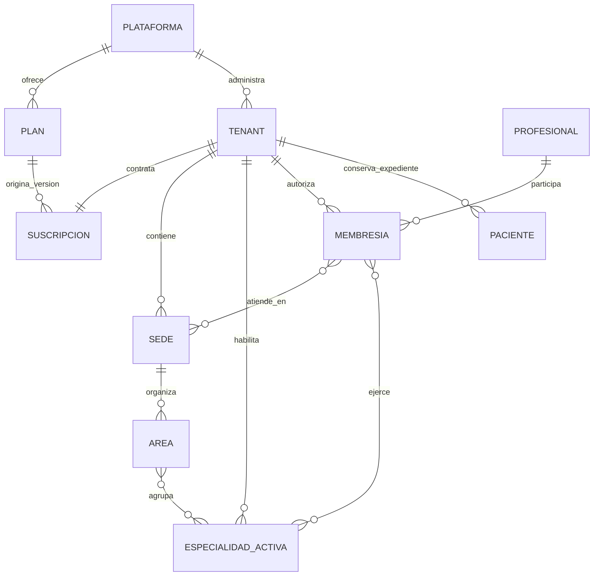
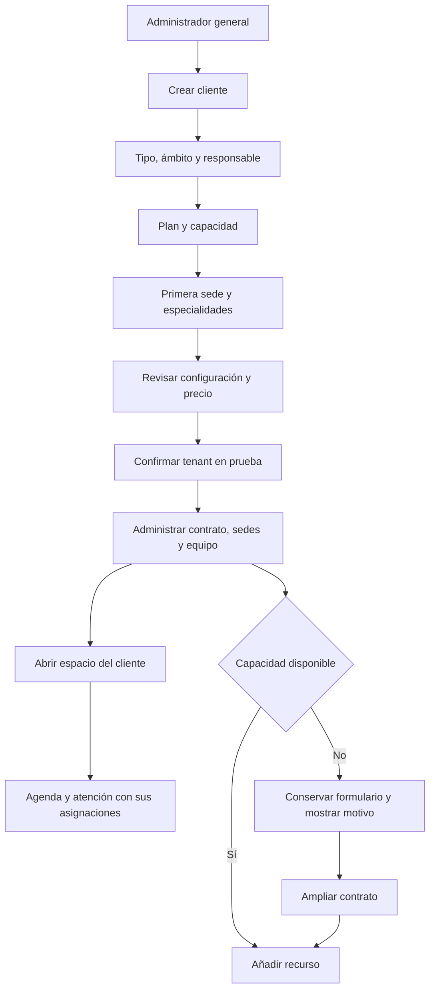

# SaaS multi-tenant · ampliación del frontend

La presentación contiene dos niveles de administración. El administrador general (`SAD`) gestiona clientes, oferta comercial, contratos, pagos simulados y auditoría de plataforma. El administrador de un cliente (`ADM`) configura su organización, sedes, áreas, especialidades y equipo. El propietario profesional de un tenant independiente también puede gestionar su espacio.

El operador técnico (`SOP`) conserva su consola de operación y soporte. La administración comercial tiene un rol y una consola propios.

## Modelo del producto

Los tipos de cliente son profesional independiente humano o veterinario, clínica humana, hospital, centro veterinario, centro odontológico y centro de especialidad. Una especialidad se activa dentro del tenant; un centro especializado puede contratar un espacio dedicado a cardiología, dermatología u otras combinaciones compatibles.

Un profesional tiene una identidad global y una membresía por tenant. La membresía contiene estado, sedes y especialidades. Una invitación reserva una licencia; una membresía inactiva libera capacidad y deja de ofrecerse en la agenda. La asignación a áreas se deriva de la sede y las especialidades compatibles.

Los lugares externos de atención de un independiente se distinguen de sus sedes propias. No convierten al hospital ajeno en una sucursal de su consultorio. El acceso a los pacientes de ese hospital corresponde a una membresía en el tenant del hospital.

Las historias se consultan entre sucursales del mismo tenant, conservando la sede de origen. El alta de otro cliente comienza con su propio directorio vacío. La consola general presenta información comercial y de configuración; no presenta expedientes clínicos.

## Oferta configurable

Los cuatro planes iniciales son ejemplos editables: Profesional, Centro, Hospital y Veterinaria. No constituyen precios comerciales aprobados. Cada plan define:

- Tipos de cliente y ámbitos compatibles; publicación como borrador, publicado o archivado.
- Precio base, sedes y profesionales incluidos, precio de capacidad adicional y descuento anual.
- Capacidad máxima de sedes, licencias clínicas y especialidades.
- Módulos incluidos: consulta, portal, odontología, diagnóstico, farmacia, finanzas, inventario, hospitalización, cirugía, procesos especializados, salud poblacional veterinaria y reportes.

La suscripción guarda una copia de la versión, tarifas y módulos aceptados. Editar el catálogo no modifica los contratos anteriores. Configurar una suscripción establece su nueva capacidad y genera un comprobante ficticio. La facturación del SaaS se presenta aparte de la caja clínica.

Las sedes propias activas y membresías activas o invitadas consumen capacidad. Un profesional en varias sedes cuenta una sola vez en ese cliente. Se rechaza una reducción por debajo del consumo actual. El plan de independiente admite una identidad clínica.

Los módulos condicionan la navegación, las rutas directas y los comandos simulados. Suspender conserva la información y bloquea nuevas operaciones. Desactivar una sede conserva el origen de los registros; debe quedar una sede propia activa. Una especialidad asignada a profesionales debe retirarse de esas asignaciones antes de desactivarse.

## Flujos para la presentación

Los paneles entran desde la derecha, usan componentes shadcn/ui y desenfocan el fondo. Los cambios se validan antes de la revisión y se confirman expresamente. Hay protección al cerrar formularios con cambios sin guardar. Los temas blanco, negro y navy comparten los mismos componentes.

## Pantallas y acciones añadidas

| Pantalla | Ruta | Uso |
| --- | --- | --- |
| S57 | `/saas/inicio` | Resumen y acceso al alta |
| S58 | `/saas/clientes` | Clientes; detalle con contrato, sedes, equipo, especialidades y actividad |
| S59 | `/saas/planes` | Crear, publicar, archivar y versionar planes |
| S60 | `/saas/suscripciones` | Capacidad y estado de contratos |
| S61 | `/saas/especialidades` | Catálogo global de 241 entradas |
| S62 | `/saas/auditoria` | Cambios comerciales y de configuración |
| S63 | `/app/configuracion/sedes` | Sedes y áreas del cliente |
| S64 | `/saas/acceso` | Acceso ficticio del administrador general |

Las pantallas anteriores de organización, equipo, especialidades y plataforma incorporan estas configuraciones. Se añaden 16 comandos SaaS a las 429 acciones del diseño clínico original; no se mezclan ambos inventarios. El catálogo global distingue las 152 entradas humanas, 30 odontológicas y 59 veterinarias del diseño.

## Implementación y alcance

El modelo está en `frontend/src/lib/saas-types.ts`; las reglas transaccionales simuladas en `frontend/src/lib/saas.ts`; pantallas en `frontend/src/components/saas.tsx`; formularios en `frontend/src/components/saas-panel.tsx`. Las configuraciones se conservan en Zustand y localStorage. La migración añade la capa SaaS a las demos anteriores sin borrar sus registros clínicos.

Todo sigue siendo frontend con mocks: acceso, invitaciones, precios, pagos y contratos son simulados. Los permisos y el aislamiento implementados sirven para demostrar los flujos; el backend futuro deberá verificarlos por solicitud, derivando el tenant de una identidad autenticada. La arquitectura acordada continúa siendo Next.js, monolito Java Spring Boot y SQL Server con procedimientos almacenados. La interfaz no contiene aún esos servicios.

## Validación reproducible

`npm test` ejecuta 30 pruebas funcionales: 17 de clínica y 13 de SaaS. Incluyen aislamiento, cuotas, ampliaciones, identidad compartida, asignaciones, versiones de contrato, suspensión y pagos repetidos. `npm run qa:saas` recorre el alta y administración desde Edge, y genera evidencias en `frontend/test-results`. `npm run qa:routes` incluye las 64 pantallas. `npm run qa:specialties` usa una fixture de prueba que activa todo el catálogo compatible para revisar los 241 perfiles sin modificar la demo del usuario.

La revisión del 13 de octubre de 2026 pasó las 30 pruebas funcionales, 64 pantallas en 74 visitas y la presencia de las 429 acciones originales. El recorrido SaaS comprobó ocho flujos: creación y edición de planes con contratos conservados, pago simulado, tres altas de distintos tipos, suspensión y reactivación, límite y ampliación de sedes con área, y apertura del cliente con agenda aislada y persistencia. No se registraron errores de JavaScript. Se comprobaron los tres temas a 390 px y el desenfoque de 8 px. La revisión del catálogo pasó 241 perfiles y 31 familias de componentes. Las evidencias están en `frontend/test-results/saas-qa.json`, `routes-qa.json` y `specialties-qa.json`.
